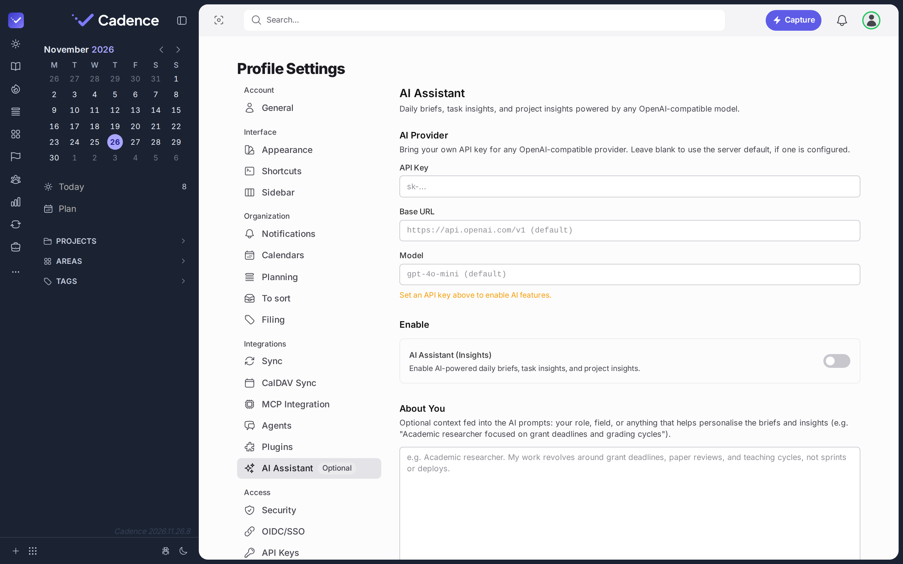
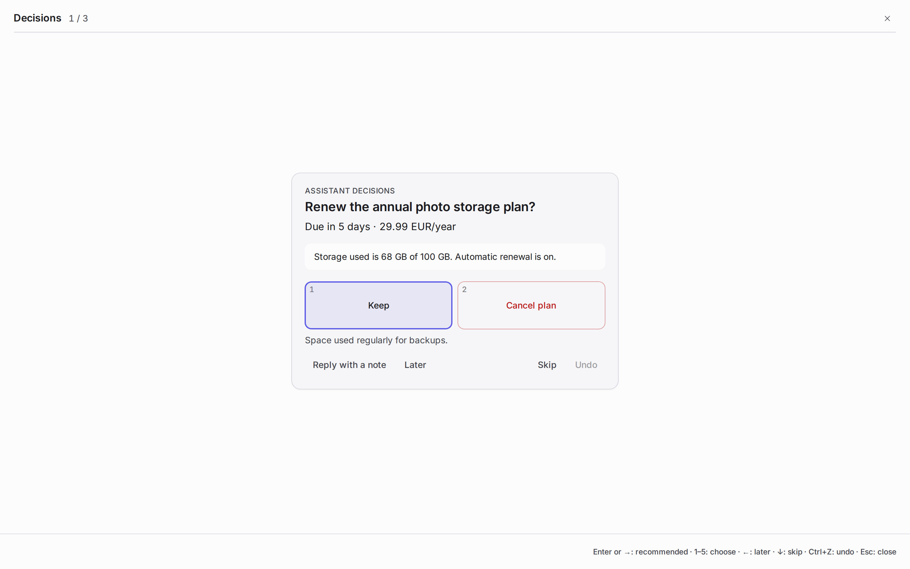
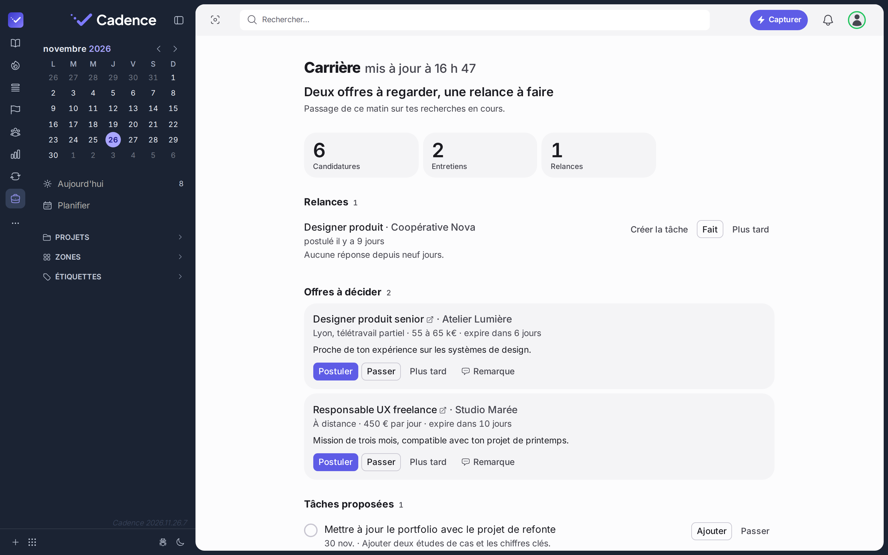
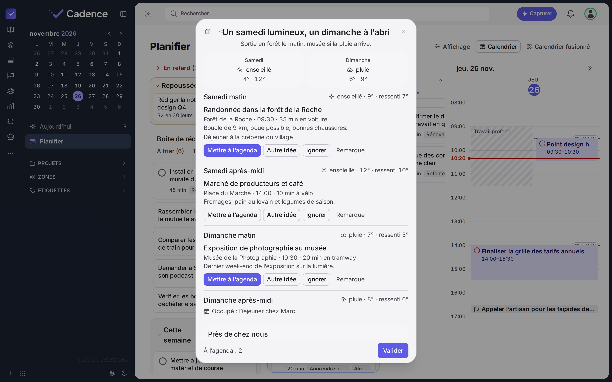

# AI and proposals

Cadence uses AI for two things: filling in the empty fields of what you capture, and preparing decisions that you confirm with one gesture. It proposes, you decide: nothing in your data changes without your confirmation, except the filing of fields you left empty, which you can always undo.

## What to connect for what

There are two separate "connections", and both are optional: Cadence works without AI.

| Connection | Where | What it enables |
|---|---|---|
| An **AI provider** (API key, OpenAI-compatible) | Profile › AI Assistant | Automatic filing, "Break down into steps", AI insights on a task or a project, daily plan help, the "To sort" assistant's proposals |
| An **external agent** that listens to the server (plugin or webhook) | Profile › Plugins, or Profile › Notifications (webhooks) | "Plan my week", "Prepare my review", "Discuss with the AI", mail cards, "Decide", "Career", "Week-end", the morning ritual |

What the interface shows depends on what is connected:

- Without a running external agent, **all the AI buttons of the second row disappear** (web and Android). There is no button that leads nowhere.
- Without an AI provider, filing is "skipped" (items stay as they are), and "Break down into steps" falls back to a manual mode (see below).
- To turn off everything that depends on the provider at once: Profile › AI Assistant › **Enabled** (or Profile › Features & Add-ons). With the switch off, the interface hides these functions and the server answers "forbidden".

Proposals (week, review, Career, Week-end) are read and decided **online**: they are neither kept nor replayed offline, because a week plan applied later would act on stale facts. Offline, the buttons show "Offline" and keep nothing.

## AI settings in the Profile

### Profile › AI Assistant

| Field | Role |
|---|---|
| API key | Never sent back in full: the screen only says that a key is saved and shows its last 4 characters. "Clear" removes it. It is encrypted at rest on the server. |
| Base URL | Any OpenAI-compatible endpoint (Ollama, LM Studio, Groq, Azure OpenAI, Anthropic's compatible address...). An address entered here must be public: the server refuses a local or internal address. A local AI is better connected on the server side (see [Self-Hosting](Self-Hosting)). |
| Model | The name your provider expects. Empty: the server's, otherwise `gpt-4o-mini`. |
| Enabled | Master switch for the functions that rely on this provider. |
| About you | Optional context (500 characters) added to daily plan requests: your job, your typical deadlines. It keeps the AI from talking to you as if you were a developer. |

Resolution order, field by field: your setting, otherwise the server variable, otherwise the default value. Leaving a field empty therefore falls back to the server's setting if there is one.

The same page holds the **Break down into steps** card (model, number of steps, durations, size of the note sent), detailed below.

### Profile › Filing (automatic filing settings)

The page shows the mode (enabled, **Dry run** or **Live writing**), a red banner if the last AI call failed, then the limits:

| Setting | Default | Range |
|---|---|---|
| Grace period (seconds) | 90 | 0 to 3600 |
| Items per call | 12 | 1 to 50 |
| Retries on failure | 5 | 1 to 20 |
| Context cache (minutes) | 30 | 0 to 1440 |
| Suggestion lifetime (days) | 7 | 1 to 365 |
| Suggestions per day (0 = no limit) | 0 | 0 to 1000 |
| Log retention (days) | 180 | 1 to 3650 |
| Tags per item | 3 | 0 to 10 |
| Maximum response tokens | 2000 | 200 to 16000 |
| Reasoning effort | not sent | minimal, low, medium, high |
| Model | the AI Assistant's | free |

Confidence thresholds (from 0 to 1): **Project or area 0.8**, **Tags 0.8**, **Duration 0.6**, **Priority (suggested only) 0.8**, **Ask starting at 0.4** (never above the project or tags threshold). A field whose confidence is above its threshold is written; between "ask" and the threshold, it becomes a card; below that, it is dropped. An out-of-range value is refused with an error message. The **Tags never set** field lists the state tags that filing must not set (by default `someday`, `today`, `ticktick`, `urgent`, `🔎focus_mois`, `🔍focus_trimestre`).

The same screen lists **Recent runs**, with "Undo run", and a **Dry run** (1 to 30 days) that shows what would be filed without writing anything.

### Profile › To sort

Calendars read (for scheduling questions), days to look ahead (1 to 14), alerts to turn on or off, postponements before a card (3 by default), closed tasks checked (7 days), duplicate threshold (0.8), and the queue's **AI assistant** (off by default, at most 20 tasks looked at per day). The same screen lists the **always-archived senders** (see [Mail-Triage](Mail-Triage)).

### Profile › Planning

The **Morning overdue replan (AI)** card: a switch "Prepare a proposal automatically in the morning" and a time (06:30 by default). See "Morning pass" below.

### On Android

Réglages › Organisation › **Classement automatique** (Settings › Organization › Automatic filing; same settings as the web, plus the "Notifier les propositions" (Notify about proposals) switch, with the step breakdown at the bottom of the page) and Réglages › Organisation › **À trier** (To sort). These screens need a connection: offline, they say so instead of showing stale values.

## Automatic filing

**What it does.** A few moments after you create a task or a note, the server fills in what is **still empty**: a project *or* an area, up to 3 tags, a duration. It never replaces what you already filled in.

**What is filled in**

| Item | Fields | Condition |
|---|---|---|
| Task | a project **or** an area (never both: a specific project wins), 0 to 3 tags, a duration of 5 to 720 minutes | only if project, area, tags and duration are all empty |
| Note | a project, 0 to 3 tags | only the empty fields |
| Task priority | 1 or 2 | **never written**: only suggested on a card, and only if the task is at 0 |

**What is never touched**: completed, archived or cancelled tasks, recurring tasks, habits, subtasks, tasks imported from a TODO.md file, items of a TODO.md project or of a completed, cancelled or archived project. Items that existed before filing was turned on are never processed: there is no pass over your history.

**How it works**

1. A task or a note is created (web, Android, MCP, Telegram, import: it does not matter).
2. The server waits for the **grace period** (90 s by default): that is your time to file it yourself.
3. It re-reads the item. If it was filled in or modified in the meantime, it does not write it.
4. It sends a batch to the AI, which can only choose among your **existing** projects, areas and tags: it cannot invent any.
5. The result is checked by code, field by field, against the thresholds above, then written.

**Special cases**

| Case | Result |
|---|---|
| The AI hesitates (confidence between 0.4 and the threshold) | A card in "To sort": project (1 to 3 proposals, the area, "New project", "Other...", "None"), tags to tick, priority. Buttons "Apply", "Accept all" (never a new project or a new tag), "Ignore". |
| You filled in the field in the meantime | The card never overwrites a field filled in by hand: only a still-empty field is written. |
| A card stays unanswered | It expires after 7 days (adjustable), or as soon as the item disappears, is closed or is fully filled in. |
| The call fails | New attempt after 1, 2, 4... minutes (60 at most), up to 5 attempts. Then the item is "failed". |
| No AI provider | Items are skipped; the banner in Profile › Filing says so. |
| The red banner "The last AI call failed" | Shows the most recent error (for example `401: invalid x-api-key`). **Retry** puts failed or skipped items back in the queue. |
| "Dry run" mode | Everything is computed and logged, nothing is written, no card. |

**"When?"** Filing files, it never decides *when*. A task it files into a project or an area stays in Inbox › **Tasks to sort** with a "When?" row (This week, A date, Later, No date), until you choose. Any moment is enough to take it out of there: a due date, a week, a day in the plan, "Later", or "No date" (which leaves it where it is filed). See [Inbox-and-Capture](Inbox-and-Capture).

**Mark and undo.** A filed task or note carries "**Filed automatically · Undo**" as long as it is exactly in the state filing left it in. As soon as you modify it, the mark disappears and so does the undo ("The item changed since: can't undo"). Profile › Filing lets you undo one change or a whole run.

**On Android.** After each sync, one notification per new card (channel "Classement" (Filing), quiet hours respected), with the buttons **Tout accepter** (Accept all), **Ignorer** (Ignore), **Ouvrir** (Open). Answers go through the deferred call queue: they work offline.

## The "To sort" queue

A queue of proposals **about your open tasks**, one at a time, with the reason in one line. You confirm, correct, keep the task as it is, or skip. Nothing changes without that gesture. You get there from the inbox header ("To sort (n)"), from "Ma journée" (My day) on Android, or directly at `/triage` on the web.

**Rules that never change**

- At most **one proposal per task**. A simple, clear task gets none.
- **Code first**: duplicates, dates, recurrence and postponements are deduced by rules, not by an AI.
- **Read before proposing**: a recurring task repeats by construction, and two tasks dated on different days are two tasks: neither is flagged as a duplicate.
- **Settled as long as nothing changes**: a task you kept or handled leaves the queue until its name, note, due date, status, project, tags or recurrence changes. You are never asked the same question twice about the same state.
- A task that mirrors a TODO.md file is the file's business: it is excluded.

**What the rules propose**

| Card | What it proposes | When |
|---|---|---|
| Possible duplicate | Cancel the task | same name as a task closed in the last 7 days, or very close, or same name as another open task (except recurring or dated on another day) |
| Deadline found in a note | Change the due date | the note mentions an upcoming date, earlier than the due date |
| Often postponed | Cancel the task | pushed back at least 3 times recently |
| Conflicting events, event during work hours | a question (Yes, No, Specify) | two busy events overlap, or an event falls on a work block, in the calendars read |

The possible actions on a card: Rename, Split into subtasks, Change the due date, Mark as done, Cancel the task, Delete, Classify, Convert to a note, a project or a habit. A conversion creates the new thing first, then deletes the task; it keeps the note (and the tags) but not the due date or the comments. "Delete" waits a moment to leave time to undo. The server refuses to delete or convert a task from a TODO.md file, a recurring task, or (for a note or a habit) a task that has subtasks.

**Linked contexts.** When you answer a scheduling question, the answer becomes a "context" (500 characters at most) attached to the task, the event or the series: the question is not asked again. The context shows in the task's detail, editable or deletable. It expires on its own: end of the task, end of the event's day, disappearance of the series.

**The queue's AI assistant** (off by default). Once a night, it looks at the open tasks the rules left, in batches of 10, up to the daily limit, and may propose an action. The code checks every answer: an unknown action, an out-of-range value or a missing reason gives "no proposal". As long as automatic filing is on, the assistant no longer proposes "Classify".

**Offline.** Android keeps the last queue to read offline; a gesture removes the card right away and is then sent after 4.5 seconds (the time to "Undo"). On the web, a card already handled elsewhere leaves with "Already settled elsewhere."

## Break down into steps

In a task's detail (web and Android), **Break down into steps** asks the AI for small concrete steps, in order, each with a duration.

**How to use it**

1. Open the detail of a top-level task, then "Break down into steps".
2. The sheet proposes the steps. You can rename, change the minutes, reorder, remove or add a step; the total is displayed.
3. **Add N steps** creates them as subtasks, with their estimated duration, after your existing subtasks.

**Special cases**

| Case | Result |
|---|---|
| Subtask, or task from a TODO.md file | Refused (a subtask cannot be split; the subtasks of a TODO.md live in the file) |
| No AI (switch off, function disabled, no provider, error, nothing usable) | The sheet asks "A first step of 2 min?" with a single empty step to fill in; durations start at 5 minutes, the smallest stored estimate |
| Duplicate names | The server removes duplicates (case ignored), including against your existing subtasks |
| Durations | Rounded into the range 5 to 25 minutes by default; at most 6 steps by default |
| Offline (Android) | "Découper en étapes demande une connexion au serveur." (Breaking down into steps needs a connection to the server.) |

Settings (Profile › AI Assistant, Android Réglages › Classement automatique): enabled, model, steps at most (2 to 15), shortest (5 to 60) and longest (5 to 240) step duration, note characters sent (0 to 10000, 1500 by default), response tokens. Nothing is cached: one call per click.

## Daily plan help

When the AI switch is on, the Plan and Today offer:

- **Draft with AI**: on an empty plan, it prepares right away; otherwise it offers "Fill free time" (keeps what is planned) or "Start over" (redoes the whole day, undoable). The code cleans up the answer: only your known tasks, on a 15-minute grid, never in the past nor on a meeting. Proposed blocks carry a sparkle, with the AI's reason in a tooltip; "Undo" restores the previous plan.
- **Duration estimates** for tasks without an estimate: the estimate is pre-selected on the chips (marked with a dot) and is only saved if you add the task. Kept for 24 hours on the server.
- **Day wrap-up** (Today): offered after the last time block or when everything is done; a short summary, what worked, and the tasks to carry over. "Add to tomorrow" adds them without a time to tomorrow's plan.

Planning tips ("30 min free at 09:30 fit...") are computed locally, with no AI call. See [Today-and-Daily-Plan](Today-and-Daily-Plan).

## AI insights on a task or a project

In a task's detail, an "AI Insights" panel ("About this task", "Next step", "How to approach it", "Watch out", suggested links); on a project page, "About this project", "Next action", "Project health". An insight is generated on demand and stays displayed until you regenerate it; you can hide it without deleting it. Without enough context (no note, tag or project), the detail warns you and offers "Generate anyway".

## Plan my week and Prepare my review

These two buttons send a request to the external agent. Cadence computes the **facts** (open tasks, due dates, plans, events, the review queue); the agent judges; Cadence validates the answer; **you** apply what you tick. The agent never writes into your data itself.

### Plan my week

- **Where**: "Plan my week (AI)" button in the header of Today and of Plan; on Android, Planifier (Plan), the ⋯ menu of Aujourd'hui (Today), and a link on Sunday and Monday. Next to "Replan", a "Reschedule with AI" button handles overdue tasks.
- **Flow**: the button turns into "Preparing...", then "Your week is ready". A notification may also warn you. You can close the window: the proposal waits for you.
- **Period**: today and the next six days, or tomorrow and the next six when your day hours are over (so that an evening already past is not planned). 14 days at most.
- **Tasks taken into account** (60 at most): overdue, due in the period, already in the plan, decided for this week, "in view", then the inbox and the horizons (this month, next week, next month). Never "Someday", recurring tasks, subtasks, closed tasks or habit tasks.

**On the web**, the proposal opens **directly on the Plan**: a third tab "Planned by AI" appears next to Days and Horizons. A purple card shows where the AI sends a task (with "← where it was · duration" and the reason), a dotted trail shows where it is now. A click on a card opens its menu: "See the task", "Refuse: keep it where it is" (or "Back to the AI's choice"), "Mark as done", "Drop", each day of the period, each horizon. A card can also be dragged onto a day or a horizon. Nothing is written before "**Apply (N)**"; "Ignore" closes without changing anything.

**On Android**, a sheet groups the changes by day: a title, the period, question chips, then rows with the AI's decision that you can change ("modifié" (changed), "Rétablir" (Restore)). "Appliquer (N)" (Apply (N)) sends everything at once.

**The possible operations for each task**: On today's plan, Due on..., This week, Next week, This month, Next month, Later, Done, Drop, or "Keep as is". You can pick one other than the AI's for any task in the proposal.

| Case | Result |
|---|---|
| Overdue task put back on a day's plan | Its due date also moves to that day: it is no longer overdue |
| Overdue task sent to a horizon | Its due date is cleared |
| Task already in another day's plan | It leaves the old plan: it is moved, not planned twice |
| A day is full | At most 5 tasks per day (default cap, no settings screen for now): extra plan additions become "This week" |
| "Drop" | The task is cancelled, not deleted |
| An operation fails | The others go through anyway; the row shows "Not applied" |
| The agent does not answer | After 10 minutes, the proposal fails ("Your week could not be prepared"); a new click starts it again |
| Two clicks | Only one pending proposal per type: the second click finds the first |

**Questions, notes, answers.** The AI can ask up to 3 questions (4 choices each). An answer chip only **selects** locally; "Send" transmits them with your decisions. The "Note" button under a task opens a line (500 characters); a task with a note goes to "To review": "Send" applies the other decisions and **sends back** the annotated tasks to the AI for a second pass ("M tasks sent back, I'll tell you when it's ready"). "Reply" writes a free answer and restarts the proposal. A "Your week is ready" notification (or "could not be prepared") shows in the bell and on the phone.

### Prepare my review

A button in the Review header (see [Review-Insights-and-Focus](Review-Insights-and-Focus)). The AI judges the **quick review** (10 items at most: postponed tasks, reviews due, old tasks, ideas set aside). Once ready, the quick review shows for each task the AI's choice as the main button "**Validate: ...**" with its reason below; Enter validates. The other options stay. A judgment already given is not asked again as long as the task has not changed. Deliberately **limited to tasks**: inbox ideas and stalled projects are not in this queue.

### Morning pass

Once a day, a scheduled job starts "Plan my week" by itself when **four conditions** are met: the option is on in Profile › Planning (on by default, 06:30) and the time in your time zone is between the chosen time and three hours later; an agent is listening; no week proposal has already been started today; and you have at least one overdue task. It is never restarted automatically after a failure. The notification says "N overdue tasks replanned, to confirm". On Android, it opens the **morning ritual** (mails to sort, then overdue tasks, then "Ta journée" (Your day), then "C'est parti" (Let's go)), described in the [Android](Android) page.

## Discuss with the AI

When an agent plugin is running, a speech bubble icon appears in the header of a task's detail: **Discuss with the AI** opens a conversation already set on this task (same on Android, in the detail header). Reopening the same task resumes the conversation. The mail deck and the "Decide" deck also have a "Chat" button. Without an agent plugin, these buttons do not exist.

## Decide

A deck for everything that needs your choice and is not a mail: a subscription to keep or cancel, a held container update, who drives the kids, a contract to renew, two memories of the agent that contradict each other. A scheduled job of the agent proposes the cards; you decide them; **what follows is code, never the agent**.

- **Where**: "Decide (N)" next to "Sort my mail (N)" at the top of "To sort". A "N decisions to make" notification opens it.
- **A card**: a title, a context line, a text (collapsed after 7 lines, "Read more"), "Open" when there is an address, and 2 to 5 big choice buttons. The **recommended** choice is framed and tinted, with the reason in small print below.
- **Discreet gestures**: "Reply with a note" (the card goes back to the agent, which will propose it again corrected), "Later" (tomorrow 08:00 by default), "Skip", "Undo" (the last decision waits 5 seconds on the web, 4.5 s on Android).
- **Keyboard (web)**: Enter or right arrow = the recommendation; 1 to 5 = that button; left arrow = later; down arrow = skip; Ctrl or ⌘ + Z = undo; Esc closes. **Android**: swipe right = the recommendation, left = later.
- **One card per thing**: if the agent proposes a pending thing again, the card is updated; a thing already decided is not reopened. A decided card disappears 30 days later.
- **Already settled elsewhere**: if you decide on two devices, the first one wins; the other sees "Already settled elsewhere."
- End of the deck: "All decided".

## Career

The morning page of the job search agent, on the web (`/career`, "Career" entry in the rail, after Review) and in Bilan (Insights) on Android.

- **Content**: a title and a subtitle, up to 4 number tiles, then three sections. **Follow-ups** (applications to follow up: "Open draft", "Create task", "Done", "Later"), **Offers to decide** ("Apply", "Skip", "Later", "Note", with the fit estimated by the agent and the expiry), **Suggested tasks** ("Add", "Skip").
- **Effect of each choice**: "Apply" creates the task "Postuler : <title>" (Apply: <title>) (due date at the offer's expiry, or in 3 days if it has passed; the note carries the fit, the source link carries the offer). A follow-up "Create task" creates "Relancer <company>" (Follow up with <company>) for today, with the draft in the note. "Done" only records.
- **Confirm**: a click only **chooses** ("chosen: Apply" under the item, a ring). Nothing is sent before "**Confirm (N)**" at the bottom of the page (Ctrl+Enter too). "Clear" cancels your choices. Leaving the page with pending choices asks for confirmation.
- Applied items go to "Decided (N)", collapsed. "Later" is sent but the item stays open. An item already decided creates nothing a second time.
- No undo button. Empty: "Nothing new today"; everything decided: "Everything is decided for today".
- Only http and https links are clickable; the rest is shown as text.

## Week-end

The outings sheet of the family agent: on Thursday for the following Saturday and Sunday, or **on demand** for 1 to 4 days that you pick one by one.

- **Where**: "Week-end" button in the Review header (web; `?weekend=1` opens it over any page), panel of Bilan (Insights) on Android, notification.
- **On demand**: "Other days" opens 14 days as toggles (Saturday and Sunday pre-tinted, 4 days at most); "Prepare" sends the request. The agent has one hour; beyond that, the request fails ("Could not be prepared"). "AI prepares at least 5 ideas per day. A notification arrives when it is ready."
- **The sheet**: a title, two day tiles (weather and temperatures), then a block per half-day. Each idea has a thumbnail, a place, a time, a note, and three chips: **Add to calendar**, **Another idea**, **Skip** (plus a note button). The recommended idea is pre-selected. A slot already taken shows "Busy: ...". "Nearby" lists other events around the home, "Nicer elsewhere" places with better weather.
- **Confirm**: a single click applies all your choices. "Add to calendar" requests the creation of the event in the shared calendar, done by the agent without AI: the sheet shows "Adding to calendar", then "Added to calendar" (with the link) or "Not added". "Another idea" leaves the slot open ("Another idea asked") and asks for another idea.
- **Share**: builds on the device a PNG image 1080 px wide (gradient depending on the dominant weather, one card per day, your choices marked "On the calendar") sent to the system share sheet. On the web: share with a file if the browser allows it, otherwise copy to the clipboard, otherwise download. Nothing is sent to the server.
- A new weekend replaces the previous one, but decisions already made carry over to slots with the same identifier: an accepted outing is not asked again.

## The daily summary has been removed

The morning summary and the evening wrap-up are no longer Cadence screens: they are messages from the agent, in the agents inbox (plugin), with a banner at the top of every page as long as a message is unread ("Open" marks it read and opens it, the cross marks it read). What also served "To sort" (duplicates, dates in notes, postponements, calendar conflicts) stayed there. See [Notifications-and-Reminders](Notifications-and-Reminders).

## Cost and privacy

**What goes to your AI provider**, function by function. Nothing other than what is listed is sent: not your other tasks, nor comments, attachments, habits or full notes.

| Function | Sent |
|---|---|
| Filing | the name and note (first 500 characters) of a task; the title and content (first 1500 characters) of a note; the catalog: areas (name, description 200 chars), projects (name, area, description 200 chars, 4 open task names), tags with their usage count |
| Break down into steps | the task name, its shortened note (1500 chars by default), the names of its subtasks |
| Task insight | name, status, priority, due date, tags, number of subtasks, note (300 chars), project, area, goal, project description (200 chars) |
| Project insight | name, status, priority, due date, area, goal, description (300 chars), task counters |
| Daily plan | up to 60 candidate tasks, meetings, free slots, current time, and the "About you" text |
| "To sort" assistant | the tasks the rules left, in batches of 10 |

The texts of your items are sent as **data, never as instructions**: the prompt tells the AI to ignore any instruction written inside them.

**What goes to the external agent** (week and review proposals): the facts computed by Cadence: task names, due dates, project, priority (if medium or high), duration, events of the displayed calendars (title and times), goal titles, area names, names of active projects with a 160-character description. No free text about you.

**What it costs.** One call per click for breakdown and insights; a batch of 12 items at most for filing (so costs proportional to your captures, not to your database). Anthropic's OpenAI-compatible endpoint has no prompt cache and ignores the reasoning effort. On a **hosted** instance (multi-user service), there is no personal provider: each subscriber gets monthly "AI credits" (one per insight, plan draft, batch of estimates or wrap-up), reset on the 1st of the month.

## Going further

- [AI Assistant](https://github.com/PreciselyWrong/cadence/blob/main/docs/13-ai-assistant.md) (provider, step breakdown, tokens)
- [Automatic filing](https://github.com/PreciselyWrong/cadence/blob/main/docs/41-auto-classify.md) and [The "To sort" queue](https://github.com/PreciselyWrong/cadence/blob/main/docs/40-triage.md)
- [Agent proposals](https://github.com/PreciselyWrong/cadence/blob/main/docs/47-proposals.md), [Week-end](https://github.com/PreciselyWrong/cadence/blob/main/docs/48-weekend.md), [Decisions](https://github.com/PreciselyWrong/cadence/blob/main/docs/49-agent-decisions.md), [Morning ritual](https://github.com/PreciselyWrong/cadence/blob/main/docs/50-morning-ritual.md)
- Related pages: [Mail-Triage](Mail-Triage), [Integrations-MCP-and-Plugins](Integrations-MCP-and-Plugins), [Tasks](Tasks)
