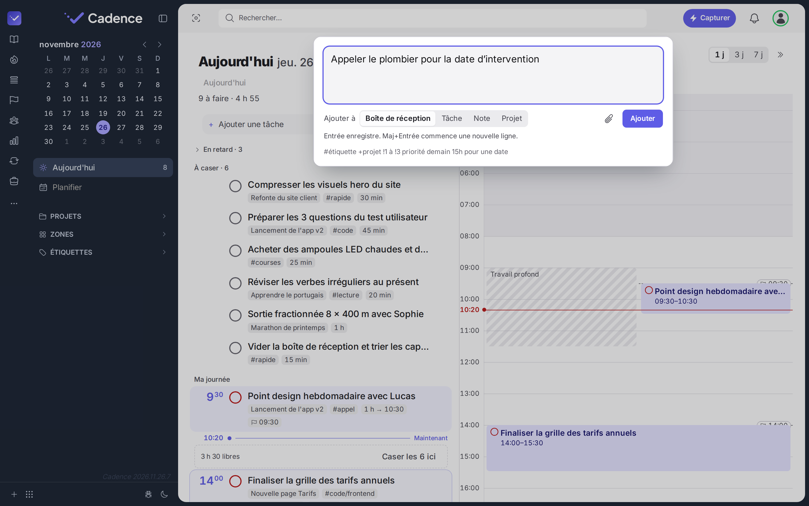
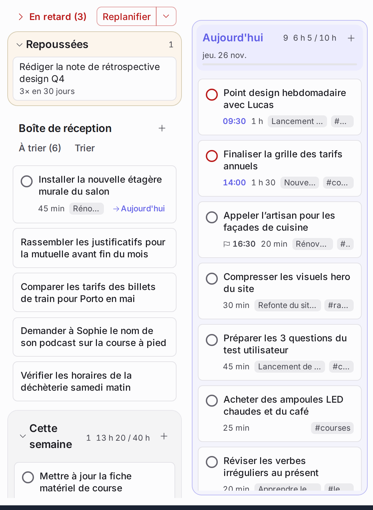

# Boîte de réception et capture

La capture sert à sortir une idée de votre tête en une seconde, sans choisir un projet, une date ou un type ; la boîte de réception la garde jusqu'à ce que vous la triiez. Cette page décrit la boîte, la saisie rapide et sa syntaxe, la capture d'une adresse web, le partage depuis Android, les widgets et le raccourci clavier du client Linux.

## Capturer d'abord, ranger ensuite

Trois principes guident tout :

1. **Capturer sans friction.** Tapez, validez, passez à autre chose. La boîte de réception ne demande ni statut, ni priorité, ni date.
2. **Un seul endroit pour tout.** Tâches, notes, signets et pensées passent d'abord par là.
3. **Trier plus tard.** Vous décidez, idée par idée, si elle devient une tâche, une note, un projet, ou disparaît.

Il y a **trois sortes de choses** à garder à l'esprit :

| Terme | Sens |
|---|---|
| **Idée** (élément de la boîte de réception) | Un texte brut, pas encore décidé |
| **Tâche à classer** | Une tâche déjà créée mais sans moment (voir plus bas) |
| **Tâche** | Une chose à faire, datée ou non |

## Où est la boîte de réception

Sur le web, **il n'y a plus de page Boîte de réception** depuis le 13 novembre 2026 : la boîte est la **colonne de gauche de Planifier** (`g` puis `u`). Cette colonne liste d'abord les **tâches à classer**, puis les idées ouvertes. L'adresse `/inbox` renvoie vers Planifier. Un partage système ouvre la boîte d'ajout préremplie. La colonne cherche de nouveaux éléments **toutes les 15 secondes** (un message signale ceux qui viennent de Telegram).

- L'en-tête de la colonne porte **« À trier (N) »** et, tant que des idées attendent, **« Trier »**, le tri une idée à la fois (voir plus bas).
- Un clic sur une idée ouvre **son panneau de décision sur place**.
- Les idées et les tâches se **glissent sur un jour ou un horizon** pour les planifier ; une idée glissée devient d'abord une tâche.
- La colonne se redimensionne (de 220 à 560 px ; double-clic pour revenir à 260 px) et se replie.
- « La boîte de réception est vide. » s'affiche quand il n'y a rien.

Sur **Android**, il n'y a pas non plus d'onglet Inbox : elle est la section du haut de **Planifier** (sélecteur de listes du titre de Tâches).

## La saisie rapide

### L'ouvrir

| Où | Comment |
|---|---|
| Web, partout | Touche **`c`**, le bouton **« Capturer »** (éclair) de la barre du haut, ou la palette `Ctrl+K` › « Capture rapide ». Sur grand écran, le bouton bleu **Ajouter** de la barre ouvre le même panneau en bulle ; sur tablette et téléphone, le bouton rond **+** du bas de l'écran ouvre une feuille (il est masqué pendant l'édition d'une tâche ou d'une note) |
| Raccourcis `Alt+Maj+I` / `T` / `P` / `N` / `A` / `G` | Créer un élément de boîte, une tâche, un projet, une note, une zone ou une étiquette (réglables dans Profil › Interface › Raccourcis) |
| Android | Le bouton **+** de l'écran (feuille « Inbox · Tâche · Note ») ; le widget ; le raccourci d'icône ; la tuile des réglages rapides |
| Linux | `Ctrl+Alt+Space` (voir plus bas) |
| Firefox | Le bouton d'extension (voir plus bas) |

La boîte s'ouvre toujours sur **Inbox**, sauf `Alt+Maj+T` et « Nouveau › Tâche » de la barre latérale, qui l'ouvrent sur **Tâche**.

### Choisir ce que ça devient

Une rangée **« Ajouter à »** décide ce que le texte devient : **Boîte de réception**, **Tâche**, **Note** ou **Projet**. Rien n'est deviné : ce qui est sélectionné est ce qui est créé.

| Ajouter à | Première ligne | Autres lignes | Lu aussi dans la première ligne |
|---|---|---|---|
| Boîte de réception | Gardée telle quelle | Gardées telles quelles | Appliqué plus tard, à la conversion |
| Tâche | Titre | Notes | Échéance, récurrence, `@personne`, `~Zone`, `#étiquettes`, `+Projet` |
| Note | Titre | Contenu | `#étiquettes`, `+Projet` (une note n'a pas de date, les mots de date restent dans le titre) |
| Projet | Nom | Description | Échéance, `#étiquettes`, `~Zone` |

Les dates, `@personne` et `~zone` ne sont lues **que dans la première ligne** : une date citée plus bas dans une longue note ne devient jamais son échéance. Les `#étiquettes` se lisent partout. Une `#étiquette`, `+Projet` ou `~Zone` inconnue est **créée** à l'ajout.

### La syntaxe

Chaque élément ci-dessous est retiré du titre et posé sur la tâche (ou ce que le texte devient).

| Vous écrivez | Effet |
|---|---|
| `#maison` | Étiquette (un mot sans espace ; lettres, chiffres, tirets, soulignés) ; `#perso/sport` pour une étiquette imbriquée |
| `+Projet` ou `+"Mon projet"` | Projet ; `^Liste` est un alias de `+` |
| `~Zone` ou `~"Ma zone"` | Zone (seulement un nom qui commence par une lettre : « marcher ~5 km » reste tel quel) |
| `@Camille` ou `@"Camille Martin"` | Personne assignable (les e-mails et pseudos qui ne correspondent à personne restent dans le texte) |
| `!1`, `!2`, `!3` | Priorité haute, moyenne, basse (seuls ces trois jetons, précédés d'un espace ou du début, comptent : `!4` et `bravo!1` sont des mots) |
| `demain 15h`, `après-demain`, `lundi`, `le 12`, `d'ici vendredi`, `dans 3 jours` | Échéance (en anglais aussi : `tomorrow`, `next fri`, `Oct 12`) |
| `tous les lundis à 9h`, `chaque mardi`, `toutes les deux semaines`, `tous les jours ouvrés` | Récurrence |
| `1h`, `1h30`, `30 min`, `pendant 45 min` | Durée (estimation, de 5 minutes à 12 heures) |

Détails qui évitent les surprises :

- **Les dates** se calculent dans votre fuseau. Pour une idée restée dans la boîte, les dates relatives comptent **depuis le jour de la capture** : « demain » écrit un lundi donne le mardi, même converti le mercredi. Une seule date est utilisée ; avec plusieurs, la dernière gagne. Les mots de date (et ceux qui les introduisent : « avant », « jusqu'à », « by », « due ») sont retirés du nom ; une phrase avec une heure en anglais (`3pm`) reste dans le nom. Les mots ordinaires comme « mai », « mars » ou un nombre seul sont ignorés. Rien n'est lu dans un `#tag`, un `+projet` ou une adresse.
- **L'heure en français** (« demain 15h », « demain à 9h ») règle l'heure d'échéance et la phrase entière quitte le nom. Un « 15h » seul, sans jour, n'est pas une date.
- **La durée** : un « à 9h » ou « at 9am » avec marqueur est une heure, jamais une durée ; un « 9h30 » nu est lu comme une durée de 9 h 30 ; « toutes les 30 min » n'est pas une durée.
- **Récurrence avec heure** : « Standup tous les lundis à 9h » crée la tâche avec 9 h comme heure pour chaque occurrence.
- **Un projet** : le nom se compare sans tenir compte des majuscules ni des accents, et un début **unique** suffit (`^mais` trouve `Maison`) ; si plusieurs projets commencent pareil, rien ne correspond et le nom est créé tel quel. Seul le premier `+Projet` est utilisé.
- Une pastille sous le champ montre la date reconnue ; sa croix ✕ garde les mots tels quels dans le texte. Les `#étiquettes`, projets et zones choisis dans une liste ne restent pas dans le texte : ils apparaissent en **pastilles sous la boîte**, ajoutées à l'enregistrement, retirées par leur croix.

### Les suggestions en direct

- Dès qu'un mot commence par `#`, `+`, `~` ou `!`, **une liste s'ouvre immédiatement** : étiquettes (les plus utilisées d'abord, avec leur chemin pour les imbriquées), projets (ceux en pause ou clos sont écartés), zones, ou les trois priorités (`!1` Haute, `!2` Moyenne, `!3` Basse).
- La saisie affine par préfixe, par segment de chemin et sans tenir compte des accents, et finit par « Créer #nom » pour une nouvelle étiquette.
- Le **menu `/`** (au début d'un mot, pas dans une adresse ni dans « et/ou ») liste les jetons : Étiquette, Projet, Personne, Zone, Échéance, Répéter. Choisissez à la souris, avec Haut/Bas puis Entrée, ou avec Tab ; une liste de valeurs s'ouvre (vos étiquettes, projets, personnes assignables, zones, dates et répétitions prêtes à l'emploi). Entrée insère le jeton en mettant entre guillemets les noms à espaces. Échap ferme le menu et garde le texte. Le menu suit ce que vous ajoutez : « Tâche » montre tout, « Note » seulement Étiquette et Projet, « Projet » Étiquette, Zone et Échéance.
- Une phrase de date reconnue (« demain 15h ») est surlignée dans le champ.
- Android propose les mêmes suggestions en direct, ainsi que `~domaine` pour une zone existante (sinon le mot reste dans le titre).

### Plusieurs lignes, plusieurs tâches

Par défaut tout ce que vous tapez devient **un seul élément**. Quand le texte a plusieurs lignes, la boîte l'annonce en une phrase (« Cela donnera 1 tâche. La première ligne sera le titre et les 2 autres lignes les notes. ») avec un lien **« Créer N … à la place »** qui passe en **un élément par ligne** : une tâche par ligne non vide, sans les marqueurs de liste (`-`, `*`, `1.`). Si une ligne échoue, les lignes non enregistrées restent dans la boîte.

### Ajouter plusieurs tâches de suite

Après l'enregistrement d'une tâche, la boîte reste **ouverte et vide**. Le projet de la tâche (choisi par `+Projet`, une pastille, ou la page projet d'où l'on vient) reste comme une pastille amovible pour la suivante, avec un compteur « Ajoutées à *Projet* : 3 » et **« Annuler »** pour la dernière. Les étiquettes, la priorité et la date ne sont pas reportées. La série s'arrête quand on rouvre la boîte, quand on retire la pastille, ou après deux minutes sans rien taper ni enregistrer.

### Fichiers

Collez, déposez ou choisissez des fichiers avec le trombone : ils sont enregistrés avec ce que devient le texte. Une idée, une tâche ou un projet les garde en pièces jointes ; une note les reçoit **dans son texte** (les images s'affichent, les autres fichiers deviennent des liens). Une capture d'écran collée seule suffit : son nom devient le titre, renommé en « Pasted image *date heure* ». Quand une copie porte du texte **et** une image (cellules de tableur), seul le texte est collé. Chaque fichier doit rester sous la limite du serveur, vingt au plus par élément. Si un fichier échoue, l'élément est quand même enregistré et les noms des fichiers ratés sont montrés. Les fichiers d'une idée passent sur la tâche, le projet ou la note qui en sort ; supprimer une idée supprime ses fichiers.

### La touche Entrée

Sur un clavier d'ordinateur, Entrée enregistre et Maj+Entrée saute une ligne. Sur un appareil tactile, Retour saute une ligne et le bouton Ajouter enregistre (avec un bouton « Saut de ligne » si Retour est réglé pour enregistrer). Ctrl ou Cmd + Entrée enregistre toujours. Ces deux choix et « Un élément par ligne » se règlent dans Profil › Interface › Raccourcis › « Ajout d'éléments », et restent sur l'appareil.

### Confirmation et annulation

Il n'y a **pas de toast** : une ligne discrète sous la boîte dit ce qui a été enregistré (« « Appeler Sam » enregistré dans la boîte de réception. ») avec un lien **« Annuler »**, qui supprime ce qui vient d'être créé ; elle reste jusqu'à la prochaine frappe. Fermer la bulle ou la feuille garde un texte à moitié tapé. En cas d'échec, « Échec de l'enregistrement. Votre texte est toujours là. »

## Une adresse web devient une tâche

Quand le texte est **seulement une adresse** (avec au plus des `#étiquettes`, un `+Projet` ou une `~Zone`, sur une ligne, sans fichier), la boîte devient la même feuille rapide que le partage Android : l'aperçu de la page sous le texte, et **« Ajouter à »** propose **Inbox · Tâche · Note** (pas de Projet). **Inbox** reste le choix par défaut. Dès qu'on écrit des mots avec l'adresse, les quatre choix habituels reviennent.

Choisir **Tâche** crée une tâche **nommée d'après le genre de page**, depuis son titre :

| Genre de page | Nom de la tâche |
|---|---|
| Dépôt ou outil | « Essayer : *titre* » |
| Article | « Lire : *titre* » |
| Vidéo | « Regarder : *titre* » |
| Toute autre page | Le titre seul |

Le titre est lu sur l'aperçu ou pendant 3 secondes au plus ; sans titre, c'est le dépôt (`propriétaire/dépôt`), sinon le site, sinon l'adresse. L'**adresse est dans la note** de la tâche, qui garde son badge d'origine « Link » ; sans projet ni échéance choisis, elle attend dans **« Tâches à classer »** avec **« Quand ? »**. Les mots de vos verbes suivent votre langue.

**« Déjà dans … »** apparaît au-dessus du nom quand l'adresse figure déjà dans une tâche ouverte ou dans les pages d'un projet, avec **Ouvrir** ; le bouton principal devient **« Ajouter quand même »**.

Une adresse permet aussi **« Projet… »** : la page est ajoutée au projet choisi (voir [Projets et domaines](Projets-et-domaines)). Il n'y a pas de bibliothèque de liens à trier ni à étiqueter : un lien vit dans une tâche, ou dans les pages d'un projet ; le reste est une note. Les sites sont lus par le serveur, jamais par votre navigateur, et aucune IA ne touche aux liens.

Une tâche qui porte une adresse montre sur sa ligne l'icône et le nom du site, et l'image de la page ; un clic sur le site l'ouvre dans un nouvel onglet. Les aperçus (image, titre, site, étoiles et langage d'un dépôt GitHub) s'affichent aussi sous toute adresse écrite dans une note de tâche, une note ou une description de projet.

## Décider d'une idée

Un clic sur une idée de la colonne ouvre un **panneau de décision** : le texte (modifiable), les chips des mots retirés (date, étiquettes, projet, personne, zone), puis **« Enregistrer sous »** avec **Tâche**, **Note**, **Projet** et **Inbox** (garder), et **Supprimer**.

- **Tâche** : crée la tâche avec le nom nettoyé, les étiquettes et le projet lus, l'échéance et la récurrence ; l'idée est marquée traitée et quitte la boîte. Son origine (Telegram, Desktop, MCP…) passe à la tâche.
- **Note** : crée la note avec le texte ; pour une adresse, le titre de la page est lu (3 secondes au plus, sinon l'adresse sert de titre) et l'étiquette `bookmark` est ajoutée.
- **Projet** : crée un projet « Prévu » avec le nom nettoyé et les étiquettes.
- **Une adresse** : **Tâche** (voir plus haut) ou **Projet…** pour en faire une page d'un projet.
- Les mots retirés sont gardés : ils comptent à l'enregistrement et sont **remis au bout de la première ligne** si vous enregistrez le texte modifié. Enregistrer sans rien changer ne change rien.
- **Supprimer** retire l'idée **pour de bon** (avec ses fichiers), après confirmation, ou par la touche Suppr ; il n'y a pas d'annulation.
- Une idée convertie passe à « traitée » : le geste est à sens unique et sert de trace, l'idée ne revient pas.

### « Trier » : une idée à la fois

« Trier » (ou `/inbox?triage=1`, ou « Trier la boîte de réception » dans la palette) montre une idée à la fois. Les suggestions sont des **règles**, sans IA : un `+projet` fait penser à une tâche ; une étiquette comme `idée`, `recette` ou `lire` à une note ; `#projet` à un projet ; une adresse seule, un texte long ou multiligne, ou un premier mot comme « idée » ou « lire », à une note ; des verbes d'action (« acheter », « appeler », « buy », « call »)… à une tâche ; le reste à une tâche.

| Touche | Action |
|---|---|
| `t` | Faire une tâche |
| `p` | Faire un projet |
| `n` | Faire une note |
| `s` | Plus tard : garder dans la boîte et passer à la suivante (jusqu'à la fin de la session) |
| Suppr | Supprimer |
| Entrée | Accepter la suggestion |
| Échap | Quitter |

Sous « Tri de la boîte », l'aide `?` liste aussi une touche `l`, héritée de l'ancienne bibliothèque de liens.

## « Tâches à classer » et « Quand ? »

La colonne de gauche liste aussi les tâches **à classer** : des tâches ouvertes, sans échéance, non récurrentes et non « Plus tard », qui ne sont rangées nulle part (sans projet ni zone) **ou** que le classement automatique a rangées sans leur donner un moment. Chacune a une rangée **« Quand ? »** :

| Bouton | Effet |
|---|---|
| **Cette semaine** | La tâche est engagée sur la semaine |
| **Une date** | Ouvre le sélecteur de date |
| **Plus tard** | La tâche passe en « Plus tard » (`someday`) |
| **Sans date** | Elle reste où elle est rangée, sans date : la question s'arrête |

Tout moment décidé, quel que soit le chemin (une échéance, une semaine, un plan sur aujourd'hui ou après, la fermeture de la tâche), sort la tâche de la liste. Un plan d'hier ne compte pas : une tâche prévue hier et non faite revient. Les cinq premières s'affichent, puis « Tout afficher ». La même liste existe sur Android. Le classement automatique est décrit dans [IA et propositions](IA-et-propositions).

## Capturer depuis Android

### Le bouton +

Le **+** de l'écran ouvre une feuille avec la destination **Inbox · Tâche · Note**, Inbox d'office depuis la section Inbox de Planifier, Tâche d'office depuis Tâches. En Inbox et Note, le texte est gardé tel quel (aucune date ni étiquette reconnue) ; en Tâche, la date, l'heure, `#étiquette`, `+projet`, `~domaine`, `@personne` et `!priorité` sont reconnus, avec suggestions en direct et pastilles. Une adresse seule propose Inbox, Tâche et Note comme sur le web. « Plus d'options » ouvre la date et d'autres champs ; la touche ✓ du clavier ajoute.

### Le partage vers Cadence

Dans n'importe quelle application, **Partager › Cadence** (nom : « Cadence – Inbox ») ouvre une petite fenêtre **« Ajouter à Cadence »** :

- **Inbox · Tâche · Projet… · Note** : un toucher décide. Le **sujet** du partage sert de texte quand il n'y a que lui.
- **Tâche** : le nom est modifiable au-dessus (« Nom de la tâche »), et une ligne **« Échéance »** propose Aujourd'hui, Demain, Ce week-end, « Choisir… » ; la date choisie se retire d'un toucher. Elle ne vaut que pour « Tâche » ; avec une date, la tâche ne va plus dans « Tâches à classer » ; sans adresse, « Tâche » devient le bouton principal.
- **Projet…** ajoute l'adresse comme page du projet choisi (« Page ajoutée au projet »), hors ligne aussi.
- **Déjà dans « X »** (+N) avec **Ouvrir** et **Ajouter quand même** quand l'adresse existe déjà.
- Pour **Inbox**, la fenêtre se ferme tout de suite (moins d'une seconde, sans aucun appel réseau) ; l'écriture continue en arrière-plan puis un toast confirme (« Ajouté à l'Inbox ») ou signale l'échec (« Impossible d'ajouter à l'Inbox »).
- L'entrée **« Cadence »** du menu de **sélection de texte** (`PROCESS_TEXT`) range le texte sélectionné dans l'Inbox de la même façon.

### Sans ouvrir l'application

| Surface | Ce qu'elle fait |
|---|---|
| Raccourci d'icône **« Nouvelle tâche »** | Ouvre l'ajout rapide (la même saisie que l'application) |
| Raccourci d'icône **« Inbox »** | Ouvre l'ajout rapide, sans échéance, qui écrit dans l'Inbox |
| Tuile des réglages rapides **« Capturer »** | Ouvre l'ajout rapide |
| Widget **« Cadence – Ajouter »** | « Ajouter une tâche en un geste » |
| Widget **« Cadence – Barre de capture »** | « Nouvelle tâche… », **Idée** (vers l'Inbox) et **Dicter** (dictée vocale, si un service de dictée existe) |
| Widgets **« Cadence – Tâches 2×2 »** et **« Aujourd'hui »** | Les tâches du jour, à cocher depuis l'accueil |

La fenêtre d'ajout rapide **se ferme** une fois la tâche ajoutée ; la saisie en série reste dans l'application. Elle ne met plus d'échéance « Aujourd'hui » d'office : la date se tape (« auj », « demain »). Toutes ces captures s'écrivent localement et partent à la reconnexion.

## Capturer depuis un ordinateur Linux

Le client Linux tient une icône dans la barre système et ouvre un petit champ **toujours au premier plan** (560 par 76 px) avec **`Ctrl+Alt+Space`** (réglable). Entrée enregistre la capture et ferme le champ. Elle part dans la boîte de réception avec l'origine « Desktop », et **elle attend dans une file locale si le serveur est injoignable** : le client la renvoie dès qu'il peut, puis toutes les minutes. Chaque capture porte une clé d'idempotence, donc une capture reçue deux fois par le serveur n'est créée qu'une fois (pendant 24 heures). Sous Wayland, le raccourci passe par le portail système (le bureau demande de le confirmer la première fois) : un autre programme qui détient déjà la combinaison peut forcer à en choisir une autre dans les réglages de raccourcis du bureau ; `cadence-desktop --quick`, lié à un raccourci du bureau, marche partout. Voir [Client Linux et Firefox](Client-Linux-et-Firefox).

## Depuis Firefox et Gmail

L'add-on Firefox crée une tâche pour la page ouverte : le bouton de la barre d'outils (ou `Alt+Maj+K`) montre le nom proposé (modifiable), une échéance facultative (« Aujourd'hui » ou « Demain »), « Déjà dans … » avec « Ouvrir » si la page existe, puis **« Créer la tâche »**. Un clic droit sur un lien en fait une tâche d'un seul geste. Dans Gmail, un bouton **« + Cadence »** près de l'objet d'un message ouvert propose un nom et une échéance ; la tâche garde l'adresse du message et le badge Gmail. Voir [Client Linux et Firefox](Client-Linux-et-Firefox).

## Depuis Telegram

Telegram est **désactivé par défaut** : l'administrateur doit activer `TELEGRAM_ENABLED=true`. Ensuite, Profil › Intégrations › Telegram permet de coller le jeton d'un bot créé avec l'assistant officiel de Telegram. Chaque message envoyé au bot crée une idée d'origine « telegram », visible sous 15 secondes environ, avec un message d'annonce. Le jeton est chiffré sur le serveur et n'est jamais renvoyé au navigateur : l'écran montre `••••••••` et ses quatre derniers caractères, avec un bouton « Effacer ». Voir aussi [Notifications et rappels](Notifications-et-rappels).

## Cas particuliers

| Situation | Ce qui se passe |
|---|---|
| Hors ligne sur le web | L'idée est gardée dans la file locale (« Enregistré hors ligne ») et part à la reconnexion |
| Une idée relancée par le réseau | Une clé d'idempotence évite le doublon |
| Un `#tag` inconnu | Créé à la conversion, sans confirmation |
| Un projet inconnu | Créé à la conversion, avec le statut « Prévu » |
| Une adresse sans titre lisible | Le titre est le dépôt, le site ou l'adresse |
| Une adresse privée (IP, `.lan`, messagerie, recherche…) | Jamais lue pour un aperçu ni transformée en page de projet |
| Une capture très longue | La première ligne est le titre, le texte complet est gardé |
| Vous cherchez dans la boîte | Il n'y a ni recherche, ni filtre, ni groupe : elle est faite pour être vidée, pas organisée |
| L'ordre | Les plus récentes en premier, sans autre tri |

## Raccourcis

| Touche | Action |
|---|---|
| `c` | Capture rapide |
| `n` (sur Planifier) | Ajouter à la boîte de réception |
| `g` puis `u` | Aller à Planifier |
| `Alt+Maj+I` / `T` | Créer un élément de boîte / une tâche |
| Entrée, Maj+Entrée, Ctrl+Entrée | Enregistrer, nouvelle ligne, enregistrer dans tous les cas |
| `Échap` | Annuler |

## Pour aller plus loin

- [Boîte de réception (règles de capture)](https://github.com/PreciselyWrong/cadence/blob/main/docs/04-inbox-page.md)
- [Liens : adresses, aperçus et pages de projet](https://github.com/PreciselyWrong/cadence/blob/main/docs/37-links.md)
- [Classement automatique et « Quand ? »](https://github.com/PreciselyWrong/cadence/blob/main/docs/41-auto-classify.md)
- [Clavier, palette et tri de la boîte](https://github.com/PreciselyWrong/cadence/blob/main/docs/35-keyboard-palette.md)
- [Client Linux](https://github.com/PreciselyWrong/cadence/blob/main/docs/fork/DESKTOP.md)
- [Notes UX Android](https://github.com/PreciselyWrong/cadence/blob/main/docs/fork/ANDROID-UX-NOTES.md)
