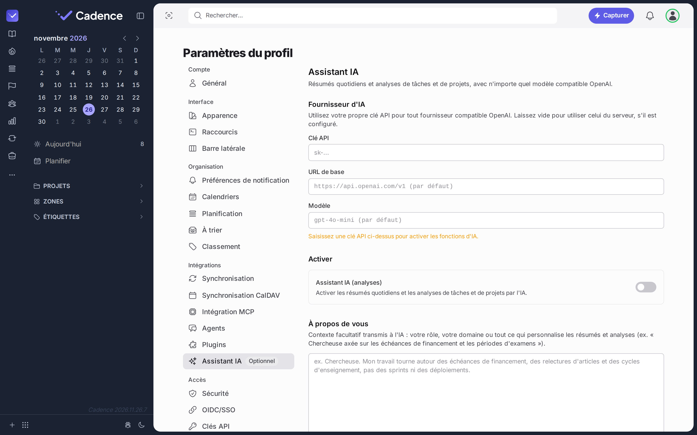
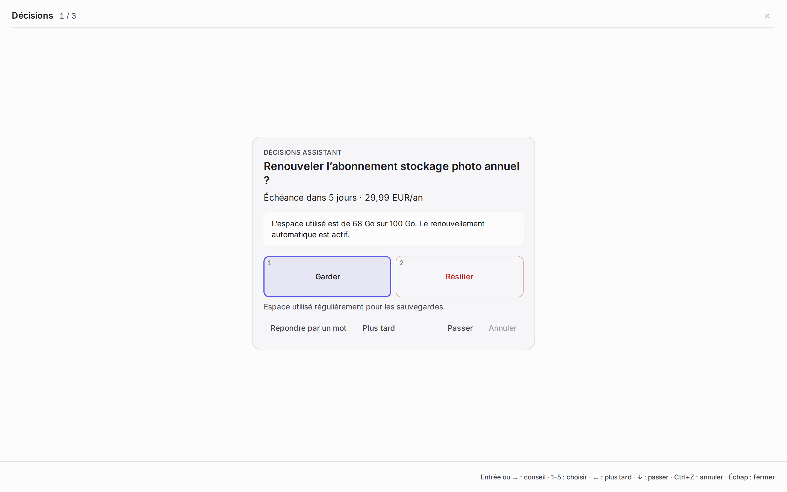
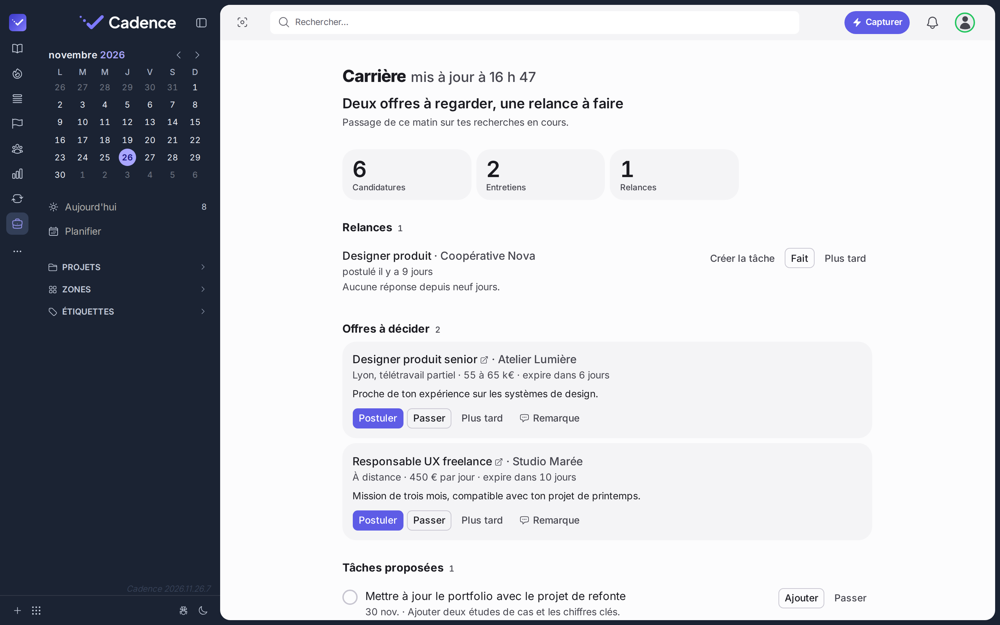
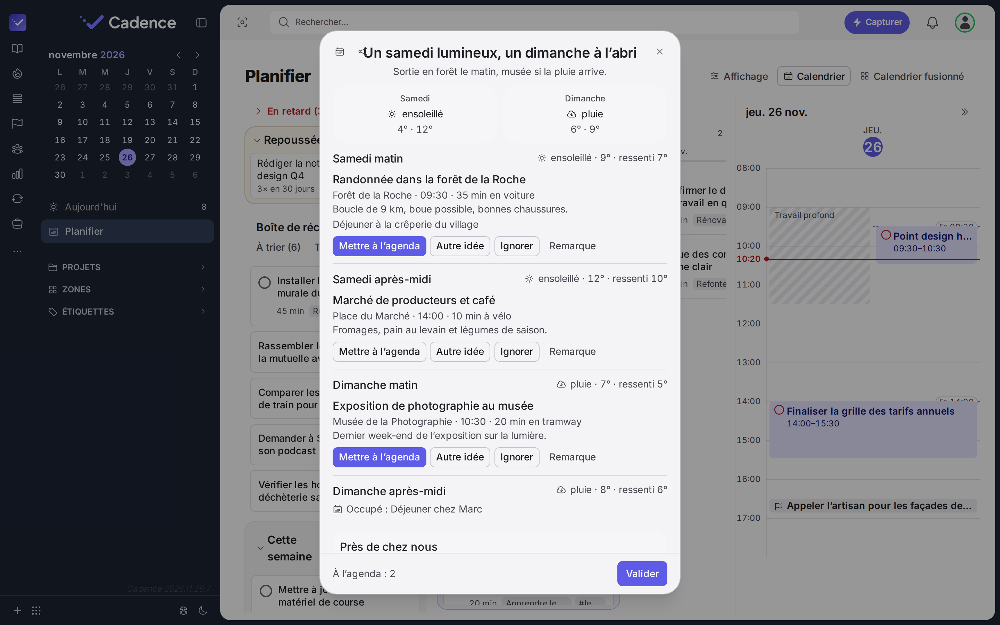

# IA et propositions

Cadence se sert d'une IA pour deux choses : remplir les champs vides de ce que vous capturez, et vous préparer des décisions que vous validez d'un geste. Elle propose, vous décidez : rien ne change dans vos données sans votre validation, sauf le classement des champs laissés vides, que vous pouvez toujours annuler.

## Ce qu'il faut brancher pour quoi

Il y a deux « branchements » distincts, et tout est facultatif : Cadence marche sans IA.

| Branchement | Où | Ce que ça active |
|---|---|---|
| Un **fournisseur d'IA** (clé d'API, compatible OpenAI) | Profil › Assistant IA | Classement automatique, « Découper en étapes », aperçus IA d'une tâche ou d'un projet, aide au plan du jour, propositions de l'assistant de « À trier » |
| Un **agent externe** qui écoute le serveur (plugin ou webhook) | Profil › Plugins, ou Profil › Notifications (webhooks) | « Planifier ma semaine », « Préparer ma revue », « Discuter avec l'IA », cartes de mails, « Décider », « Carrière », « Week-end », rituel du matin |

Ce que l'interface affiche dépend de ce qui est branché :

- Sans agent externe en marche, **tous les boutons d'IA de la deuxième ligne disparaissent** (web et Android). Il n'y a pas de bouton qui ne mène nulle part.
- Sans fournisseur d'IA, le classement est « sauté » (les éléments restent tels quels), et « Découper en étapes » se replie sur un mode manuel (voir plus bas).
- Pour désactiver tout ce qui dépend du fournisseur d'un coup : Profil › Assistant IA › **Activer** (ou Profil › Fonctionnalités et modules). Interrupteur coupé, l'interface masque ces fonctions et le serveur répond « interdit ».

Les propositions (semaine, revue, Carrière, Week-end) se lisent et se décident **en ligne** : elles ne sont ni gardées ni rejouées hors ligne, parce qu'un plan de semaine appliqué plus tard agirait sur des faits périmés. Hors ligne, les boutons affichent « Hors ligne » et ne gardent rien.

## Réglages de l'IA dans le Profil

### Profil › Assistant IA

| Champ | Rôle |
|---|---|
| Clé API | Jamais renvoyée en entier : l'écran indique seulement qu'une clé est enregistrée et ses 4 derniers caractères. « Effacer » la retire. Elle est chiffrée au repos sur le serveur. |
| URL de base | N'importe quel point d'accès compatible OpenAI (Ollama, LM Studio, Groq, Azure OpenAI, l'adresse compatible d'Anthropic...). Pour une adresse saisie ici, elle doit être publique : le serveur refuse une adresse locale ou interne. Une IA locale se branche plutôt côté serveur (voir [Auto-hebergement](Auto-hebergement)). |
| Modèle | Le nom que votre fournisseur attend. Vide : celui du serveur, sinon `gpt-4o-mini`. |
| Activer | Interrupteur général des fonctions qui s'appuient sur ce fournisseur. |
| À propos de vous | Contexte facultatif (500 caractères) ajouté aux demandes de plan du jour : votre métier, vos échéances types. Il évite que l'IA vous parle comme à un développeur. |

Ordre de résolution, champ par champ : votre réglage, sinon la variable du serveur, sinon la valeur par défaut. Laisser un champ vide revient donc au réglage du serveur s'il existe.

La même page porte la carte **Découper en étapes** (modèle, nombre d'étapes, durées, taille de la note envoyée), détaillée plus bas.

### Profil › Classement (réglages du classement automatique)

La page affiche le fonctionnement (activé, **Essai à blanc** ou **Écriture réelle**), un bandeau rouge si le dernier appel à l'IA a échoué, puis les limites :

| Réglage | Défaut | Plage |
|---|---|---|
| Délai de grâce (secondes) | 90 | 0 à 3600 |
| Éléments par appel | 12 | 1 à 50 |
| Essais en cas d'échec | 5 | 1 à 20 |
| Cache du contexte (minutes) | 30 | 0 à 1440 |
| Durée de vie d'une suggestion (jours) | 7 | 1 à 365 |
| Suggestions par jour (0 = sans limite) | 0 | 0 à 1000 |
| Durée du journal (jours) | 180 | 1 à 3650 |
| Tags par élément | 3 | 0 à 10 |
| Jetons de réponse au plus | 2000 | 200 à 16000 |
| Effort de raisonnement | non envoyé | minimal, faible, moyen, élevé |
| Modèle | celui de l'Assistant IA | libre |

Seuils de confiance (de 0 à 1) : **Projet ou zone 0,8**, **Tags 0,8**, **Durée 0,6**, **Priorité (proposée seulement) 0,8**, **Poser la question à partir de 0,4** (jamais au-dessus du seuil du projet ou des tags). Un champ dont la confiance est au-dessus du seuil est écrit ; entre « poser la question » et le seuil, il devient une carte ; en dessous, il est abandonné. Une valeur hors plage est refusée avec un message d'erreur. Le champ **Tags jamais posés** liste les tags d'état que le classement ne doit pas poser (par défaut `someday`, `today`, `ticktick`, `urgent`, `🔎focus_mois`, `🔍focus_trimestre`).

Le même écran liste les **passes récentes**, avec « Annuler la passe », et un **Essai à blanc** (1 à 30 jours) qui montre ce qui serait classé sans rien écrire.

### Profil › À trier

Calendriers lus (pour les questions d'horaire), jours à regarder (1 à 14), alertes à activer ou non, reports avant une carte (3 par défaut), tâches terminées vérifiées (7 jours), seuil de doublon (0,8), et l'**assistant IA** de la file (désactivé par défaut, 20 tâches regardées par jour au plus). Le même écran liste les **expéditeurs toujours archivés** (voir [Tri-des-mails](Tri-des-mails)).

### Profil › Planification

La carte **Replanification des retards le matin (IA)** : un interrupteur « Préparer automatiquement une proposition le matin » et une heure (06:30 par défaut). Voir « Passage du matin » plus bas.

### Sur Android

Réglages › Organisation › **Classement automatique** (mêmes réglages que le web, plus l'interrupteur « Notifier les propositions », avec la découpe en étapes en bas de page) et Réglages › Organisation › **À trier**. Ces écrans demandent une connexion : hors ligne, ils le disent plutôt que d'afficher des valeurs périmées.

## Classement automatique

**Ce que ça fait.** Quelques instants après la création d'une tâche ou d'une note, le serveur remplit ce qui est **encore vide** : un projet *ou* une zone, jusqu'à 3 tags, une durée. Il ne remplace jamais ce que vous avez déjà rempli.

**Ce qui est rempli**

| Élément | Champs | Condition |
|---|---|---|
| Tâche | un projet **ou** une zone (jamais les deux : un projet précis l'emporte), 0 à 3 tags, une durée de 5 à 720 minutes | seulement si projet, zone, tags et durée sont tous vides |
| Note | un projet, 0 à 3 tags | uniquement les champs vides |
| Priorité d'une tâche | 1 ou 2 | **jamais écrite** : seulement proposée sur une carte, et seulement si la tâche est à 0 |

**Ce qui n'est jamais touché** : les tâches terminées, archivées ou annulées, les tâches récurrentes, les habitudes, les sous-tâches, les tâches importées d'un fichier TODO.md, les éléments d'un projet TODO.md ou d'un projet terminé, annulé ou archivé. Les éléments qui existaient avant l'activation du classement ne sont jamais traités : pas de passage sur l'historique.

**Comment ça se passe**

1. Une tâche ou une note est créée (web, Android, MCP, Telegram, import : peu importe).
2. Le serveur attend le **délai de grâce** (90 s par défaut) : c'est votre temps pour la ranger vous-même.
3. Il relit l'élément. S'il a été rempli ou modifié entre-temps, il ne l'écrit pas.
4. Il envoie un lot à l'IA, qui ne peut choisir que parmi vos projets, zones et tags **existants** : elle ne peut pas en inventer.
5. Le résultat est contrôlé par le code, champ par champ, selon les seuils ci-dessus, puis écrit.

**Cas particuliers**

| Cas | Résultat |
|---|---|
| L'IA hésite (confiance entre 0,4 et le seuil) | Une carte dans « À trier » : projet (1 à 3 propositions, la zone, « Nouveau projet », « Autre... », « Aucun »), tags à cocher, priorité. Boutons « Appliquer », « Tout accepter » (jamais un nouveau projet ni un nouveau tag), « Ignorer ». |
| Vous avez rempli le champ entre-temps | La carte n'écrase jamais un champ rempli à la main : seul un champ encore vide est écrit. |
| Une carte reste sans réponse | Elle expire après 7 jours (réglable), ou dès que l'élément disparaît, est fermé ou entièrement rempli. |
| L'appel échoue | Nouvel essai après 1, 2, 4... minutes (60 au plus), jusqu'à 5 essais. Puis l'élément est « en échec ». |
| Aucun fournisseur d'IA | Les éléments sont sautés ; le bandeau de Profil › Classement le dit. |
| Le bandeau rouge « Le dernier appel à l'IA a échoué » | Montre l'erreur la plus récente (par exemple `401: invalid x-api-key`). **Réessayer** remet les éléments en échec ou sautés dans la file. |
| Mode « Essai à blanc » | Tout est calculé et journalisé, rien n'est écrit, aucune carte. |

**« Quand ? »** Le classement range, il ne décide jamais *quand*. Une tâche qu'il classe dans un projet ou une zone reste dans Boîte de réception › **Tâches à classer** avec une rangée « Quand ? » (Cette semaine, Une date, Plus tard, Sans date), jusqu'à ce que vous choisissiez. Tout moment suffit à la sortir de là : une échéance, une semaine, un jour au plan, « Plus tard », ou « Sans date » (qui la laisse où elle est rangée). Voir [Boite-de-reception-et-capture](Boite-de-reception-et-capture).

**Marque et annulation.** Une tâche ou une note classée porte « **Classé automatiquement · Annuler** » tant qu'elle est exactement dans l'état laissé par le classement. Dès que vous la modifiez, la marque disparaît et l'annulation avec elle (« L'élément a changé depuis : annulation impossible »). Profil › Classement permet d'annuler un changement ou toute une passe.

**Sur Android.** Après chaque synchronisation, une notification par nouvelle carte (canal « Classement », heures calmes respectées), avec les boutons **Tout accepter**, **Ignorer**, **Ouvrir**. Les réponses passent par la file des appels différés : elles marchent hors ligne.

## La file « À trier »

Une file de propositions **sur vos tâches ouvertes**, une à la fois, avec la raison en une ligne. Vous validez, corrigez, gardez la tâche telle quelle ou passez. Rien ne change sans ce geste. On y entre depuis l'en-tête de la boîte de réception (« À trier (n) »), depuis « Ma journée » sur Android, ou directement en `/triage` sur le web.

**Règles qui ne changent pas**

- Au plus **une proposition par tâche**. Une tâche simple et claire n'en reçoit aucune.
- **Le code d'abord** : les doublons, les dates, la récurrence et les reports sont déduits par des règles, pas par une IA.
- **Lire avant de proposer** : une tâche récurrente se répète par construction, et deux tâches datées de jours différents sont deux tâches : ni l'une ni l'autre n'est signalée comme doublon.
- **Réglé tant que rien ne change** : une tâche gardée ou traitée quitte la file jusqu'à ce que son nom, sa note, son échéance, son statut, son projet, ses tags ou sa récurrence change. On ne vous pose jamais deux fois la même question sur le même état.
- Une tâche qui reflète un fichier TODO.md est l'affaire du fichier : elle est exclue.

**Ce que les règles proposent**

| Carte | Ce qu'elle propose | Quand |
|---|---|---|
| Doublon possible | Annuler la tâche | même nom qu'une tâche fermée ces 7 derniers jours, ou très proche, ou même nom qu'une autre tâche ouverte (sauf récurrente ou datée un autre jour) |
| Échéance trouvée dans une note | Changer l'échéance | la note cite une date à venir, plus tôt que l'échéance |
| Souvent reportée | Annuler la tâche | repoussée au moins 3 fois récemment |
| Événements en conflit, événement pendant le travail | une question (Oui, Non, Préciser) | deux événements occupés se chevauchent, ou un événement tombe sur un bloc de travail, dans les calendriers lus |

Les actions possibles sur une carte : Renommer, Découper en sous-tâches, Changer l'échéance, Marquer comme faite, Annuler la tâche, Supprimer, Classer, Convertir en note, en projet ou en habitude. Une conversion crée la nouvelle chose d'abord, puis supprime la tâche ; elle garde la note (et les tags) mais pas l'échéance ni les commentaires. « Supprimer » attend un instant pour laisser le temps d'annuler. Le serveur refuse de supprimer ou convertir une tâche d'un fichier TODO.md, une tâche récurrente, ou (pour une note ou une habitude) une tâche qui a des sous-tâches.

**Contextes liés.** Quand vous répondez à une question d'horaire, la réponse devient un « contexte » (500 caractères au plus) rattaché à la tâche, à l'événement ou à la série : la question n'est plus posée. Le contexte s'affiche dans la fiche de la tâche, modifiable ou supprimable. Il s'éteint tout seul : fin de la tâche, fin de la journée de l'événement, disparition de la série.

**Assistant IA de la file** (désactivé par défaut). Une fois par nuit, il regarde les tâches ouvertes que les règles ont laissées, par lots de 10, jusqu'à la limite quotidienne, et peut proposer une action. Le code vérifie chaque réponse : une action inconnue, une valeur hors limites ou une raison manquante donnent « pas de proposition ». Tant que le classement automatique est actif, l'assistant ne propose plus « Classer ».

**Hors ligne.** Android garde la dernière file pour la lire hors ligne ; un geste retire la carte tout de suite puis part après 4,5 secondes (le temps d'« Annuler »). Sur le web, une carte déjà traitée ailleurs sort avec « Déjà traité ailleurs. ».

## Découper en étapes

Dans la fiche d'une tâche (web et Android), **Découper en étapes** demande à l'IA de petites étapes concrètes, dans l'ordre, chacune avec une durée.

**Comment s'en servir**

1. Ouvrez la fiche d'une tâche de premier niveau, puis « Découper en étapes ».
2. La feuille propose les étapes. Vous pouvez renommer, changer les minutes, réordonner, retirer ou ajouter une étape ; le total s'affiche.
3. **Ajouter N étapes** les crée comme sous-tâches, avec leur durée estimée, après vos sous-tâches existantes.

**Cas particuliers**

| Cas | Résultat |
|---|---|
| Sous-tâche, ou tâche d'un fichier TODO.md | Refusé (une sous-tâche ne se découpe pas ; les sous-tâches d'un TODO.md vivent dans le fichier) |
| Pas d'IA (interrupteur coupé, fonction désactivée, pas de fournisseur, erreur, rien d'utilisable) | La feuille demande « Première étape de 2 min ? » avec une seule étape vide à saisir ; les durées démarrent à 5 minutes, la plus petite estimation stockée |
| Noms en double | Le serveur supprime les doublons (casse ignorée), y compris contre vos sous-tâches existantes |
| Durées | Arrondies dans la plage 5 à 25 minutes par défaut ; au plus 6 étapes par défaut |
| Hors ligne (Android) | « Découper en étapes demande une connexion au serveur. » |

Réglages (Profil › Assistant IA, Android Réglages › Classement automatique) : activé, modèle, étapes au plus (2 à 15), durée minimale (5 à 60) et maximale (5 à 240) d'une étape, caractères de la note envoyés (0 à 10000, 1500 par défaut), jetons de réponse. Rien n'est mis en cache : un appel par clic.

## Aide au plan du jour

Quand l'interrupteur d'IA est actif, le Plan et Aujourd'hui proposent :

- **Préparer avec l'IA** : sur un plan vide, il prépare tout de suite ; sinon il propose « Remplir le temps libre » (garde ce qui est prévu) ou « Recommencer » (refait toute la journée, annulable). Le code nettoie la réponse : seules vos tâches connues, sur une grille de 15 minutes, jamais dans le passé ni sur une réunion. Les blocs proposés portent un éclat, avec la raison de l'IA en infobulle ; « Annuler » rétablit le plan d'avant.
- **Estimations de durée** pour les tâches sans estimation : l'estimation est pré-sélectionnée sur les puces (marquée d'un point) et n'est enregistrée que si vous ajoutez la tâche. Gardées 24 heures côté serveur.
- **Bilan de la journée** (Aujourd'hui) : proposé après le dernier bloc horaire ou quand tout est fait ; un court résumé, ce qui a marché, et les tâches à reporter. « Ajouter à demain » les ajoute sans heure au plan du lendemain.

Les conseils de planification (« 30 min libres à 09:30 conviennent à... ») sont calculés en local, sans appel à l'IA. Voir [Aujourd-hui-et-plan-du-jour](Aujourd-hui-et-plan-du-jour).

## Aperçus IA d'une tâche ou d'un projet

Dans la fiche d'une tâche, un panneau « Aperçus IA » (« À propos de cette tâche », « Prochaine étape », « Comment l'aborder », « Attention », liens suggérés) ; dans la page d'un projet, « À propos de ce projet », « Prochaine action », « Santé du projet ». Un aperçu se génère à la demande et reste affiché jusqu'à ce que vous le régénériez ; vous pouvez le masquer sans le supprimer. Sans contexte suffisant (pas de note, de tag ni de projet), la fiche prévient et propose « Générer quand même ».

## Planifier ma semaine et Préparer ma revue

Ces deux boutons envoient une demande à l'agent externe. Cadence calcule les **faits** (tâches ouvertes, échéances, plans, événements, file de revue) ; l'agent juge ; Cadence valide la réponse ; **vous** appliquez ce que vous cochez. L'agent n'écrit jamais lui-même dans vos données.

### Planifier ma semaine

- **Où** : bouton « Planifier ma semaine (IA) » dans l'en-tête d'Aujourd'hui et de Planifier ; sur Android, Planifier, le menu ⋯ d'Aujourd'hui, et un lien le dimanche et le lundi. À côté de « Replanifier », un bouton « Replanifier avec l'IA » traite les retards.
- **Déroulé** : le bouton passe à « En préparation... », puis « Ta semaine est prête ». Une notification peut aussi vous prévenir. Vous pouvez fermer la fenêtre : la proposition vous attend.
- **Période** : aujourd'hui et les six jours suivants, ou demain et les six suivants quand vos heures de journée sont finies (pour ne pas planifier une soirée déjà passée). 14 jours au plus.
- **Tâches prises en compte** (60 au plus) : en retard, échues dans la période, déjà au plan, décidées pour cette semaine, « en vue », puis la boîte de réception et les horizons (ce mois-ci, semaine prochaine, mois prochain). Jamais « Un jour », les tâches récurrentes, les sous-tâches, les tâches fermées ou d'habitude.

**Sur le web**, la proposition s'ouvre **directement sur le Plan** : un troisième onglet « Planifié par l'IA » apparaît à côté de Jours et Horizons. Une carte violette montre où l'IA envoie une tâche (avec « ← où elle était · durée » et la raison), une trace en pointillés montre où elle est maintenant. Un clic sur une carte ouvre son menu : « Voir la tâche », « Refuser : la garder où elle est » (ou « Revenir au choix de l'IA »), « Marquer comme faite », « Abandonner », chaque jour de la période, chaque horizon. Une carte se glisse aussi sur un jour ou un horizon. Rien n'est écrit avant « **Appliquer (N)** » ; « Ignorer » ferme sans rien changer.

**Sur Android**, une feuille regroupe les changements par jour : un titre, la période, des puces de questions, puis des rangées avec la décision de l'IA que vous pouvez changer (« modifié », « Rétablir »). « Appliquer (N) » envoie tout d'un coup.

**Les opérations possibles pour chaque tâche** : Au plan du jour, Échéance le..., Cette semaine, Semaine prochaine, Ce mois-ci, Le mois prochain, Plus tard, Faite, Abandonner, ou « Garder tel quel ». Vous pouvez en choisir une autre que celle de l'IA pour n'importe quelle tâche de la proposition.

| Cas | Résultat |
|---|---|
| Tâche en retard replacée au plan d'un jour | Son échéance passe aussi à ce jour : elle n'est plus en retard |
| Tâche en retard envoyée vers un horizon | Son échéance est effacée |
| Tâche déjà au plan d'un autre jour | Elle quitte l'ancien plan : elle est déplacée, pas planifiée deux fois |
| Un jour est plein | Au plus 5 tâches par jour (plafond par défaut, sans écran de réglage pour l'instant) : les ajouts au plan en trop deviennent « Cette semaine » |
| « Abandonner » | La tâche est annulée, pas supprimée |
| Une opération échoue | Les autres passent quand même ; la ligne affiche « Pas appliqué » |
| L'agent ne répond pas | Après 10 minutes, la proposition passe en échec (« Ta semaine n'a pas pu être préparée ») ; un nouveau clic relance |
| Deux clics | Une seule proposition en attente par type : le second clic retrouve la première |

**Questions, remarques, réponses.** L'IA peut poser jusqu'à 3 questions (4 choix chacune). Une puce de réponse ne fait que **sélectionner** localement ; « Envoyer » les transmet avec vos décisions. Le bouton « Remarque » sous une tâche ouvre une ligne (500 caractères) ; une tâche avec remarque passe en « À revoir » : « Envoyer » applique les autres décisions et **renvoie** les tâches annotées à l'IA pour un deuxième passage (« M tâches renvoyées, je te préviens quand c'est prêt »). « Répondre » écrit une réponse libre et relance la proposition. Une notification « Ta semaine est prête » (ou « n'a pas pu être préparée ») s'affiche dans la cloche et sur le téléphone.

### Préparer ma revue

Bouton dans l'en-tête de la Revue (voir [Revue-bilan-et-focus](Revue-bilan-et-focus)). L'IA juge la **revue rapide** (10 éléments au plus : tâches repoussées, revues dues, tâches anciennes, idées mises de côté). Une fois prête, la revue rapide affiche pour chaque tâche le choix de l'IA en bouton principal « **Valider : ...** » avec sa raison dessous ; Entrée valide. Les autres options restent. Un jugement déjà rendu n'est pas redemandé tant que la tâche n'a pas changé. Volontairement **limitée aux tâches** : les idées de la boîte de réception et les projets en panne ne sont pas dans cette file.

### Passage du matin

Une fois par jour, un travail planifié lance tout seul « Planifier ma semaine » quand **quatre conditions** sont réunies : l'option est activée dans Profil › Planification (activée par défaut, 06:30) et l'heure de votre fuseau est entre l'heure choisie et trois heures après ; un agent écoute ; aucune proposition de semaine n'a déjà été lancée aujourd'hui ; et vous avez au moins une tâche en retard. Il n'est jamais relancé automatiquement en cas d'échec. La notification dit « N retards replacés, à valider ». Sur Android, elle ouvre le **rituel du matin** (mails à trier, puis retards, puis « Ta journée », puis « C'est parti »), décrit dans la page [Android](Android).

## Discuter avec l'IA

Quand un plugin d'agent tourne, une icône de bulle apparaît dans l'en-tête de la fiche d'une tâche : **Discuter avec l'IA** ouvre une conversation déjà posée sur cette tâche (même chose sur Android, dans l'en-tête de la fiche). Rouvrir la même tâche reprend la conversation. Le deck des mails et celui de « Décider » ont aussi un bouton « Discuter ». Sans plugin d'agent, ces boutons n'existent pas.

## Décider

Un deck pour tout ce qui demande votre choix et qui n'est pas un mail : un abonnement à garder ou résilier, une mise à jour de conteneur retenue, qui conduit les enfants, un contrat à renouveler, deux souvenirs de la mémoire de l'agent qui se contredisent. Un travail planifié de l'agent propose les cartes ; vous les décidez ; **la suite est du code, jamais l'agent**.

- **Où** : « Décider (N) » à côté de « Trier mes mails (N) » en haut de « À trier ». Une notification « N décisions à prendre » l'ouvre.
- **Une carte** : un titre, une ligne de contexte, un texte (replié après 7 lignes, « Lire la suite »), « Ouvrir » quand il y a une adresse, et 2 à 5 gros boutons de choix. Le choix **conseillé** est encadré et teinté, avec la raison en petit dessous.
- **Gestes discrets** : « Répondre par un mot » (la carte repart à l'agent, qui la reproposera corrigée), « Plus tard » (demain 08:00 par défaut), « Passer », « Annuler » (la dernière décision attend 5 secondes sur le web, 4,5 s sur Android).
- **Clavier (web)** : Entrée ou flèche droite = le conseil ; 1 à 5 = ce bouton ; flèche gauche = plus tard ; flèche bas = passer ; Ctrl ou ⌘ + Z = annuler ; Échap ferme. **Android** : glisser à droite = le conseil, à gauche = plus tard.
- **Une carte par chose** : si l'agent repropose une chose en attente, la carte est mise à jour ; une chose déjà décidée n'est pas rouverte. Une carte décidée disparaît 30 jours plus tard.
- **Déjà traité ailleurs** : si vous décidez sur deux appareils, le premier gagne ; l'autre voit « Déjà traité ailleurs. ».
- Fin du deck : « Tout est décidé ».

## Carrière

La page du matin de l'agent de recherche d'emploi, sur le web (`/career`, entrée « Carrière » dans le rail, après Revue) et dans Bilan sur Android.

- **Contenu** : un titre et un sous-titre, jusqu'à 4 tuiles de chiffres, puis trois sections. **Relances** (candidatures à relancer : « Ouvrir le brouillon », « Créer la tâche », « Fait », « Plus tard »), **Offres à décider** (« Postuler », « Passer », « Plus tard », « Remarque », avec l'adéquation estimée par l'agent et l'expiration), **Tâches proposées** (« Ajouter », « Passer »).
- **Effet de chaque choix** : « Postuler » crée la tâche « Postuler : <titre> » (échéance à l'expiration de l'offre, ou dans 3 jours si elle est passée ; la note reprend l'adéquation, le lien source reprend l'offre). Une relance « Créer la tâche » crée « Relancer <entreprise> » pour aujourd'hui, avec le brouillon dans la note. « Fait » ne fait qu'enregistrer.
- **Valider** : un clic ne fait que **choisir** (« choisi : Postuler » sous l'élément, un anneau). Rien n'est envoyé avant « **Valider (N)** » en bas de page (Ctrl+Entrée aussi). « Effacer » annule vos choix. Quitter la page avec des choix en attente demande confirmation.
- Les éléments appliqués passent dans « Décidé (N) », replié. « Plus tard » est envoyé mais l'élément reste ouvert. Un élément déjà décidé ne crée rien une seconde fois.
- Pas de bouton annuler. Vide : « Rien de neuf aujourd'hui » ; tout décidé : « Tout est décidé pour aujourd'hui ».
- Seuls les liens http et https sont cliquables ; le reste s'affiche en texte.

## Week-end

La fiche de sorties de l'agent famille : le jeudi pour le samedi et le dimanche suivants, ou **à la demande** pour 1 à 4 jours que vous choisissez un par un.

- **Où** : bouton « Week-end » dans l'en-tête de la Revue (web ; `?weekend=1` l'ouvre par-dessus n'importe quelle page), panneau de Bilan sur Android, notification.
- **À la demande** : « Autres jours » ouvre 14 jours en bascules (samedi et dimanche pré-teintés, 4 jours au plus) ; « Préparer » envoie la demande. L'agent a une heure ; au-delà, la demande échoue (« Le week-end n'a pas pu être préparé »). « L'IA prépare au moins 5 idées par jour. Une notification arrive quand c'est prêt. »
- **La fiche** : un titre, deux tuiles de jour (météo et températures), puis un bloc par demi-journée. Chaque idée a une vignette, un lieu, un horaire, une note, et trois puces : **Mettre à l'agenda**, **Autre idée**, **Ignorer** (plus un bouton de remarque). L'idée conseillée est pré-sélectionnée. Un créneau déjà pris affiche « Occupé : ... ». « Près de chez nous » liste d'autres événements autour de la maison, « Plus beau ailleurs » des lieux à meilleure météo.
- **Valider** : un seul clic applique tous vos choix. « Mettre à l'agenda » demande la création de l'événement dans l'agenda partagé, faite par l'agent sans IA : la fiche affiche « Ajout en cours », puis « Ajouté à l'agenda » (avec le lien) ou « Pas ajouté ». « Autre idée » laisse le créneau ouvert (« Autre idée demandée ») et redemande une idée.
- **Partager** : fabrique sur l'appareil une image PNG de 1080 px de large (dégradé selon la météo dominante, une carte par jour, vos choix marqués « À l'agenda ») envoyée à la feuille de partage du système. Sur le web : partage avec fichier si le navigateur le permet, sinon copie dans le presse-papiers, sinon téléchargement. Rien n'est envoyé au serveur.
- Un nouveau week-end remplace le précédent, mais les décisions déjà prises se reportent sur les créneaux de même identifiant : une sortie acceptée n'est pas redemandée.

## Le résumé du jour a été retiré

Le résumé du matin et le bilan du soir ne sont plus des écrans de Cadence : ce sont des messages de l'agent, dans la boîte des agents (plugin), avec une bannière en haut de chaque page tant qu'un message est non lu (« Ouvrir » le marque lu et l'ouvre, la croix le marque lu). Ce qui servait aussi à « À trier » (doublons, dates dans les notes, reports, conflits d'agenda) y est resté. Voir [Notifications-et-rappels](Notifications-et-rappels).

## Coût et confidentialité

**Ce qui part vers votre fournisseur d'IA**, fonction par fonction. Rien d'autre que ce qui est listé n'est envoyé : ni vos autres tâches, ni les commentaires, pièces jointes, habitudes ou notes complètes.

| Fonction | Envoyé |
|---|---|
| Classement | le nom et la note (500 premiers caractères) d'une tâche ; le titre et le contenu (1500 premiers caractères) d'une note ; le catalogue : zones (nom, description 200 car.), projets (nom, zone, description 200 car., 4 noms de tâches ouvertes), tags avec leur nombre d'usages |
| Découper en étapes | le nom de la tâche, sa note raccourcie (1500 car. par défaut), les noms de ses sous-tâches |
| Aperçu d'une tâche | nom, statut, priorité, échéance, tags, nombre de sous-tâches, note (300 car.), projet, zone, objectif, description du projet (200 car.) |
| Aperçu d'un projet | nom, statut, priorité, échéance, zone, objectif, description (300 car.), compteurs de tâches |
| Plan du jour | jusqu'à 60 tâches candidates, réunions, plages libres, heure actuelle, et le texte « À propos de vous » |
| Assistant de « À trier » | les tâches que les règles ont laissées, par lots de 10 |

Les textes de vos éléments sont envoyés comme **des données, jamais comme des instructions** : le prompt demande à l'IA d'ignorer toute consigne écrite dedans.

**Ce qui part vers l'agent externe** (propositions de semaine et de revue) : les faits calculés par Cadence : noms de tâches, échéances, projet, priorité (si moyenne ou haute), durée, événements des calendriers affichés (titre et heures), titres d'objectifs, noms de zones, noms de projets actifs avec une description de 160 caractères. Aucun texte libre sur vous.

**Ce que ça coûte.** Un appel par clic pour le découpage et les aperçus ; un lot de 12 éléments au plus pour le classement (donc des coûts proportionnels à vos captures, pas à votre base). Le point d'accès compatible OpenAI d'Anthropic n'a pas de cache de prompt et ignore l'effort de raisonnement. Sur une instance **hébergée** (service multi-utilisateurs), il n'y a pas de fournisseur personnel : chaque abonné reçoit des « crédits IA » mensuels (un par aperçu, brouillon de plan, lot d'estimations ou bilan), remis à zéro le 1er du mois.

## Pour aller plus loin

- [Assistant IA](https://github.com/PreciselyWrong/cadence/blob/main/docs/13-ai-assistant.md) (fournisseur, découpage en étapes, jetons)
- [Classement automatique](https://github.com/PreciselyWrong/cadence/blob/main/docs/41-auto-classify.md) et [File « À trier »](https://github.com/PreciselyWrong/cadence/blob/main/docs/40-triage.md)
- [Propositions de l'agent](https://github.com/PreciselyWrong/cadence/blob/main/docs/47-proposals.md), [Week-end](https://github.com/PreciselyWrong/cadence/blob/main/docs/48-weekend.md), [Décisions](https://github.com/PreciselyWrong/cadence/blob/main/docs/49-agent-decisions.md), [Rituel du matin](https://github.com/PreciselyWrong/cadence/blob/main/docs/50-morning-ritual.md)
- Pages liées : [Tri-des-mails](Tri-des-mails), [Integrations-MCP-et-plugins](Integrations-MCP-et-plugins), [Taches](Taches)
