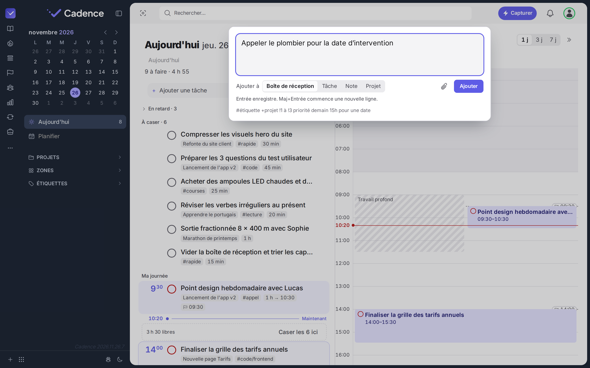
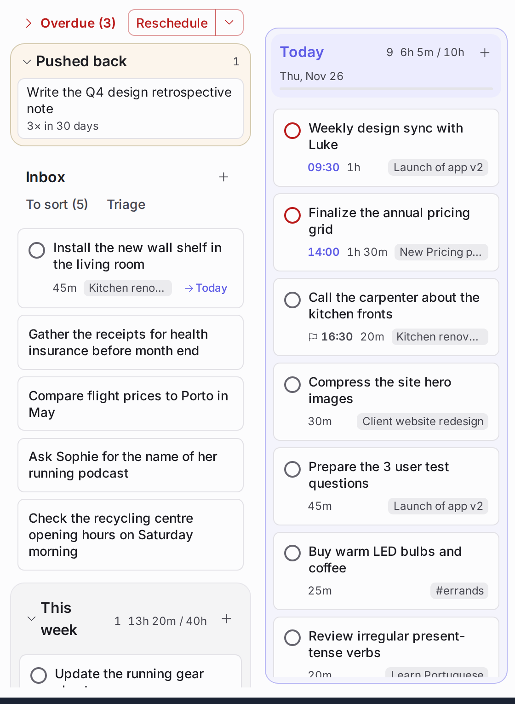

# Inbox and Capture

Capture is for getting an idea out of your head in a second, without choosing a project, a date or a type; the inbox keeps it until you sort it. This page describes the inbox, quick entry and its syntax, capturing a web address, sharing from Android, widgets and the Linux client's keyboard shortcut.

## Capture first, file later

Three principles guide everything:

1. **Capture without friction.** Type, confirm, move on. The inbox asks for no status, no priority, no date.
2. **One place for everything.** Tasks, notes, bookmarks and thoughts go through here first.
3. **Sort later.** You decide, idea by idea, whether it becomes a task, a note, a project, or disappears.

There are **three kinds of things** to keep in mind:

| Term | Meaning |
|---|---|
| **Idea** (inbox item) | Plain text, not yet decided |
| **Task to sort** | A task already created but with no moment (see below) |
| **Task** | Something to do, dated or not |

## Where the inbox is

On the web, **there is no longer an Inbox page** since 13 November 2026: the inbox is the **left column of Plan** (`g` then `u`). This column first lists the **tasks to sort**, then the open ideas. The `/inbox` address redirects to Plan. A system share opens the Add box prefilled. The column checks for new items **every 15 seconds** (a message flags those coming from Telegram).

- The column header carries **"To sort (N)"** and, while ideas are waiting, **"Triage"**, sorting one idea at a time (see below).
- A click on an idea opens **its decision panel in place**.
- Ideas and tasks can be **dragged onto a day or a horizon** to plan them; a dragged idea first becomes a task.
- The column can be resized (from 220 to 560 px; double-click to return to 260 px) and collapsed.
- "Inbox is empty." is shown when there is nothing.

On **Android**, there is no Inbox tab either: it is the top section of **Planifier** (Plan; the list selector in the Tasks title).

## Quick entry

### Open it

| Where | How |
|---|---|
| Web, anywhere | The **`c`** key, the **"Capture"** button (lightning bolt) of the top bar, or the `Ctrl+K` palette › "Quick capture". On a large screen, the blue **Add** button of the bar opens the same panel as a bubble; on tablet and phone, the round **+** button at the bottom of the screen opens a sheet (it is hidden while editing a task or a note) |
| Shortcuts `Alt+Shift+I` / `T` / `P` / `N` / `A` / `G` | Create an inbox item, a task, a project, a note, an area or a tag (adjustable in Profile › Interface › Shortcuts) |
| Android | The **+** button on screen (« Inbox · Tâche · Note » sheet, that is Inbox · Task · Note); the widget; the icon shortcut; the quick settings tile |
| Linux | `Ctrl+Alt+Space` (see below) |
| Firefox | The extension button (see below) |

The box always opens on **Inbox**, except `Alt+Shift+T` and the sidebar's "New › Task", which open it on **Task**.

### Choose what it becomes

An **"Add to"** row decides what the text becomes: **Inbox**, **Task**, **Note** or **Project**. Nothing is guessed: what is selected is what is created.

| Add to | First line | Other lines | Also read in the first line |
|---|---|---|---|
| Inbox | Kept as is | Kept as is | Applied later, on conversion |
| Task | Title | Notes | Due date, recurrence, `@person`, `~Area`, `#tags`, `+Project` |
| Note | Title | Content | `#tags`, `+Project` (a note has no date, date words stay in the title) |
| Project | Name | Description | Due date, `#tags`, `~Area` |

Dates, `@person` and `~area` are read **only in the first line**: a date quoted further down in a long note never becomes its due date. `#tags` are read everywhere. An unknown `#tag`, `+Project` or `~Area` is **created** on adding.

### The syntax

Each item below is removed from the title and set on the task (or on whatever the text becomes).

| You write | Effect |
|---|---|
| `#home` | Tag (one word without spaces; letters, digits, hyphens, underscores); `#personal/sport` for a nested tag |
| `+Projet` or `+"Mon projet"` | Project; `^Liste` is an alias of `+` |
| `~Zone` or `~"Ma zone"` | Area (only a name that starts with a letter: "marcher ~5 km" stays as is) |
| `@Camille` or `@"Camille Martin"` | Assignable person (emails and handles that match nobody stay in the text) |
| `!1`, `!2`, `!3` | High, medium, low priority (only these three tokens, preceded by a space or the start, count: `!4` and `bravo!1` are words) |
| `tomorrow 3pm`, `day after tomorrow`, `monday`, `next fri`, `Oct 12` | Due date (French works too: `demain 15h`, `lundi`, `dans 3 jours`) |
| `every monday at 9am`, `every tuesday`, `every 2 weeks`, `every weekday` | Recurrence (French works too: `tous les lundis à 9h`) |
| `1h`, `1h30`, `30 min`, `for 45 min` | Duration (estimate, from 5 minutes to 12 hours) |

Details that avoid surprises:

- **Dates** are computed in your timezone. For an idea left in the inbox, relative dates count **from the day of capture**: "tomorrow" written on a Monday gives Tuesday, even converted on Wednesday. Only one date is used; with several, the last wins. Date words (and those that introduce them: "before", "until", "by", "due") are removed from the name; an English sentence with a time (`3pm`) stays in the name. Ordinary words such as "May", "March" or a lone number are ignored. Nothing is read inside a `#tag`, a `+project` or an address.
- **Times** ("tomorrow 3pm", "tomorrow at 9am", or French "demain 15h") set the due time and the whole phrase leaves the name. A lone "3pm", without a day, is not a date.
- **Duration**: an "at 9am" (or French "à 9h") with a marker is a time, never a duration; a bare "9h30" is read as a duration of 9 h 30; "every 30 min" is not a duration.
- **Recurrence with a time**: "Standup every monday at 9am" creates the task with 9 am as the time of each occurrence.
- **A project**: the name is compared ignoring case and accents, and a **unique** beginning is enough (`^mais` finds `Maison`); if several projects start the same way, nothing matches and the name is created as typed. Only the first `+Project` is used.
- A pill under the field shows the recognized date; its ✕ keeps the words as they are in the text. `#tags`, projects and areas chosen from a list do not stay in the text: they appear as **pills under the box**, added on saving, removed by their cross.

### Live suggestions

- As soon as a word starts with `#`, `+`, `~` or `!`, **a list opens immediately**: tags (most used first, with their path for nested ones), projects (paused or closed ones are left out), areas, or the three priorities (`!1` High, `!2` Medium, `!3` Low).
- Typing narrows by prefix, by path segment and ignoring accents, and ends with "Create #name" for a new tag.
- The **`/` menu** (at the start of a word, not in an address nor in "and/or") lists the tokens: Tag, Project, Person, Area, Due date, Repeat. Choose with the mouse, with Up/Down then Enter, or with Tab; a list of values opens (your tags, projects, assignable people, areas, ready-to-use dates and repetitions). Enter inserts the token, putting names with spaces in quotes. Esc closes the menu and keeps the text. The menu follows what you are adding: "Task" shows everything, "Note" only Tag and Project, "Project" Tag, Area and Due date.
- A recognized date phrase ("tomorrow 3pm") is highlighted in the field.
- Android offers the same live suggestions, as well as `~domaine` for an existing area (otherwise the word stays in the title).

### Several lines, several tasks

By default everything you type becomes **a single item**. When the text has several lines, the box announces it in one sentence ("This will be 1 task. The first line is the title and the other 2 lines are its notes.") with a **"Make N … instead"** link that switches to **one item per line**: one task per non-empty line, without list markers (`-`, `*`, `1.`). If a line fails, the unsaved lines stay in the box.

### Add several tasks in a row

After a task is saved, the box stays **open and empty**. The task's project (chosen by `+Project`, a pill, or the project page you came from) stays as a removable pill for the next one, with an "Added to *Project*: 3" counter and **"Undo"** for the last one. Tags, priority and date are not carried over. The series stops when you reopen the box, when you remove the pill, or after two minutes without typing or saving anything.

### Files

Paste, drop or choose files with the paperclip: they are saved with whatever the text becomes. An idea, a task or a project keeps them as attachments; a note receives them **in its text** (images are displayed, other files become links). A pasted screenshot alone is enough: its name becomes the title, renamed "Pasted image *date time*". When a copy carries text **and** an image (spreadsheet cells), only the text is pasted. Each file must stay under the server's limit, twenty at most per item. If a file fails, the item is saved anyway and the names of the failed files are shown. An idea's files move to the task, project or note it produces; deleting an idea deletes its files.

### The Enter key

On a computer keyboard, Enter saves and Shift+Enter inserts a line break. On a touch device, Return inserts a line break and the Add button saves (with a "Line break" button if Return is set to save). Ctrl or Cmd + Enter always saves. These two choices and "One item per line" are set in Profile › Interface › Shortcuts › "Adding items", and stay on the device.

### Confirmation and undo

There is **no toast**: a discreet line under the box says what was saved ("Saved "Appeler Sam" to Inbox.") with an **"Undo"** link, which deletes what was just created; it stays until the next keystroke. Closing the bubble or the sheet keeps a half-typed text. On failure, "Could not save. Your text is still here."

## A web address becomes a task

When the text is **only an address** (with at most `#tags`, a `+Project` or a `~Area`, on one line, with no file), the box becomes the same quick sheet as the Android share: the page preview under the text, and **"Add to"** offers **Inbox · Task · Note** (no Project). **Inbox** remains the default choice. As soon as you write words with the address, the four usual choices come back.

Choosing **Task** creates a task **named after the kind of page**, from its title:

| Kind of page | Task name |
|---|---|
| Repository or tool | "Essayer : *title*" (Try: *title*) |
| Article | "Lire : *title*" (Read: *title*) |
| Video | "Regarder : *title*" (Watch: *title*) |
| Any other page | The title alone |

The title is read from the preview or for 3 seconds at most; without a title, it is the repository (`owner/repository`), otherwise the site, otherwise the address. The **address is in the task's note**, which keeps its "Link" origin badge; with no project or due date chosen, it waits in **"Tasks to sort"** with **"When?"**. The words of your verbs follow your language.

**"Already in …"** appears above the name when the address is already in an open task or in a project's pages, with **Open**; the main button becomes **"Add anyway"**.

An address also allows **"Project…"**: the page is added to the chosen project (see [Projects and Areas](Projects-and-Areas)). There is no library of links to sort or tag: a link lives in a task, or in a project's pages; the rest is a note. Sites are read by the server, never by your browser, and no AI touches links.

A task that carries an address shows the site's icon and name on its row, and the page's image; a click on the site opens it in a new tab. Previews (image, title, site, stars and language of a GitHub repository) are also shown under any address written in a task note, a note or a project description.

## Deciding about an idea

A click on an idea in the column opens a **decision panel**: the text (editable), the chips of the removed words (date, tags, project, person, area), then **"Save as"** with **Task**, **Note**, **Project** and **Inbox** (keep), and **Delete**.

- **Task**: creates the task with the cleaned name, the tags and project read, the due date and the recurrence; the idea is marked processed and leaves the inbox. Its origin (Telegram, Desktop, MCP…) passes to the task.
- **Note**: creates the note with the text; for an address, the page title is read (3 seconds at most, otherwise the address serves as the title) and the `bookmark` tag is added.
- **Project**: creates a "Planned" project with the cleaned name and the tags.
- **An address**: **Task** (see above) or **Project…** to make it a page of a project.
- The removed words are kept: they count on saving and are **put back at the end of the first line** if you save the edited text. Saving without changing anything changes nothing.
- **Delete** removes the idea **for good** (with its files), after confirmation, or with the Del key; there is no undo.
- A converted idea becomes "processed": the gesture is one-way and serves as a trace, the idea does not come back.

### "Triage": one idea at a time

"Triage" (or `/inbox?triage=1`, or "Triage the inbox" in the palette) shows one idea at a time. Suggestions are **rules**, without AI: a `+project` suggests a task; a tag like `idée`, `recette` or `lire` a note; `#projet` a project; a lone address, a long or multiline text, or a first word like "idée" or "lire", a note; action verbs ("acheter", "appeler", "buy", "call")… a task; everything else a task.

| Key | Action |
|---|---|
| `t` | Make a task |
| `p` | Make a project |
| `n` | Make a note |
| `s` | Later: keep in the inbox and move to the next (until the end of the session) |
| Del | Delete |
| Enter | Accept the suggestion |
| Esc | Exit |

Under "Inbox triage", the `?` help also lists an `l` key, inherited from the old link library.

## "Tasks to sort" and "When?"

The left column also lists the tasks **to sort**: open tasks, with no due date, non-recurring and not "Later", that are filed nowhere (no project or area) **or** that automatic filing has filed without giving them a moment. Each has a **"When?"** row:

| Button | Effect |
|---|---|
| **This week** | The task is committed to the week |
| **A date** | Opens the date picker |
| **Later** | The task goes to "Later" (`someday`) |
| **No date** | It stays where it is filed, without a date: the question stops |

Any decided moment, whatever the path (a due date, a week, a plan on today or later, closing the task), takes the task out of the list. A plan from yesterday does not count: a task planned yesterday and not done comes back. The first five are shown, then "Show all". The same list exists on Android. Automatic filing is described in [AI and Proposals](AI-and-Proposals).

## Capture from Android

### The + button

The **+** on screen opens a sheet with the destination **Inbox · Tâche · Note** (Inbox · Task · Note), Inbox by default from the Inbox section of Planifier (Plan), Task by default from Tâches (Tasks). In Inbox and Note, the text is kept as is (no date or tag recognized); in Task, the date, time, `#tag`, `+project`, `~domaine` (area), `@person` and `!priority` are recognized, with live suggestions and pills. A lone address offers Inbox, Task and Note as on the web. « Plus d'options » (More options) opens the date and other fields; the keyboard's ✓ key adds.

### Sharing to Cadence

In any app, **Share › Cadence** (name: « Cadence – Inbox ») opens a small window **« Ajouter à Cadence »** (Add to Cadence):

- **Inbox · Tâche · Projet… · Note**: a touch decides. The share's **subject** serves as the text when it is the only thing.
- **Task**: the name is editable above (« Nom de la tâche », Task name), and a **« Échéance »** (Due date) row offers Today, Tomorrow, This weekend, « Choisir… » (Choose…); the chosen date is removed with a touch. It only applies to "Task"; with a date, the task no longer goes to "Tasks to sort"; without an address, "Task" becomes the main button.
- **Projet…** (Project…) adds the address as a page of the chosen project (« Page ajoutée au projet », Page added to the project), offline too.
- **« Déjà dans "X" »** (Already in "X"; +N) with **Ouvrir** (Open) and **Ajouter quand même** (Add anyway) when the address already exists.
- For **Inbox**, the window closes right away (under a second, with no network call at all); the write continues in the background then a toast confirms (« Ajouté à l'Inbox », Added to Inbox) or reports the failure (« Impossible d'ajouter à l'Inbox », Could not add to Inbox).
- The **« Cadence »** entry in the **text selection** menu (`PROCESS_TEXT`) files the selected text in the Inbox the same way.

### Without opening the app

| Surface | What it does |
|---|---|
| Icon shortcut **« Nouvelle tâche »** (New task) | Opens quick add (the same entry as the app) |
| Icon shortcut **« Inbox »** | Opens quick add, with no due date, which writes to the Inbox |
| Quick settings tile **« Capturer »** (Capture) | Opens quick add |
| Widget **« Cadence – Ajouter »** (Cadence – Add) | "Add a task in one gesture" |
| Widget **« Cadence – Barre de capture »** (Cadence – Capture bar) | « Nouvelle tâche… » (New task…), **Idée** (Idea; to the Inbox) and **Dicter** (Dictate; voice dictation, if a dictation service exists) |
| Widgets **« Cadence – Tâches 2×2 »** (Cadence – Tasks 2×2) and **« Aujourd'hui »** (Today) | The day's tasks, to tick from the home screen |

The quick add window **closes** once the task is added; series entry stays in the app. It no longer sets a "Today" due date by default: the date is typed ("today", "tomorrow"). All these captures are written locally and leave on reconnection.

## Capture from a Linux computer

The Linux client keeps an icon in the system tray and opens a small **always-on-top** field (560 by 76 px) with **`Ctrl+Alt+Space`** (adjustable). Enter saves the capture and closes the field. It goes to the inbox with the "Desktop" origin, and **it waits in a local queue if the server is unreachable**: the client resends it as soon as it can, then every minute. Each capture carries an idempotency key, so a capture received twice by the server is created only once (for 24 hours). Under Wayland, the shortcut goes through the system portal (the desktop asks you to confirm it the first time): another program already holding the combination may force you to choose another in the desktop's shortcut settings; `cadence-desktop --quick`, bound to a desktop shortcut, works everywhere. See [Linux Client and Firefox](Linux-Client-and-Firefox).

## From Firefox and Gmail

The Firefox add-on creates a task for the open page: the toolbar button (or `Alt+Shift+K`) shows the proposed name (editable), an optional due date ("Today" or "Tomorrow"), "Already in …" with "Open" if the page exists, then **"Create the task"**. A right click on a link turns it into a task in one gesture. In Gmail, a **"+ Cadence"** button near the subject of an open message offers a name and a due date; the task keeps the message's address and the Gmail badge. See [Linux Client and Firefox](Linux-Client-and-Firefox).

## From Telegram

Telegram is **off by default**: the administrator must enable `TELEGRAM_ENABLED=true`. Then, Profile › Integrations › Telegram lets you paste the token of a bot created with Telegram's official assistant. Each message sent to the bot creates an idea with the "telegram" origin, visible within about 15 seconds, with an announcement message. The token is encrypted on the server and never sent back to the browser: the screen shows `••••••••` and its last four characters, with a "Clear" button. See also [Notifications and Reminders](Notifications-and-Reminders).

## Special cases

| Situation | What happens |
|---|---|
| Offline on the web | The idea is kept in the local queue ("Saved offline") and leaves on reconnection |
| An idea retried by the network | An idempotency key avoids the duplicate |
| An unknown `#tag` | Created on conversion, without confirmation |
| An unknown project | Created on conversion, with the "Planned" status |
| An address without a readable title | The title is the repository, the site or the address |
| A private address (IP, `.lan`, mail, search…) | Never read for a preview nor turned into a project page |
| A very long capture | The first line is the title, the full text is kept |
| You search in the inbox | There is no search, filter or group: it is made to be emptied, not organized |
| The order | Most recent first, with no other sorting |

## Shortcuts

| Key | Action |
|---|---|
| `c` | Quick capture |
| `n` (on Plan) | Add to the inbox |
| `g` then `u` | Go to Plan |
| `Alt+Shift+I` / `T` | Create an inbox item / a task |
| Enter, Shift+Enter, Ctrl+Enter | Save, new line, save in all cases |
| `Esc` | Cancel |

## Going further

- [Inbox (capture rules)](https://github.com/PreciselyWrong/cadence/blob/main/docs/04-inbox-page.md)
- [Links: addresses, previews and project pages](https://github.com/PreciselyWrong/cadence/blob/main/docs/37-links.md)
- [Automatic filing and "When?"](https://github.com/PreciselyWrong/cadence/blob/main/docs/41-auto-classify.md)
- [Keyboard, palette and inbox triage](https://github.com/PreciselyWrong/cadence/blob/main/docs/35-keyboard-palette.md)
- [Linux client](https://github.com/PreciselyWrong/cadence/blob/main/docs/fork/DESKTOP.md)
- [Android UX notes](https://github.com/PreciselyWrong/cadence/blob/main/docs/fork/ANDROID-UX-NOTES.md)
