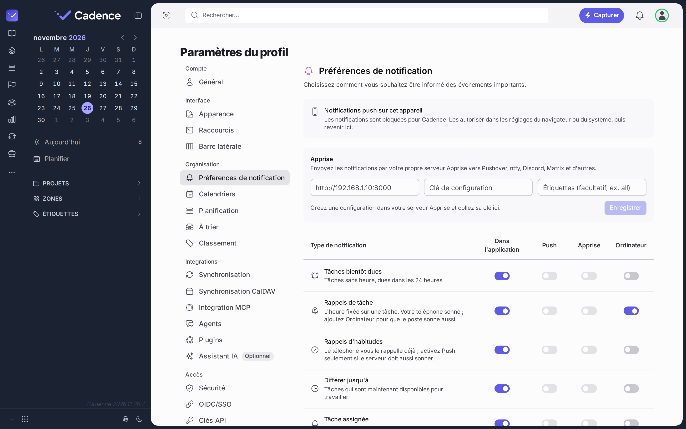

# Integrations: MCP, plugins, webhooks, SSO

Cadence connects to your ecosystem in both directions: **assistants** and scripts read and write in Cadence (API keys, MCP), Cadence **notifies** your tools (webhooks, Apprise, plugins), and **sign-in** can go through your identity provider (OIDC/SSO) with a second factor (2FA). Almost everything is set in the **Profile**, groups "Integrations" and "Access".

| I want to... | Section |
|---|---|
| Let an assistant (Claude, Cursor...) act on my tasks | API keys then MCP server |
| Connect Cadence to claude.ai from the web or the phone | claude.ai connector |
| Plug in an agent that prepares proposals, sorts my mail... | Plugins |
| Send events to n8n, Home Assistant, Slack... | Webhooks |
| Be notified through ntfy, Pushover, Matrix... | Apprise |
| Sign in with Google, Authentik, Keycloak... | OIDC / SSO |
| Protect the account with a code | Two-factor sign-in (2FA) |

## API keys

An API key is a personal token that lets a client talk to Cadence without a password: the Android app, the Linux client, the Firefox add-on, an MCP assistant, a script.

**Create a key**: Profile › **API Keys** › key name (for example "Personal laptop"), optional expiry date, **Generate key**. The token (prefix `tt_`) is shown **only once**: "Copy this token now. It will not be shown again." A **QR code "to connect a device"** lets you pass it to the phone or the Linux client without retyping it.

**The keys table** shows for each one the name, the prefix, the state (Active, Revoked, Expired), the last use and the expiry. **Revoke** cuts the key immediately (the next call gets "401") without deleting it; **Delete** erases it (irreversible).

Special cases:

| Situation | What happens |
|---|---|
| Creating a key when you have not authenticated for 10 minutes | Cadence asks for your password again (or a code, with 2FA) |
| A "Claude MCP (...)" key appears | It is the claude.ai connector's: it opens **only** the MCP server (see below) |
| Keys and 2FA | A key keeps working without a code: the 2FA card lists the active keys so that you can revoke those you do not recognize |
| Lost key | Revoke it, create another: the token is never shown again |

A key opens the **REST API** (documented by Swagger at `/api-docs`, after sign-in) and the MCP server.

## MCP server

The **Model Context Protocol** is the standard language by which AI assistants (Claude Desktop, Claude Code, Cursor, VS Code, Windsurf, Zed...) act on your data. Cadence's MCP server is **on by default**, with no server setting; each user has their own tokens, and each tool only sees **the data of the account** that authenticates.

### What the assistant can do

About 80 tools, grouped:

| Family | Example actions |
|---|---|
| Tasks | list, read, create, edit, complete, delete, skip an occurrence, add a subtask, link two tasks ("blocks"), metrics, turn into a project |
| Comments | list, add |
| Projects, areas, goals, tags | list, read, create, edit, delete |
| Inbox | list, add, read, edit, delete, "process" (convert) |
| Notes, saved views, people | list, read, create, edit, delete |
| Habits | list, read, create, edit, delete, log a success, delete an entry, statistics |
| Links and project pages | read, list a project's pages, add a page, edit, delete |
| Search | a cross-cutting search |

Plus **agent-only** tools that prepare decision cards (never applied without you): `propose_mail`, `resolve_mail`, `list_mail_cards`, `report_mail_event`, `report_mail_action` (see [Mail-Triage](Mail-Triage)), `propose_decisions`, `list_decisions`, `report_decision`, `propose_career`, `propose_weekend` (see [AI-and-Proposals](AI-and-Proposals)).

Examples of requests to a connected assistant: "Show me my tasks for today", "Create a task to reread the MCP integration", "Which projects are in progress?", "Add a reminder to my inbox to check my emails", "Search for tasks related to the documentation".

### Connect an assistant

Two transport modes:

| Mode | For whom | Principle |
|---|---|---|
| **HTTP** (remote) | A Docker or remote server, the most common case | Calls go to `https://cadence.example.com/api/mcp` with the header `Authorization: Bearer <token>`. Clients that do not speak HTTP use the `mcp-remote` bridge |
| **Stdio** (local) | Cadence and the client on the same machine | The client launches the MCP server as a process and passes it the token through the `CADENCE_API_TOKEN` variable |

The **Profile › MCP Integration** page guides you step by step: "1. Generate API Token" (link to API Keys), "2. Configure Your MCP Client" (a configuration to copy, with the location of Claude Desktop's file), "3. Available Operations", "4. Start Using", and troubleshooting. Example configuration for Claude Desktop (HTTP):

```json
{
  "mcpServers": {
    "Cadence": {
      "command": "npx",
      "args": ["-y", "mcp-remote", "https://cadence.example.com/api/mcp",
               "--header", "Authorization:Bearer <token>"]
    }
  }
}
```

Fully restart the client after adding the configuration.

**Troubleshooting**: "Invalid or expired API token" (token expired or revoked: create another); connection refused (server unreachable, firewall, certificate); the tools do not appear (restart the client, check that the server is "Connected", ask "What tools do you have?"); do not use stdio mode in Docker, prefer HTTP; empty results (filters too narrow).

## claude.ai connector

To add Cadence as a **custom connector** of claude.ai (browser, desktop app, phone), you need a **public** address (for example `https://cadence.example.com/mcp`) while the rest of Cadence stays on your private network. Cadence embeds its own OAuth authorization server, surrounded by **five locks** that each hold on their own:

1. **Only the connector's paths are public** (`/mcp` and the OAuth addresses); everything else answers 404 at the tunnel edge.
2. **The machine paths only answer to Anthropic** (Cloudflare firewall rules on the published address range).
3. **The consent page is behind Cloudflare Access** (a code received by e-mail).
4. **A pairing window**: the connector's registration is only accepted within the **10 minutes** after you click "**Authorize a new connector**" (Profile › MCP Integration, "Connect claude.ai"). It only serves one client and closes as soon as you grant it.
5. **Cadence checks everything a second time**: the public `/mcp` endpoint only accepts the MCP-only tokens issued to connectors; consent requires an authorized account, its **password and a two-factor code** (an account without 2FA cannot connect anything); each grant is written to the audit log and sends you a security e-mail.

**Setup, in brief**

1. On the server side, set `CADENCE_PUBLIC_MCP_URL` (the public `https` origin: it **enables** the connector, which is absent without it), `CADENCE_MCP_OAUTH_ALLOWED_EMAILS` (the authorized accounts, otherwise the administrators), leave `CADENCE_MCP_OAUTH_REDIRECT_URIS` empty (claude.ai callbacks by default), `CADENCE_MCP_OAUTH_TOKEN_DAYS` (token lifetime, 30 days by default), `CADENCE_TRUST_PROXY` with the tunnel's address. Keep `CADENCE_SESSION_SECRET` stable: it signs client identifiers.
2. On the Cloudflare side: a tunnel that only forwards the listed paths, the firewall rules, an Access application on `/oauth/authorize` only. The full settings and 17 end-to-end checks are in the technical documentation.
3. In Cadence, turn on 2FA, then Profile › MCP Integration › **Authorize a new connector**.
4. Within 10 minutes, in claude.ai: Customize › Connectors › **Add custom connector**, address `https://cadence.example.com/mcp`, leave the OAuth client ID and secret empty, **Connect**. Cloudflare Access asks for its code, then Cadence's consent page (check that it indicates a client registered "less than a minute ago").

**Good to know**

- The issued token is a key named "Claude MCP (<client>)": visible in Profile › API Keys, it opens **only** `/mcp` (`/api/mcp`), expires after 30 days (a new pairing is then needed), and can be **revoked** at any time. **No refresh token** is issued: no second durable secret to steal.
- Removing then re-adding the connector in claude.ai registers a **new** client: the old "Claude MCP (...)" key stays valid until it expires, revoke it by hand.
- Only approve a consent page right after clicking "Connect" yourself. If it opens from a link you did not start, click **Deny**.
- Claude Code does not use this flow (it sends a local callback, refused by the allow list): for it, keep a `tt_` key on `/api/mcp`.
- Pairings are in memory: a server restart requires clicking "Authorize a new connector" again.
- There is no API key setting or MCP pairing on Android: it is a server installation step.

## Plugins

A **plugin** adds a personal integration (an agent, home automation, a messaging bridge) **without putting it in Cadence**: it lives in its own folder (often its own Git repository), with its version and its update cycle. Cadence loads it, lets you configure, enable or turn it off, and notifies it when things happen (new task, completed task, decision made...). It is also through a plugin that Cadence's "agent" AI functions (proposals, mails, Decide, Discuss...) find their agent: see [AI-and-Proposals](AI-and-Proposals).

### Trust rules (read before installing)

- **Off by default**: nothing loads until `CADENCE_PLUGINS_DIR` points to a folder. **Never in hosted mode** (multi-user service): arbitrary code on a shared server is unacceptable.
- **Only an administrator** sees and changes plugins. A plugin found on disk stays **off** until an administrator enables it.
- Enabling first displays **what the plugin asks for** (its permissions and events) and requires "**Approve and enable**". If an update asks for **more**, the plugin goes back to "Needs approval" until it is enabled again.
- Permissions limit what Cadence gives the plugin; **this is not a sandbox**: a plugin runs in the server's process with its rights. Only install code you have read. Code that must stay isolated should use a webhook and an API key, outside the server.
- Cadence only runs `git` at an administrator's request (**Add**: shallow clone; **Update**: update without merge), **never `npm`**, never on its own. Addresses are `https`, `http` or `ssh`, with no credentials in the address. A fresh clone is always **off**.

### Profile › Plugins (and Android)

Reserved for administrators (web: Profile › Plugins; Android: Réglages › Données › Plugins (Settings › Data › Plugins)). Without `CADENCE_PLUGINS_DIR`, the page says: "Les plugins sont désactivés. Renseignez CADENCE_PLUGINS_DIR avec un dossier qui contient les dossiers de plugins, puis redémarrez le serveur." (Plugins are disabled. Set CADENCE_PLUGINS_DIR to a folder that contains the plugin folders, then restart the server.)

| Action | Effect |
|---|---|
| **Plugin Git address** › **Add** | Downloads code that runs in the server: "Read what it asks for, then turn it on." |
| **Enabled** | Opens the "Approve permissions?" box (Listens to events, Serves its own routes, Notifications...) |
| **Settings** / **Save settings** | The fields declared by the plugin. A saved secret is never read back ("Saved", Clear button) |
| **Reload** / **Reload all** | Re-reads the folder (after replacing the code by hand) |
| **Update** | Git update without merge, then reload |
| **Check for updates** | Reads the version address published by the plugin: "Up to date" or "Update available: x.y.z" |
| **Delete** | Stops the plugin, deletes its folder and settings. Irreversible. |

States: **Off**, **Running**, **Error** (the message is displayed; the server keeps running), **Invalid** (unreadable manifest), **Incompatible** (API version higher than Cadence's), **Needs approval**, **Missing** (folder gone; settings are kept). To roll back: `git checkout <tag>` in the folder, then Reload.

### What a plugin adds to the interface

- **A menu entry** (for example "Agents") that opens its page in Cadence.
- **Action buttons in the header** of some pages: Plan, the overdue strip, Today, Inbox, a project, To sort, the mail deck (« Relever les mails » (Check mail)) and Career (web and Android). A button opens the plugin's page with the screen's context, or, for a **"to launch"** action, runs a job **in the server** and answers with a short message: « C'est lancé. » (It's started.) or "Le plugin n'a pas pu agir." (The plugin could not act.) These launches are **never queued offline**: replayed later, they would start work that nobody asked for at that moment.
- **Notifications** (on the desktop and on the phone, subject to quiet hours) and the **one-line banner** at the top of pages: "Open" marks it read and opens the plugin's page, the cross marks it read. The plugin marks the message read on its side, and the reverse.
- On Android, "Répondre" (Reply) on an agent notification sends a free answer to the plugin.

### Writing a plugin, in brief

```
$CADENCE_PLUGINS_DIR/my-agent/
  cadence-plugin.json     manifest: id, name, version, apiVersion, permissions, events, settings
  index.js                entry point: activate(ctx)
```

`activate(ctx)` has `ctx.on('task.completed', ...)` (events, 10 s per handler), `ctx.router` (routes under `/api/plugins/<id>/x/`), `ctx.settings`, `ctx.storage` (64 KB), `ctx.logger`, `ctx.notify(...)`. Cadence does not install dependencies: bundle them. A plugin that touches your data goes through the API with a key, like any other client. Step-by-step guide: [PLUGIN-GUIDE](https://github.com/PreciselyWrong/cadence/blob/main/docs/fork/PLUGIN-GUIDE.md).

## Webhooks

A **webhook** is an address to which Cadence sends JSON when something happens. Point it at n8n, Home Assistant, a Slack or Discord incoming webhook, or your own server.

**Create**: Profile › **Notifications** › **Webhooks** card › **Add webhook**: a name (for example "n8n"), the address, the wanted events. Up to **10 webhooks** per user. The **signing secret** is shown only once ("New secret" makes another). **Test** sends a test message ("n8n accepted the test message"); **History** lists the last 20 deliveries.

**Events**

| Family | Events |
|---|---|
| Reminders and alerts | `task.reminder`, `task.due_soon`, `task.deferred_ready`, `task.assigned`, `project.due_soon`, `habit.reminder`, `comment.added`, `comment.mention`, `share.invitation` (follow the same settings as the bell: column off, no webhook) |
| Content changes | `task.created`, `task.updated`, `task.completed`, `task.deleted`, `note.created`, `link.created`, wherever they come from (web, API, MCP, inbox) |
| Summary | `daily_summary`, once a day at the time chosen in your time zone |
| Decisions | `mail.decided` (a mail card decided), `decision.made` (a "Decide" card decided), `proposal.requested` and `proposal.decided` (proposals) |

`task.updated` is only sent for changes that matter outside (name, note, status, priority, dates, project, parent, estimate) and lists them in `data.changed`; ticking a habit is not a task change; bulk edits are not sent. `task.overdue` and `project.overdue` are no longer emitted (being overdue is no longer announced).

**Verify a request.** Each delivery carries `X-Tududi-Event`, `X-Tududi-Delivery` (the same on every new attempt), `X-Tududi-Timestamp` and `X-Tududi-Signature` (`sha256=` followed by the HMAC-SHA256 of `<timestamp>.<raw body>` with the secret), as well as `X-Webhook-Timestamp` and `X-Webhook-Signature-V2` for generic receivers. Also check that the timestamp is less than 5 minutes old. The human-readable text is given under `text` and `content`, so a Slack or Discord incoming webhook displays it without an intermediary.

**Delivery and retries**

| Case | Result |
|---|---|
| 2xx response | Delivered |
| Timeout, network error, 5xx, 408, 429 | New attempt after 1, 5, 30 then 120 minutes (5 attempts) |
| Other 4xx | Immediate failure |
| 10 failures in a row | The webhook **turns itself off** and the card says so; turning it back on resets the counter |
| Retention | Deliveries, delivered or failed, are kept 7 days |
| Address on your private network | Refused unless the administrator has set `CALDAV_ALLOW_PRIVATE_HOSTS=true`; link-local addresses and cloud metadata addresses are always refused, even after a redirect |

The address and secret are encrypted at rest (`CADENCE_SESSION_SECRET` must be set before saving); only the host is read back on display.



## Apprise

**Apprise** sends Cadence's notifications through your own apprise-api server, which relays them to Pushover, ntfy, Discord, Matrix, e-mail and dozens of other services, with no separate integration for each.

1. Run apprise-api (for example `docker run -d --name apprise -p 8000:8000 caronc/apprise:latest`).
2. Create a configuration in it that lists your services, and note its **key**.
3. Profile › Notifications › **Apprise**: the Apprise server address (for example `http://apprise.example.com:8000`), the config key, optional tags (sent with each message, to route inside apprise-api), **Save**.
4. Turn on the **Apprise** column of the wanted notification types, then **Test**.

Apprise is a choice **per notification type**, like Telegram and push: it covers tasks and projects due, deferred tasks that became active, habit reminders, comments, mentions and assignments. The daily summary remains reserved for Telegram. Only the host is read back on display, the key is never sent back to the browser. A private network address requires `CALDAV_ALLOW_PRIVATE_HOSTS=true`, as for webhooks.

## OIDC / SSO

**Single sign-on** (OpenID Connect) lets users sign in with an existing provider: Google, Okta, Keycloak, Authentik, PocketID, Azure AD, Kanidm, or any OIDC provider.

**Configuration.** Either through server variables (restart required), or in Profile › **OIDC/SSO** ("Provider configuration" panel visible to administrators; the only way on a hosted instance). What you save in the panel **entirely replaces** the `OIDC_*` variables: it is not a merge.

Variables for a single provider (the values below are examples):

```bash
OIDC_ENABLED=true
OIDC_PROVIDER_NAME=Authentik
OIDC_PROVIDER_SLUG=authentik
OIDC_ISSUER_URL=https://auth.example.com/application/o/cadence/
OIDC_CLIENT_ID=<client id>
OIDC_CLIENT_SECRET=<client secret>
OIDC_SCOPE="openid profile email"
OIDC_AUTO_PROVISION=true
BASE_URL=https://cadence.example.com
```

Several providers: numbered variables `OIDC_PROVIDER_1_*`, `OIDC_PROVIDER_2_*`... with no gap in the numbering. The callback address to declare at the provider is derived from `BASE_URL`. Behind a reverse proxy, `CADENCE_TRUST_PROXY` is **mandatory**, otherwise you lose the session after sign-in (401 errors).

| Setting | Effect |
|---|---|
| `OIDC_AUTO_PROVISION` (default `true`) | An account is created on first sign-in (username taken from the start of the e-mail, no password). At `false`, only already-linked accounts can sign in: useful for invitation-only access |
| `OIDC_ADMIN_EMAIL_DOMAINS` | **New** accounts from these domains become administrators (never any effect on an existing account) |
| `OIDC_TRUST_UNVERIFIED_EMAIL` | Only turn on if your provider never sends `email_verified` and you control who signs up there: without a verified e-mail, Cadence refuses to link or create an account |
| `PASSWORD_AUTH_ENABLED=false` | **SSO-only mode**: password sign-in and sign-up turned off |

**User side**

- **First sign-in**: the provider's button on the sign-in page, consent at the provider, return to Cadence, account created if auto-provisioning is on.
- **Link an existing account**: Profile › **Security** › Connected Accounts › "Link <provider>"; the list shows the linked providers, their e-mails, the link date and last sign-in. **Unlink** is possible except for the **last** method: you must keep a password or at least one SSO identity.
- **Hybrid**: an account with a password can also sign in through SSO; an account created by SSO without a password answers "This account uses single sign-on." to an e-mail and password attempt (resetting the password gives it one).

**Troubleshooting**

| Message or symptom | Cause and remedy |
|---|---|
| Session lost right after sign-in (401) | `CADENCE_TRUST_PROXY` missing behind a proxy |
| "Invalid state parameter" | State expired (more than 10 minutes), already consumed or wrong callback address: start the sign-in again from the sign-in page, and check `BASE_URL` |
| "Sign-in session mismatch" | The browser that finishes the sign-in is not the one that started it (other profile, cookies blocked or stripped by a proxy): start again in a single browser |
| "Callback URL mismatch" | The callback address declared at the provider must be exactly `<BASE_URL>/api/oidc/callback/<slug>` (http or https included) |
| "Your identity provider has not verified this email" | The provider does not send `email_verified`: see `OIDC_TRUST_UNVERIFIED_EMAIL` |
| The provider's button does not appear | `OIDC_ENABLED`, numbering, or the admin panel replaces the variables |
| "Can't unlink last auth method" | Set a password or link another provider first |

Provider secrets entered in the panel are encrypted at rest (with `CADENCE_SESSION_SECRET` or `CADENCE_OIDC_SECRET_ENCRYPTION_KEY`) and only ever show their last four characters.

## Two-factor sign-in (2FA)

A 6-digit code from an authenticator app (TOTP) in addition to the password or SSO. **Optional** for each user, **mandatory** to connect claude.ai (see above).

**Turn on**: Profile › **Security** › **Two-factor sign-in** › **Turn on**: scan the QR code (Google Authenticator, 1Password, Aegis...) or enter the key, enter the 6-digit code, **Confirm**. Cadence then shows **10 recovery codes**, **only once** (copy, download, "I saved them"). Other devices are signed out.

| Rule | Value |
|---|---|
| Code | 6 digits, 30-second step, a margin of one step; a code is never used twice |
| Attempts per sign-in | 5 wrong codes, then the password is asked again |
| Lockout | 10 wrong codes in 15 minutes for a user, all devices combined |
| Half-completed sign-in | Expires after 5 minutes |
| Recovery code | "Use a recovery code"; each one is worth only one use |
| New recovery codes | Made from the same card: the old ones stop working |
| Turn off | Requires a current or recovery code |
| CalDAV with 2FA | The account password no longer works: use an API key as the password |
| Phone and codes lost | An administrator resets 2FA (Admin › Access): the user is signed out everywhere and receives an e-mail |

2FA requires `CADENCE_SESSION_SECRET` to be set on the server (the authenticator secret is encrypted at rest); otherwise the card says so and turning it on is refused. API tokens and connector tokens keep working with 2FA. Every activation, deactivation, reset, recovery code use and every wrong code is logged; most trigger a security e-mail.

## Going further

- [MCP Integration](https://github.com/PreciselyWrong/cadence/blob/main/docs/14-mcp-integration.md) and [claude.ai connector](https://github.com/PreciselyWrong/cadence/blob/main/docs/38-remote-mcp.md) (Cloudflare, 17 end-to-end checks)
- [Plugins](https://github.com/PreciselyWrong/cadence/blob/main/docs/46-plugins.md) and [step-by-step guide](https://github.com/PreciselyWrong/cadence/blob/main/docs/fork/PLUGIN-GUIDE.md)
- [Webhooks](https://github.com/PreciselyWrong/cadence/blob/main/docs/27-webhooks.md), [Apprise](https://github.com/PreciselyWrong/cadence/blob/main/docs/26-apprise.md)
- [OIDC/SSO](https://github.com/PreciselyWrong/cadence/blob/main/docs/10-oidc-sso.md), [Two-factor sign-in](https://github.com/PreciselyWrong/cadence/blob/main/docs/29-two-factor-sign-in.md)
- Related pages: [Self-Hosting](Self-Hosting), [Notifications-and-Reminders](Notifications-and-Reminders), [AI-and-Proposals](AI-and-Proposals)
