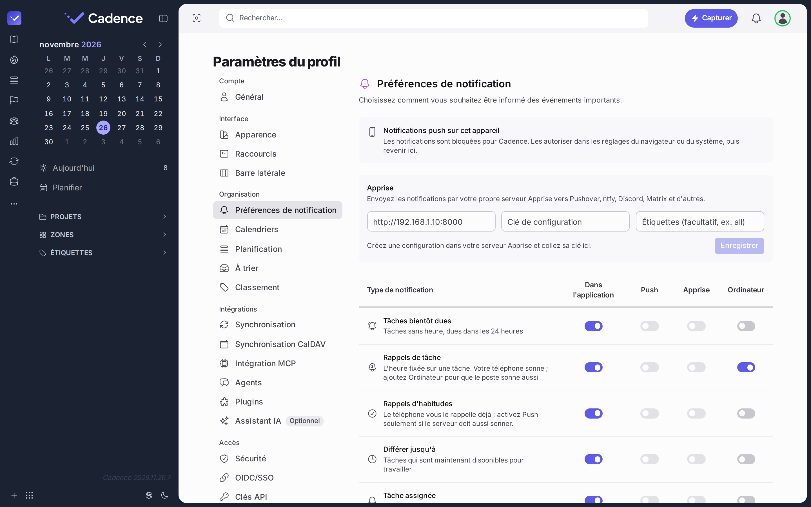

# Intégrations : MCP, plugins, webhooks, SSO

Cadence se branche à votre écosystème dans les deux sens : des **assistants** et des scripts lisent et écrivent dans Cadence (clés d'API, MCP), Cadence **prévient** vos outils (webhooks, Apprise, plugins), et la **connexion** peut passer par votre fournisseur d'identité (OIDC/SSO) avec un second facteur (2FA). Presque tout se règle dans le **Profil**, groupe « Intégrations » et « Accès ».

| Je veux... | Section |
|---|---|
| Qu'un assistant (Claude, Cursor...) agisse sur mes tâches | Clés d'API puis Serveur MCP |
| Connecter Cadence à claude.ai depuis le web ou le téléphone | Connecteur claude.ai |
| Brancher un agent qui prépare des propositions, trie mes mails... | Plugins |
| Envoyer des événements à n8n, Home Assistant, Slack... | Webhooks |
| Être notifié par ntfy, Pushover, Matrix... | Apprise |
| Me connecter avec Google, Authentik, Keycloak... | OIDC / SSO |
| Protéger le compte par un code | Double authentification (2FA) |

## Clés d'API

Une clé d'API est un jeton personnel qui permet à un client de parler à Cadence sans mot de passe : l'application Android, le client Linux, l'add-on Firefox, un assistant MCP, un script.

**Créer une clé** : Profil › **Clés API** › nom de la clé (par exemple « Ordinateur personnel »), date d'expiration facultative, **Générer une clé**. Le jeton (préfixe `tt_`) s'affiche **une seule fois** : « Copiez ce jeton maintenant. Il ne sera plus affiché. » Un **code QR** « pour connecter un appareil » permet de la passer au téléphone ou au client Linux sans la retaper.

**Le tableau des clés** montre pour chacune le nom, le préfixe, l'état (Actif, Révoquée, Expirée), la dernière utilisation et l'expiration. **Révoquer** coupe la clé immédiatement (le prochain appel reçoit « 401 ») sans la supprimer ; **Supprimer** l'efface (irréversible).

Cas particuliers :

| Situation | Ce qui se passe |
|---|---|
| Créer une clé alors que vous ne vous êtes pas authentifié depuis 10 minutes | Cadence redemande votre mot de passe (ou un code, avec la 2FA) |
| Une clé « Claude MCP (...) » apparaît | C'est celle du connecteur claude.ai : elle n'ouvre **que** le serveur MCP (voir plus bas) |
| Clé et 2FA | Une clé continue de fonctionner sans code : la carte 2FA liste les clés actives pour que vous révoquiez celles que vous ne reconnaissez pas |
| Clé perdue | Révoquez-la, créez-en une autre : le jeton ne se relit jamais |

Une clé ouvre l'**API REST** (documentée par Swagger sur `/api-docs`, après connexion) et le serveur MCP.

## Serveur MCP

Le **Model Context Protocol** est le langage standard par lequel les assistants d'IA (Claude Desktop, Claude Code, Cursor, VS Code, Windsurf, Zed...) agissent sur vos données. Le serveur MCP de Cadence est **activé par défaut**, sans réglage serveur ; chaque utilisateur a ses propres jetons, et chaque outil ne voit que **les données du compte** qui s'authentifie.

### Ce que l'assistant peut faire

Environ 80 outils, regroupés :

| Famille | Exemples d'actions |
|---|---|
| Tâches | lister, lire, créer, modifier, terminer, supprimer, sauter une occurrence, ajouter une sous-tâche, lier deux tâches (« bloque »), métriques, transformer en projet |
| Commentaires | lister, ajouter |
| Projets, zones, objectifs, tags | lister, lire, créer, modifier, supprimer |
| Boîte de réception | lister, ajouter, lire, modifier, supprimer, « traiter » (convertir) |
| Notes, vues enregistrées, personnes | lister, lire, créer, modifier, supprimer |
| Habitudes | lister, lire, créer, modifier, supprimer, noter une réussite, supprimer une saisie, statistiques |
| Liens et pages de projet | lire, lister les pages d'un projet, ajouter une page, modifier, supprimer |
| Recherche | une recherche transversale |

Plus des outils **réservés aux agents** qui préparent des cartes de décision (jamais appliquées sans vous) : `propose_mail`, `resolve_mail`, `list_mail_cards`, `report_mail_event`, `report_mail_action` (voir [Tri-des-mails](Tri-des-mails)), `propose_decisions`, `list_decisions`, `report_decision`, `propose_career`, `propose_weekend` (voir [IA-et-propositions](IA-et-propositions)).

Exemples de demandes à un assistant branché : « Montre-moi mes tâches du jour », « Crée une tâche pour relire l'intégration MCP », « Quels projets sont en cours ? », « Ajoute un rappel dans ma boîte de réception pour vérifier mes e-mails », « Cherche les tâches liées à la documentation ».

### Brancher un assistant

Deux modes de transport :

| Mode | Pour qui | Principe |
|---|---|---|
| **HTTP** (distant) | Un serveur Docker ou distant, le cas le plus courant | Les appels vont à `https://cadence.example.com/api/mcp` avec l'en-tête `Authorization: Bearer <jeton>`. Les clients qui ne parlent pas HTTP se servent du pont `mcp-remote` |
| **Stdio** (local) | Cadence et le client sur la même machine | Le client lance le serveur MCP comme un processus et lui transmet le jeton par la variable `CADENCE_API_TOKEN` |

La page **Profil › Intégration MCP** guide pas à pas : « 1. Générer un jeton API » (lien vers Clés API), « 2. Configurer votre client MCP » (une configuration à copier, avec l'emplacement du fichier de Claude Desktop), « 3. Opérations disponibles », « 4. Commencer », et un dépannage. Exemple de configuration pour Claude Desktop (HTTP) :

```json
{
  "mcpServers": {
    "Cadence": {
      "command": "npx",
      "args": ["-y", "mcp-remote", "https://cadence.example.com/api/mcp",
               "--header", "Authorization:Bearer <jeton>"]
    }
  }
}
```

Redémarrez complètement le client après avoir ajouté la configuration.

**Dépannage** : « Invalid or expired API token » (jeton expiré ou révoqué : en créer un autre) ; connexion refusée (serveur injoignable, pare-feu, certificat) ; les outils n'apparaissent pas (redémarrer le client, vérifier que le serveur est « Connecté », demander « Quels outils as-tu ? ») ; ne pas utiliser le mode stdio dans Docker, préférer HTTP ; résultats vides (filtres trop étroits).

## Connecteur claude.ai

Pour ajouter Cadence comme **connecteur personnalisé** de claude.ai (navigateur, application de bureau, téléphone), il faut une adresse **publique** (par exemple `https://cadence.example.com/mcp`) tandis que le reste de Cadence reste sur votre réseau privé. Cadence embarque son propre serveur d'autorisation OAuth, entouré de **cinq verrous** qui tiennent chacun seul :

1. **Seuls les chemins du connecteur sont publics** (`/mcp` et les adresses OAuth) ; tout le reste répond 404 au bord du tunnel.
2. **Les chemins machine ne répondent qu'à Anthropic** (règles de pare-feu Cloudflare sur la plage d'adresses publiée).
3. **La page de consentement est derrière Cloudflare Access** (un code reçu par e-mail).
4. **Une fenêtre d'appairage** : l'enregistrement du connecteur n'est accepté que dans les **10 minutes** qui suivent votre clic sur « **Autoriser un nouveau connecteur** » (Profil › Intégration MCP, « Connecter claude.ai »). Elle ne sert qu'à un client et se ferme dès que vous l'accordez.
5. **Cadence vérifie tout une seconde fois** : le point `/mcp` public n'accepte que les jetons MCP-seulement émis aux connecteurs ; le consentement exige un compte autorisé, son **mot de passe et un code à deux facteurs** (un compte sans 2FA ne peut rien connecter) ; chaque octroi est écrit dans le journal d'audit et vous envoie un e-mail de sécurité.

**Mise en place, en bref**

1. Côté serveur, définir `CADENCE_PUBLIC_MCP_URL` (l'origine `https` publique : elle **active** le connecteur, absent sans elle), `CADENCE_MCP_OAUTH_ALLOWED_EMAILS` (les comptes autorisés, sinon les administrateurs), laisser `CADENCE_MCP_OAUTH_REDIRECT_URIS` vide (rappels claude.ai par défaut), `CADENCE_MCP_OAUTH_TOKEN_DAYS` (durée du jeton, 30 jours par défaut), `CADENCE_TRUST_PROXY` avec l'adresse du tunnel. Garder `CADENCE_SESSION_SECRET` stable : il signe les identifiants de client.
2. Côté Cloudflare : un tunnel qui ne transmet que les chemins listés, les règles de pare-feu, une application Access sur `/oauth/authorize` seulement. Les réglages complets et 17 contrôles de bout en bout sont dans la doc technique.
3. Dans Cadence, activer la 2FA, puis Profil › Intégration MCP › **Autoriser un nouveau connecteur**.
4. Dans les 10 minutes, dans claude.ai : Personnaliser › Connecteurs › **Ajouter un connecteur personnalisé**, adresse `https://cadence.example.com/mcp`, laissez l'identifiant et le secret OAuth vides, **Se connecter**. Cloudflare Access demande son code, puis la page de consentement de Cadence (vérifiez qu'elle indique un client enregistré « il y a moins d'une minute »).

**À savoir**

- Le jeton émis est une clé nommée « Claude MCP (<client>) » : visible dans Profil › Clés API, il n'ouvre **que** `/mcp` (`/api/mcp`), expire au bout de 30 jours (il faut alors un nouvel appairage), et se **révoque** à tout moment. **Aucun jeton de rafraîchissement** n'est émis : pas de second secret durable à voler.
- Retirer puis rajouter le connecteur dans claude.ai enregistre un **nouveau** client : l'ancienne clé « Claude MCP (...) » reste valable jusqu'à son expiration, révoquez-la à la main.
- N'approuvez une page de consentement que juste après avoir cliqué vous-même sur « Se connecter ». Si elle s'ouvre depuis un lien que vous n'avez pas lancé, cliquez **Refuser**.
- Claude Code n'utilise pas ce flux (il envoie un rappel local, refusé par la liste blanche) : pour lui, gardez une clé `tt_` sur `/api/mcp`.
- Les appairages sont en mémoire : un redémarrage du serveur impose de recliquer sur « Autoriser un nouveau connecteur ».
- Il n'y a ni réglage de clé d'API ni appairage MCP sur Android : c'est une étape d'installation du serveur.

## Plugins

Un **plugin** ajoute une intégration personnelle (un agent, la domotique, un pont de messagerie) **sans la mettre dans Cadence** : il vit dans son propre dossier (souvent son propre dépôt Git), avec sa version et son cycle de mise à jour. Cadence le charge, vous laisse le configurer, l'activer ou l'éteindre, et le prévient quand des choses arrivent (nouvelle tâche, tâche terminée, décision prise...). C'est aussi par un plugin que les fonctions d'IA « agent » de Cadence (propositions, mails, Décider, Discuter...) trouvent leur agent : voir [IA-et-propositions](IA-et-propositions).

### Règles de confiance (à lire avant d'installer)

- **Désactivé par défaut** : rien ne se charge tant que `CADENCE_PLUGINS_DIR` ne pointe pas vers un dossier. **Jamais en mode hébergé** (service multi-utilisateurs) : du code arbitraire sur un serveur partagé est inacceptable.
- **Seul un administrateur** voit et change les plugins. Un plugin trouvé sur le disque reste **éteint** tant qu'un administrateur ne l'active pas.
- L'activation affiche d'abord **ce que le plugin demande** (ses permissions et événements) et exige « **Approuver et activer** ». Si une mise à jour demande **plus**, le plugin repasse « Approbation requise » jusqu'à une nouvelle activation.
- Les permissions limitent ce que Cadence donne au plugin ; **ce n'est pas un bac à sable** : un plugin tourne dans le processus du serveur avec ses droits. N'installez que du code que vous avez lu. Un code qui doit rester isolé doit utiliser un webhook et une clé d'API, hors du serveur.
- Cadence ne lance `git` que sur demande d'un administrateur (**Ajouter** : clone superficiel ; **Mettre à jour** : mise à jour sans fusion), **jamais `npm`**, jamais seul. Les adresses sont `https`, `http` ou `ssh`, sans identifiants dans l'adresse. Un clone neuf est toujours **éteint**.

### Profil › Plugins (et Android)

Réservé aux administrateurs (web : Profil › Plugins ; Android : Réglages › Données › Plugins). Sans `CADENCE_PLUGINS_DIR`, la page dit : « Les plugins sont désactivés. Renseignez CADENCE_PLUGINS_DIR avec un dossier qui contient les dossiers de plugins, puis redémarrez le serveur. »

| Action | Effet |
|---|---|
| **Adresse Git du plugin** › **Ajouter** | Télécharge du code qui s'exécute dans le serveur : « Lisez ce qu'il demande avant de l'activer. » |
| **Activé** | Ouvre la boîte « Approuver les permissions ? » (Écoute les événements, Expose ses propres routes, Notifications...) |
| **Réglages** / **Enregistrer les réglages** | Les champs déclarés par le plugin. Un secret enregistré ne se relit jamais (« Enregistré », bouton Effacer) |
| **Recharger** / **Tout recharger** | Relit le dossier (après avoir remplacé le code à la main) |
| **Mettre à jour** | Mise à jour Git sans fusion, puis rechargement |
| **Vérifier les mises à jour** | Lit l'adresse de version publiée par le plugin : « À jour » ou « Mise à jour disponible : x.y.z » |
| **Supprimer** | Arrête le plugin, supprime son dossier et ses réglages. Irréversible. |

États : **Désactivé**, **Actif**, **Erreur** (le message s'affiche ; le serveur continue de tourner), **Invalide** (manifeste illisible), **Incompatible** (version d'API supérieure à celle de Cadence), **Approbation requise**, **Introuvable** (dossier disparu ; les réglages sont gardés). Pour revenir en arrière : `git checkout <étiquette>` dans le dossier, puis Recharger.

### Ce qu'un plugin ajoute à l'interface

- **Une entrée de menu** (par exemple « Agents ») qui ouvre sa page dans Cadence.
- **Des boutons d'action en en-tête** de certaines pages : Planifier, la bande des échues, Aujourd'hui, Inbox, un projet, À trier, le deck de mails (« Relever les mails ») et Carrière (web et Android). Un bouton ouvre la page du plugin avec le contexte de l'écran, ou, pour une action **« à lancer »**, exécute un traitement **dans le serveur** et répond par un court message : « C'est lancé. » ou « Le plugin n'a pas pu agir. » Ces lancements ne sont **jamais mis en file hors ligne** : rejoués plus tard, ils lanceraient un travail que personne ne demandait à ce moment-là.
- **Des notifications** (au bureau et sur le téléphone, soumises aux heures calmes) et la **bannière d'une ligne** en haut des pages : « Ouvrir » marque lu et ouvre la page du plugin, la croix marque lu. Le plugin marque le message lu de son côté, et l'inverse.
- Sur Android, « Répondre » sur une notification d'agent envoie une réponse libre au plugin.

### Écrire un plugin, en bref

```
$CADENCE_PLUGINS_DIR/mon-agent/
  cadence-plugin.json     manifeste : id, nom, version, apiVersion, permissions, événements, réglages
  index.js                point d'entrée : activate(ctx)
```

`activate(ctx)` dispose de `ctx.on('task.completed', ...)` (événements, 10 s par gestionnaire), `ctx.router` (routes sous `/api/plugins/<id>/x/`), `ctx.settings`, `ctx.storage` (64 Ko), `ctx.logger`, `ctx.notify(...)`. Cadence n'installe pas de dépendances : empaquetez-les. Un plugin qui touche vos données passe par l'API avec une clé, comme n'importe quel client. Guide pas à pas : [PLUGIN-GUIDE](https://github.com/PreciselyWrong/cadence/blob/main/docs/fork/PLUGIN-GUIDE.md).

## Webhooks

Un **webhook** est une adresse à laquelle Cadence envoie du JSON quand quelque chose arrive. À pointer vers n8n, Home Assistant, un webhook entrant Slack ou Discord, ou votre propre serveur.

**Créer** : Profil › **Préférences de notification** › carte **Webhooks** › **Ajouter un webhook** : un nom (par exemple « n8n »), l'adresse, les événements voulus. Jusqu'à **10 webhooks** par utilisateur. Le **secret de signature** s'affiche une seule fois (« Nouveau secret » en fabrique un autre). **Tester** envoie un message d'essai (« n8n a accepté le message de test ») ; **Historique** liste les 20 derniers envois.

**Événements**

| Famille | Événements |
|---|---|
| Rappels et alertes | `task.reminder`, `task.due_soon`, `task.deferred_ready`, `task.assigned`, `project.due_soon`, `habit.reminder`, `comment.added`, `comment.mention`, `share.invitation` (suivent les mêmes réglages que la cloche : colonne éteinte, pas de webhook) |
| Changements de contenu | `task.created`, `task.updated`, `task.completed`, `task.deleted`, `note.created`, `link.created`, d'où qu'ils viennent (web, API, MCP, boîte de réception) |
| Résumé | `daily_summary`, une fois par jour à l'heure choisie dans votre fuseau |
| Décisions | `mail.decided` (une carte de mail décidée), `decision.made` (une carte de « Décider » décidée), `proposal.requested` et `proposal.decided` (propositions) |

`task.updated` ne part que pour des changements qui comptent à l'extérieur (nom, note, statut, priorité, dates, projet, parent, estimation) et les liste dans `data.changed` ; cocher une habitude n'est pas un changement de tâche ; les modifications en masse ne sont pas envoyées. `task.overdue` et `project.overdue` ne sont plus émis (le retard n'est plus annoncé).

**Vérifier une requête.** Chaque envoi porte `X-Tududi-Event`, `X-Tududi-Delivery` (le même à chaque nouvel essai), `X-Tududi-Timestamp` et `X-Tududi-Signature` (`sha256=` suivi du HMAC-SHA256 de `<horodatage>.<corps brut>` avec le secret), ainsi que `X-Webhook-Timestamp` et `X-Webhook-Signature-V2` pour les récepteurs génériques. Vérifiez aussi que l'horodatage a moins de 5 minutes. Le texte lisible est donné sous `text` et `content`, donc un webhook entrant Slack ou Discord l'affiche sans intermédiaire.

**Livraison et reprises**

| Cas | Résultat |
|---|---|
| Réponse 2xx | Livré |
| Délai dépassé, erreur réseau, 5xx, 408, 429 | Nouvel essai après 1, 5, 30 puis 120 minutes (5 essais) |
| Autre 4xx | Échec immédiat |
| 10 échecs d'affilée | Le webhook **s'éteint** et la carte le dit ; le réactiver remet le compteur à zéro |
| Conservation | Les envois, livrés ou échoués, sont gardés 7 jours |
| Adresse sur votre réseau privé | Refusée sauf si l'administrateur a réglé `CALDAV_ALLOW_PRIVATE_HOSTS=true` ; les adresses de lien local et celles des métadonnées cloud sont toujours refusées, même après redirection |

L'adresse et le secret sont chiffrés au repos (il faut que `CADENCE_SESSION_SECRET` soit défini avant d'enregistrer) ; seul l'hôte est relu à l'affichage.



## Apprise

**Apprise** envoie les notifications de Cadence par votre propre serveur apprise-api, qui les relaie à Pushover, ntfy, Discord, Matrix, e-mail et des dizaines d'autres services, sans intégration à part pour chacun.

1. Lancez apprise-api (par exemple `docker run -d --name apprise -p 8000:8000 caronc/apprise:latest`).
2. Créez-y une configuration qui liste vos services, et notez sa **clé**.
3. Profil › Préférences de notification › **Apprise** : l'adresse du serveur Apprise (par exemple `http://apprise.example.com:8000`), la clé de configuration, des étiquettes facultatives (envoyées avec chaque message, pour router dans apprise-api), **Enregistrer**.
4. Activez la colonne **Apprise** des types de notification voulus, puis **Test**.

Apprise est un choix **par type de notification**, comme Telegram et le push : il couvre les tâches et projets à échéance, les tâches différées devenues actives, les rappels d'habitudes, les commentaires, mentions et assignations. Le résumé quotidien reste réservé à Telegram. Seul l'hôte est relu à l'affichage, la clé n'est jamais renvoyée au navigateur. Une adresse de réseau privé exige `CALDAV_ALLOW_PRIVATE_HOSTS=true`, comme pour les webhooks.

## OIDC / SSO

L'**authentification unique** (OpenID Connect) laisse les utilisateurs se connecter avec un fournisseur existant : Google, Okta, Keycloak, Authentik, PocketID, Azure AD, Kanidm, ou tout fournisseur OIDC.

**Configuration.** Soit par des variables du serveur (redémarrage requis), soit dans Profil › **OIDC/SSO** (panneau « Configuration des fournisseurs » visible des administrateurs ; le seul moyen sur une instance hébergée). Ce que vous enregistrez dans le panneau **remplace entièrement** les variables `OIDC_*` : ce n'est pas une fusion.

Variables d'un fournisseur unique (les valeurs ci-dessous sont des exemples) :

```bash
OIDC_ENABLED=true
OIDC_PROVIDER_NAME=Authentik
OIDC_PROVIDER_SLUG=authentik
OIDC_ISSUER_URL=https://auth.example.com/application/o/cadence/
OIDC_CLIENT_ID=<identifiant client>
OIDC_CLIENT_SECRET=<secret client>
OIDC_SCOPE="openid profile email"
OIDC_AUTO_PROVISION=true
BASE_URL=https://cadence.example.com
```

Plusieurs fournisseurs : des variables numérotées `OIDC_PROVIDER_1_*`, `OIDC_PROVIDER_2_*`... sans trou dans la numérotation. L'adresse de rappel (callback) à déclarer chez le fournisseur se déduit de `BASE_URL`. Derrière un proxy inverse, `CADENCE_TRUST_PROXY` est **obligatoire**, sinon vous perdez la session après la connexion (erreurs 401).

| Réglage | Effet |
|---|---|
| `OIDC_AUTO_PROVISION` (défaut `true`) | Un compte est créé à la première connexion (nom d'utilisateur tiré du début de l'e-mail, sans mot de passe). À `false`, seuls les comptes déjà liés se connectent : utile pour un accès sur invitation |
| `OIDC_ADMIN_EMAIL_DOMAINS` | Les **nouveaux** comptes de ces domaines deviennent administrateurs (jamais d'effet sur un compte existant) |
| `OIDC_TRUST_UNVERIFIED_EMAIL` | À n'activer que si votre fournisseur n'envoie jamais `email_verified` et que vous contrôlez qui s'y inscrit : sans e-mail vérifié, Cadence refuse de lier ou créer un compte |
| `PASSWORD_AUTH_ENABLED=false` | **Mode SSO seulement** : connexion et inscription par mot de passe coupées |

**Côté utilisateur**

- **Première connexion** : le bouton du fournisseur sur la page de connexion, l'accord chez le fournisseur, retour dans Cadence, compte créé si l'auto-provisionnement est actif.
- **Lier un compte existant** : Profil › **Sécurité** › Comptes connectés › « Lier <fournisseur> » ; la liste montre les fournisseurs liés, leurs e-mails, la date de liaison et de dernière connexion. **Délier** est possible sauf pour la **dernière** méthode : il faut garder un mot de passe ou au moins une identité SSO.
- **Hybride** : un compte avec mot de passe peut aussi se connecter par SSO ; un compte créé par SSO sans mot de passe répond « Ce compte utilise l'authentification unique. » à une tentative par e-mail et mot de passe (réinitialiser le mot de passe lui en donne un).

**Dépannage**

| Message ou symptôme | Cause et remède |
|---|---|
| Session perdue juste après la connexion (401) | `CADENCE_TRUST_PROXY` manquant derrière un proxy |
| « Invalid state parameter » | État expiré (plus de 10 minutes), déjà consommé ou adresse de rappel incorrecte : recommencer la connexion depuis la page de connexion, et vérifier `BASE_URL` |
| « Sign-in session mismatch » | Le navigateur qui termine la connexion n'est pas celui qui l'a commencée (autre profil, cookies bloqués ou retirés par un proxy) : recommencer dans un seul navigateur |
| « Callback URL mismatch » | L'adresse de rappel déclarée chez le fournisseur doit être exactement `<BASE_URL>/api/oidc/callback/<slug>` (http ou https compris) |
| « Your identity provider has not verified this email » | Le fournisseur n'envoie pas `email_verified` : voir `OIDC_TRUST_UNVERIFIED_EMAIL` |
| Le bouton du fournisseur n'apparaît pas | `OIDC_ENABLED`, numérotation, ou le panneau d'administration remplace les variables |
| « Can't unlink last auth method » | Définir un mot de passe ou lier un autre fournisseur d'abord |

Les secrets de fournisseur saisis dans le panneau sont chiffrés au repos (avec `CADENCE_SESSION_SECRET` ou `CADENCE_OIDC_SECRET_ENCRYPTION_KEY`) et n'affichent jamais que leurs quatre derniers caractères.

## Double authentification (2FA)

Un code à 6 chiffres d'une application d'authentification (TOTP) en plus du mot de passe ou du SSO. **Facultative** pour chaque utilisateur, **obligatoire** pour connecter claude.ai (voir plus haut).

**Activer** : Profil › **Sécurité** › **Authentification à deux facteurs** › **Activer** : scannez le code QR (Google Authenticator, 1Password, Aegis...) ou saisissez la clé, entrez le code à 6 chiffres, **Confirmer**. Cadence affiche alors **10 codes de récupération**, **une seule fois** (copier, télécharger, « Je les ai enregistrés »). Les autres appareils sont déconnectés.

| Règle | Valeur |
|---|---|
| Code | 6 chiffres, pas de 30 secondes, une marge d'un pas ; un code ne sert jamais deux fois |
| Essais par connexion | 5 codes faux, puis le mot de passe est redemandé |
| Verrouillage | 10 codes faux en 15 minutes pour un utilisateur, tous appareils confondus |
| Connexion à moitié faite | Expire au bout de 5 minutes |
| Code de récupération | « Utiliser un code de récupération » ; chacun ne vaut qu'une fois |
| Nouveaux codes de récupération | Fabriqués depuis la même carte : les anciens cessent de fonctionner |
| Désactiver | Demande un code actuel ou de récupération |
| CalDAV avec 2FA | Le mot de passe du compte ne marche plus : utilisez une clé d'API comme mot de passe |
| Téléphone et codes perdus | Un administrateur réinitialise la 2FA (Admin › Accès) : l'utilisateur est déconnecté partout et reçoit un e-mail |

La 2FA exige `CADENCE_SESSION_SECRET` défini sur le serveur (le secret de l'application d'authentification est chiffré au repos) ; sinon la carte le dit et l'activation est refusée. Les jetons d'API et de connecteur continuent de fonctionner avec la 2FA. Chaque activation, désactivation, réinitialisation, usage d'un code de récupération et chaque code faux est journalisé ; la plupart déclenchent un e-mail de sécurité.

## Pour aller plus loin

- [MCP Integration](https://github.com/PreciselyWrong/cadence/blob/main/docs/14-mcp-integration.md) et [Connecteur claude.ai](https://github.com/PreciselyWrong/cadence/blob/main/docs/38-remote-mcp.md) (Cloudflare, 17 contrôles de bout en bout)
- [Plugins](https://github.com/PreciselyWrong/cadence/blob/main/docs/46-plugins.md) et [guide pas à pas](https://github.com/PreciselyWrong/cadence/blob/main/docs/fork/PLUGIN-GUIDE.md)
- [Webhooks](https://github.com/PreciselyWrong/cadence/blob/main/docs/27-webhooks.md), [Apprise](https://github.com/PreciselyWrong/cadence/blob/main/docs/26-apprise.md)
- [OIDC/SSO](https://github.com/PreciselyWrong/cadence/blob/main/docs/10-oidc-sso.md), [Double authentification](https://github.com/PreciselyWrong/cadence/blob/main/docs/29-two-factor-sign-in.md)
- Pages liées : [Auto-hebergement](Auto-hebergement), [Notifications-et-rappels](Notifications-et-rappels), [IA-et-propositions](IA-et-propositions)
