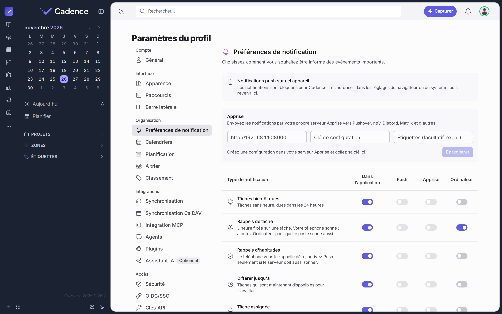

# Notifications and Reminders

Cadence notifies you with a single, calm voice: a task due soon, a reminder you set, a postponed task that becomes active again, a habit to do. It never tells you that something is "overdue". This page describes task reminders (web and Android), the app's notifications and their settings, then Apprise and webhooks.

## What triggers a notification

| Event | When | How many times |
|---|---|---|
| Task at a fixed time | The task's time (minus the chosen lead) is reached | Once per due date, within the 15 minutes after that moment |
| Task without a time, or project, due soon | The due date falls within 24 hours | Once per due date; as long as it is unread, the same notification is updated in place |
| Task reminder | The time of the "Reminder" field is reached | Once per reminder |
| Habit reminder | The reminder time is reached and the habit is still to do | Once per reminder and per day |
| Postponed task becoming active | The "Defer Until" date arrives | Once, if this date passed less than a day ago |
| Task assigned, comment, mention | Someone else acts | Right away |
| Google sync failure | A whole pass fails | A single alert as long as it fails; it disappears as soon as a pass succeeds |

**Lateness is never announced.** Old overdue notifications remain readable, but no new ones are created, and the daily summary says "Still open" with the due date.

## Task reminders

### Set a reminder

- **Web.** In the task panel, "More" reveals a **Reminder** chip (visible directly as soon as a reminder exists); the task's full page has a **Reminder** card. The field offers "Select reminder date and time" and "No reminder" to clear it. Setting a new time re-arms the reminder.
- **Android.** The task panel has the same field; the reminder is set on the phone even without a network.

### Tasks at a fixed time: no reminder needed

A task that has a due **time** rings at that time, without a reminder to set. Setting: Profile › Notifications › **Tasks with a time** › "Ring for tasks with a time" (on by default), with "When": "At the time" (default), 5, 10, 15 or 30 min before. On Android, the same setting is in Réglages › Notifications (Settings › Notifications), and it is shared with the web and the server.

| Case | Result |
|---|---|
| A task has a time **and** an explicit reminder | The explicit reminder takes precedence; it does not ring twice |
| Recurring task at a fixed time | It rings at **each occurrence** of the next 14 days (Android); the reminder follows the due date when the task moves to the next date |
| Task "Later", completed, cancelled, or before its postponement date | Does not ring |
| Task placed at a time in the daily plan (even without a due date) | Rings at that time on the phone, with the same setting and the same lead; a task that has a due date at one time and a slot at another time rings at both; a plan item without a time does not ring |
| Phone off at the time of a fixed-time task's reminder | Rings only within the following 15 minutes |
| Phone off at the time of an explicit reminder | Caught up for 24 hours |
| Moving or removing the slot on the web | The phone's alarm follows at the next sync (every 15 minutes, or when the app opens) |

### On the phone

The phone is **the main voice** of reminders: Android sets the alarm itself and rings every reminder, even if the server is unreachable. Two phones on the same account each ring.

- The notification carries **Terminer** (Complete; for the occurrence concerned only) and two postponements, three actions at most: **À la fin** (At the end; at the due time plus the estimated duration; only for a fixed-time task that has an estimate, absent if less than 5 minutes remain) or, otherwise, **10 min**; then **Demain** (Tomorrow; same time). Each postponement is local to the phone and respects quiet hours.
- Alarms are set again when the app starts, after a sync, every 6 hours, and after a restart, an update, a clock change or a timezone change.
- **Exact time.** Réglages › Notifications › **Heure exacte** (Settings › Notifications › Exact time): allow exact alarms to ring to the minute. Otherwise the alarm rings within a minute, even with the phone asleep. The app does not ask for it at installation.
- If Android blocks Cadence's notifications, the page says so (« Notifications désactivées », Notifications turned off) with an **Ouvrir les réglages d'Android** (Open Android settings) button: nothing will ring until it is restored.

### Calendar events (Android)

Réglages › Notifications › **Événements d'agenda** (Calendar events) › « Rappeler les événements » (Remind about events; on, 10 minutes before by default). Each calendar has its switch in « Par agenda » (Per calendar; also in Réglages › Agendas, **Notifications** chip).

- All-day events do not ring; **Résumé des journées entières à 8 h** (All-day summary at 8 am; off by default) sends a morning notification that lists them.
- A calendar hidden everywhere never rings; an event copied across several calendars rings only once.
- The notification offers **Ouvrir l'agenda** (Open the calendar) and **Fait** (Done; absent if « Cocher un événement » (Tick an event) is off), then **À la fin** and **10 min**.
- The event is read again at the moment of ringing: moved, deleted, hidden or finished, it stays silent.

### Habits

A habit with a reminder time rings at that time, as long as it is still to do (see [Habits](Habits)). On the phone, the notification offers **Dans 30 min** (In 30 min) to postpone it. By default only the phone rings; the server only adds an in-app notification if you kept it.

## Quiet hours

Profile › Notifications › **Quiet hours**: "From" and "To" (the range may cross midnight), in your profile's timezone. During this range, nothing rings: push, Telegram, Apprise and desktop wait for the end, and you find everything in the app. Held reminders arrive together at the end of the range. The phone applies the same hours to all its alarms; it only reads them (Réglages › Notifications › Heures calmes (Quiet hours): « Aucune. Elles se règlent dans votre profil Cadence, sur le web. », None. They are set in your Cadence profile, on the web). Webhooks are not held.

## App settings (Profile › Notifications)

Each notification type has its own switches, one per channel:

| Channel | What it is |
|---|---|
| In-app | The bell's list |
| Push | Browser or PWA notification, even with Cadence closed |
| Telegram | Message from the Telegram bot (to set up in the Telegram tab) |
| Desktop | Native notification of the Linux client (see [Linux Client and Firefox](Linux-Client-and-Firefox)) |
| Apprise | Your Apprise server (see below) |

The types: "Due Tasks", "Due Projects", "Defer Until", "Task Assigned", "Habit reminders", "Comments & Mentions", "Task reminders". The "overdue" rows are hidden. Each column has a **Test** button that sends a test notification on that channel.

Things to know:

- **The in-app row is always the record**: an external channel works even if "In-app" is off (the row is then already marked read, with no dot).
- **Defaults.** Task reminders: the phone rings, and **Desktop is on** so that the computer rings too. "Habit reminders": in-app only; turn on a channel only if the server should ring too. Desktop is on by default for task reminders, upcoming due dates and tasks that became active again, off elsewhere. A choice you have made always wins.
- **Push on this device.** The "Push notifications on this device" card offers **Turn on**; if the browser refuses, it explains how to unblock. On iPhone and iPad, first add Cadence to the home screen (Share, then "Add to Home Screen") and open it from there.
- **Desktop test.** It appears on the computer within a minute if the Cadence app for Linux is open.
- A channel is not repeated for the same notification within 24 hours; Telegram receives upcoming due dates in a single message per pass.

### The bell and the Notifications screen

The web bell and Android's Notifications screen only show what an agent is waiting on you for: proposals, mails to sort and plugin messages (see [AI and Proposals](AI-and-Proposals) and [Mail Triage](Mail-Triage)). Reminders and due dates ring on their channels but are not listed there. Only what is still waiting appears: a notification read elsewhere, or whose work is done, disappears everywhere, and "Mark all as read" empties the list.

### Instant agent notifications (Android)

Réglages › Notifications › **Notifications instantanées des agents** (Instant agent notifications; on by default) keeps the phone connected to the server to show agent messages right away; a permanent notification indicates it and can be hidden. If Android cuts the connection while asleep, messages arrive on wake-up: the **Ne pas optimiser la batterie** (Do not optimize battery) option avoids this.

## Apprise

Apprise sends notifications through **your own server** to ntfy, Pushover, Discord, Matrix and many other services. You need an apprise-api server and a configuration that lists your services.

1. Profile › Notifications › **Apprise** card.
2. Fill in the **Apprise server address**, the **Config key** and, if you want, **Tags** (for example `all`), then **Save** ("Apprise server saved.").
3. Turn on the **Apprise** column of the wanted types and press **Test**.

The card only shows the host name ("Sending through ..."); the key is never read back. **Remove** deletes the server. Addresses on a private network are refused until the server administrator has allowed it (see [Self-Hosting](Self-Hosting)). The daily summary remains reserved for Telegram.

## Webhooks

A webhook is an address to which Cadence sends JSON when something happens: n8n, Home Assistant, an incoming Slack or Discord webhook, or your server. Each account can have **10**, each with its own events.

1. Profile › Notifications › **Webhooks** card › **Add webhook**.
2. A **Name** (for example "n8n"), the **Webhook address**, the events, grouped in "Reminders and alerts", "Task changes" and "Daily summary" (with the sending time).
3. Copy the **signing secret**: it is shown only once; **New secret** creates another.
4. **Test** tells you whether the recipient accepted; **History** lists the last 20 deliveries.

| Case | Result |
|---|---|
| The recipient answers 2xx | Delivered |
| Timeout, network error, 5xx, 408 or 429 | Retry after 1, 5, 30 then 120 minutes (5 attempts in all) |
| Other 4xx error | Fails right away, with no retry |
| 10 deliveries in a row fail | The webhook turns itself off ("Turned off after too many failed deliveries"); check the address then turn it back on |
| "In-app" column off for a type | No webhook for that alert type either |

Delivered or failed deliveries are kept for 7 days. Each request carries an HMAC signature in `X-Tududi-Signature` and the timestamp in `X-Tududi-Timestamp`, to verify on the receiver's side. The address and the secret are encrypted on the server.

## Going further

- [Notifications (doc)](https://github.com/PreciselyWrong/cadence/blob/main/docs/36-notifications.md)
- [Apprise (doc)](https://github.com/PreciselyWrong/cadence/blob/main/docs/26-apprise.md)
- [Webhooks (doc, payload and signature)](https://github.com/PreciselyWrong/cadence/blob/main/docs/27-webhooks.md)
- [Offline and sync (doc)](https://github.com/PreciselyWrong/cadence/blob/main/docs/30-offline-sync.md)
- Related pages: [Tasks](Tasks), [Habits](Habits), [Android](Android), [Offline and Sync](Offline-and-Sync), [Integrations, MCP and Plugins](Integrations-MCP-and-Plugins)
