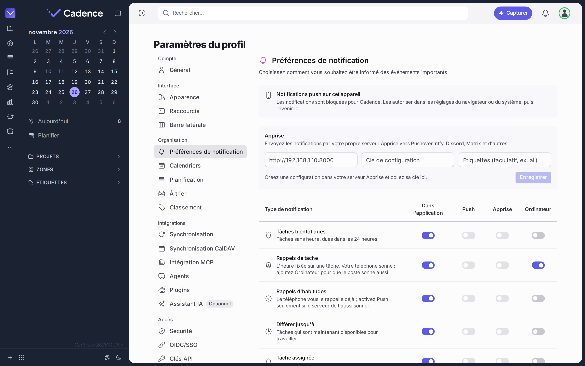

# Notifications et rappels

Cadence vous prévient d'une seule voix, calmement : une tâche bientôt due, un rappel que vous avez réglé, une tâche reportée qui redevient active, une habitude à faire. Il ne vous dit jamais qu'une chose est « en retard ». Cette page décrit les rappels de tâche (web et Android), les notifications de l'application et leurs réglages, puis Apprise et les webhooks.

## Ce qui déclenche une notification

| Événement | Quand | Combien de fois |
|---|---|---|
| Tâche à heure fixe | L'heure de la tâche (moins l'avance choisie) est atteinte | Une fois par échéance, dans les 15 minutes qui suivent ce moment |
| Tâche sans heure, ou projet, bientôt dû | L'échéance tombe dans les 24 heures | Une fois par échéance ; tant qu'elle n'est pas lue, la même notification est mise à jour sur place |
| Rappel de tâche | L'heure du champ « Rappel » est atteinte | Une fois par rappel |
| Rappel d'habitude | L'heure du rappel est atteinte et l'habitude reste à faire | Une fois par rappel et par jour |
| Tâche reportée qui devient active | La date « Différer jusqu'à » arrive | Une fois, si cette date est passée depuis moins d'un jour |
| Tâche assignée, commentaire, mention | Quelqu'un d'autre agit | Tout de suite |
| Échec de la synchronisation Google | Une passe entière échoue | Une seule alerte tant que ça échoue ; elle disparaît dès qu'une passe réussit |

**Le retard n'est jamais annoncé.** Les anciennes notifications de retard restent lisibles, mais aucune nouvelle n'est créée, et le résumé quotidien dit « Encore ouvert » avec la date d'échéance.

## Rappels de tâche

### Poser un rappel

- **Web.** Dans le panneau de la tâche, « Plus » révèle une puce **Rappel** (visible directement dès qu'un rappel existe) ; la page complète de la tâche a une carte **Rappel**. Le champ propose « Choisir la date et l'heure du rappel » et « Aucun rappel » pour l'effacer. Régler une nouvelle heure réarme le rappel.
- **Android.** La fiche de la tâche a le même champ ; le rappel est posé sur le téléphone même sans réseau.

### Tâches à heure fixe : pas besoin de rappel

Une tâche qui a une **heure** d'échéance sonne à cette heure, sans rappel à poser. Réglage : Profil › Notifications › **Tâches à heure fixe** › « Rappeler les tâches à heure fixe » (activé par défaut), avec « Quand » : « À l'heure » (par défaut), 5, 10, 15 ou 30 min avant. Sur Android, le même réglage se trouve dans Réglages › Notifications, et il est partagé avec le web et le serveur.

| Cas | Résultat |
|---|---|
| Une tâche a une heure **et** un rappel explicite | Le rappel explicite passe avant ; elle ne sonne pas deux fois |
| Tâche récurrente à heure fixe | Elle sonne à **chaque occurrence** des 14 prochains jours (Android) ; le rappel suit l'échéance quand la tâche passe à la date suivante |
| Tâche « Plus tard », terminée, annulée, ou avant sa date de report | Ne sonne pas |
| Tâche placée à une heure dans le plan du jour (même sans échéance) | Sonne à cette heure sur le téléphone, avec le même réglage et la même avance ; une tâche qui a une échéance à une heure et un créneau à une autre heure sonne aux deux ; un élément du plan sans heure ne sonne pas |
| Téléphone éteint à l'heure du rappel d'une tâche à heure fixe | Sonne seulement dans les 15 minutes suivantes |
| Téléphone éteint à l'heure d'un rappel explicite | Rattrapé pendant 24 heures |
| Déplacement ou retrait du créneau sur le web | L'alarme du téléphone suit à la synchronisation suivante (toutes les 15 minutes, ou à l'ouverture de l'app) |

### Sur le téléphone

Le téléphone est **la voix principale** des rappels : Android pose lui-même l'alarme et sonne chaque rappel, même si le serveur est injoignable. Deux téléphones sur un même compte sonnent chacun.

- La notification porte **Terminer** (pour l'occurrence concernée seulement) et deux reports, trois actions au plus : **À la fin** (à l'échéance plus la durée estimée ; seulement pour une tâche à heure fixe qui a une estimation, absent s'il reste moins de 5 minutes) ou, sinon, **10 min** ; puis **Demain** (même heure). Chaque report est local au téléphone et respecte les heures calmes.
- Les alarmes sont reposées au démarrage de l'app, après une synchronisation, toutes les 6 heures, et après un redémarrage, une mise à jour, un changement d'heure ou de fuseau.
- **Heure exacte.** Réglages › Notifications › **Heure exacte** : autorisez les alarmes exactes pour sonner à la minute près. Sinon l'alarme sonne à une minute près, même téléphone endormi. L'app ne le demande pas à l'installation.
- Si Android bloque les notifications de Cadence, la page l'indique (« Notifications désactivées ») avec un bouton **Ouvrir les réglages d'Android** : rien ne sonnera tant que ce n'est pas rétabli.

### Événements d'agenda (Android)

Réglages › Notifications › **Événements d'agenda** › « Rappeler les événements » (activé, 10 minutes avant par défaut). Chaque agenda a son interrupteur dans « Par agenda » (aussi dans Réglages › Agendas, puce **Notifications**).

- Les journées entières ne sonnent pas ; **Résumé des journées entières à 8 h** (désactivé par défaut) envoie une notification le matin qui les liste.
- Un agenda masqué partout ne sonne jamais ; un événement copié sur plusieurs agendas ne sonne qu'une fois.
- La notification propose **Ouvrir l'agenda** et **Fait** (absent si « Cocher un événement » est désactivé), puis **À la fin** et **10 min**.
- L'événement est relu au moment de sonner : déplacé, supprimé, masqué ou terminé, il reste silencieux.

### Habitudes

Une habitude avec une heure de rappel sonne à cette heure, tant qu'elle reste à faire (voir [Habitudes](Habitudes)). Sur le téléphone, la notification propose **Dans 30 min** pour la reporter. Par défaut seul le téléphone sonne ; le serveur n'ajoute une notification dans l'application que si vous l'avez gardée.

## Heures calmes

Profil › Notifications › **Heures calmes** : « De » et « À » (la plage peut passer minuit), dans le fuseau horaire de votre profil. Pendant cette plage, rien ne sonne : push, Telegram, Apprise et ordinateur attendent la fin, et vous retrouvez tout dans l'application. Les rappels retenus arrivent ensemble à la fin de la plage. Le téléphone applique les mêmes heures à toutes ses alarmes ; il les lit seulement (Réglages › Notifications › Heures calmes : « Aucune. Elles se règlent dans votre profil Cadence, sur le web. »). Les webhooks ne sont pas retenus.

## Réglages de l'application (Profil › Notifications)

Chaque type de notification a ses propres interrupteurs, un par canal :

| Canal | Ce que c'est |
|---|---|
| Dans l'application | La liste de la cloche |
| Push | Notification du navigateur ou de la PWA, même Cadence fermée |
| Telegram | Message du bot Telegram (à configurer dans l'onglet Telegram) |
| Ordinateur | Notification native du client Linux (voir [Client Linux et Firefox](Client-Linux-et-Firefox)) |
| Apprise | Votre serveur Apprise (voir plus bas) |

Les types : « Tâches bientôt dues », « Projets bientôt dus », « Différer jusqu'à », « Tâche assignée », « Rappels d'habitudes », « Commentaires et mentions », « Rappels de tâche ». Les lignes « en retard » sont masquées. Chaque colonne a un bouton **Tester** qui envoie une notification de test sur ce canal.

Points à connaître :

- **La ligne dans l'application est toujours le registre** : un canal externe fonctionne même si « Dans l'application » est désactivé (la ligne est alors déjà marquée lue, sans pastille).
- **Valeurs par défaut.** Rappels de tâche : le téléphone sonne, et **Ordinateur est activé** pour que le poste sonne aussi. « Rappels d'habitudes » : dans l'application seulement ; activez un canal seulement si le serveur doit aussi sonner. Ordinateur est activé par défaut pour les rappels de tâche, les échéances proches et les tâches redevenues actives, désactivé ailleurs. Un choix que vous avez fait l'emporte toujours.
- **Push sur cet appareil.** La carte « Notifications push sur cet appareil » propose **Activer** ; si le navigateur refuse, elle explique comment débloquer. Sur iPhone et iPad, ajoutez d'abord Cadence à l'écran d'accueil (Partager, puis « Sur l'écran d'accueil ») et ouvrez-la depuis là.
- **Test Ordinateur.** Il apparaît sur le poste dans la minute si l'app Cadence pour Linux est ouverte.
- Un canal n'est pas répété pour une même notification dans les 24 heures ; Telegram reçoit les échéances proches en un seul message par passe.

### La cloche et l'écran Notifications

La cloche du web et l'écran Notifications d'Android ne montrent que ce qu'un agent attend de vous : propositions, mails à trier et messages de plugins (voir [IA et propositions](IA-et-propositions) et [Tri des mails](Tri-des-mails)). Les rappels et échéances sonnent sur leurs canaux mais n'y figurent pas. Seul ce qui attend encore apparaît : une notification lue ailleurs, ou dont le travail est fait, disparaît partout, et « Tout marquer comme lu » vide la liste.

### Notifications instantanées des agents (Android)

Réglages › Notifications › **Notifications instantanées des agents** (activé par défaut) garde le téléphone connecté au serveur pour afficher aussitôt les messages des agents ; une notification permanente l'indique et peut être masquée. Si Android coupe la connexion en veille, les messages arrivent au réveil : l'option **Ne pas optimiser la batterie** évite cela.

## Apprise

Apprise envoie les notifications par **votre propre serveur** vers ntfy, Pushover, Discord, Matrix et bien d'autres services. Il vous faut un serveur apprise-api et une configuration qui liste vos services.

1. Profil › Notifications › carte **Apprise**.
2. Renseignez l'**Adresse du serveur Apprise**, la **Clé de configuration** et, si vous voulez, des **Étiquettes** (par exemple `all`), puis **Enregistrer** (« Serveur Apprise enregistré. »).
3. Activez la colonne **Apprise** des types voulus et pressez **Tester**.

La carte affiche seulement le nom d'hôte (« Envoi par ... ») ; la clé n'est jamais relue. **Retirer** supprime le serveur. Les adresses sur un réseau privé sont refusées tant que l'administrateur du serveur ne l'a pas autorisé (voir [Auto-hébergement](Auto-hebergement)). Le résumé quotidien reste réservé à Telegram.

## Webhooks

Un webhook est une adresse à laquelle Cadence envoie du JSON quand quelque chose se passe : n8n, Home Assistant, un webhook entrant Slack ou Discord, ou votre serveur. Chaque compte peut en avoir **10**, chacun avec ses propres événements.

1. Profil › Notifications › carte **Webhooks** › **Ajouter un webhook**.
2. Un **Nom** (par exemple « n8n »), l'**Adresse du webhook**, les événements, regroupés en « Rappels et alertes », « Modifications de tâches » et « Résumé quotidien » (avec l'heure d'envoi).
3. Copiez le **secret de signature** : il n'est affiché qu'une fois ; **Nouveau secret** en crée un autre.
4. **Tester** indique si le destinataire a accepté ; **Historique** liste les 20 derniers envois.

| Cas | Résultat |
|---|---|
| Le destinataire répond 2xx | Livré |
| Délai dépassé, erreur réseau, 5xx, 408 ou 429 | Nouvel essai après 1, 5, 30 puis 120 minutes (5 essais en tout) |
| Autre erreur 4xx | Échec tout de suite, sans nouvel essai |
| 10 envois d'affilée échouent | Le webhook se désactive (« Désactivé après trop d'envois échoués ») ; vérifiez l'adresse puis réactivez-le |
| Colonne « Dans l'application » désactivée pour un type | Aucun webhook non plus pour ce type d'alerte |

Les envois livrés ou échoués sont gardés 7 jours. Chaque requête porte une signature HMAC dans `X-Tududi-Signature` et l'horodatage dans `X-Tududi-Timestamp`, à vérifier côté récepteur. L'adresse et le secret sont chiffrés sur le serveur.

## Pour aller plus loin

- [Notifications (doc)](https://github.com/PreciselyWrong/cadence/blob/main/docs/36-notifications.md)
- [Apprise (doc)](https://github.com/PreciselyWrong/cadence/blob/main/docs/26-apprise.md)
- [Webhooks (doc, charge utile et signature)](https://github.com/PreciselyWrong/cadence/blob/main/docs/27-webhooks.md)
- [Hors-ligne et synchronisation (doc)](https://github.com/PreciselyWrong/cadence/blob/main/docs/30-offline-sync.md)
- Pages liées : [Tâches](Taches), [Habitudes](Habitudes), [Android](Android), [Hors ligne et synchronisation](Hors-ligne-et-synchronisation), [Intégrations, MCP et plugins](Integrations-MCP-et-plugins)
