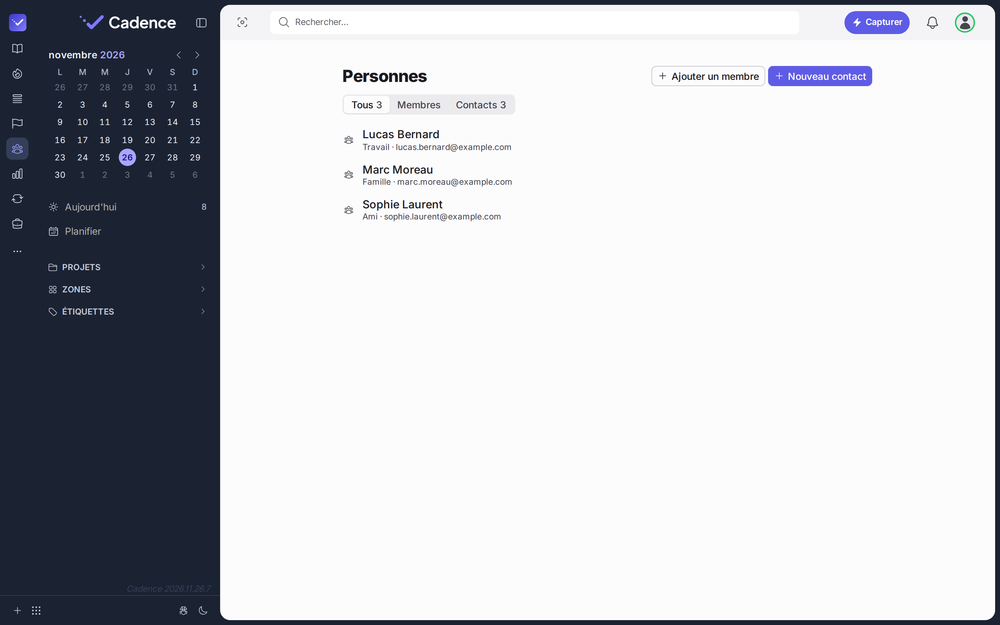

# People and Close Ones

Cadence is shared with yourself, your family, or a small team: a person is someone you can hand a task to (a member with an account, or a simple contact), roles decide what each account can do, groups share in one go, and the Android app Proches ("Close Ones") can hand you a task. This page covers the People page, roles, groups, assignment, the Everyone board, and task handoff from Proches.

## The words used

| Word | Meaning |
|---|---|
| **Member** | Someone who has an account on this server (including an account added without an email) |
| **Contact** | A person you follow who has no account (the plumber, the teacher, a grandparent); private: nobody else sees them |
| **Person** | An entry you can assign a task to: every account has one, and so do contacts |
| **Group** | A named set of members, kept by an administrator |
| **Share** | Giving a member or a group access to a project, an area, a goal, a note, or a task |
| **Role** | Admin, User, or Guest |

## The People page

A single screen lists everything you can assign a task to: your own person (marked "(me)"), your contacts, and the members of your space. The **All**, **Members**, and **Contacts** tabs filter. Each card says whether it is a member ("Member", or "Member, can't sign in yet") or a contact (with their relationship).

**A contact** has a name (unique among yours), a relationship (**Family**, **Work**, **Friend**, **Other**), an email, a phone, notes, and a color; it can be archived (**Archive** then **Unarchive**). **New contact** or **Add Person** creates the card.

**Useful rules**
- A contact who has tasks assigned **cannot be deleted**: archive them, or remove the assignments first.
- **Every account has its own person**, named after the account (first and last name, otherwise the part before the "@", otherwise "Member"). If that name conflicts with one of your contacts, "(me)" is added. Renaming the account renames the person and vice versa.
- A contact can be **linked to an account** (only someone in your space; one contact per account). A linked contact is not listed a second time next to the account.
- **Other members' cards are read-only** (name and color only). The person of your own account is editable but can be neither archived nor deleted.
- **Contacts stay private**: another member sees in an assignment list only the name and color of your account, never the email, phone, or notes.
- Android has no People page: mentions read there as chips without opening ([Notes and Outliner](Notes-and-Outliner)).

## Mentioning a person in a note

Typing `@` in a note or a task description opens the list of people. The choice is written `@[Name](person:...)` and reads as a chip to the card; a person's card lists (backlinks) the notes and tasks that mention them.

## Assigning a task

**Who can receive the task** depends on where it is:
- **Task in a project**: your contacts, the project's owner, and anyone the project is shared with (access through an area, goal, or group counts as a direct share).
- **Task outside a project**: your contacts and all members of your space.

**What happens**
- Assigning to a **member** **notifies** them ("task assigned" notification, according to their preferences) and **gives them access to that task** (it appears in their lists and in "Assigned to me"). They can open and complete it even without seeing its project.
- Assigning to a **contact** is only a **label**: with no account, nobody is notified and nothing is shared.
- At capture, `@name` or `@"Full Name"` in the Inbox offers the same list, limited to the project if the text contains a `+project`.
- **Losing access** unassigns open tasks: when someone's access to a project ends (removal from a group, revoked share, voluntary leave, project moved out of a shared or restricted area), their open tasks in that project are unassigned, unless they still have access by another route. Completed tasks keep their assignee. The owner receives one notification per project and per person.

## Roles

| Role | What it can do |
|---|---|
| **Admin** | Manages accounts, roles, and groups; can do everything |
| **User** | Adds people, creates projects, areas, and goals |
| **Guest** | Works in what is shared with them or assigned to them; creates none of that |

Three capabilities are tied to roles: adding people, inviting members, creating projects. The administration **Roles** tab shows each role, how many accounts carry it, and what it allows; it is **read-only** for now. On a self-hosted instance, only an admin can therefore add members.

## Adding a member, including without an email

**Add member** (People page) asks for a name, an optional email, an optional password, and a role.
- With an email: the member is invited by email. With an email and a password: they are registered. **With no email and no password**: they are added as a member who signs in with a **sign-in link**.
- **A member without an email** (meant for a child or a household member with no address) has their own person, can be put in groups, and can receive shares and tasks. The list shows "No email".
- **An email can be added later, never removed**; it is unique across accounts (any number of accounts can have none).
- The person who created the account (or an admin) can rename the member, add an email to them (which sends the invitation), or delete them; an email that is already set cannot be changed this way.

### The sign-in link

- The account's creator or an admin opens the member (People page) and chooses **Sign-in link**, then **sends the link themselves** (message, in person). Opening it asks "Sign in as Emma?"; the button signs in for 30 days.
- A link **works once and is valid for 24 hours** (adjustable on the server side); creating another replaces the old one. It is **shown only once**: only its fingerprint is kept, a lost link is replaced.
- **Opening the link does not consume it**: only signing in does, so messaging previews do not use it up.
- **Take access back** removes the current link and **signs the member out everywhere**. If the member receives an email or becomes an admin before using the link, the link stops working.
- A creator who is not an admin can only make a link for a member whose permissions are contained in their own. These operations are written to the sign-in log.

## Removing a member

The confirmation states how many open tasks are assigned to them and offers **Hand their tasks to** (you by default): the chosen member receives **a single** notice ("Léa handed you 7 of Bea's tasks"), not one per task. Completed, archived, or cancelled tasks do not move, and the member's own tasks leave with their account. "Nobody" leaves the tasks unassigned. Tasks they created in someone else's project stay in that project and pass to its owner. A removed member frees their seat on an account-based hosting.

## Giving a contact an account

A contact's menu › **Give account**: the form is the one from **Add member**, pre-filled. The contact **becomes the account's person** and keeps their history: tasks that were assigned to them stay assigned, and nobody has two entries. The phone, color, and relationship are kept. **The contact's private notes are not carried over** (the account now owns the card: they are erased, and the form says so before you confirm). The administration's add-user form offers the same option. If a step fails, nothing is created.

## Groups

A group is a set of members kept by an **admin** (Administration › Access › **Groups** tab): create, rename, delete, add or remove members. Any user can pick a group when sharing.

- **Sharing with a group**: the share dialog shows a **User | Group** choice as soon as a group exists. Each member receives an **invitation** as with a direct share and sees nothing before accepting (except on a hosting where an admin of their own account made the share: it applies right away with a simple notice).
- **Membership changes are live**: adding a member invites them to everything already shared; removing them only removes the access that came from the group; deleting the group removes its accesses, without touching the shared items. An access is the **highest level** between a direct share and each group.
- **Being in a group with someone** puts you in each other's space: you appear in the assignment list of tasks outside a project, and as columns on the Everyone board. This shares nothing by itself.
- **A group's page** (`/groups/...`): one column per member with their assigned tasks, same slices as Everyone; only the tasks you can already read.
- **Leaving a share**: any share holder can leave it (the **Leave** entry in the menu of a shared project or area); their open tasks are unassigned and the person who shared is notified.

## The "Everyone" board

`/everyone` (link in the sidebar as soon as you share with someone or belong to a group; can be hidden in Profile › Sidebar) shows what everyone has on now.
- **One column per person**: you first, then members, then contacts who have tasks. Each column sorts its tasks into **Overdue, Today, Tomorrow, This week** (7 days) and **No date**; tasks more than a week away are set aside until they get closer.
- A task is under its **assignee**, otherwise under its **creator**. Habits are excluded; a recurring task appears once, with its current due date.
- **Drag a column** by its header for the order you want (saved for your account). **Drag a task onto another column** to assign it to that person, with the same checks as on the task card: refused (and the board reloads) if the person cannot see the project.
- **Timeline** (Board / Timeline toggle): one track per person over 2 or 4 weeks, bars from start to due date, and a load line per day (estimates spread out) that turns orange beyond your planning day. Your track also shows your private tasks. Dragging a bar sideways moves its dates, onto another track assigns it.

## Task handoff from Proches (Android)

**Proches** is the app for keeping track of close ones; it can hand a task to Cadence: an accepted proposal becomes a Cadence task with its due date, put in the sync queue like a hand-typed task. Cross-app entry, **Android only**: the web has no equivalent.

- **Contract**: three pieces of information: the proposal's id, the title (200 characters at most), and the due date (a real date). Cadence replies that it accepted or not.
- **Security**: Cadence **only answers the Proches app**, verified by its package name **and** its signing certificate; any other caller is refused and leaves only a log line with no data.
- **One task per proposal**: the task's id is derived from the proposal's; handing over the same one twice creates no duplicate (the reply stays "accepted").
- **Offline**: the task waits for the network like the others. The due date is a date without a time, with no reminder.
- **Delay**: the call is synchronous on the Proches side, within a 5-second limit on Cadence's side; beyond that, it is refused and Proches keeps the proposal open. When Cadence is not installed, Proches says so.
- **Limit**: a task deleted and then handed over again for the same proposal would be rejected by the server (it refuses to recreate a deleted id).

## Going further

- [People, members, and roles (doc)](https://github.com/PreciselyWrong/cadence/blob/main/docs/19-people-and-roles.md), [User groups (doc)](https://github.com/PreciselyWrong/cadence/blob/main/docs/18-user-groups.md), [Task handoff from Proches (doc)](https://github.com/PreciselyWrong/cadence/blob/main/docs/42-proches-handoff.md)
- Wiki pages: [Tasks](Tasks), [Projects and Areas](Projects-and-Areas), [Notes and Outliner](Notes-and-Outliner), [Self-Hosting](Self-Hosting), [Android](Android)
