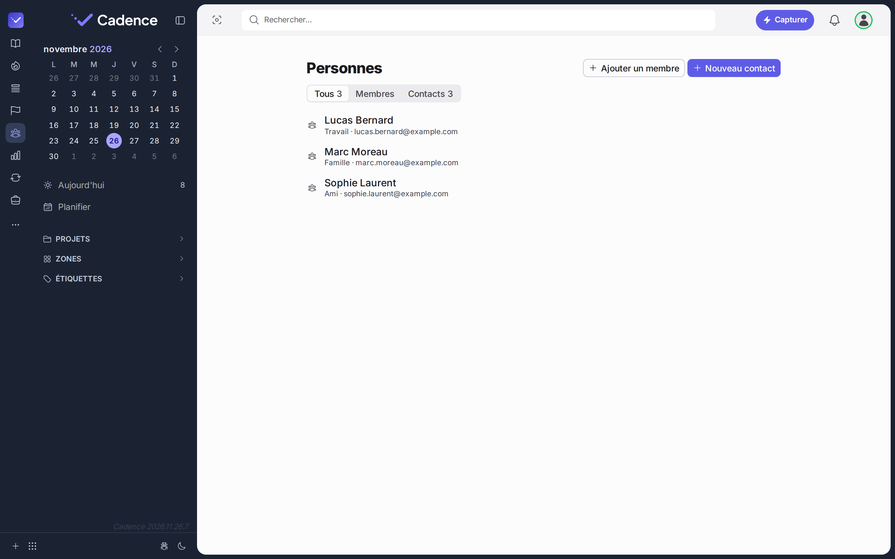

# Personnes et proches

Cadence se partage avec vous-même, votre famille ou une petite équipe : une personne est quelqu'un à qui on peut confier une tâche (membre avec un compte, ou simple contact), les rôles décident de ce que chaque compte peut faire, les groupes partagent d'un coup, et l'app Android Proches peut vous remettre une tâche. Cette page couvre la page Personnes, les rôles, les groupes, l'assignation, le tableau Tout le monde et la remise de tâche depuis Proches.

## Les mots utilisés

| Mot | Sens |
|---|---|
| **Membre** | Quelqu'un qui a un compte sur ce serveur (y compris un compte ajouté sans e-mail) |
| **Contact** | Une personne que vous suivez et qui n'a pas de compte (le plombier, la maîtresse, un grand-parent) ; privée : personne d'autre ne la voit |
| **Personne** | Une entrée à qui on peut assigner une tâche : chaque compte en a une, et les contacts aussi |
| **Groupe** | Un ensemble nommé de membres, tenu par un administrateur |
| **Partage** | Donner à un membre ou un groupe l'accès à un projet, une zone, un objectif, une note ou une tâche |
| **Rôle** | Administrateur, utilisateur ou invité |

## La page Personnes

Un seul écran liste tout ce à quoi vous pouvez assigner une tâche : votre propre personne (marquée « (moi) »), vos contacts et les membres de votre espace. Les onglets **Tous**, **Membres** et **Contacts** filtrent. Chaque carte dit si c'est un membre (« Membre », ou « Membre, ne peut pas encore se connecter ») ou un contact (avec sa relation).

**Un contact** a un nom (unique chez vous), une relation (**Famille**, **Travail**, **Ami**, **Autre**), un e-mail, un téléphone, des notes et une couleur ; il peut être archivé (**Archiver** puis **Désarchiver**). **Nouveau contact** ou **Ajouter une personne** crée la fiche.

**Règles utiles**
- Un contact à qui des tâches sont assignées **ne peut pas être supprimé** : archivez-le, ou retirez d'abord les assignations.
- **Chaque compte a sa propre personne**, nommée d'après le compte (prénom et nom, sinon la partie avant le « @ », sinon « Membre »). Si ce nom entre en conflit avec un de vos contacts, « (moi) » est ajouté. Renommer le compte renomme la personne et inversement.
- Un contact peut être **lié à un compte** (seulement quelqu'un de votre espace ; un contact par compte). Un contact lié n'est pas listé une seconde fois à côté du compte.
- Les cartes **des autres membres sont en lecture seule** (nom et couleur seulement). La personne de votre propre compte est modifiable mais ni archivable ni supprimable.
- **Les contacts restent privés** : un autre membre voit dans une liste d'assignation seulement le nom et la couleur de votre compte, jamais l'e-mail, le téléphone ni les notes.
- Android n'a pas de page Personnes : les mentions s'y lisent en puce sans s'ouvrir ([Notes et outliner](Notes-et-outliner)).

## Mentionner une personne dans une note

Taper `@` dans une note ou une description de tâche ouvre la liste de personnes. Le choix s'écrit `@[Nom](person:...)` et se lit en puce vers la fiche ; la fiche d'une personne liste (rétroliens) les notes et les tâches qui la mentionnent.

## Assigner une tâche

**Qui peut recevoir la tâche** dépend de l'endroit où elle se trouve :
- **Tâche dans un projet** : vos contacts, le propriétaire du projet et toute personne avec qui le projet est partagé (un accès par zone, objectif ou groupe compte comme un partage direct).
- **Tâche hors projet** : vos contacts et tous les membres de votre espace.

**Ce qui se passe**
- Assigner à un **membre** le **prévient** (notification « tâche assignée », selon ses préférences), lui **donne l'accès à cette tâche** (elle apparaît dans ses listes et dans « Assignées à moi »). Il peut l'ouvrir et la terminer même sans voir son projet.
- Assigner à un **contact** n'est qu'une **étiquette** : sans compte, personne n'est prévenu et rien n'est partagé.
- À la capture, `@nom` ou `@"Nom complet"` dans l'Inbox propose la même liste, limitée au projet si le texte contient un `+projet`.
- **Perdre l'accès** désassigne les tâches ouvertes : quand l'accès de quelqu'un à un projet prend fin (retrait d'un groupe, partage révoqué, départ volontaire, projet déplacé hors d'une zone partagée ou restreint), ses tâches ouvertes dans ce projet sont désassignées, sauf s'il y a encore accès par une autre voie. Les tâches terminées gardent leur assigné. Le propriétaire reçoit une notification par projet et par personne.

## Les rôles

| Rôle | Ce qu'il peut faire |
|---|---|
| **Administrateur** | Gère les comptes, les rôles et les groupes ; peut tout faire |
| **Utilisateur** | Ajoute des personnes, crée des projets, des zones et des objectifs |
| **Invité** | Travaille dans ce qui est partagé avec lui ou assigné à lui ; ne crée rien de cela |

Trois capacités se rattachent aux rôles : ajouter des personnes, inviter des membres, créer des projets. L'onglet **Rôles** de l'administration montre chaque rôle, combien de comptes le portent et ce qu'il permet ; il est en **lecture seule** pour l'instant. Sur une instance auto-hébergée, seul un administrateur peut donc ajouter des membres.

## Ajouter un membre, y compris sans e-mail

**Ajouter un membre** (page Personnes) demande un nom, un e-mail facultatif, un mot de passe facultatif et un rôle.
- Avec un e-mail : le membre est invité par e-mail. Avec un e-mail et un mot de passe : il est inscrit. **Sans e-mail ni mot de passe** : il est ajouté comme membre qui se connecte avec un **lien de connexion**.
- **Un membre sans e-mail** (pensé pour un enfant ou une personne du foyer sans adresse) a sa propre personne, peut être mis dans des groupes, recevoir des partages et des tâches. La liste affiche « Pas d'e-mail ».
- **Un e-mail peut être ajouté plus tard, jamais retiré** ; il est unique entre les comptes (un nombre quelconque de comptes peuvent n'en avoir aucun).
- Celui qui a créé le compte (ou un administrateur) peut renommer le membre, lui ajouter un e-mail (ce qui envoie l'invitation) ou le supprimer ; un e-mail déjà défini ne peut pas être changé de cette façon.

### Le lien de connexion

- Le créateur du compte ou un administrateur ouvre le membre (page Personnes) et choisit **Lien de connexion**, puis **envoie le lien lui-même** (message, en personne). L'ouvrir demande « Se connecter en tant que Emma ? » ; le bouton connecte pour 30 jours.
- Un lien **sert une fois et vaut 24 heures** (réglable côté serveur) ; en créer un autre remplace l'ancien. Il est **affiché une seule fois** : seule son empreinte est gardée, un lien perdu se remplace.
- **Ouvrir le lien ne le consomme pas** : seule la connexion le fait, donc les aperçus de messageries ne l'épuisent pas.
- **Reprendre l'accès** retire le lien en cours et **déconnecte le membre partout**. Si le membre reçoit un e-mail ou devient administrateur avant d'utiliser le lien, le lien cesse de marcher.
- Un créateur qui n'est pas administrateur ne peut faire un lien que pour un membre dont les permissions sont dans les siennes. Ces opérations sont écrites au journal des connexions.

## Retirer un membre

La confirmation indique combien de tâches ouvertes lui sont assignées et propose **Confier ses tâches à** (vous par défaut) : le membre choisi reçoit **une seule** notice (« Léa vous a confié 7 tâches de Bea »), pas une par tâche. Les tâches terminées, archivées ou annulées ne bougent pas, et les propres tâches du membre partent avec son compte. « Personne » laisse les tâches non assignées. Les tâches qu'il a créées dans le projet de quelqu'un d'autre restent dans ce projet et passent à son propriétaire. Un membre supprimé libère sa place sur un hébergement par comptes.

## Donner un compte à un contact

Menu d'un contact › **Donner un compte** : le formulaire est celui d'**Ajouter un membre**, pré-rempli. Le contact **devient la personne du compte** et garde son historique : les tâches qui lui étaient assignées le restent, et personne n'a deux entrées. Le téléphone, la couleur et la relation sont conservés. **Les notes privées du contact ne sont pas reportées** (le compte possède maintenant la fiche : elles sont effacées, et le formulaire le dit avant que vous confirmiez). Le formulaire d'ajout d'un utilisateur côté administration propose la même option. Si une étape échoue, rien n'est créé.

## Les groupes

Un groupe est un ensemble de membres qu'un **administrateur** tient (Administration › Accès › onglet **Groupes**) : créer, renommer, supprimer, ajouter ou retirer des membres. N'importe quel utilisateur peut choisir un groupe quand il partage.

- **Partager avec un groupe** : le dialogue de partage affiche un choix **Utilisateur | Groupe** dès qu'un groupe existe. Chaque membre reçoit une **invitation** comme pour un partage direct et ne voit rien avant d'accepter (sauf sur un hébergement où un administrateur de son propre compte a fait le partage : il l'applique tout de suite avec une simple notice).
- **Les changements de membre sont vivants** : ajouter un membre l'invite à tout ce qui est déjà partagé ; le retirer ne retire que l'accès venu du groupe ; supprimer le groupe retire ses accès, sans toucher aux éléments partagés. Un accès est le **plus haut niveau** entre un partage direct et chaque groupe.
- **Être dans un groupe avec quelqu'un** vous met dans l'espace de l'autre : vous apparaissez dans la liste d'assignation des tâches hors projet, comme colonnes sur le tableau Tout le monde. Cela ne partage rien par soi-même.
- **Page d'un groupe** (`/groups/...`) : une colonne par membre avec ses tâches assignées, mêmes tranches que Tout le monde ; seulement les tâches que vous pouvez déjà lire.
- **Quitter un partage** : tout détenteur d'un partage peut le quitter (entrée **Quitter** dans le menu d'un projet ou d'une zone partagés) ; ses tâches ouvertes sont désassignées et la personne qui avait partagé est prévenue.

## Le tableau « Tout le monde »

`/everyone` (lien dans la barre latérale dès que vous partagez avec quelqu'un ou faites partie d'un groupe ; masquable dans Profil › Barre latérale) montre ce que chacun a en cours.
- **Une colonne par personne** : vous d'abord, puis les membres, puis les contacts qui ont des tâches. Chaque colonne range ses tâches en **En retard, Aujourd'hui, Demain, Cette semaine** (7 jours) et **Pas de date** ; les tâches à plus d'une semaine sont laissées de côté jusqu'à ce qu'elles approchent.
- Une tâche est sous son **assigné**, sinon sous son **créateur**. Les habitudes sont exclues ; une tâche récurrente apparaît une fois, avec son échéance en cours.
- **Glisser une colonne** par son en-tête pour l'ordre de votre choix (enregistré pour votre compte). **Glisser une tâche sur une autre colonne** l'assigne à cette personne, avec les mêmes vérifications que sur la fiche : refusé (et le tableau se recharge) si la personne ne voit pas le projet.
- **Chronologie** (bascule Tableau / Chronologie) : une piste par personne sur 2 ou 4 semaines, des barres du début à l'échéance, et une ligne de charge par jour (estimations réparties) qui vire à l'orange au-delà de votre journée de planification. Votre piste montre aussi vos tâches privées. Glisser une barre sur le côté déplace ses dates, vers une autre piste l'assigne.

## La remise de tâche depuis Proches (Android)

**Proches** est l'app de suivi des proches ; elle peut confier une tâche à Cadence : une proposition acceptée devient une tâche Cadence avec son échéance, rangée dans la file de synchronisation comme une tâche saisie à la main. Entrée inter-applications, **Android seulement** : le web n'a pas d'équivalent.

- **Contrat** : trois informations : l'identifiant de la proposition, le titre (200 caractères au plus) et l'échéance (une date réelle). Cadence répond qu'elle a accepté ou non.
- **Sécurité** : Cadence ne répond **qu'à l'app Proches**, vérifiée par son nom de paquet **et** son certificat de signature ; tout autre appelant est refusé et ne laisse qu'une ligne de journal sans donnée.
- **Une seule tâche par proposition** : l'identifiant de la tâche est dérivé de celui de la proposition ; remettre deux fois la même ne crée pas de doublon (la réponse reste « acceptée »).
- **Hors ligne** : la tâche attend le réseau comme les autres. L'échéance est une date sans heure, sans rappel.
- **Délai** : l'appel est synchrone côté Proches, dans une limite de 5 secondes côté Cadence ; au-delà, c'est refusé et Proches garde la proposition ouverte. Quand Cadence n'est pas installée, Proches l'indique.
- **Limite** : une tâche supprimée puis remise pour la même proposition serait rejetée par le serveur (il refuse de recréer un identifiant supprimé).

## Pour aller plus loin

- [Personnes, membres et rôles (doc)](https://github.com/PreciselyWrong/cadence/blob/main/docs/19-people-and-roles.md), [Groupes d'utilisateurs (doc)](https://github.com/PreciselyWrong/cadence/blob/main/docs/18-user-groups.md), [Remise de tâche depuis Proches (doc)](https://github.com/PreciselyWrong/cadence/blob/main/docs/42-proches-handoff.md)
- Pages du wiki : [Taches](Taches), [Projets et domaines](Projets-et-domaines), [Notes et outliner](Notes-et-outliner), [Auto-hébergement](Auto-hebergement), [Android](Android)
