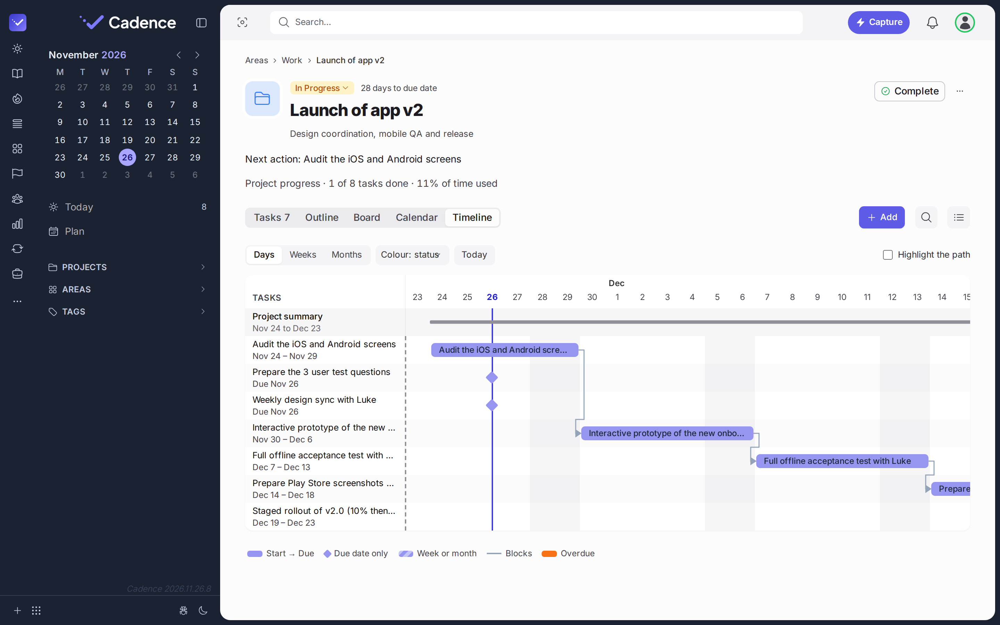
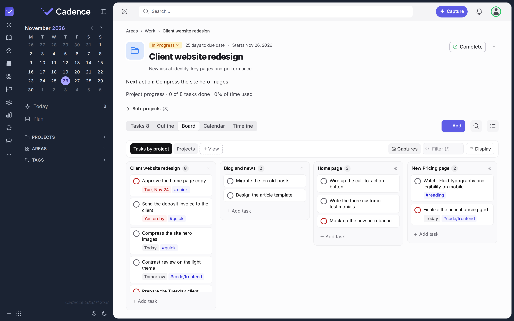
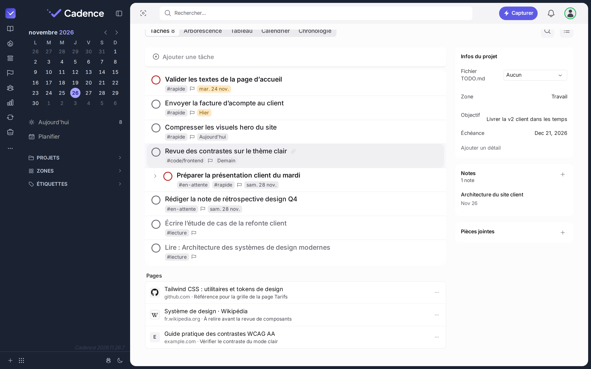

# Projects and Areas

A project groups tasks, notes, and pages around a specific goal; an area (also called a life domain) sorts your projects into the big parts of your life. This page covers projects, their sub-projects, their views (list, outline, board, timeline), their pages and links, turning a task into a project, the next action, the Friday review routine, and areas.


## The hierarchy

```
Area (life domain)
  └── Project
        ├── Sub-project (any depth)
        ├── Tasks
        ├── Notes
        └── Pages (reference addresses)
```

In the interface, a zone is called an **Area** ("Areas" in the sidebar); Android sometimes calls it a domain in quick capture (`~domaine`). A project is optional: a task or a note can live without one.

## A project's life cycle

**Statuses**: Not Started, Planned, In Progress, Waiting, Completed, Abandoned, Paused, Archived.

| Status | Meaning | Effects |
|---|---|---|
| In Progress, Planned, Waiting | Active project | Counted among active projects |
| Paused | Set aside for later | Forms the **Stash**; no more due-date notifications |
| Completed | Finished | End date recorded (removed if you reopen it) |
| Abandoned | Decided not to pursue | No end date |
| Archived | Kept for the record | Hidden from lists and due dates; visible in the closed-projects filter |

**The Stash**: the Projects page shows a counter "N active · N in the stash". On Android, the Projets (Projects) tab separates **Actifs** (Active) and **Stash** (the headers only appear when there is a stash); completed, abandoned, and archived projects are folded behind "Terminés, abandonnés et archivés" (Completed, abandoned and archived). Tasks of a paused project stay visible in Today.

**Completing a project**: the **Complete** button (it becomes **Reopen** once the project is done). If open tasks remain, a question offers to **mark them done too** or **leave them open**. Recurring tasks are never completed this way: they keep their schedule. The `/projects/completed` history (the **History** button on the Projects page) sorts completed projects by year and then by month, with the number of days they took.

**Deleting a project** is permanent: its tasks and their attachments are deleted along with it (notes, on the other hand, are detached and kept). To keep a trace without keeping the project active, set it to **Abandoned** or **Archived** instead. If the project follows a TODO.md file, you must unlink it first ([TODO.md Projects](TODO-md-Projects)).

## A project's views

A project page has tabs above its tasks: **Tasks** (the list), **Outline**, **Board**, **Timeline**, and in the Minimal interface a **Calendar** tab (the month, by due date, drag to change the date). Your choice is remembered, per project in Minimal.



### Outline

Tasks and sub-tasks as an indented list of editable lines, keyboard first:
- **Enter**: saves the line and opens a new one at the same level (a sibling sub-task when you are in a sub-task). Typing a name and then Enter creates the task.
- **Esc** or **Backspace** on an empty line: discards the line.
- **Tab**: becomes a sub-task of the task above. **Shift+Tab**: becomes a task again, right after its former parent. Only one level: a task that already has sub-tasks cannot be indented.
- **Alt+Up / Alt+Down**: moves among its siblings (the project's order, the same on Android).
- **Up / Down**: moves from one line to another; the checkbox completes or reopens.
- A single add control: "+ Add task" at the bottom. In read-only mode, nothing is editable. In a TODO.md project, only new lines and checkboxes are written.

### Board (free columns)

The columns are the ones you define (like sections), independent of task status.
- The first one, **Unsectioned**, holds every task without a column; it cannot be renamed, moved, or deleted.
- **Add column** sits at the end of the board; each column's menu lets you rename it (or double-click its name), add a column to the left or right, move it, or delete it. **Deleting a column never deletes its tasks**: they return to Unsectioned.
- Dragging a card to another column moves it; dropping it on another card places it just above that card. Dragging a column header reorders the columns.
- A read-only reader sees the board but cannot change it.
- A task that changes project leaves its column.

**Android**: a **Liste / Tableau** (List / Board) switch per project. The board scrolls horizontally (Unsectioned, then the sections), with "+ Section". Each column offers **Renommer** (Rename) and **Supprimer** (Delete, with confirmation). Long-press to drag a card, or **Déplacer vers…** (Move to...) in the card's menu as a no-drag alternative.

### Timeline

A Gantt chart of the project's tasks.
- **Bars**: from the start date to the due date. A task with only a due date is a diamond; with only a start, a short faded bar. A task planned for a **week** or a **month** without exact dates is a hatched bar across the whole week or month. Tasks without dates wait in the "No dates yet" tray.
- **Scheduling**: drag a bar to move both of its dates, an end to change just one, a diamond to move the due date. Times of day are kept; a hatched bar moves by whole weeks or months. Dragging a task from the tray onto a day gives it that day as both start and due date. Clicking a bar opens the task.
- **Dependencies**: hover over the chart and a dot appears at the end of each bar; drag it onto another task so the first one **blocks** the second. Click an arrow and then "Remove the link". Linking or moving a task **pushes later** the tasks it blocks when they no longer follow it (by day, week, or month depending on precision), never earlier; a message names the tasks that moved ("Following tasks moved later: ..."). A link that would create a loop is refused.
- **Highlight the path**: marks the chain of blocking tasks that sets the finish date and shows the spare days of tasks off the path.
- **Color**: status (default), priority, or tag. **Scale**: Days, Weeks, Months. A line marks today, dotted lines mark the project's start and due date, and open overdue tasks are orange. The timeline follows the page's filter and search.
- A summary row at the top runs from the first start to the last end, with a diamond on the target date of the project's goal.

An area's **Timeline** tab shows the same chart for the whole area (see also the Roadmap over a quarter).

## Sub-projects

A project can have a **parent project** that you own, to split up a big project.

- **Free depth**: a sub-project can have its own sub-projects.
- **The area follows the parent**: a sub-project is always in its parent's area, the area selector is locked, and moving a parent to another area moves all its sub-projects.
- **No cycles**: a project cannot become its own parent or the child of one of its sub-projects. A parent that belongs to someone else is refused.
- **Owner only** can set or remove the parent. Sharing is **not inherited**: sharing a parent does not share its sub-projects.
- **Separate tasks**: a project's page shows only its own tasks, plus a **Sub-projects** list above them (icon, name, number of open tasks, one click opens the sub-project). Children's tasks are not merged into the parent's.
- **Breadcrumb**: a sub-project shows "Projects (or the root area) › each parent, root first › the sub-project".
- **Deleting a parent** keeps its sub-projects: they become top-level projects.
- The sidebar (web) folds sub-projects under their parent (chevron, remembered per device; the open project stays visible). In drop-down lists, a sub-project reads "Parent / Child".
- **Android**: a project's page lists its direct sub-projects; a sub-project's header shows the parent path. The parent is changed from the project's sheet (**Projet parent** row (Parent project), "Premier niveau" (Top level) to detach). A project that would create a cycle is not offered.

## Sub-project board

This is the control tower of a parent project (for example a "Dev" project with about fifty sub-projects), in that parent's **Board** tab. It is designed for projects that follow TODO.md files ([TODO.md Projects](TODO-md-Projects)) but works with any sub-projects.



**Two views**, in the **Display** menu (view type):

| View | A column or card is... | Useful for |
|---|---|---|
| **Tasks by project** | One column per sub-project that is in progress, planned or not started (columns without tasks are hidden) | Seeing and handling each project's work |
| **Projects** | One card per sub-project, sorted by project status ("Paused" is visible), with no work-in-progress limit | Steering the portfolio |

One more tab, **All tasks**, groups the tasks of all sub-projects by status, tag, priority, or section.

**What you see in a column**
- The sub-project's name with its status and task count; the **Current state** reduced to the **next action** (two lines). Branch, tree state, and age are in the tooltip and the drawer.
- **Blocked** (red badge) when the Current state reports a blocker, **Stale · N days ago** (grey badge) when the Current state has not moved for 14 days (adjustable in Display, 0 to turn it off), "On track" otherwise.
- File tasks follow the **file's sections** (Now, Next, Ideas, then the others), in the **file's order**; Cadence-only tasks come after. A section folds after 8 cards ("Show N more", "Show less").
- A round Cadence checkbox on each task; a click opens the floating task card.
- In the **Projects** view, a **click anywhere on a card** (or **Enter** / **Space** on the keyboard, or the **Inspect tasks** button) opens a side **drawer**: **in-progress** tasks first, then the other open tasks, quick add, the full "Current state" block (the next action is not cut off there), and **Open page**. The number next to the progress bar is the number of open tasks ("28 open", the total on hover).
- A card in the **Projects** view can be **dragged from one column to another** to change the sub-project's status (or priority).
- On a desktop screen, the board stops at the bottom of the window: the **horizontal scroll bar** stays visible whenever the columns overflow, and each column scrolls on its own.

**The board toolbar**
- Tabs of saved views; **Save as new view** keeps your settings.
- **Display**: view type, group by, density (Compact, Normal, Detailed), card fields (next task, progress, tags, due date), hide empty columns, collapse a column into a rail, WIP limit (visual only, never blocking), "TODO.md repos only", the "Stale after (days)" threshold.
- **Include sub-projects** (on by default, adjustable per project), **7d** (tasks created in the last 7 days: an active filter stays visible in the bar, one click removes it), search with `/`, **Space** opens the drawer, **Esc** closes it.
- **Refresh TODO.md**: rereads the files of all sub-projects, then reloads the columns.
- A **Captures & Inbox** column (on the left, one click to show it) gathers ideas and "to sort" tasks, to drag onto a sub-project.
- **Mobile**: a tab bar of columns at the top, one full-width column, a status selector on the cards, a full-screen drawer.

**Special cases**: dragging a TODO.md task to another sub-project is refused ("TODO.md tasks stay in their repository project."). A sub-project without a file behaves like an ordinary project (no Current state).

**Android** (version 1.49 and later): a **Tableau** (Board) view of a parent project, columns per in-progress sub-project, "next action" on two lines, a "Bloqué" (Blocked) or "Périmé · il y a N j" (Stale · N d ago) badge only when relevant, file sections folding after 8 cards, a round checkbox and the task card; **Actualiser les TODO.md** (Refresh TODO.md files) in the page menu, for the owner only. Branch and tree are not shown on the phone (they stay in the web tooltip). No empty columns and no lanes.

## A project's pages and links

A project gathers its **pages**: the material it uses (documentation, articles, repositories, tools). An address always lives in one place: in a **task** (something to do: try, read, watch) or in a **project's pages**; everything else is a note. There is no longer a library of links to sort.



**What it does.** Under the project's tasks, a **Pages** section lists each page (initial or site icon, title, site, note) and opens the address. An address exists only once per project, but can be in two projects.

**How to use it**
- **... per page**: **Create a task** (in the project, named after the page type, with the address in the note), **Edit** (title and note), **Remove**.
- **... of the project**: **Copy the pages as Markdown** (one `[Title](address)` bullet per page) and **Check the pages**.
- **Adding a page**: from the [Inbox or the Android share sheet](Inbox-and-Capture) (the **Project…** choice), from the Firefox add-on, by importing bookmarks, or through an agent (MCP).
- **Import bookmarks** (web): Projects › ... › **Import bookmarks** reads a Firefox export (Library › Import and Backup › Export); a folder becomes a project's pages, in a new project of the same name (the default) or a project you choose, in batches of 100.
- **Firefox**: **Send to project** (this tab) or **Send the group** (all tabs of its tab group); **Open the project** reopens its pages in tabs gathered in a group named after the project (Firefox 139 and later). See [Linux Client and Firefox](Linux-Client-and-Firefox).
- **Android**: the same section and the same menus, with offline adding.
- **Previews**: any address written in a task's note, a note, or a project's description shows a card (image, title, site, and for a GitHub repository "stars · language · last push"). An address shown in a task row shows the site's icon and name in place of the address.

**Special cases**
- **Check the pages** queries each address once: 404, 410, or a site that does not respond are marked **Not found**; 401 and 403 (page behind a login) are **never** "not found". Nothing is deleted; a summary says "N pages not found" or "Every page answers".
- Context addresses (IP addresses, local network, mail, chats, searches, continuous integration) get neither a preview nor an automatic page.
- A page is read by the server, never by your device: the site does not know who is looking. Offline, Android keeps the previews it has already read.
- The **With a link** filter (Tasks › filter): tasks whose name or note contains a web address.

## Turning a task into a project

A task too big to stay a task becomes a project: the task's **...** menu (row or page, web) or the card and row menu (Android) › **Turn into a project**. An agent can do it too (MCP).

- The task's **name** becomes the project's name; its **note** becomes the description; its **sub-tasks** become the project's tasks; the **addresses in its note** become the project's **pages**; its tags and area carry over. The original task disappears.
- The confirmation reads: "Turn `<name>` into a project? Its subtasks become the project's tasks and the addresses in its note its pages."
- **Refused** for a recurring task, a sub-task, a task that follows a TODO.md file, or someone else's task.
- Android sends the request as a deferred call and hides the task until sync brings back the project.

## Projects not touched for 30 days

At the bottom of the Projects page, a folded block **Not touched for 30 days (N)** lists open projects (not completed, abandoned, archived, or templates) with no change to the project, its tasks, or its pages for 30 days, oldest first. Each line has **Keep**: the project is considered reviewed and leaves the list for 30 days. **Nothing is archived or closed**: it is an invitation to decide, never an automatic action. Android shows the same block at the bottom of the project list (the last response is kept offline).

## A project's next action

A project can designate **one** of its open tasks as "what to do next".

- **Choosing**: right-click a task row in the project (Minimal) and check **Next action**; check again to remove it. Android: the task's menu and card (**Prochaine action** (Next action) / **Retirer la prochaine action** (Remove the next action)).
- **Rules**: it must be an **open task of the same project** (otherwise refused). It is **removed automatically** when the task is completed, archived, cancelled, deleted, or moved to another project.
- **Display**: "Next action: `<title>`" in the page header and on project cards. With no choice, the page offers its automatic suggestion; cards show nothing.
- **Effect on Today**: for a project that has a next action, it is the **only** task that Today's suggestion list offers for that project (tasks already in progress, due, or overdue still appear in their own sections). A project without a choice behaves as before.
- It is synced across devices.

## The Friday review routine

The weekly review ([Review, Insights, and Focus](Review-Insights-and-Focus)) offers, optionally and never automatically, a discreet **Plan a weekly review on Fridays** link: it creates a recurring "Weekly review" task on Fridays, whose note points to the review page, with no reminder or notification. It is an ordinary task that you can edit or delete.

## Areas (life domains)

An **area** sorts your projects into the big parts of your life (Work, Personal, Health...). It has an optional name, description, and color.

**Suggest 5 areas.** Never automatic. On an empty Areas page, a **Suggest 5 areas** button; above the list, when some are missing, a discreet link of the same name. It creates areas in your language: Business & Money, Tech & Systems, Personal, Family & Social, Logistics. A name that already exists (case ignored) is skipped. These are ordinary areas that you can rename, reorder, or delete. On Android, the action is the same and requires being online.

**An area's page** (`/area/...`): a header card (number of projects, tasks, active goals, with the area's color as background), a goals side (each active goal with its projects, a **Maintenance** block for maintenance projects, an **Unlinked** block, inactive goals folded, a warning above 5 active goals), and a side with tasks filed directly in the area. The **Timeline** tab shows the area's timeline. Completed or abandoned projects fold into **Finished (N)**.

**Deleting an area** deletes neither projects nor tasks: the projects become "no area" (the **No area** filter on the Projects page finds them again).

**Sharing**: an area can be shared; sharing extends to all the projects you file in it (and their tasks and notes), including those you add later. A project marked **Restricted** is excluded: only you, the area's owner, and the people the project itself is shared with can see it.

**On Android**: a row of chips filters Today, Upcoming, and Projects by area (the choice is kept).

## Other project settings

- **Priority** (none, medium, high), **due date** (notifications as it approaches, never red for a past date in the header: "Due Sep 20").
- **Pin**: a pinned project appears in the **Pinned** block at the top of the sidebar; on Android, at the head of the list picker.
- **Icon**: chosen from the set shared with Android; **banner**: a wide image at the top of the project page (web and Android, edited on the web only).
- **Templates**: **Save as Template** creates a template (tasks copied with status reset), **Create from template** clones it. Android: "+" button on Projects › "Depuis un modèle" (From template) (online).
- **Sharing**: with a person or a group, read-only or read-write; the invitee must accept. See [People and Close Ones](People-and-Close-Ones).
- **Goal**: a project links to a goal ([Goals](Goals)) or is marked **Maintenance**.

## Going further

- [Projects (doc)](https://github.com/PreciselyWrong/cadence/blob/main/docs/06-projects.md), [Areas (doc)](https://github.com/PreciselyWrong/cadence/blob/main/docs/07-areas.md), [Links, pages, and turning a task into a project (doc)](https://github.com/PreciselyWrong/cadence/blob/main/docs/37-links.md)
- [Sub-project control tower plan](https://github.com/PreciselyWrong/cadence/blob/main/docs/fork/PLAN-kanban-control-tower.md)
- Wiki pages: [TODO.md Projects](TODO-md-Projects), [Tasks](Tasks), [Goals](Goals), [Review, Insights, and Focus](Review-Insights-and-Focus), [Android](Android)
