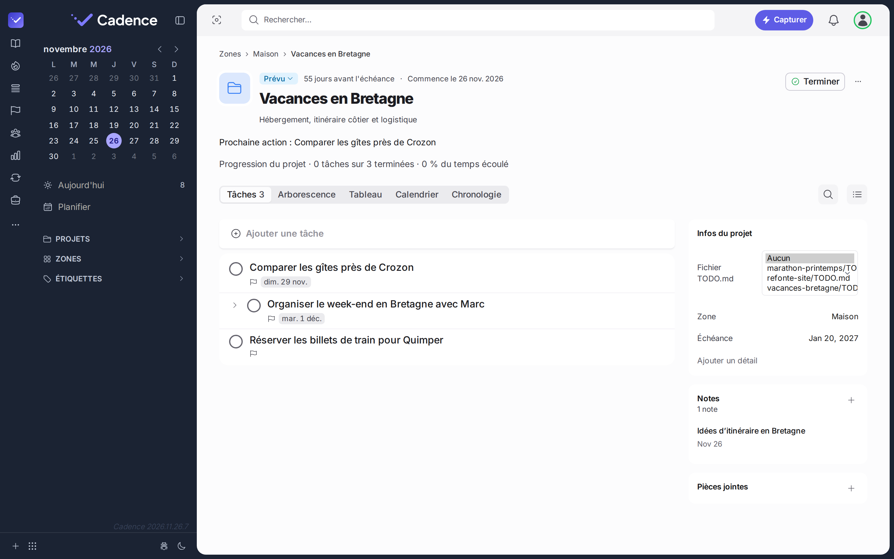

# Projets TODO.md

Un projet Cadence peut suivre un fichier `TODO.md` de votre poste ou d'un dépôt Git : les tâches taguées `code` vont dans le fichier et en reviennent, tout le reste reste dans Cadence. Vous continuez d'éditer votre `TODO.md` dans votre éditeur ou avec votre agent de code, et Cadence le montre comme un projet ordinaire (liste, tableau, plan, calendrier, web et Android).



## À quoi ça sert

- Le **fichier reste la source de vérité** de ses lignes : on peut l'éditer partout, à tout moment, sans passer par Cadence.
- Un projet ne se transforme pas en simple miroir : **seules les tâches taguées `code`** vont dans le fichier et en viennent. Une tâche sans ce tag (appeler quelqu'un, acheter une pièce) reste dans Cadence, avec sa date, son rappel, son plan du jour.
- Pour un parent qui regroupe plusieurs projets de code, la section « État actuel » de chaque fichier alimente le [tableau des sous-projets](Projets-et-domaines#tableau-des-sous-projets) : branche, bloqueur, prochaine action.

## Les deux sources : dossier partagé ou dépôt Git

| | Dossier partagé | Dépôt Git |
|---|---|---|
| Où vit le fichier | Un dossier que le serveur lit et écrit (un sous-dossier par projet, chacun avec son `TODO.md`) | Un dépôt (Gitea, GitHub, etc.) que le serveur clone lui-même |
| Qui le remplit | Vous, par la synchro locale ([plus bas](#synchro-locale-avec-systemd)) ou n'importe quel moyen | Les commits que vous poussez au dépôt |
| Écriture depuis Cadence | Une puce ajoutée ou une case cochée est écrite dans le fichier | Un commit d'auteur `Cadence` est poussé sur la branche |
| Lecture par Cadence | Détection native des changements, sinon passe toutes les 30 s | Webhook de push (immédiat), sinon passe toutes les 5 min |
| Quel projet | Vous choisissez vous-même quel projet suit quel fichier | Un projet est créé et suivi par dépôt, nommé d'après son identifiant et qui garde ce nom |

Les deux sources peuvent coexister. L'installation côté serveur (variables d'environnement, clé de déploiement, webhook) est décrite dans [Auto-hébergement](Auto-hebergement).

## Lier ou délier un projet à un fichier

Un fichier ne nourrit rien tant qu'aucun projet ne le suit : Cadence ne crée **aucun projet de lui-même** pour un dossier (sauf pour un dépôt Git, qui crée son projet).

**Sur le web**
1. Ouvrez le projet, panneau d'information du projet.
2. Choisissez un fichier dans la liste **Fichier TODO.md** (valeur « Aucun » par défaut). Un fichier déjà pris par un autre projet est grisé, avec le nom de ce projet.
3. Le fichier est lu tout de suite. Le projet affiche le badge **TODO.md**, sa provenance (« Suit `<dossier>/TODO.md`. Les tâches avec l'étiquette code sont écrites dans le fichier ; les autres restent dans Cadence. ») et un bouton **Recharger les fichiers**.

La liste n'apparaît que si le serveur propose des fichiers (ou si le projet en suit déjà un). Pour délier : repassez sur « Aucun ».

**Sur Android**
- Menu du projet › **Fichier TODO.md**, puis choisissez le fichier (ou « Aucun »). La liste se lit en ligne.
- Même menu › **Actualiser les TODO.md** : relit les fichiers de tous les sous-projets (propriétaire seulement, en ligne), puis lance une synchro.

### Ce qui se passe quand on délie

- Le projet cesse de suivre le fichier. **Ses tâches restent** comme tâches ordinaires, et le fichier n'est pas touché.
- Si vous liez de nouveau le même fichier, Cadence retrouve les tâches **par leur nom**.
- Un fichier ou un dossier déjà suivi par un autre projet est refusé (erreur 409).

## Le tag `code`

- Les tâches lues depuis le fichier reçoivent le tag **`code`**, ajouté à leurs autres tags. Si vous le retirez à la main, il est remis à la lecture suivante : c'est lui qui relie la tâche au fichier.
- Le **titre de section** (`Now`, `Next`, `Ideas`...) n'est pas un tag : Cadence le garde à part sur la tâche (c'est ce qui range les cartes d'un projet dans le tableau des sous-projets).
- **Donner `code` à une tâche existante** (sur le web, sur Android, par un agent) l'écrit comme une puce à la fin de `## Next` du fichier à la **passe suivante, 30 secondes au plus tard**, et elle suit alors le fichier. Sa note passe avec elle, en lignes indentées.
- Ne sont **pas écrites** : une tâche terminée, une tâche récurrente.
- **Retirer `code` à une tâche qui est dans le fichier ne la sort pas du fichier** : le tag est remis à la lecture suivante. Pour qu'une tâche quitte le fichier, supprimez sa ligne dans le fichier ; elle disparaît alors de Cadence ([plus bas](#ce-qui-arrive-aux-lignes)).
- Une tâche créée sans `code` dans un projet lié reste une tâche Cadence, sans que rien n'arrive dans le fichier.
- Pour un projet de dépôt Git, la passe de 30 s n'exporte pas un tag `code` ajouté après coup (seules l'ajout d'une tâche et la case à cocher sont écrits par commit) : voir [Dépôt Git](#dépôt-git).

### Ajouter une tâche depuis Cadence

| Action | Résultat |
|---|---|
| Ajouter une tâche taguée `code` (web ou Android) | Puce `- ` ajoutée à la fin de `## Next` (section créée si elle manque) |
| Web : le champ « + Ajouter une tâche » du projet | Un menu **Ajouter à** propose : Cadence seulement, Now, Next, Ideas |
| Ajouter une tâche sans `code` | Reste dans Cadence |
| Cocher la tâche | `[x]` est écrit sur la puce (ou ajouté si elle n'avait pas de case) ; décocher écrit `[ ]` |
| Cocher une tâche qui est dans `## Done` ou `## Dropped` | Rouvrir n'est pas possible depuis Cadence : déplacez la ligne dans le fichier |

## Sections du fichier

```markdown
# TODO

## État actuel
Branche: `main` | Arbre: propre
Tests: OK
Bloqueur: aucun
Prochaine action: publier la version

## Now
- [ ] Corriger la redirection de connexion #bug !high @2026-12-05
      une note sur les lignes suivantes, indentées
    - une sous-puce reste dans la note

## Next
- Écrire la doc #doc
- [x] Déjà fait

## Ideas
- Un widget peut-être

## Done
- [x] Mettre en place le dépôt

## Dropped
- Ancienne idée (abandonnée, raison courte)
```

| Élément | Lecture par Cadence |
|---|---|
| `## Now`, `## Next`, `## Ideas`, ou tout autre `## Titre` | Section : ses puces de premier niveau deviennent des tâches, le nom de la section est gardé (`source_section`) |
| `## Done` | Les puces sont **terminées** (même sans case cochée) |
| `## Dropped` | Les puces sont **archivées** |
| `## État actuel` (ou `## Handoff`, `## Current state`) | **Jamais des tâches** : c'est l'état du projet (voir ci-dessous) |
| Texte avant le premier `##`, titres `###` et plus, paragraphes, blocs de code | Ignorés |
| Puce vide | Pas une tâche |

Règles de lecture utiles :
- Seule une puce de **premier niveau** (`-`, `*` ou `+` au bord gauche) est une tâche. Les lignes indentées, les sous-puces et les lignes vides entre elles forment la **note** de la tâche.
- Le **nom** est la première ligne sans sa mise en forme Markdown (gras, code, liens, barré) et sans ses [métadonnées en ligne](#métadonnées-en-ligne-dune-puce).
- Une tâche est **terminée** si sa case est cochée ou si elle est dans `## Done`.
- Une puce lue pour la première fois déjà terminée n'a **pas de date de fin** (inconnue) : elle n'entre ni dans « terminé aujourd'hui » ni dans les statistiques ; une puce cochée plus tard prend la date du fichier.
- Les fichiers avec fins de ligne Windows, sans retour final ou avec BOM UTF-8 sont gérés. Un fichier dans un autre encodage n'est pas modifié par Cadence.

### La section « État actuel »

Cette section est reconnue par ses mots-clés, avec ou sans accent : `Branche`, `Tests`, `Bloqueur`, `Prochaine action`. La ligne `Branche: main | Arbre: propre` donne à la fois la branche et l'état de l'arbre. Un bloqueur « aucun » (ou équivalent) est lu comme vide.

Elle n'est jamais convertie en tâches. Cadence en garde un résumé sur le projet (`handoff_state`), envoyé en **lecture seule** à Android. C'est ce qui alimente l'« État actuel » du [tableau des sous-projets](Projets-et-domaines#tableau-des-sous-projets) et les pastilles « Bloqué » et « Périmé ».

## Métadonnées en ligne d'une puce

La première ligne d'une puce de premier niveau peut porter des tags, une priorité et une échéance, n'importe où dans la ligne (les lignes de note ne sont pas lues) :

```markdown
- Corriger la redirection de connexion #bug #secu !high @2026-12-05
- !low Ranger le README #doc
- Déplacer les sauvegardes #infra @2026-12-31
```

| Jeton | Effet |
|---|---|
| `#nom` (minuscules, chiffres, `_` et `-`) | Ajoute le tag `nom` (créé pour le compte s'il manque) |
| `!high`, `!med`, `!low` (casse libre) | Priorité haute, moyenne, basse |
| `@AAAA-MM-JJ` | Échéance, sur toute la journée (sans heure), à condition que ce soit une vraie date |

Cas particuliers :
- Chaque jeton est un **mot entier** : début de ligne ou espace avant, espace ou fin de ligne après. `mail@2026-01-01`, `a!low` ou `#bug,` restent du texte.
- Ce qui est dans un code (`` `#perf` ``), un lien Markdown, un lien entre `<...>` ou une adresse nue n'est jamais lu comme jeton.
- `#123` (numéro d'issue), `#UX` (majuscules) et `@2026-02-30` (date impossible) ne sont pas des jetons : ils restent dans le nom.
- Les jetons sont **retirés du nom** affiché. Une puce faite seulement de jetons garde ses jetons comme nom. Le fichier lui-même n'est jamais réécrit.
- Plusieurs priorités ou dates sur une ligne : **la dernière gagne**. Un tag répété compte une fois.
- Sans jeton de priorité ou de date, Cadence garde la valeur de la tâche. Avec un jeton, **chaque lecture l'applique** : une modification faite dans Cadence tient jusqu'à la prochaine lecture d'une puce qui contient encore ce jeton.
- Les tags ne sont qu'**ajoutés** : `code` et les tags ajoutés dans Cadence restent, et un tag retiré de la puce reste sur la tâche.

## Ce que le fichier possède, ce que Cadence possède

| Donnée de la tâche | Propriétaire | Conséquence |
|---|---|---|
| Nom | Le fichier | Modifier dans Cadence est refusé |
| Note (lignes indentées) | Le fichier | Idem |
| Case cochée / non cochée (statut terminé) | Le fichier | Cocher dans Cadence est écrit dans le fichier |
| Projet | Le fichier | Déplacer vers un autre projet est refusé |
| Priorité, échéance | Cadence (le jeton `!` ou `@` du fichier les applique à chaque lecture) | Modifiables partout |
| Tags, zone, objectif, estimation, épingle, ordre du jour, plan du jour, assignation, rappel, début, report, champs de revue | Cadence | Modifiables partout |
| Commentaires, relations, pièces jointes | Cadence | Ne sont pas bloqués |

Une tâche issue d'un fichier porte le badge **TODO.md** ; son titre et sa note sont en lecture seule (un message dit que ça vient du fichier), et la corbeille est masquée.

Précisions :
- Refus : modifier le nom, la note ou le projet d'une telle tâche, ou la supprimer, renvoie `403 todo_md_read_only`. Sur Android les opérations de synchro sont rejetées comme `read_only`, et l'outil MCP de mise à jour renvoie une erreur.
- Un statut autre que terminé (par exemple « en cours ») écrit la case comme **non cochée** ; la réponse montre ce que contient réellement le fichier.
- Envoyer une valeur identique à l'actuelle n'est pas un changement.
- Un projet lié peut être **renommé** (sauf un projet de dépôt Git). Il ne peut être ni **supprimé** ni **terminé avec ses tâches** : déliez-le d'abord.
- Les sous-tâches ne sont pas proposées sur une tâche de fichier.
- La vue **plan** (outliner) d'un projet lié reste en lecture seule pour ses tâches de fichier ; seule la vue liste édite normalement les tâches Cadence.

## Ce qui arrive aux lignes

Une tâche est reconnue à sa puce par la section, la première ligne normalisée (sans métadonnées) et son rang parmi les lignes identiques (la deuxième puce identique d'une section est le rang 1). Cette clé est gardée sur la tâche : relire ne duplique rien.

| Ce que vous faites dans le fichier | Ce que fait Cadence |
|---|---|
| Réordonner, modifier la note, cocher une case, ajouter des lignes sans rapport | Toutes les tâches sont gardées |
| Ajouter, changer ou retirer un `#tag`, `!priorité` ou `@date` | La tâche est gardée |
| Déplacer une puce vers une autre section | Elle garde sa ligne tant que son texte est unique parmi les puces non appariées ; la section suit |
| **Modifier le texte** d'une puce (renommer) | C'est une **nouvelle tâche** ; l'ancienne est supprimée avec ses données propres à Cadence |
| **Supprimer** la ligne | La tâche est **supprimée** de Cadence (avec ses liens propres) à la lecture suivante |
| Ajouter une puce du même nom qu'une tâche `code` ouverte ou fermée qui n'est pas encore dans le fichier | La puce **adopte** cette tâche |
| Cocher la même case dans Cadence et dans le fichier | Le résultat est le même : coché |
| Supprimer le projet dans Cadence | Refusé tant qu'il suit un fichier ; déliez-le d'abord |
| Le dossier partagé n'est pas monté, le fichier est illisible | **Rien n'est supprimé** : la passe est ignorée et signalée |
| Renommer ou retirer un dossier | Le projet reste lié, avec ses tâches ; choisis un autre fichier ou aucun |

Une lecture n'écrase que le nom, la note, la case, et la priorité et l'échéance que la puce énonce ; les autres champs côté Cadence sont conservés. Renommer une tâche **dans le fichier** perd donc ses données Cadence : pensez à garder les titres stables (voir le guide du fichier ci-dessous).

## Délais : combien de temps avant que ça apparaisse

| Chemin | Délai |
|---|---|
| Édition locale du `TODO.md` vers le dossier partagé | Dès que le fichier local change, si l'unité `todo-md-sync.path` est active ; sinon au plus **1 minute** (timer) |
| Dossier partagé vers Cadence | **0,75 s** après un changement si le serveur reçoit l'événement du système de fichiers ; sinon une passe toutes les **30 s** (taille et date de chaque fichier, ce qui marche aussi sur un montage réseau) |
| Dépôt Git vers Cadence | **Immédiat** si le webhook de push est configuré, sinon toutes les **5 min** |
| Cadence vers le fichier : case cochée, tâche ajoutée avec `code` | Écrite **au moment de l'action** |
| Cadence vers le fichier : un tag `code` ajouté plus tard | **30 s au plus** (passe suivante), dossier partagé seulement |
| Dossier partagé vers votre poste | Au plus **1 minute** (le timer), la surveillance locale ne regarde que les fichiers du poste |
| Bouton **Recharger les fichiers** (web), « Actualiser les TODO.md » (Android) | Tout de suite : lit chaque dossier et dépôt (propriétaire du projet seulement) |

Enchaînement typique d'une édition sur votre poste : vous enregistrez `TODO.md`, la synchro locale pousse le fichier dans le dossier partagé en quelques secondes, puis Cadence le relit dans la seconde (détection native) ou dans les 30 s.

## Synchro locale avec systemd

Le script [`scripts/todo-md-sync.sh`](https://github.com/PreciselyWrong/cadence/blob/main/scripts/todo-md-sync.sh) garde en phase les `TODO.md` de votre dossier de travail et le dossier partagé que Cadence lit, **sans exposer le reste** de votre dossier de travail. Trois unités systemd (utilisateur) l'automatisent, des exemples sont dans [`scripts/systemd/`](https://github.com/PreciselyWrong/cadence/tree/main/scripts/systemd) :

| Unité | Rôle |
|---|---|
| `todo-md-sync.service` | Une passe de synchro (`Type=oneshot`) |
| `todo-md-sync.timer` | Lance le service **toutes les minutes** : c'est le sens serveur vers poste (les changements faits dans Cadence ou sur un autre poste) |
| `todo-md-sync.path` | Surveille (inotify, par systemd, **sans processus de plus**) chaque `TODO.md` local et lance le service dès qu'un fichier change : c'est le sens poste vers serveur, instantané |

### Le service

```ini
[Unit]
Description=Synchro des TODO.md entre le dossier de travail et Cadence

[Service]
Type=oneshot
# Saute la passe si le dossier partagé est injoignable.
ExecCondition=/usr/bin/timeout 15 /usr/bin/test -d <dossier partagé>
Environment=LOCAL_ROOT=%h/projets
Environment=SHARE_ROOT=<dossier partagé>
ExecStart=%h/.local/bin/todo-md-sync.sh
ExecStartPost=-%h/.local/bin/todo-md-sync-paths.sh
TimeoutStartSec=2min
```

- **`ExecCondition`** : si le dossier partagé (un montage de votre NAS, par exemple) ne répond pas en 15 s, la passe est sautée sans erreur ; rien n'est perdu et ça évite de tourner dans le vide hors de votre réseau.
- **`LOCAL_ROOT`** : le dossier qui contient vos projets (un sous-dossier par projet, chacun avec son `TODO.md`). **`SHARE_ROOT`** : le dossier que Cadence lit.
- **`ExecStartPost`** (le `-` devant ignore un échec) lance le générateur de liste de fichiers surveillés, voir plus bas.
- Les exemples fournis dans le dépôt utilisent les chemins de leur auteur : adaptez `LOCAL_ROOT`, `SHARE_ROOT` et l'emplacement des scripts.

### Le timer

```ini
[Unit]
Description=Synchro des TODO.md toutes les minutes

[Timer]
OnStartupSec=1min
OnUnitActiveSec=1min
AccuracySec=10s

[Install]
WantedBy=timers.target
```

Une première passe 1 min après le démarrage de la session, puis une par minute, avec une marge de 10 s que systemd utilise pour regrouper ses réveils.

### La surveillance (`.path`) et le générateur

`todo-md-sync-paths.sh` écrit `~/.config/systemd/user/todo-md-sync.path` : une ligne `PathChanged=<chemin du TODO.md>` par fichier de `LOCAL_ROOT/*/TODO.md`, moins les dossiers listés dans le fichier d'exclusion, avec `Unit=todo-md-sync.service`.

- **Quand un projet apparaît**, le prochain passage du timer relance le générateur (via `ExecStartPost`), qui **réécrit l'unité seulement si la liste a changé**, puis fait `systemctl --user daemon-reload` et redémarre `todo-md-sync.path`. Un nouveau `TODO.md` est donc surveillé au plus une minute après sa création.
- Variables du générateur : `LOCAL_ROOT` (par défaut `~/Dev`), `EXCLUDE` (par défaut `~/.config/todo-md-sync/exclude.txt`).

### Installation, en bref

1. Copiez `todo-md-sync.sh` et `todo-md-sync-paths.sh` dans `~/.local/bin/` (exécutables) et les unités `.service` et `.timer` dans `~/.config/systemd/user/`, après avoir adapté les chemins.
2. Montez le dossier partagé à l'endroit de `SHARE_ROOT`.
3. `systemctl --user daemon-reload`, puis `systemctl --user enable --now todo-md-sync.timer`.
4. Lancez une fois le service (`systemctl --user start todo-md-sync.service`) : il génère l'unité `.path`. Puis `systemctl --user enable --now todo-md-sync.path` pour qu'elle démarre avec votre session.
5. Pour exclure un dossier (un projet qui ne doit pas quitter votre machine), ajoutez son nom, un par ligne, dans `~/.config/todo-md-sync/exclude.txt`.

Suivre les passes : `journalctl --user -u todo-md-sync.service`.

### Ce que fait une passe, fichier par fichier

Le script compare les **contenus**, pas les dates (les dates d'un montage réseau ne sont pas fiables). Il garde une copie de la dernière version synchronisée (« base ») dans un dossier d'état (par défaut `~/.local/state/todo-md-sync`). Les écritures passent par un fichier temporaire puis un renommage, pour que Cadence ne lise jamais un fichier à moitié écrit.

| Situation | Résultat |
|---|---|
| Les deux fichiers sont identiques | Rien à faire (la base est mise à jour) |
| Seul le fichier local a changé depuis la base | Local vers partage (« local vers partage ») |
| Seul le fichier partagé a changé | Partage vers local (« partage vers local ») |
| Les deux ont changé, sur des lignes différentes | **Fusion ligne à ligne** (fusion à trois voies avec la base) ; le résultat est écrit des deux côtés |
| Les deux ont changé **la même ligne** | **Conflit** : la version locale est gardée, la version du partage est conservée dans `<état>/conflicts/<projet>-<date>.md`, une notification s'affiche |
| Les deux fichiers existent mais aucune base (premier passage) et ils diffèrent | Traité comme un conflit : le local gagne, la version du partage est sauvegardée |
| Le fichier existe d'un seul côté, jamais synchronisé | Il est copié de l'autre côté (« ajouté au partage » ou « ajouté en local ») |
| Un fichier **manque d'un côté** alors qu'il a déjà été synchronisé | **Rien n'est supprimé** ; une ligne dans le journal dit « manque d'un côté : rien n'est supprimé, à vérifier » (pas de notification, la passe tourne chaque minute) |
| Dossier partagé ou local introuvable | Passe en erreur (code de sortie 1) ; une absence de montage ne perd donc rien |

Une suppression n'est **jamais propagée** : un montage absent ou une branche sans le fichier ne peut rien effacer. Un projet de `EXCLUDE` est ignoré. Le script ne copie que les fichiers nommés `TODO.md`.

## Conflits et modifications en attente côté serveur

Quand Cadence écrit dans un **dossier**, le fichier est relu juste avant, le nouveau contenu va dans un fichier temporaire du même dossier (mêmes droits), puis remplace l'original par un renommage atomique **seulement si l'original est toujours identique octet pour octet** à ce qui a été lu. Sinon l'écriture recommence, jusqu'à 3 fois (`409 file_conflict` ensuite). Seuls les octets insérés changent : autres lignes, fins de ligne, retour final et BOM sont conservés.

### Dépôt Git

Le serveur clone le dépôt et, pour une tâche ajoutée ou cochée dans Cadence : récupère la branche, repose le clone dessus, applique la modification sur le fichier **tel qu'il est maintenant**, fait un commit (auteur `Cadence`) et pousse. Un push refusé (quelqu'un a poussé entre-temps) recommence depuis la récupération, jusqu'à 3 fois. Les modifications des deux côtés sont donc gardées.

| Cas | Résultat |
|---|---|
| La puce a changé ou disparu dans le dépôt entre-temps (cocher, décocher) | Rien n'est écrit : **`409 todo_md_conflict`** ; le projet montre l'état du dépôt et la modification reste **en attente** |
| Le dépôt est injoignable (réseau, droits, push refusé 3 fois) | Rien n'est écrit : **`503 todo_md_repo_unreachable`** ; la modification reste **en attente**, rien n'est supprimé |
| Une lecture échoue | Le projet garde ses tâches ; une erreur est affichée jusqu'à la prochaine lecture réussie |

Sur la page du projet : « Synchronisé avec `<dépôt>` · il y a 3 minutes » (ou « Pas encore synchronisé »), ou l'avertissement correspondant au conflit (« `<nom>` a changé dans le dépôt, rien n'a été écrit ») ou aux modifications en attente (« N modification(s) en attente : le dépôt est injoignable »). Deux boutons : **Réessayer** (rejoue les modifications dans l'ordre, abandonne celles qui s'appliquent déjà) et **Abandonner** (les oublie et relit le dépôt). Ces commandes sont réservées au compte propriétaire. Sur Android, la ligne d'état se met à jour toutes les 30 s en ligne, et la synchro dit en clair « La ligne a changé dans le dépôt : rien n'a été écrit (TODO.md). » ou « Dépôt injoignable : la modification attend sur le serveur (TODO.md). ».

Pour un dépôt Git, seuls **l'ajout d'une tâche et la case à cocher** sont écrits depuis Cadence. Renommer une tâche ou la changer de section ne l'est pas : le texte de la puce est son identité, un renommage la remplacerait. Faites-le dans le dépôt.

## Le tableau des sous-projets et le plan

- Un projet parent dont les sous-projets suivent des `TODO.md` s'affiche dans l'onglet **Tableau** en deux vues, « Tâches par projet » (une colonne par sous-projet en cours) et « Projets » (une carte par sous-projet). Chaque colonne range les tâches par section du fichier (Now, Next, Ideas, puis les autres) **dans l'ordre du fichier**, les tâches propres à Cadence venant après. Détails : [Projets et domaines](Projets-et-domaines#tableau-des-sous-projets).
- Les tâches de fichier ne quittent pas leur projet : glisser-déposer vers un autre sous-projet est refusé avec le message « Les tâches TODO.md restent dans leur projet de dépôt. »
- L'onglet **Arborescence** (plan) d'un projet lié est en lecture seule pour les tâches de fichier.

## Cas limites

- **Un projet de dépôt Git ne se renomme pas** (le nom vient de son identifiant).
- Un dossier ou un `TODO.md` qui sort de la racine par lien symbolique est refusé, de même qu'un `TODO.md` qui pointe vers un fichier d'un autre nom. Les dossiers dont le nom commence par un point, ceux sans `TODO.md` et ceux plus profonds d'un niveau sont ignorés.
- Un fichier monté seul (pas un dossier) ne peut pas être remplacé atomiquement : monte le **dossier**.
- Deux serveurs sur la même base : une seule passe à la fois grâce à un verrou, mais les écritures ne sont sérialisées que par processus. Lancez un seul serveur quand le dossier est inscriptible.
- Un dépôt retiré de la configuration laisse son projet en place : supprime-le à la main.

## Sécurité

- **Ne montez jamais votre dossier de travail entier** dans le serveur ni dans un conteneur : monte un dossier **dédié** qui ne contient que des `TODO.md`. Le serveur ne lit et n'écrit que des fichiers nommés `TODO.md`, mais un montage expose tout son contenu au conteneur (fichiers `.env`, clés, identifiants).
- C'est la raison d'être de la synchro locale : elle ne copie que les `TODO.md` de chaque sous-dossier, hors liste d'exclusion.
- Les chemins sont résolus (`realpath`) et doivent rester dans la racine ; aucun autre fichier du dossier n'est jamais lu ni écrit.
- Dépôt Git : le jeton et la clé ne figurent jamais dans les arguments, les adresses, les journaux ni les erreurs gardées ; git tourne sans configuration de la machine, sans hooks ni signature, avec les seuls transports `file`, `git`, `http(s)` et `ssh`. La signature du webhook (HMAC-SHA256) est vérifiée avec une comparaison à temps constant.

## Écrire un bon TODO.md

- Une tâche, une puce de premier niveau, **titre court et stable** : ne le reformulez pas, car renommer crée un doublon et perd les données de l'ancienne.
- Quand c'est livré et vérifié, cochez `[x]` et déplacez la ligne sous `## Done` (toute puce hors `## Done` sans `[x]` reste ouverte dans Cadence).
- Gardez `## État actuel` à jour (branche, tests, bloqueur, prochaine action) : c'est ce que montre le tableau des sous-projets.
- Ne mettez une échéance `@AAAA-MM-JJ` que pour une vraie date butoir.

## Pour aller plus loin

- [Projets TODO.md (doc technique)](https://github.com/PreciselyWrong/cadence/blob/main/docs/35-todo-md-projects.md)
- [Projets](https://github.com/PreciselyWrong/cadence/blob/main/docs/06-projects.md), [Synchronisation hors ligne](https://github.com/PreciselyWrong/cadence/blob/main/docs/30-offline-sync.md)
- Pages du wiki : [Projets et domaines](Projets-et-domaines), [Hors-ligne et synchronisation](Hors-ligne-et-synchronisation), [Auto-hébergement](Auto-hebergement), [Android](Android)
