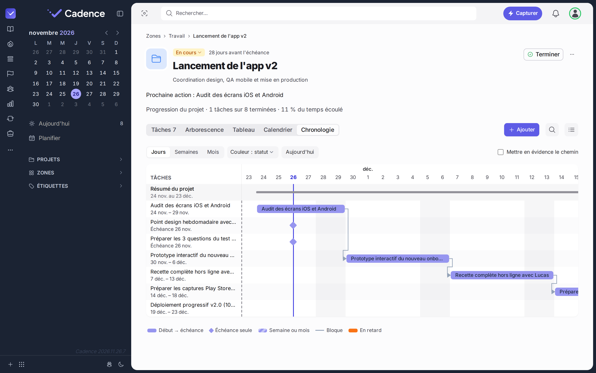
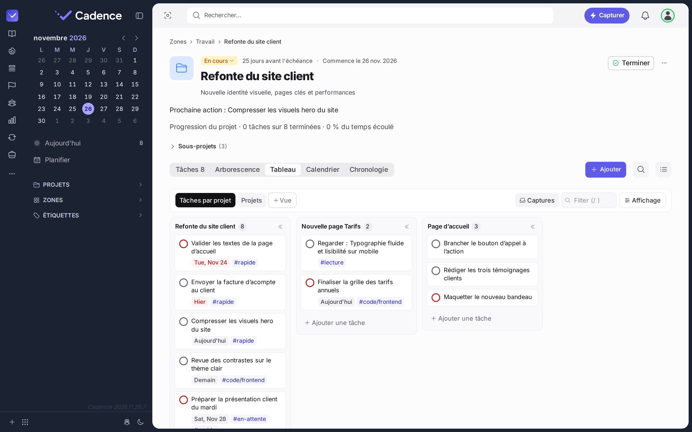
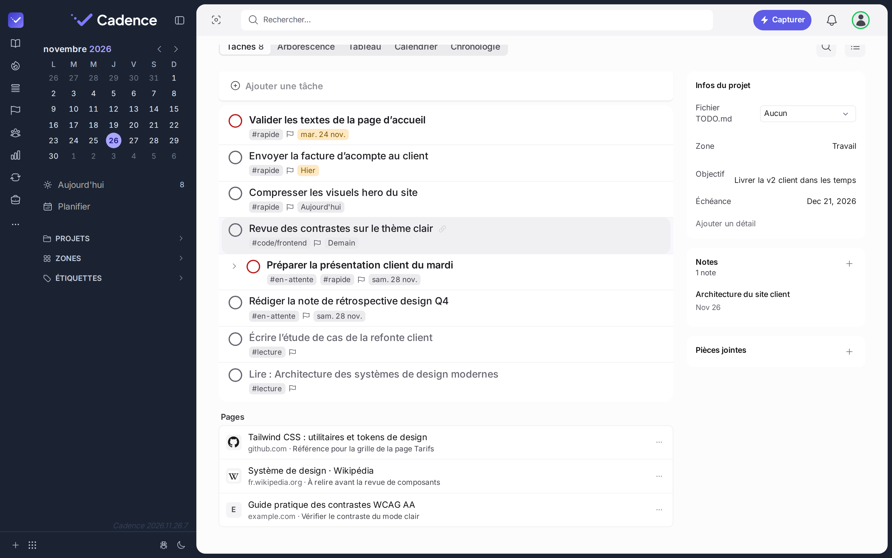

# Projets et domaines

Un projet regroupe des tâches, des notes et des pages autour d'un but précis ; une zone (appelée aussi domaine de vie) range les projets par grands pans de votre vie. Cette page couvre les projets, leurs sous-projets, leurs vues (liste, plan, tableau, frise), leurs pages et liens, la transformation d'une tâche en projet, la prochaine action, la routine de revue du vendredi et les zones.


## La hiérarchie

```
Zone (domaine de vie)
  └── Projet
        ├── Sous-projet (à toute profondeur)
        ├── Tâches
        ├── Notes
        └── Pages (adresses de référence)
```

Dans l'interface française, une zone s'appelle **Zone** (« Zones » dans la barre latérale) ; Android la nomme parfois domaine dans la saisie rapide (`~domaine`). Un projet est facultatif : une tâche ou une note peut vivre sans projet.

## Le cycle de vie d'un projet

**Statuts** (libellés français) : Non commencé, Prévu, En cours, En attente, Terminé, Abandonné, En pause, Archivé.

| Statut | Sens | Effets |
|---|---|---|
| En cours, Prévu, En attente | Projet actif | Compté dans les projets actifs |
| En pause | Mis de côté pour plus tard | Forme le **Stash** ; plus aucune notification d'échéance |
| Terminé | Fini | Date de fin enregistrée (retirée si vous rouvrez) |
| Abandonné | Décidé de ne pas poursuivre | Pas de date de fin |
| Archivé | Gardé pour mémoire | Masqué des listes et des échéances ; visible dans le filtre des projets fermés |

**Le Stash** : la page Projets affiche un compteur « N actifs · N dans le stash ». Sur Android, l'onglet Projets sépare **Actifs** et **Stash** (les en-têtes n'apparaissent que s'il y a un stash) ; les projets terminés, abandonnés et archivés sont repliés derrière « Terminés, abandonnés et archivés ». Les tâches d'un projet en pause restent visibles dans Aujourd'hui.

**Terminer un projet** : le bouton **Terminer** (devient **Rouvrir** une fois fini). S'il reste des tâches ouvertes, une question vous propose de les **terminer aussi** ou de les **laisser ouvertes**. Les tâches récurrentes ne sont jamais terminées de cette façon : elles gardent leur calendrier. L'historique `/projects/completed` (bouton Historique de la page Projets) classe les projets terminés par année puis par mois, avec les jours qu'ils ont pris.

**Supprimer un projet** est définitif : ses tâches et leurs pièces jointes sont supprimées avec lui (les notes, elles, sont détachées et conservées). Pour garder la trace sans garder le projet actif, mettez-le plutôt en **Abandonné** ou **Archivé**. Si le projet suit un fichier TODO.md, il faut d'abord le délier ([Projets TODO.md](Projets-TODO-md)).

## Les vues d'un projet

La page d'un projet a des onglets au-dessus de ses tâches : **Tâches** (la liste), **Arborescence**, **Tableau**, **Chronologie**, et en interface Minimal un onglet **Calendrier** (le mois, par échéance, glisser pour changer la date). Le choix est mémorisé, par projet en Minimal.



### Arborescence (plan)

Les tâches et sous-tâches en une liste indentée de lignes modifiables, au clavier :
- **Entrée** : enregistre la ligne et en ouvre une nouvelle au même niveau (sous-tâche du même parent pour une sous-tâche). Tapez un nom puis Entrée crée la tâche.
- **Échap** ou **Retour arrière** sur une ligne vide : abandonne la ligne.
- **Tab** : devient sous-tâche de la tâche au-dessus. **Maj+Tab** : redevient tâche, juste après son ancien parent. Un seul niveau : une tâche qui a déjà des sous-tâches ne se décale pas.
- **Alt+↑ / Alt+↓** : déplace parmi ses sœurs (l'ordre du projet, le même sur Android).
- **↑ / ↓** : passe d'une ligne à l'autre ; la case termine ou rouvre.
- Un seul ajout : « + Ajouter une tâche » en bas. En lecture seule, rien n'est modifiable. Dans un projet TODO.md, seules les nouvelles lignes et les cases sont écrites.

### Tableau (colonnes libres)

Les colonnes sont celles que vous définissez (comme des sections), indépendantes du statut des tâches.
- La première, **Sans section**, contient toute tâche sans colonne ; elle ne se renomme pas, ne se déplace pas, ne se supprime pas.
- **Ajouter une colonne** en fin de tableau ; le menu de chaque colonne permet de la renommer (ou double-clic sur son nom), d'ajouter une colonne à gauche ou à droite, de la déplacer, de la supprimer. **Supprimer une colonne ne supprime jamais ses tâches** : elles retournent dans Sans section.
- Glisser une carte vers une autre colonne la déplace ; la déposer sur une autre carte la place juste au-dessus. Glisser l'en-tête d'une colonne la réordonne.
- Un lecteur en lecture seule voit le tableau sans pouvoir le modifier.
- Une tâche qui change de projet quitte sa colonne.

**Android** : un interrupteur **Liste / Tableau** par projet. Le tableau défile horizontalement (Sans section, puis les sections), avec « + Section ». Chaque colonne offre **Renommer** et **Supprimer** (avec confirmation). Appui long pour faire glisser une carte, ou **Déplacer vers…** dans le menu de la carte comme alternative sans glisser.

### Chronologie (la frise)

Un diagramme de Gantt des tâches du projet.
- **Barres** : de la date de début à l'échéance. Une tâche avec seulement une échéance est un losange ; avec seulement un début, une courte barre estompée. Une tâche planifiée pour une **semaine** ou un **mois** sans dates exactes est une barre hachurée sur toute la semaine ou le mois. Les tâches sans date attendent dans le bac « Pas encore de dates ».
- **Planifier** : glissez une barre pour déplacer ses deux dates, une extrémité pour changer l'une, un losange pour déplacer l'échéance. Les heures sont conservées ; une barre hachurée se déplace par semaines ou mois entiers. Glisser une tâche du bac sur un jour lui donne ce jour comme début et échéance. Cliquer une barre ouvre la tâche.
- **Dépendances** : survolez le graphique, un point apparaît au bout de chaque barre ; glissez-le sur une autre tâche pour que la première **bloque** la seconde. Cliquez une flèche puis « Retirer le lien ». Lier ou déplacer une tâche **pousse plus tard** celles qu'elle bloque quand elles ne la suivent plus (jour, semaine ou mois selon la précision), jamais en arrière ; un message nomme les tâches décalées (« Tâches suivantes décalées : ... »). Un lien qui ferait une boucle est refusé.
- **Mettre en évidence le chemin** : marque la chaîne de tâches bloquantes qui fixe la fin et affiche les jours de marge des tâches hors chemin.
- **Couleur** : statut (défaut), priorité ou étiquette. **Échelle** : Jours, Semaines, Mois. Une ligne marque aujourd'hui, des traits pointillés le début et l'échéance du projet, les tâches ouvertes en retard sont orange. La frise suit le filtre et la recherche de la page.
- Une ligne de synthèse en haut va du premier début à la dernière fin, avec un losange sur la date cible de l'objectif du projet.

L'onglet **Chronologie** d'une zone montre la même frise pour la zone entière (voir aussi la Roadmap sur un trimestre).

## Sous-projets

Un projet peut avoir un **projet parent** que vous possédez, pour découper un gros projet.

- **Profondeur libre** : un sous-projet peut avoir ses propres sous-projets.
- **La zone suit le parent** : un sous-projet est toujours dans la zone de son parent, le sélecteur de zone est verrouillé, et déplacer un parent vers une autre zone déplace tous ses sous-projets.
- **Pas de cycle** : un projet ne peut devenir ni son propre parent ni l'enfant d'un de ses sous-projets. Un parent qui appartient à quelqu'un d'autre est refusé.
- **Propriétaire seulement** pour définir ou retirer le parent. Le partage n'est **pas hérité** : partager un parent ne partage pas ses sous-projets.
- **Tâches séparées** : la page d'un projet n'affiche que ses propres tâches, plus une liste **Sous-projets** au-dessus (icône, nom, nombre de tâches ouvertes, un clic ouvre le sous-projet). Les tâches des enfants ne sont pas fondues dans celles du parent.
- **Fil d'Ariane** : un sous-projet affiche « Projets (ou la zone racine) › chaque parent, racine d'abord › le sous-projet ».
- **Supprimer un parent** garde ses sous-projets : ils deviennent des projets de premier niveau.
- La barre latérale (web) replie les sous-projets sous leur parent (chevron, mémorisé par appareil ; le projet ouvert reste visible). Dans les listes déroulantes, un sous-projet se lit « Parent / Enfant ».
- **Android** : la page d'un projet liste ses sous-projets directs ; l'en-tête d'un sous-projet montre le chemin des parents. Le parent se change depuis la feuille du projet (ligne **Projet parent**, « Premier niveau » pour détacher). Un projet qui créerait un cycle n'est pas proposé.

## Tableau des sous-projets

C'est la tour de contrôle d'un projet parent (par exemple un projet « Dev » avec une cinquantaine de sous-projets), dans l'onglet **Tableau** de ce parent. Elle est pensée pour les projets qui suivent des fichiers TODO.md ([Projets TODO.md](Projets-TODO-md)) mais marche avec n'importe quels sous-projets.



**Deux vues**, au menu **Affichage** (type de vue) :

| Vue | Une colonne ou carte, c'est... | Utile pour |
|---|---|---|
| **Tâches par projet** | Une colonne par sous-projet en cours (les colonnes sans tâche sont masquées) | Voir et traiter le travail de chaque projet |
| **Projets** | Une carte par sous-projet, rangée par statut de projet (« En pause » est visible), sans limite de travail en cours | Piloter le portefeuille |

Un onglet de plus, **Toutes les tâches**, regroupe les tâches de tous les sous-projets par statut, étiquette, priorité ou section.

**Ce qu'on voit dans une colonne**
- Le nom du sous-projet avec son statut et son nombre de tâches ; l'**État actuel** réduit à la **prochaine action** (deux lignes). Branche, état de l'arbre et âge sont dans l'infobulle et le tiroir.
- **Bloqué** (pastille rouge) quand l'État actuel signale un bloqueur, **Périmé · il y a N j** (pastille grise) quand l'État actuel n'a pas bougé depuis 14 jours (réglable dans Affichage, 0 pour couper), « À jour » sinon.
- Les tâches du fichier suivent les **sections du fichier** (Now, Next, Ideas, puis les autres), dans l'**ordre du fichier** ; les tâches propres à Cadence viennent après. Une section se replie après 8 cartes (« Afficher les N autres », « Afficher moins »).
- Une coche ronde de Cadence sur chaque tâche ; un clic ouvre la fiche flottante.
- Dans la vue **Projets**, un **clic n'importe où sur une carte** (ou **Entrée** / **Espace** au clavier, ou le bouton **Voir les tâches**) ouvre un **tiroir** latéral : les tâches **en cours** d'abord, puis les autres tâches ouvertes, l'ajout rapide, le bloc « État actuel » complet (la prochaine action n'y est pas coupée) et **Ouvrir la page**. Le chiffre à côté de la barre de progression est le nombre de tâches ouvertes (« 28 ouvertes », le total au survol).
- Une carte de la vue **Projets** se **glisse d'une colonne à l'autre** pour changer le statut (ou la priorité) du sous-projet.
- Sur un écran d'ordinateur, le tableau s'arrête au bas de la fenêtre : la **barre de défilement horizontale** reste toujours visible quand les colonnes dépassent, et chaque colonne défile à part.

**La barre du tableau**
- Onglets de vues enregistrées ; **Enregistrer comme nouvelle vue** pour garder vos réglages.
- **Affichage** : type de vue, grouper par, densité (Compact, Normal, Détaillé), champs des cartes (prochaine tâche, progression, étiquettes, échéance), masquer les colonnes vides, replier une colonne en rail, limite WIP (visuelle, jamais bloquante), « Dépôts TODO.md uniquement », seuil « Périmé après (jours) ».
- **Inclure les sous-projets** (activé par défaut, réglable par projet), **7 j** (tâches créées ces 7 derniers jours : un filtre actif reste visible dans la barre, un clic l'enlève), recherche avec `/`, **Espace** ouvre le tiroir, **Échap** le ferme.
- **Actualiser les TODO.md** : relit les fichiers de tous les sous-projets, puis recharge les colonnes.
- Une colonne **Captures et Boîte de réception** (à gauche, un clic pour l'afficher) rassemble les idées et les tâches « à classer », à glisser vers un sous-projet.
- **Mobile** : barre d'onglets de colonnes en haut, une colonne pleine largeur, sélecteur de statut sur les cartes, tiroir plein écran.

**Cas particuliers** : glisser une tâche TODO.md vers un autre sous-projet est refusé (« Les tâches TODO.md restent dans leur projet de dépôt. »). Un sous-projet sans fichier fonctionne comme un projet ordinaire (pas d'État actuel).

**Android** (version 1.49 et suivantes) : vue **Tableau** d'un projet parent, colonnes par sous-projet en cours, « → prochaine action » sur deux lignes, pastille « Bloqué » ou « Périmé · il y a N j » seulement s'il y a lieu, sections du fichier avec repli après 8 cartes, case ronde et fiche de tâche ; **Actualiser les TODO.md** dans le menu de la page, pour le propriétaire seulement. Branche et arbre ne sont pas affichés sur le téléphone (ils restent dans l'infobulle web). Pas de colonnes sans tâche ni de couloirs.

## Pages et liens d'un projet

Un projet rassemble ses **pages** : le matériau dont il se sert (documentation, articles, dépôts, outils). Une adresse vit toujours à un endroit : dans une **tâche** (quelque chose à faire : essayer, lire, regarder) ou dans les **pages d'un projet** ; tout le reste est une note. Il n'y a plus de bibliothèque de liens à trier.



**Ce que ça fait.** Sous les tâches du projet, une section **Pages** liste chaque page (initiale ou icône du site, titre, site, note) et ouvre l'adresse. Une même adresse n'existe qu'une fois par projet, mais peut être dans deux projets.

**Comment s'en servir**
- **⋯ par page** : **Créer une tâche** (dans le projet, nommée d'après le type de page, avec l'adresse en note), **Modifier** (titre et note), **Retirer**.
- **⋯ du projet** : **Copier les pages en Markdown** (une puce `[Titre](adresse)` par page) et **Vérifier les pages**.
- **Ajouter une page** : depuis l'[Inbox ou le partage Android](Boite-de-reception-et-capture) (choix **Projet…**), depuis le module Firefox, par import de favoris, ou par un agent (MCP).
- **Importer des favoris** (web) : Projets › ⋯ › **Importer des favoris** lit un export Firefox (Bibliothèque › Importation et sauvegarde › Exporter) ; un dossier devient les pages d'un projet, un nouveau projet du même nom (par défaut) ou un projet choisi, par lots de 100.
- **Firefox** : **Envoyer au projet** (cet onglet) ou **Envoyer le groupe** (tous les onglets de son groupe d'onglets) ; **Ouvrir le projet** rouvre ses pages dans des onglets rassemblés dans un groupe nommé comme le projet (Firefox 139 et suivantes). Voir [Client Linux et Firefox](Client-Linux-et-Firefox).
- **Android** : la même section et les mêmes menus, avec ajout hors ligne.
- **Aperçus** : toute adresse écrite dans la note d'une tâche, une note ou la description d'un projet affiche une carte (image, titre, site, et pour un dépôt GitHub « ★ étoiles · langage · dernier push »). Une adresse affichée dans une ligne de tâche montre l'icône et le nom du site à la place de l'adresse.

**Cas particuliers**
- **Vérifier les pages** interroge chaque adresse une fois : 404, 410 ou un site qui ne répond pas sont marqués **Introuvable** ; 401 et 403 (page derrière une connexion) ne sont **jamais** « introuvables ». Rien n'est supprimé ; un résumé dit « N pages introuvables » ou « Toutes les pages répondent ».
- Les adresses de contexte (adresses IP, réseau local, mails, conversations, recherches, intégration continue) ne donnent ni aperçu ni page automatique.
- La lecture d'une page est faite par le serveur, jamais par votre appareil : le site ne sait pas qui regarde. Hors ligne, Android garde les aperçus déjà lus.
- Filtre **Avec un lien** (Tâches › filtre) : les tâches dont le nom ou la note contient une adresse web.

## Transformer une tâche en projet

Une tâche trop grosse pour rester une tâche devient un projet : menu **⋯** de la tâche (ligne ou page, web) ou fiche et menu de ligne (Android) › **Transformer en projet**. Un agent le fait aussi (MCP).

- Le **nom** de la tâche devient le nom du projet ; sa **note** devient la description ; ses **sous-tâches** deviennent les tâches du projet ; les **adresses de sa note** deviennent les **pages** du projet ; ses étiquettes et sa zone suivent. La tâche d'origine disparaît.
- La confirmation dit : « Transformer `<nom>` en projet ? Ses sous-tâches deviennent les tâches du projet et les adresses de sa note ses pages. »
- **Refusé** pour une tâche récurrente, une sous-tâche, une tâche qui suit un fichier TODO.md, ou la tâche de quelqu'un d'autre.
- Android envoie la demande comme un appel différé et masque la tâche en attendant que la synchro apporte le projet.

## Projets pas touchés depuis 30 jours

En bas de la page Projets, un bloc replié **Pas touché depuis 30 jours (N)** liste les projets ouverts (ni terminés, ni abandonnés, ni archivés, ni modèles) sans aucun changement du projet, de ses tâches ou de ses pages depuis 30 jours, du plus ancien au plus récent. Chaque ligne a **Garder** : le projet est considéré comme revu et sort de la liste pour 30 jours. **Rien n'est archivé ni fermé** : c'est une invitation à décider, jamais une action automatique. Android affiche le même bloc en bas de la liste des projets (dernière réponse gardée hors ligne).

## La prochaine action d'un projet

Le projet peut désigner **une** de ses tâches ouvertes comme « ce qu'il faut faire ensuite ».

- **Choisir** : clic droit sur une ligne de tâche du projet (Minimal) et cochez **Prochaine action** ; cochez de nouveau pour la retirer. Android : menu et fiche de la tâche (**Prochaine action** / **Retirer la prochaine action**).
- **Règles** : ce doit être une tâche **ouverte du même projet** (sinon refusé). Elle est **retirée automatiquement** quand la tâche est terminée, archivée, annulée, supprimée ou déplacée dans un autre projet.
- **Affichage** : « Prochaine action : `<titre>` » dans l'en-tête de la page et sur les cartes de projet. Sans choix, la page propose sa suggestion automatique ; les cartes n'affichent rien.
- **Effet sur Aujourd'hui** : pour un projet qui a une prochaine action, c'est la **seule** tâche que la liste de suggestions d'Aujourd'hui propose pour ce projet (les tâches déjà en cours, dues ou en retard s'affichent quand même dans leurs propres sections). Un projet sans choix se comporte comme avant.
- Elle est synchronisée avec les appareils.

## La routine de revue du vendredi

La revue hebdomadaire ([Revue, bilan et focus](Revue-bilan-et-focus)) propose, de façon facultative et jamais automatique, un lien discret **Planifier une revue hebdo le vendredi** : il crée une tâche récurrente « Revue hebdomadaire » le vendredi, dont la note renvoie vers la page de revue, sans rappel ni notification. C'est une tâche ordinaire que vous pouvez modifier ou supprimer.

## Les zones (domaines de vie)

Une **zone** range vos projets par grands pans de vie (Travail, Perso, Santé...). Elle a un nom, une description et une couleur facultatifs.

**Suggérer 5 zones.** Jamais automatique. Sur la page Zones vide, un bouton **Suggérer 5 zones** ; au-dessus de la liste, quand il en manque, un lien discret du même nom. Il crée dans votre langue : Business et Argent, Tech et Systèmes, Perso, Famille et Social, Logistique. Un nom déjà présent (casse ignorée) est ignoré. Ce sont des zones ordinaires que vous pouvez renommer, réordonner ou supprimer. Sur Android, l'action est la même et nécessite d'être en ligne.

**La page d'une zone** (`/area/...`) : une carte d'en-tête (nombre de projets, de tâches, d'objectifs actifs, couleur de la zone en fond), un côté objectifs (chaque objectif actif avec ses projets, un bloc **Entretien** pour les projets d'entretien, un bloc **Non liés**, les objectifs inactifs repliés, un avertissement au-delà de 5 objectifs actifs) et un côté tâches directement rangées dans la zone. L'onglet **Chronologie** montre la frise de la zone. Les projets terminés ou abandonnés se replient dans **Terminés (N)**.

**Supprimer une zone** ne supprime ni projets ni tâches : les projets deviennent « sans zone » (filtre **Sans zone** de la page Projets pour les retrouver).

**Partage** : une zone peut être partagée ; le partage s'étend à tous les projets que vous y rangez (et leurs tâches et notes), y compris ceux que vous y ajoutez plus tard. Un projet marqué **Restreint** est exclu : seuls vous, le propriétaire de la zone et les personnes avec qui le projet lui-même est partagé le voient.

**Sur Android** : une rangée de puces filtre Aujourd'hui, À venir et Projets par zone (le choix est gardé).

## Autres réglages de projet

- **Priorité** (aucune, moyenne, haute), **échéance** (notifications à l'approche, jamais en rouge pour une date passée dans l'en-tête : « Échéance 20 sept. »).
- **Épingler** : un projet épinglé apparaît dans le bloc **Épinglés** en haut de la barre latérale ; sur Android, en tête du sélecteur de listes.
- **Icône** : choisie dans le jeu partagé avec Android ; **bannière** : une image large en haut de la page projet (web et Android, modifiée sur le web seulement).
- **Modèles** : **Enregistrer comme modèle** crée un modèle (tâches copiées avec statut remis à zéro), **Créer depuis un modèle** le clone. Android : bouton « + » sur Projets › « Depuis un modèle » (en ligne).
- **Partage** : avec une personne ou un groupe, en lecture ou lecture-écriture ; l'invité doit accepter. Voir [Personnes et proches](Personnes-et-proches).
- **Objectif** : un projet se lie à un objectif ([Objectifs](Objectifs)) ou est marqué **Entretien**.

## Pour aller plus loin

- [Projets (doc)](https://github.com/PreciselyWrong/cadence/blob/main/docs/06-projects.md), [Zones (doc)](https://github.com/PreciselyWrong/cadence/blob/main/docs/07-areas.md), [Liens, pages et transformation en projet (doc)](https://github.com/PreciselyWrong/cadence/blob/main/docs/37-links.md)
- [Plan de la tour de contrôle des sous-projets](https://github.com/PreciselyWrong/cadence/blob/main/docs/fork/PLAN-kanban-control-tower.md)
- Pages du wiki : [Projets TODO.md](Projets-TODO-md), [Tâches](Taches), [Objectifs](Objectifs), [Revue, bilan et focus](Revue-bilan-et-focus), [Android](Android)
