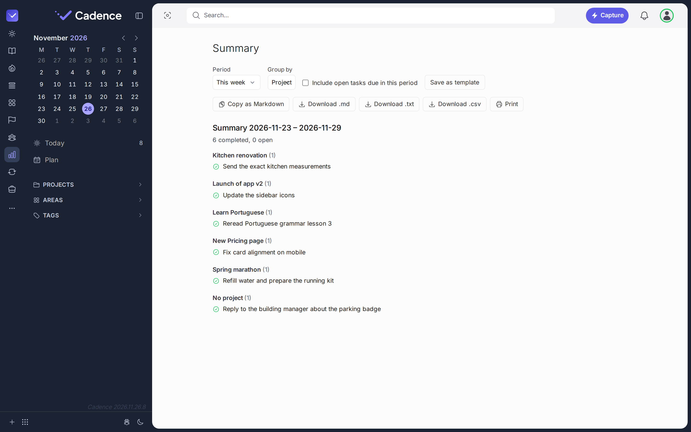

# Review, Insights, and Focus

Cadence lets you keep hundreds of ideas without showing them all every day, and shows you what keeps slipping when you choose to look. This page covers the **review** (the decision funnel, postponements, the quick review, the Friday weekly review), Android's **Bilan** (Review tab), the **summary** and statistics, and **focus** (the timer and the focus chip).

Nothing here needs AI, nothing sends a notification, and nothing is a due date.

## The decision funnel

A task moves from one stage to the next, without it ever being a numbered commitment:

| Stage | Meaning | Where it lives |
|---|---|---|
| **Inbox** | Captured, not decided | The inbox (the ideas) |
| **In view** | A possibility kept in sight: no commitment, no priority, no pin, no status | A marker on the task |
| **This week** | Decided for this week (this is not a due date) | A "week of" marker on the task |
| **Today** | The daily plan | Today's plan |
| **Now** | The block in progress | The Now card |
| **Later** | Set aside: kept, findable, out of the day's suggestions | The `someday` system tag, with an optional **review date** |
| **Review** | Maintenance, whenever you want | The **Review** page |

Three different intentions remain three different things: *hide until a time* (**Defer until**), *wait for something* (**Waiting** status or a blocking link), *keep for later and decide again someday* (**Later**, with a review date). A project has no "In view": you set it aside with the `someday` tag.

**Setting them**: on a task's card (panel and full page), three chips **In view**, **This week**, **Later**, and the postponement row below them; a **Review on** date only appears for a task that is set aside or already dated. The right-click menu of a row in the Minimal interface offers the same choices. On Android: the card, the row menu, and the swipe.

**Effects on Today**: in the "To do today" list, tasks decided for the week come first among the suggestions, then those in view, before the usual ranking; they ignore planning filters (since you chose them); a future defer date still holds them back. Their row says "This week" or "In view" instead of "Suggested". The daily plan never falls back on a `someday` task, and a `someday` task is never overdue.

**This week**: it is the calendar week that contains today, according to your first day of the week (Monday by default). It stays "this week" until its last day: on a Sunday, the "week" of a user who starts on Monday is the one that ends tonight. To plan the following week, choose "Next week" (Plan page).

## Postponements (what keeps slipping)

The history is the one the app already keeps: the user's due-date changes and daily plans. Nothing is counted at write time: everything can be rebuilt.

| Type of due-date change | A postponement? |
|---|---|
| Moved to a later day when the old day had arrived, or was tomorrow | **Yes** (pushed back) |
| Moved well in advance to a later day | No: a change of plan |
| Same day, another time (the planner's "Postpone" does not even touch the due date) | No |
| Moved earlier, date set, date removed | No |
| Changed automatically (import, Google or CalDAV server sync, recurrence, any source other than the app, an API key, or your own device) | No |

A **daily plan** also counts: a one-off task that was in a past day's plan and was not completed by the end of that day is "planned, not done". Recurring tasks and habits are excluded (they reopen on their own).

- **One postponement per abandoned day**: being pushed out of Tuesday's plan and having its Tuesday due date moved make **a single** postponement; moving a task three times in the afternoon is a single postponement for the day left.
- Only **your own writes** count for you. On a shared task, another person's changes are theirs.
- Moving an occurrence of a recurring task is recorded on the series as a due-date change (from its day to the new one), counted like the others. A due date received by sync from one of your devices is recorded with the date the device changed it (never in the future) and counts as a change made in the app.
- Never counted: completing a recurring task, skipping an occurrence, Google or CalDAV sync. A spreadsheet import, agents (MCP), and AI suggestions you accepted are noted in the task's history but count as **automatic**.
- **No label counts days of lateness**: a task without a date is never overdue, and an overdue task shows its date ("Due Sep 20"), not a number of days.

**Frequently pushed back**: a task is listed in **Pushed back** when it was pushed back **3 times or more in the last 30 days**. **Keep as is** restarts the count from that day (the full history remains).

**In the task panel**: once pushed back, a grey line says "Moved N times, M in the last 30 days" (with the last date). The tone is neutral: it describes, blames nothing. A click lists the history (pushed back, rescheduled, date removed, planned-not-done). On the Plan page, a task in the "Pushed back" list carries a discreet "↻ N×" badge.

## The Review page

Opened from **More** in the Minimal sidebar (can be moved into the bar in Profile › Sidebar), the app launcher, or Insights in the Dense interface. The header says calmly how many things need a look ("5 things to look at, at your own pace", each counted once even when in two lists, or "All up to date"), never a number of decisions.

**The tabs** are the stages of a review, in order; each can be opened on its own, and the page remembers the last one. **Next: ...** at the bottom moves to the next stage. Decisions are written **one by one** on the tasks: a review stopped after four items resumes where it was and loses nothing. A tab's counter is what needs a look; **Later** only counts reviews that have come due (133 ideas kept are a stock, not a debt).

| Tab | Content | Choices |
|---|---|---|
| **To decide** | The open ideas in the Inbox, oldest first | Create a task, This week, Park for later, Discard; the Inbox for the rest |
| **Pushed back** | Frequently pushed-back tasks, most pushed first, with project, count, last planned date | Do today, **Short session today (25 min)**, Break into steps, Later, Drop, Keep as is |
| **Stalled projects** | Active projects (in progress or planned) with no next task, or with no change in 30 days, or with two or more pushed-back tasks | Add the next task (inline field), Open project, Put on hold, Keep as is |
| **Later** | Tasks set aside and those whose review date has arrived (due reviews first) | Do today, This week, Review in 30 days, Review on..., In view, Keep parked, Done, Drop |
| **Old** | Open tasks unchanged for 90 days (excluding set-aside, waiting, recurring, habits, sub-tasks) | This week, In view, Later, Keep as is, Drop |
| **This week** | Tasks decided for the week, then those in view, with the planned time | Decided: Do today, Not this week, Later. In view: This week, Out of view, Later; **Help me choose** |

- **Keep as is** on a project hides "no next task" until the project or one of its tasks changes, and "no change" for 30 more days. Projects on hold, not started, completed, abandoned, set aside, templates, and those whose open tasks are all waiting or deferred, are excluded from stalled projects.
- Each choice marks the task "reviewed": this is what counts the "decisions this week" and refreshes an old task.

### Later, as a stock

Later is where most set-aside ideas live: it reads as a stock, not as a flat list.
- **Grouped** by project, then by area for a task with no project, then "No project"; groups are ranked by most recently touched task; within a group, due reviews first. A group header shows its count and folds; a long list (more than 20) only opens the first group.
- **A single filter** (title, project or area, tags, link title) ignores case and accents.
- A row whose title contains an address shows its link (title, a description line, domain) instead of the raw address.
- **Do today** on a set-aside task **also takes it out of Later** (otherwise a `someday` task would never reach Today's suggestions).
- **Android**: swipe right = **Do today**, swipe left = **Review in 30 days**; each decision shows **Undo**. **Sort one by one** shows a single task at a time, large, with the same choices and **Skip** ("N of M"); skipped tasks go to the end of the queue (kept on the device, the queue resumes where it was).
- **Short session today (25 min)** (Pushed back list) adds the task, with no time and 25 minutes, to the daily plan and marks it reviewed; neither the due date nor the estimate changes, and there is no **Undo** (the daily plan is yours). On Android, this needs the network: offline, nothing is written and the phone says so.

### The quick review

**Quick review** ("About 5 minutes, one thing at a time. Stop whenever you like.") shows one item, its usual choices, and **Skip**, then the next. It reads each list once and builds a queue of **10 items at most**: first what needs a look (in the tabs' order: Inbox, pushed back, stalled projects, due set-aside ones, old ones), then set-aside ideas, those looked at longest ago first. **At least 3 places** go to set-aside ideas when there are any, whatever the load elsewhere: a big stock is read a few ideas at a time instead of never. A task present in two lists only comes once.

- For a set-aside task, **Do today**, **This week**, and **Keep parked** are one gesture away (the rest under **More...**): an idea that was looked at goes to the back of the queue for next time.
- **Skip** writes nothing: the item will come back in a later session. **Another round** builds a new queue without what was skipped during the visit.
- Progress is the session's ("3 of 10" and a thin bar), never the size of what remains. End: "That's it for now."; with nothing to look at: "Nothing needs a look right now."
- **Keyboard (web)**: **1 to 9** chooses the option with that number (shown on the chips; a choice that asks for a date is made with the mouse), **S** or **Right arrow** skips, **O** opens the item, **Esc** stops. Keys are ignored when you are typing in a field or with Ctrl, Alt, Meta.
- **Android**: the same queue full screen above the review, same choices, **Skip**, "N of M", a thin bar; Back stops. An item decided elsewhere (a list, another device) leaves the session on its own.
- Nothing new is stored: the session lives in the page (web) or the screen (Android), and each decision is the same write as in the lists.

### The week's capacity

The **This week** tab shows "4 h 30 planned / 6 h available": the sum of the estimates of tasks decided for the week against the weekly time you set by clicking **Set available time** (empty: only the planned time shows). Tasks without an estimate are counted ("N without estimate"), never required. **Help me choose** (above the list if there are at least two candidates) compares two tasks side by side ("Which one now?"): the chosen one stays and meets the next, **Neither** sets them aside; the last one can be added to the day. No task data changes, no score.

### The Friday routine

Optional, never automatic. As long as you have no review routine, the header offers a discreet **Plan a weekly review on Fridays** link: it creates a recurring "Weekly review" task on Fridays, whose note points to this page, with no reminder or notification. The link disappears when such a routine exists (an open weekly recurring task whose note contains `/review`, no matter who created it) and comes back if it is deleted; creating it twice does nothing.

### "Plan my week" and "Prepare my review"

Two buttons ("Plan my week (AI)" and "Prepare my review") start a background job ("Preparing..." then "Your week is ready"): a native sheet groups the changes by day with a checkbox each and only applies the ones you check; a prepared review is validated one item at a time in the quick review. See [AI and Proposals](AI-and-Proposals).

## Android's Bilan

The **Bilan** (Review) is the fifth tab of Android's bar (Inbox, Tâches (Tasks), Agenda, Habitudes (Habits), Bilan). It starts with figures, then the **review of the week's tasks**:

- Figures: "terminées cette semaine" (completed this week) (with "N la semaine dernière" (N last week)), "échues" (due), and "régularité des habitudes" (habit consistency) (30-day average).
- **Tâches de la semaine** (The week's tasks): completed by day, by project ("Par projet" (By project), "Sans projet" (No project)) and due; an overdue task opens in Tâches. Red and green are only used for exceptions (a missed day, lateness, a change of at least 10 points).
- **Revue** (Review): a pushed screen in six stages (those of the web tabs: To decide, Pushed back, Stalled projects, Later, Old, This week), the stage is kept between sessions. Lists come from the server when online (last read kept offline): the app never recodes the ranking. A row decided on the phone is hidden as long as its local date is more recent than the server's. Decision writes work **offline**.
- An **Objectifs** (Goals) card ([Goals](Goals)) and the **Régularité** (Consistency) panel for habits ([Habits](Habits)).
- No reminder or notification for the review.

## The summary and statistics

**Insights › Summary** (`/insights/summary`) lists what you finished over a period, ready to paste into a team standup, a journal, or a timesheet.

1. **Period**: Today, This week, Last week, This month, or a **custom range** (366 days at most). Weeks start on your first day of the week; "Today" follows your profile's time zone even if your browser is elsewhere.
2. **Tasks**: those completed during the period; the **Include open tasks due in this period** checkbox adds open tasks (not completed, archived, or cancelled) due in the period.
3. **Group by**: Project (alphabetical, "No project" last), Day (completion day, otherwise due day), or Status.
4. **Export**: **Copy as Markdown**, **Download .md / .txt / .csv**, or **Print** (the browser's dialog, the summary only).

**Save as template** keeps the grouping and the "include open ones" choice: the page opens that way the next time.

Special cases: days are whole days in your time zone (a task finished at 11:30 pm counts that day even if it is the next day in UTC); only top-level tasks are listed (not sub-tasks); visibility follows task lists (your tasks, those shared with you, those of shared projects). The CSV is UTF-8 with a BOM so that spreadsheets read accents correctly, and cells that start with `=`, `+`, `-`, or `@` are prefixed with an apostrophe to block formula injection.

The other statistics (custom Eisenhower matrices, productivity) are under **Insights**; focus statistics are described below.

## Focus

Two things go by this name in Cadence.

### The timer (focus sessions)

The **tomato timer** in the top bar (25 minutes) keeps track of the time you concentrated:
- A timer that runs to the end records a **25-minute** session, once, even if the page was closed and reopened in the meantime.
- **Resetting or closing** the timer early records the time already focused **if it reaches 5 minutes**; shorter attempts are dropped.
- **Breaks do not count**: the start time is the end time minus the focused time.
- A session can be linked to a task (`task_uid` on the API side); the timer does not choose one yet.

**Where you see them**
- **Calendar**: orange blocks at the time they took place, titled "Focus" or "Focus: task name". Display options › "Show focus sessions" (on by default).
- **Insights › Productivity › Focus**: total time, sessions, the **most focused hour**, minutes per day and per hour over 7, 30, or 90 days, and the five most worked-on tasks (in your time zone). With no session: "No focus sessions yet. Start the tomato timer in the top bar; completed sessions are counted here.".

### The focus chip (concentrate on one part of your life)

A **Focus chip** on the left of the top bar limits the app to **one area**, optionally **one project** of that area, and optionally **tags** (ten at most). The choice is saved with the account and follows it on all devices. The chip shows "Focus" when nothing is chosen, otherwise the scope in the form `Area › Project · #tag`; on a phone, only the icon appears, with a dot when a focus is active. **Apply** saves, **Clear** removes; a cross next to the chip clears it with a click on a wide screen.

**While a focus is active**
- **Today and the plan** only suggest tasks from the focus; tasks already placed in the daily plan are never removed (those outside the focus are dimmed).
- **Upcoming**, **Tasks**, **Projects** (locked to the focus's area), **Notes**, and **search** only show the focus. Saved views keep their own criteria.
- **New tasks** from quick capture get the focus's project and tags when the text names none; a typed `+project` or `#tag` wins. A task without a project gets the focus's area. **New notes** get the focus's project, and a **new project** starts in the focus's area.
- An empty list says "Showing `<focus>` only" with a link to clear it, so that an empty page is not mistaken for an empty account.
- **Not affected**: the calendar, the Kanban and Eisenhower boards, the Inbox list, tag and area pages, habits, the API, MCP, and Telegram.

**When things change**: a focus that names a deleted area or project, or a project moved out of the focus's area, is dropped at the next app load. Until then, lists come back empty rather than crash.

## Going further

- [Review (doc)](https://github.com/PreciselyWrong/cadence/blob/main/docs/34-review.md), [Summary (doc)](https://github.com/PreciselyWrong/cadence/blob/main/docs/31-summary.md), [Focus sessions (doc)](https://github.com/PreciselyWrong/cadence/blob/main/docs/30-focus-sessions.md), [Focus (doc)](https://github.com/PreciselyWrong/cadence/blob/main/docs/25-focus.md), [Proposals (doc)](https://github.com/PreciselyWrong/cadence/blob/main/docs/47-proposals.md)
- Wiki pages: [Tasks](Tasks), [Today and Daily Plan](Today-and-Daily-Plan), [Projects and Areas](Projects-and-Areas), [AI and Proposals](AI-and-Proposals), [Android](Android)
