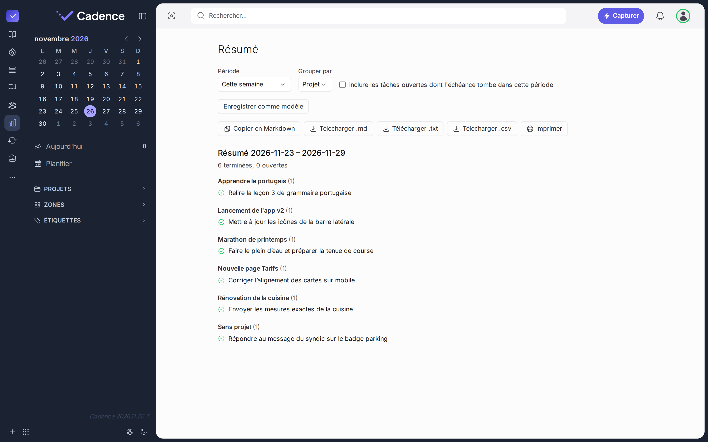

# Revue, bilan et focus

Cadence vous laisse garder des centaines d'idées sans toutes les montrer chaque jour, et vous montre ce qui glisse sans cesse quand vous choisissez de regarder. Cette page couvre la **revue** (l'entonnoir de décision, les reports, la revue rapide, la revue hebdo du vendredi), le **Bilan** d'Android, le **résumé** et les statistiques, et le **focus** (le minuteur et la puce de focus).

Rien ici n'a besoin de l'IA, rien n'envoie de notification, et rien n'est une échéance.

## L'entonnoir de décision

Une tâche progresse d'une étape à l'autre, sans que ce soit jamais un engagement chiffré :

| Étape | Sens | Où ça vit |
|---|---|---|
| **Inbox** | Capturée, pas décidée | La boîte de réception (les idées) |
| **En vue** | Une possibilité gardée à l'œil : ni engagement, ni priorité, ni épingle, ni statut | Un repère sur la tâche |
| **Cette semaine** | Décidée pour cette semaine (ce n'est pas une échéance) | Un repère « semaine de » sur la tâche |
| **Aujourd'hui** | Le plan du jour | Le plan d'Aujourd'hui |
| **Maintenant** | Le bloc en cours | La carte Maintenant |
| **Plus tard** | Mise de côté : gardée, trouvable, hors des suggestions du jour | L'étiquette système `someday`, avec une **date de revue** facultative |
| **Revue** | La maintenance, quand vous voulez | Page **À revoir** |

Trois intentions différentes restent trois choses différentes : *cacher jusqu'à un moment* (**Reporter jusqu'au**), *attendre quelque chose* (statut **En attente** ou lien de blocage), *garder pour plus tard et décider de nouveau un jour* (**Plus tard**, avec une date de revue). Un projet n'a pas d'« En vue » : on le met de côté avec l'étiquette `someday`.

**Les poser** : sur la fiche d'une tâche (panneau et page complète), trois puces **En vue**, **Cette semaine**, **Plus tard**, et la ligne de reports dessous ; une date **Revoir le** n'apparaît que pour une tâche mise de côté ou déjà datée. Le clic droit d'une ligne en interface Minimal propose les mêmes choix. Sur Android : la fiche, le menu de ligne et le balayage.

**Effets sur Aujourd'hui** : dans la liste « À faire aujourd'hui », les tâches décidées pour la semaine viennent d'abord parmi les suggestions, puis celles en vue, avant le classement habituel ; elles ignorent les filtres de planification (puisque vous les avez choisies) ; une date de report future les retient encore. Leur ligne dit « Cette semaine » ou « En vue » au lieu de « Suggérée ». Le plan de la journée ne retombe plus jamais sur une tâche `someday`, et une tâche `someday` n'est jamais en retard.

**Cette semaine** : c'est la semaine civile qui contient aujourd'hui, selon votre premier jour de semaine (lundi par défaut). Elle reste « cette semaine » jusqu'à son dernier jour : un dimanche, la « semaine » d'un utilisateur qui commence le lundi est celle qui finit ce soir. Pour planifier la semaine suivante, choisissez « Semaine prochaine » (page Plan).

## Les reports (ce qui glisse)

L'historique est celui que l'app tient déjà : les changements d'échéance et les plans de jour de l'utilisateur. Rien n'est compté à l'écriture : tout peut se reconstruire.

| Type de changement d'échéance | Un report ? |
|---|---|
| Déplacée vers un jour plus tard alors que l'ancien jour était arrivé, ou était demain | **Oui** (repoussée) |
| Déplacée bien en avance vers un jour plus tard | Non : changement de plan |
| Même jour, autre heure (« Reporter » du planificateur ne touche même pas l'échéance) | Non |
| Avancée, date posée, date retirée | Non |
| Changée automatiquement (import, synchronisation serveur Google ou CalDAV, récurrence, toute source autre que l'app, une clé d'API ou votre propre appareil) | Non |

Un **plan de jour** compte aussi : une tâche ponctuelle qui était au plan d'un jour passé et n'a pas été terminée à la fin de ce jour est « planifiée, pas faite ». Les tâches récurrentes et les habitudes sont exclues (elles se rouvrent seules).

- **Un report par jour abandonné** : être poussée hors du plan du mardi et voir son échéance du mardi déplacée font **un seul** report ; déplacer trois fois une tâche dans l'après-midi est un seul report pour le jour quitté.
- Seules **vos propres écritures** comptent pour vous. Sur une tâche partagée, les changements d'une autre personne sont les siens.
- Déplacer une occurrence d'une tâche récurrente est enregistré sur la série comme un changement d'échéance (de son jour vers le nouveau), compté comme les autres. Une échéance reçue par la synchronisation depuis un de vos appareils est enregistrée avec la date où l'appareil l'a changée (jamais dans le futur) et compte comme un changement fait dans l'app.
- Jamais comptés : terminer une tâche récurrente, sauter une occurrence, la synchronisation Google ou CalDAV. Un import de tableur, les agents (MCP) et les suggestions de l'IA que vous avez acceptées sont notés dans l'historique de la tâche mais comptent comme **automatiques**.
- **Aucun libellé ne compte des jours de retard** : une tâche sans date n'est jamais en retard, et une tâche échue montre sa date (« Échéance 20 sept. »), pas un nombre de jours.

**Fréquemment repoussée** : une tâche est listée dans **Repoussées** quand elle l'a été **3 fois ou plus sur les 30 derniers jours**. **Garder tel quel** recommence le compte à partir de ce jour (l'historique complet reste).

**Dans le panneau de la tâche** : une fois repoussée, une ligne grise dit « Déplacée N fois, dont M ces 30 derniers jours » (avec la dernière date). Le ton est neutre : elle décrit, ne reproche rien. Un clic liste l'historique (repoussée, reprogrammée, date retirée, planifiée-pas-faite). Sur la page Plan, une tâche de la liste « Repoussées » porte une pastille « ↻ N× » discrète.

## La page « À revoir »

Ouverte depuis **Plus** dans la barre latérale Minimal (déplaçable dans la barre dans Profil › Barre latérale), le lanceur d'apps, ou Aperçus en interface Dense. L'en-tête dit calmement combien de choses demandent un regard (« 5 choses à regarder, à votre rythme », chacune comptée une fois même dans deux listes, ou « Tout est à jour »), jamais un nombre de décisions.

**Les onglets** sont les étapes d'une revue, dans l'ordre ; chacun peut s'ouvrir seul, la page se souvient du dernier. **Suivant : ...** en bas passe à l'étape suivante. Les décisions s'écrivent **une par une** sur les tâches : une revue arrêtée après quatre éléments reprend là où elle en était et ne perd rien. Le compteur d'un onglet est ce qui demande un regard ; **Plus tard** ne compte que les revues arrivées à échéance (133 idées gardées sont un stock, pas une dette).

| Onglet | Contenu | Choix |
|---|---|---|
| **À décider** | Les idées ouvertes de l'Inbox, les plus anciennes d'abord | Créer une tâche, Cette semaine, Mettre de côté, Supprimer ; l'Inbox pour le reste |
| **Repoussées** | Les tâches fréquemment repoussées, les plus repoussées d'abord, avec projet, nombre, dernière date prévue | Faire aujourd'hui, **Session courte aujourd'hui (25 min)**, Découper en étapes, Plus tard, Abandonner, Garder tel quel |
| **Projets stagnants** | Projets actifs (en cours ou prévus) sans prochaine tâche, ou sans changement depuis 30 jours, ou avec deux tâches repoussées ou plus | Ajouter la prochaine tâche (champ en ligne), Ouvrir le projet, Mettre en attente, Garder tel quel |
| **Plus tard** | Les tâches mises de côté et celles dont la date de revue est arrivée (les revues dues d'abord) | Faire aujourd'hui, Cette semaine, Revoir dans 30 jours, Revoir le..., En vue, Laisser de côté, Terminer, Abandonner |
| **Anciennes** | Tâches ouvertes inchangées depuis 90 jours (hors mises de côté, en attente, récurrentes, habitudes, sous-tâches) | Cette semaine, En vue, Plus tard, Garder tel quel, Abandonner |
| **Cette semaine** | Les tâches décidées pour la semaine, puis celles en vue, avec le temps prévu | Décidées : Faire aujourd'hui, Pas cette semaine, Plus tard. En vue : Cette semaine, Retirer de la vue, Plus tard ; **Aidez-moi à choisir** |

- **Garder tel quel** d'un projet masque « pas de prochaine tâche » jusqu'à ce que le projet ou une de ses tâches change, et « pas de changement » pour 30 jours de plus. Les projets en attente, non commencés, terminés, abandonnés, mis de côté, les modèles, et ceux dont toutes les tâches ouvertes sont en attente ou reportées, sont exclus des projets stagnants.
- Chaque choix marque la tâche « revue » : c'est ce qui compte les « décisions cette semaine » et rajeunit une tâche ancienne.

### Plus tard, comme un stock

Plus tard est l'endroit où vivent la plupart des idées mises de côté : il se lit comme un stock, pas comme une liste plate.
- **Groupé** par projet, puis par zone pour une tâche sans projet, puis « Sans projet » ; les groupes sont classés par tâche la plus récemment touchée ; dans un groupe, les revues dues d'abord. Un en-tête de groupe montre son nombre et se replie ; une longue liste (plus de 20) n'ouvre que le premier groupe.
- **Un filtre** unique (titre, projet ou zone, étiquettes, titre du lien) ignore casse et accents.
- Une ligne dont le titre contient une adresse affiche son lien (titre, une ligne de description, domaine) au lieu de l'adresse brute.
- **Faire aujourd'hui** sur une tâche mise de côté la **sort aussi de Plus tard** (sinon une tâche `someday` n'arriverait jamais dans les suggestions d'Aujourd'hui).
- **Android** : balayage vers la droite = **Faire aujourd'hui**, vers la gauche = **Revoir dans 30 jours** ; chaque décision montre **Annuler**. **Trier un par un** montre une tâche à la fois, en grand, avec les mêmes choix et **Passer** (« N sur M ») ; les tâches passées vont en fin de file (gardée sur l'appareil, la file reprend où elle en était).
- **Session courte aujourd'hui (25 min)** (liste Repoussées) ajoute la tâche sans heure, 25 minutes, au plan du jour et la marque revue ; ni l'échéance ni l'estimation ne changent, et il n'y a pas d'**Annuler** (le plan du jour est le tien). Sur Android, cela demande le réseau : hors ligne, rien n'est écrit et le téléphone le dit.

### La revue rapide

**Revue rapide** (« Environ 5 minutes, une chose à la fois. Arrêtez quand vous voulez. ») montre un élément, ses choix habituels et **Passer**, puis le suivant. Elle lit chaque liste une fois et fabrique une file de **10 éléments au plus** : d'abord ce qui demande un regard (dans l'ordre des onglets : Inbox, repoussées, projets stagnants, mises de côté dues, anciennes), puis des idées mises de côté, celles regardées il y a le plus longtemps d'abord. **Au moins 3 places** vont aux idées mises de côté quand il y en a, quelle que soit la charge ailleurs : un gros stock se lit quelques idées à la fois au lieu de ne jamais l'être. Une tâche présente dans deux listes ne vient qu'une fois.

- Pour une tâche mise de côté, **Faire aujourd'hui**, **Cette semaine** et **Laisser de côté** sont à un geste (le reste sous **Plus...**) : une idée regardée passe au fond de la file pour la prochaine fois.
- **Passer** n'écrit rien : l'élément reviendra dans une session ultérieure. **Encore un tour** construit une nouvelle file sans ce qui a été passé pendant la visite.
- La progression est celle de la session (« 3 sur 10 » et une fine barre), jamais la taille de ce qui reste. Fin : « C'est tout pour cette fois. » ; sans rien à regarder : « Rien ne demande votre attention pour l'instant. »
- **Clavier (web)** : **1 à 9** choisit l'option portant ce numéro (affiché sur les puces ; un choix qui demande une date se fait à la souris), **S** ou **→** passe, **O** ouvre l'élément, **Échap** arrête. Les touches sont ignorées quand vous tapez dans un champ ou avec Ctrl, Alt, Méta.
- **Android** : la même file en plein écran au-dessus de la revue, mêmes choix, **Passer**, « N sur M », une fine barre ; Retour arrête. Un élément décidé ailleurs (une liste, un autre appareil) sort tout seul de la session.
- Rien de nouveau n'est stocké : la session vit dans la page (web) ou l'écran (Android), et chaque décision est la même écriture que dans les listes.

### La capacité de la semaine

L'onglet **Cette semaine** affiche « 4 h 30 prévues / 6 h disponibles » : la somme des estimations des tâches décidées pour la semaine contre le temps hebdomadaire que vous réglez en cliquant **Indiquer le temps disponible** (vide : seul le temps prévu s'affiche). Les tâches sans estimation sont comptées (« N sans estimation »), jamais exigées. **Aidez-moi à choisir** (au-dessus de la liste s'il y a au moins deux candidates) compare deux tâches côte à côte (« Laquelle maintenant ? ») : celle choisie reste et rencontre la suivante, **Aucune des deux** les écarte ; la dernière peut être ajoutée au jour. Aucune donnée de la tâche ne change, aucun score.

### La routine du vendredi

Facultative, jamais automatique. Tant que vous n'avez pas de routine de revue, l'en-tête propose un lien discret **Planifier une revue hebdo le vendredi** : il crée une tâche récurrente « Revue hebdomadaire » le vendredi, dont la note renvoie vers cette page, sans rappel ni notification. Le lien disparaît quand une telle routine existe (une tâche hebdomadaire récurrente ouverte dont la note contient `/review`, peu importe qui l'a créée) et revient si elle est supprimée ; le créer deux fois ne fait rien.

### « Planifier ma semaine » et « Préparer ma revue »

Deux boutons lancent un travail en arrière-plan (« En préparation... » puis « Ta semaine est prête ») : une feuille native regroupe les changements par jour avec une case chacun et n'applique que ceux que vous cochez ; une revue prête se valide un élément à la fois dans la revue rapide. Voir [IA et propositions](IA-et-propositions).

## Le Bilan d'Android

Le Bilan est le cinquième onglet de la barre d'Android (Inbox, Tâches, Agenda, Habitudes, Bilan). Il commence par des chiffres puis la **revue des tâches de la semaine** :

- Chiffres : « terminées cette semaine » (avec « N la semaine dernière »), « échues », et « régularité des habitudes » (moyenne sur 30 jours).
- **Tâches de la semaine** : terminées par jour, par projet (« Par projet », « Sans projet ») et échues ; une tâche en retard s'ouvre dans Tâches. Rouge et vert ne servent qu'aux exceptions (jour raté, retard, évolution d'au moins 10 points).
- **Revue** : un écran poussé en six étapes (celles des onglets du web : À décider, Repoussées, Projets stagnants, Plus tard, Anciennes, Cette semaine), l'étape est gardée entre les sessions. Les listes viennent du serveur en ligne (dernière lecture gardée hors ligne) : l'app ne recode jamais le classement. Une ligne décidée sur le téléphone est masquée tant que sa date locale est plus récente que celle du serveur. Les écritures de décisions marchent **hors ligne**.
- Une carte **Objectifs** ([Objectifs](Objectifs)) et le panneau **Régularité** des habitudes ([Habitudes](Habitudes)).
- Pas de rappel ni de notification pour la revue.

## Le résumé et les statistiques

**Aperçus › Résumé** (`/insights/summary`) liste ce que vous avez fini sur une période, prêt à coller dans un point d'équipe, un journal ou une feuille de temps.

1. **Période** : Aujourd'hui, Cette semaine, Semaine dernière, Ce mois-ci, ou une **période personnalisée** (366 jours au plus). Les semaines commencent par votre premier jour de semaine ; « Aujourd'hui » suit le fuseau de votre profil même si votre navigateur est ailleurs.
2. **Tâches** : celles terminées pendant la période ; la case **Inclure les tâches ouvertes dont l'échéance tombe dans cette période** ajoute les tâches ouvertes (ni terminées, ni archivées, ni annulées) dues dans la période.
3. **Grouper par** : Projet (alphabétique, « Sans projet » en dernier), Jour (jour de fin, sinon d'échéance) ou Statut.
4. **Exporter** : **Copier en Markdown**, **Télécharger .md / .txt / .csv**, ou **Imprimer** (la boîte de dialogue du navigateur, uniquement le résumé).

**Enregistrer comme modèle** garde le regroupement et le choix « inclure les ouvertes » : la page s'ouvre ainsi la fois suivante.

Cas particuliers : les jours sont des jours entiers dans votre fuseau (une tâche finie à 23 h 30 compte ce jour-là même si c'est le lendemain en UTC) ; seules les tâches de premier niveau sont listées (pas les sous-tâches) ; la visibilité suit les listes de tâches (vos tâches, celles partagées avec vous, celles des projets partagés). Le CSV est en UTF-8 avec BOM pour que les tableurs lisent bien les accents, et les cellules qui commencent par `=`, `+`, `-` ou `@` sont préfixées d'une apostrophe pour bloquer l'injection de formule.

Les autres statistiques (matrices d'Eisenhower personnalisées, productivité) sont sous **Aperçus** ; les statistiques de focus sont décrites plus bas.

## Le focus

Deux choses portent ce nom dans Cadence.

### Le minuteur (sessions de focus)

Le **minuteur tomate** de la barre du haut (25 minutes) garde la trace du temps que vous avez concentré :
- Un minuteur qui va au bout enregistre une session de **25 minutes**, une seule fois, même si la page a été fermée et rouverte entre-temps.
- **Réinitialiser ou fermer** le minuteur plus tôt enregistre le temps déjà concentré **s'il atteint 5 minutes** ; les essais plus courts sont abandonnés.
- Les **pauses ne comptent pas** : l'heure de début est l'heure de fin moins le temps concentré.
- Une session peut être liée à une tâche (`task_uid` côté API) ; le minuteur n'en choisit pas encore.

**Où on les voit**
- **Calendrier** : des blocs orange à l'heure où ils ont eu lieu, titrés « Focus » ou « Focus : nom de la tâche ». Options d'affichage › « Afficher les sessions de focus » (activé par défaut).
- **Aperçus › Productivité › Focus** : le temps total, les sessions, l'**heure de plus grande concentration**, les minutes par jour et par heure sur 7, 30 ou 90 jours, et les cinq tâches les plus travaillées (dans votre fuseau). Sans session : « Aucune session de focus pour l'instant. Lancez le minuteur Pomodoro dans la barre du haut ; les sessions terminées sont comptées ici. »

### La puce de focus (se concentrer sur une partie de sa vie)

Une **puce Focus** à gauche de la barre du haut limite l'app à **une zone**, éventuellement **un projet** de cette zone, et éventuellement des **étiquettes** (dix au plus). Le choix est enregistré avec le compte et le suit sur tous les appareils. La puce affiche « Focus » quand rien n'est choisi, sinon le périmètre sous la forme `Zone › Projet · #étiquette` ; sur téléphone, seule l'icône apparaît, avec un point quand un focus est actif. **Appliquer** enregistre, **Effacer** retire ; une croix à côté de la puce l'efface d'un clic sur écran large.

**Tant qu'un focus est actif**
- **Aujourd'hui et le plan** ne suggèrent que des tâches du focus ; les tâches déjà placées dans le plan du jour ne sont jamais retirées (celles hors focus sont estompées).
- **À venir**, **Tâches**, **Projets** (verrouillé sur la zone du focus), **Notes** et la **recherche** ne montrent que le focus. Les vues enregistrées gardent leurs propres critères.
- **Les nouvelles tâches** de la saisie rapide reçoivent le projet et les étiquettes du focus quand le texte n'en nomme pas ; un `+projet` ou `#étiquette` tapé gagne. Une tâche sans projet reçoit la zone du focus. Les **nouvelles notes** reçoivent le projet du focus, et un **nouveau projet** démarre dans la zone du focus.
- Une liste vide dit « Affiche uniquement `<focus>` » avec un lien pour l'effacer, pour ne pas confondre une page vide avec un compte vide.
- **Pas touchés** : le calendrier, les tableaux Kanban et Eisenhower, la liste d'Inbox, les pages d'étiquette et de zone, les habitudes, l'API, MCP et Telegram.

**Quand les choses bougent** : un focus qui nomme une zone ou un projet supprimé, ou un projet sorti de la zone du focus, est abandonné au prochain chargement de l'app. D'ici là, les listes reviennent vides plutôt que de planter.

## Pour aller plus loin

- [Revue (doc)](https://github.com/PreciselyWrong/cadence/blob/main/docs/34-review.md), [Résumé (doc)](https://github.com/PreciselyWrong/cadence/blob/main/docs/31-summary.md), [Sessions de focus (doc)](https://github.com/PreciselyWrong/cadence/blob/main/docs/30-focus-sessions.md), [Focus (doc)](https://github.com/PreciselyWrong/cadence/blob/main/docs/25-focus.md), [Propositions (doc)](https://github.com/PreciselyWrong/cadence/blob/main/docs/47-proposals.md)
- Pages du wiki : [Taches](Taches), [Aujourd'hui et plan du jour](Aujourd-hui-et-plan-du-jour), [Projets et domaines](Projets-et-domaines), [IA et propositions](IA-et-propositions), [Android](Android)
