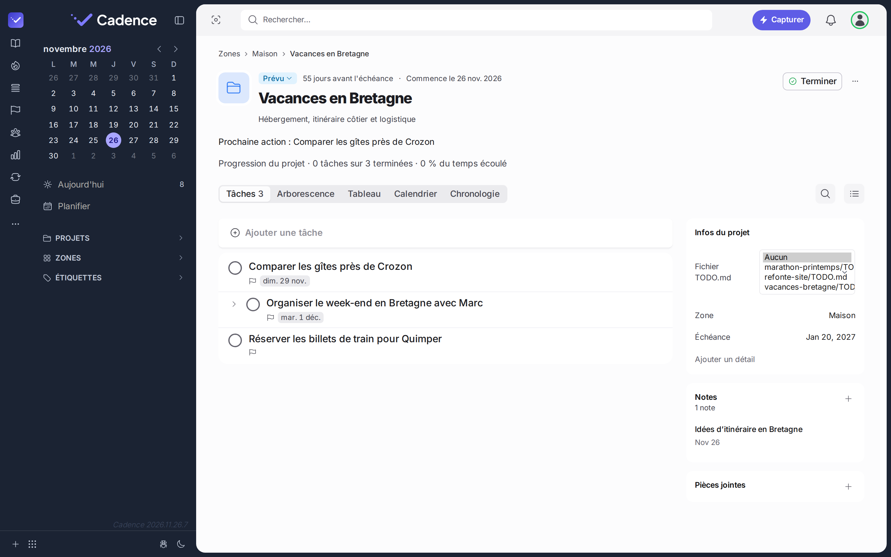

# TODO.md Projects

A Cadence project can follow a `TODO.md` file from your computer or a Git repository: tasks tagged `code` go into the file and come back from it, and everything else stays in Cadence. You keep editing your `TODO.md` in your editor or with your coding agent, and Cadence shows it as an ordinary project (list, board, outline, calendar, on web and Android).



## What it is for

- The **file remains the source of truth** for its lines: you can edit it anywhere, at any time, without going through Cadence.
- A project does not turn into a plain mirror: **only tasks tagged `code`** go into the file and come from it. A task without that tag (call someone, buy a part) stays in Cadence, with its date, its reminder, and its daily plan.
- For a parent that groups several code projects, each file's "État actuel" section feeds the [sub-project board](Projects-and-Areas#sub-project-board): branch, blocker, next action.

## The two sources: shared folder or Git repository

| | Shared folder | Git repository |
|---|---|---|
| Where the file lives | A folder that the server reads and writes (one sub-folder per project, each with its `TODO.md`) | A repository (Gitea, GitHub, etc.) that the server clones itself |
| Who fills it | You, through local sync ([below](#local-sync-with-systemd)) or any other means | The commits you push to the repository |
| Writing from Cadence | An added bullet or a checked box is written into the file | A commit by author `Cadence` is pushed to the branch |
| Reading by Cadence | Native change detection, otherwise a pass every 30 s | Push webhook (immediate), otherwise a pass every 5 min |
| Which project | You choose which project follows which file | One project is created and followed per repository, named after its identifier and keeping that name |

Both sources can coexist. Server-side setup (environment variables, deploy key, webhook) is described in [Self-Hosting](Self-Hosting).

## Linking or unlinking a project to a file

A file feeds nothing until a project follows it: Cadence creates **no project on its own** for a folder (except for a Git repository, which creates its project).

**On the web**
1. Open the project, in the project's information panel.
2. Choose a file in the **TODO.md file** list (the default value is "None"). A file already taken by another project is greyed out, with that project's name.
3. The file is read immediately. The project shows the **TODO.md** badge, its origin ("Follows `<folder>/TODO.md`. Tasks tagged code are written to the file; the others stay in Cadence.") and a **Reread** button.

The list only appears if the server offers files (or if the project already follows one). To unlink: go back to "None".

**On Android**
- Project menu › **Fichier TODO.md** (TODO.md file), then choose the file (or "Aucun" (None)). The list is read online.
- Same menu › **Actualiser les TODO.md** (Refresh TODO.md files): rereads the files of all sub-projects (owner only, online), then starts a sync.

### What happens when you unlink

- The project stops following the file. **Its tasks remain** as ordinary tasks, and the file is not touched.
- If you link the same file again, Cadence finds the tasks again **by name**.
- A file or folder already followed by another project is refused (409 error).

## The `code` tag

- Tasks read from the file get the **`code`** tag, added to their other tags. If you remove it by hand, it is put back on the next read: it is what ties the task to the file.
- The **section title** (`Now`, `Next`, `Ideas`...) is not a tag: Cadence keeps it separately on the task (that is what sorts a project's cards on the sub-project board).
- **Giving `code` to an existing task** (on the web, on Android, through an agent) writes it as a bullet at the end of `## Next` in the file on the **next pass, 30 seconds at the latest**, and it then follows the file. Its note goes with it, as indented lines.
- **Not written**: a completed task, a recurring task.
- **Removing `code` from a task that is in the file does not take it out of the file**: the tag is put back on the next read. For a task to leave the file, delete its line in the file; it then disappears from Cadence ([below](#what-happens-to-lines)).
- A task created without `code` in a linked project stays a Cadence task, and nothing happens in the file.
- For a Git repository project, the 30 s pass does not export a `code` tag added afterward (only adding a task and the checkbox are written by commit): see [Git repository](#git-repository).

### Adding a task from Cadence

| Action | Result |
|---|---|
| Add a task tagged `code` (web or Android) | A `- ` bullet is added at the end of `## Next` (section created if missing) |
| Web: the project's "+ Add task" field | An **Add to** menu offers: Cadence only, Now, Next, Ideas |
| Add a task without `code` | Stays in Cadence |
| Check the task | `[x]` is written on the bullet (or added if it had no box); unchecking writes `[ ]` |
| Check a task that is in `## Done` or `## Dropped` | Reopening is not possible from Cadence: move the line in the file |

## File sections

```markdown
# TODO

## État actuel
Branche: `main` | Arbre: propre
Tests: OK
Bloqueur: aucun
Prochaine action: publier la version

## Now
- [ ] Fix the login redirect #bug !high @2026-12-05
      a note on the following lines, indented
    - a sub-bullet stays in the note

## Next
- Write the docs #doc
- [x] Already done

## Ideas
- Maybe a widget

## Done
- [x] Set up the repository

## Dropped
- Old idea (dropped, short reason)
```

| Element | How Cadence reads it |
|---|---|
| `## Now`, `## Next`, `## Ideas`, or any other `## Title` | Section: its top-level bullets become tasks, the section name is kept (`source_section`) |
| `## Done` | Bullets are **completed** (even without a checked box) |
| `## Dropped` | Bullets are **archived** |
| `## État actuel` (or `## Handoff`, `## Current state`) | **Never tasks**: it is the project's state (see below) |
| Text before the first `##`, `###` headings and deeper, paragraphs, code blocks | Ignored |
| Empty bullet | Not a task |

Useful reading rules:
- Only a **top-level** bullet (`-`, `*`, or `+` at the left edge) is a task. Indented lines, sub-bullets, and blank lines between them form the task's **note**.
- The **name** is the first line without its Markdown formatting (bold, code, links, strikethrough) and without its [inline metadata](#inline-metadata-of-a-bullet).
- A task is **completed** if its box is checked or if it is in `## Done`.
- A bullet read for the first time already completed has **no end date** (unknown): it counts neither in "completed today" nor in the statistics; a bullet checked later takes the file's date.
- Files with Windows line endings, without a final newline, or with a UTF-8 BOM are handled. A file in another encoding is not modified by Cadence.

### The "État actuel" section

This section is recognized by its keywords, with or without accents: `Branche`, `Tests`, `Bloqueur`, `Prochaine action` (the English forms `Branch`, `Tree`, `Blocker`, `Next action` work too). The line `Branche: main | Arbre: propre` gives both the branch and the tree state. A blocker "aucun" (or an equivalent) is read as empty.

It is never converted into tasks. Cadence keeps a summary on the project (`handoff_state`), sent **read-only** to Android. This feeds the "Current state" of the [sub-project board](Projects-and-Areas#sub-project-board) and the "Blocked" and "Stale" badges.

## Inline metadata of a bullet

The first line of a top-level bullet can carry tags, a priority, and a due date, anywhere in the line (note lines are not read):

```markdown
- Fix the login redirect #bug #secu !high @2026-12-05
- !low Tidy the README #doc
- Move the backups #infra @2026-12-31
```

| Token | Effect |
|---|---|
| `#name` (lowercase, digits, `_` and `-`) | Adds the tag `name` (created for the account if missing) |
| `!high`, `!med`, `!low` (any case) | High, medium, low priority |
| `@YYYY-MM-DD` | Due date, for the whole day (no time), provided it is a real date |

Special cases:
- Each token is a **whole word**: start of line or a space before, a space or end of line after. `mail@2026-01-01`, `a!low`, or `#bug,` stay plain text.
- Anything inside code (`` `#perf` ``), a Markdown link, a link between `<...>`, or a bare address is never read as a token.
- `#123` (issue number), `#UX` (capitals), and `@2026-02-30` (impossible date) are not tokens: they stay in the name.
- Tokens are **removed from the displayed name**. A bullet made only of tokens keeps its tokens as its name. The file itself is never rewritten.
- Several priorities or dates on one line: **the last one wins**. A repeated tag counts once.
- Without a priority or date token, Cadence keeps the task's value. With a token, **every read applies it**: a change made in Cadence holds until the next read of a bullet that still contains that token.
- Tags are only **added**: `code` and tags added in Cadence stay, and a tag removed from the bullet stays on the task.

## What the file owns, what Cadence owns

| Task data | Owner | Consequence |
|---|---|---|
| Name | The file | Editing in Cadence is refused |
| Note (indented lines) | The file | Same |
| Checked / unchecked box (completed status) | The file | Checking in Cadence is written to the file |
| Project | The file | Moving to another project is refused |
| Priority, due date | Cadence (the file's `!` or `@` token applies them on every read) | Editable everywhere |
| Tags, area, goal, estimate, pin, today order, daily plan, assignment, reminder, start, defer, review fields | Cadence | Editable everywhere |
| Comments, relations, attachments | Cadence | Not blocked |

A task that comes from a file carries the **TODO.md** badge; its title and note are read-only (a message says it comes from the file), and the trash icon is hidden.

Details:
- Refusals: editing the name, note, or project of such a task, or deleting it, returns `403 todo_md_read_only`. On Android, sync operations are rejected as `read_only`, and the MCP update tool returns an error.
- A status other than completed (for example "in progress") writes the box as **unchecked**; the response shows what the file actually contains.
- Sending a value identical to the current one is not a change.
- A linked project can be **renamed** (except a Git repository project). It can be neither **deleted** nor **completed with its tasks**: unlink it first.
- Sub-tasks are not offered on a file task.
- The **outline** view of a linked project stays read-only for its file tasks; only the list view edits Cadence tasks normally.

## What happens to lines

A task is matched to its bullet by the section, the normalized first line (without metadata), and its rank among identical lines (the second identical bullet in a section is rank 1). This key is kept on the task: rereading duplicates nothing.

| What you do in the file | What Cadence does |
|---|---|
| Reorder, edit the note, check a box, add unrelated lines | All tasks are kept |
| Add, change, or remove a `#tag`, `!priority`, or `@date` | The task is kept |
| Move a bullet to another section | It keeps its line as long as its text is unique among unmatched bullets; the section follows |
| **Change the text** of a bullet (rename) | It is a **new task**; the old one is deleted with its Cadence-only data |
| **Delete** the line | The task is **deleted** from Cadence (with its own links) on the next read |
| Add a bullet with the same name as an open or closed `code` task that is not yet in the file | The bullet **adopts** that task |
| Check the same box in Cadence and in the file | The result is the same: checked |
| Delete the project in Cadence | Refused while it follows a file; unlink it first |
| The shared folder is not mounted, the file is unreadable | **Nothing is deleted**: the pass is skipped and reported |
| Rename or remove a folder | The project stays linked, with its tasks; choose another file or none |

A read only overwrites the name, note, box, and the priority and due date that the bullet states; other fields on the Cadence side are kept. Renaming a task **in the file** therefore loses its Cadence data: keep titles stable (see the file guide below).

## Delays: how long before it shows up

| Path | Delay |
|---|---|
| Local `TODO.md` edit to the shared folder | As soon as the local file changes, if the `todo-md-sync.path` unit is active; otherwise at most **1 minute** (timer) |
| Shared folder to Cadence | **0.75 s** after a change if the server receives the file system event; otherwise a pass every **30 s** (size and date of each file, which also works on a network mount) |
| Git repository to Cadence | **Immediate** if the push webhook is configured, otherwise every **5 min** |
| Cadence to the file: checked box, task added with `code` | Written **at the time of the action** |
| Cadence to the file: a `code` tag added later | **30 s at most** (next pass), shared folder only |
| Shared folder to your computer | At most **1 minute** (the timer); local watching only looks at the computer's files |
| **Reread** button (web), "Actualiser les TODO.md" (Android) | Immediately: reads every folder and repository (project owner only) |

Typical chain for an edit on your computer: you save `TODO.md`, local sync pushes the file to the shared folder within a few seconds, then Cadence rereads it within a second (native detection) or within 30 s.

## Local sync with systemd

The [`scripts/todo-md-sync.sh`](https://github.com/PreciselyWrong/cadence/blob/main/scripts/todo-md-sync.sh) script keeps the `TODO.md` files of your working folder and the shared folder that Cadence reads in step, **without exposing the rest** of your working folder. Three (user) systemd units automate it, with examples in [`scripts/systemd/`](https://github.com/PreciselyWrong/cadence/tree/main/scripts/systemd):

| Unit | Role |
|---|---|
| `todo-md-sync.service` | One sync pass (`Type=oneshot`) |
| `todo-md-sync.timer` | Runs the service **every minute**: this is the server-to-computer direction (changes made in Cadence or on another computer) |
| `todo-md-sync.path` | Watches (inotify, through systemd, **with no extra process**) each local `TODO.md` and runs the service as soon as a file changes: this is the computer-to-server direction, instant |

### The service

```ini
[Unit]
Description=Sync TODO.md files between the working folder and Cadence

[Service]
Type=oneshot
# Skip the pass if the shared folder is unreachable.
ExecCondition=/usr/bin/timeout 15 /usr/bin/test -d <shared folder>
Environment=LOCAL_ROOT=%h/projets
Environment=SHARE_ROOT=<shared folder>
ExecStart=%h/.local/bin/todo-md-sync.sh
ExecStartPost=-%h/.local/bin/todo-md-sync-paths.sh
TimeoutStartSec=2min
```

- **`ExecCondition`**: if the shared folder (a mount from your NAS, for example) does not respond within 15 s, the pass is skipped without an error; nothing is lost, and it avoids spinning idly when you are off your network.
- **`LOCAL_ROOT`**: the folder that contains your projects (one sub-folder per project, each with its `TODO.md`). **`SHARE_ROOT`**: the folder that Cadence reads.
- **`ExecStartPost`** (the `-` in front ignores a failure) runs the watched-file list generator, see below.
- The examples provided in the repository use their author's paths: adapt `LOCAL_ROOT`, `SHARE_ROOT`, and the location of the scripts.

### The timer

```ini
[Unit]
Description=Sync TODO.md files every minute

[Timer]
OnStartupSec=1min
OnUnitActiveSec=1min
AccuracySec=10s

[Install]
WantedBy=timers.target
```

A first pass 1 min after the session starts, then one per minute, with a 10 s margin that systemd uses to group its wake-ups.

### The watcher (`.path`) and the generator

`todo-md-sync-paths.sh` writes `~/.config/systemd/user/todo-md-sync.path`: one `PathChanged=<path of the TODO.md>` line per file in `LOCAL_ROOT/*/TODO.md`, minus the folders listed in the exclusion file, with `Unit=todo-md-sync.service`.

- **When a project appears**, the timer's next run reruns the generator (through `ExecStartPost`), which **rewrites the unit only if the list changed**, then runs `systemctl --user daemon-reload` and restarts `todo-md-sync.path`. A new `TODO.md` is therefore watched at most one minute after it is created.
- Generator variables: `LOCAL_ROOT` (default `~/Dev`), `EXCLUDE` (default `~/.config/todo-md-sync/exclude.txt`).

### Installation, in short

1. Copy `todo-md-sync.sh` and `todo-md-sync-paths.sh` to `~/.local/bin/` (executable) and the `.service` and `.timer` units to `~/.config/systemd/user/`, after adapting the paths.
2. Mount the shared folder at the `SHARE_ROOT` location.
3. `systemctl --user daemon-reload`, then `systemctl --user enable --now todo-md-sync.timer`.
4. Run the service once (`systemctl --user start todo-md-sync.service`): it generates the `.path` unit. Then `systemctl --user enable --now todo-md-sync.path` so that it starts with your session.
5. To exclude a folder (a project that must not leave your machine), add its name, one per line, to `~/.config/todo-md-sync/exclude.txt`.

To follow the passes: `journalctl --user -u todo-md-sync.service`.

### What a pass does, file by file

The script compares **contents**, not dates (network mount dates are unreliable). It keeps a copy of the last synced version ("base") in a state folder (by default `~/.local/state/todo-md-sync`). Writes go through a temporary file and then a rename, so that Cadence never reads a half-written file.

| Situation | Result |
|---|---|
| Both files are identical | Nothing to do (the base is updated) |
| Only the local file changed since the base | Local to share ("local vers partage") |
| Only the shared file changed | Share to local ("partage vers local") |
| Both changed, on different lines | **Line-by-line merge** (three-way merge with the base); the result is written on both sides |
| Both changed **the same line** | **Conflict**: the local version is kept, the share's version is kept in `<state>/conflicts/<project>-<date>.md`, a notification is shown |
| Both files exist but there is no base (first pass) and they differ | Treated as a conflict: local wins, the share's version is backed up |
| The file exists on one side only, never synced | It is copied to the other side ("ajouté au partage" or "ajouté en local") |
| A file is **missing on one side** although it was already synced | **Nothing is deleted**; a log line says "manque d'un côté : rien n'est supprimé, à vérifier" (no notification, since the pass runs every minute) |
| Shared or local folder not found | The pass fails (exit code 1); a missing mount therefore loses nothing |

A deletion is **never propagated**: a missing mount or a branch without the file cannot erase anything. A project in `EXCLUDE` is ignored. The script only copies files named `TODO.md`.

## Conflicts and pending changes on the server side

When Cadence writes into a **folder**, the file is reread just before, the new content goes into a temporary file in the same folder (same permissions), then replaces the original with an atomic rename **only if the original is still byte-for-byte identical** to what was read. Otherwise the write starts again, up to 3 times (`409 file_conflict` after that). Only the inserted bytes change: other lines, line endings, final newline, and BOM are preserved.

### Git repository

The server clones the repository and, for a task added or checked in Cadence: fetches the branch, resets the clone onto it, applies the change to the file **as it is now**, makes a commit (author `Cadence`) and pushes. A rejected push (someone pushed in the meantime) starts again from the fetch, up to 3 times. Changes from both sides are therefore kept.

| Case | Result |
|---|---|
| The bullet changed or disappeared in the repository in the meantime (check, uncheck) | Nothing is written: **`409 todo_md_conflict`**; the project shows the repository's state and the change stays **pending** |
| The repository is unreachable (network, permissions, push rejected 3 times) | Nothing is written: **`503 todo_md_repo_unreachable`**; the change stays **pending**, nothing is deleted |
| A read fails | The project keeps its tasks; an error is shown until the next successful read |

On the project page: "Synced with `<repository>` · 3 minutes ago" (or "Not synced with `<repository>` yet"), or the matching warning for the conflict ("Conflict: "`<name>`" changed in the repository, nothing was written.") or for pending changes ("N change(s) waiting: the repository cannot be reached."). Two buttons: **Retry** (replays the changes in order, drops those that already apply) and **Discard** (forgets them and rereads the repository). These commands are reserved for the owner account. On Android, the status line refreshes every 30 s while online, and sync says in plain words "La ligne a changé dans le dépôt : rien n'a été écrit (TODO.md)." (The line changed in the repository: nothing was written) or "Dépôt injoignable : la modification attend sur le serveur (TODO.md)." (Repository unreachable: the change is waiting on the server).

For a Git repository, only **adding a task and the checkbox** are written from Cadence. Renaming a task or moving it to another section is not: the bullet's text is its identity, and a rename would replace it. Do it in the repository.

## The sub-project board and the outline

- A parent project whose sub-projects follow `TODO.md` files shows in the **Board** tab with two views, "Tasks by project" (one column per in-progress sub-project) and "Projects" (one card per sub-project). Each column sorts tasks by file section (Now, Next, Ideas, then the others) **in the file's order**, with Cadence-only tasks coming after. Details: [Projects and Areas](Projects-and-Areas#sub-project-board).
- File tasks do not leave their project: drag and drop to another sub-project is refused with the message "TODO.md tasks stay in their repository project."
- The **Outline** tab of a linked project is read-only for file tasks.

## Edge cases

- **A Git repository project cannot be renamed** (the name comes from its identifier).
- A folder or a `TODO.md` that leaves the root through a symbolic link is refused, as is a `TODO.md` that points to a file with another name. Folders whose name starts with a dot, those without a `TODO.md`, and those one level deeper are ignored.
- A single mounted file (not a folder) cannot be replaced atomically: mount the **folder**.
- Two servers on the same database: only one pass at a time thanks to a lock, but writes are only serialized per process. Run a single server when the folder is writable.
- A repository removed from the configuration leaves its project in place: delete it by hand.

## Security

- **Never mount your entire working folder** into the server or a container: mount a **dedicated** folder that contains only `TODO.md` files. The server only reads and writes files named `TODO.md`, but a mount exposes all of its contents to the container (`.env` files, keys, credentials).
- This is the reason for local sync: it only copies the `TODO.md` of each sub-folder, outside the exclusion list.
- Paths are resolved (`realpath`) and must stay inside the root; no other file in the folder is ever read or written.
- Git repository: the token and key never appear in arguments, addresses, logs, or stored errors; git runs without the machine's configuration, without hooks or signing, with only the `file`, `git`, `http(s)`, and `ssh` transports. The webhook signature (HMAC-SHA256) is checked with a constant-time comparison.

## Writing a good TODO.md

- One task, one top-level bullet, a **short and stable title**: do not reword it, because renaming creates a duplicate and loses the old one's data.
- When it is delivered and verified, check `[x]` and move the line under `## Done` (any bullet outside `## Done` without `[x]` stays open in Cadence).
- Keep `## État actuel` up to date (branch, tests, blocker, next action): it is what the sub-project board shows.
- Only put a `@YYYY-MM-DD` due date on a real deadline.

## Going further

- [TODO.md Projects (technical doc)](https://github.com/PreciselyWrong/cadence/blob/main/docs/35-todo-md-projects.md)
- [Projects](https://github.com/PreciselyWrong/cadence/blob/main/docs/06-projects.md), [Offline sync](https://github.com/PreciselyWrong/cadence/blob/main/docs/30-offline-sync.md)
- Wiki pages: [Projects and Areas](Projects-and-Areas), [Offline and Sync](Offline-and-Sync), [Self-Hosting](Self-Hosting), [Android](Android)
