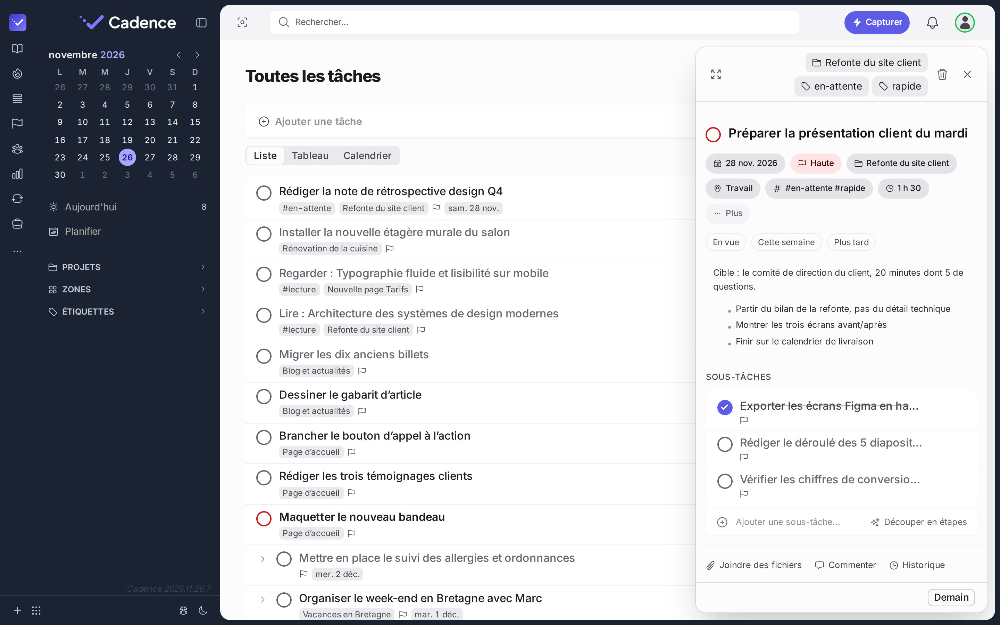

# Tâches

Une tâche est l'unité de base de Cadence : une chose à faire, qui n'a besoin que d'un nom et à laquelle on ajoute, seulement si on le veut, une échéance, un projet, une priorité ou une récurrence. Cette page décrit les lignes de tâche et leurs gestes, la fiche qui s'ouvre au clic, et chaque champ avec ses cas particuliers.

## Créer une tâche

- **Un nom suffit.** Un nom vide ou fait d'espaces est refusé ; tout le reste est facultatif, et la tâche naît « Non commencée ».
- **Où créer.** Le champ « + Ajouter une tâche » en haut de Aujourd'hui, de la liste Tâches, d'une page projet et d'une page étiquette ; la capture rapide (touche `c`, voir [Boîte de réception et capture](Boite-de-reception-et-capture)) ; la boîte de réception ; Telegram ; l'API et les agents.
- **Le champ « Ajouter une tâche » lit votre phrase.** Une date (« demain », « vendredi », « 12/3 »), une priorité (`!1` à `!3`), un projet ou des étiquettes (`#`) et une durée sont retirés du nom et posés sur la tâche. Un projet nommé dans la phrase l'emporte sur celui de la liste ; sur la page d'une étiquette, l'étiquette reste. La tâche hérite aussi de sa liste : le projet d'un projet, l'étiquette d'une étiquette, le jour affiché pour Aujourd'hui.
- Entrée crée la tâche et vide le champ ; Échap vide le champ ; un nom vide ne fait rien. Si la création échoue, votre texte revient et une erreur s'affiche.
- Le titre d'une tâche s'édite avec la même lecture : taper « Appeler Paul demain 15h #perso » dans le titre de la fiche applique la date et l'étiquette.

## Les lignes de tâche

En interface **Minimale** (la valeur par défaut), une ligne tient sur un niveau : une **case ronde**, le titre, puis des puces à droite. En **Dense**, la ligne garde ses commandes complètes et se déplie sur place.

### Ce qu'on voit sur une ligne

- La **case ronde** avant le titre porte un anneau de la couleur de la priorité ; une priorité haute est la seule à être marquée en rouge. Cliquer la case termine la tâche après un court coche, avec un message « Annuler » ; la ligne quitte alors la liste.
- Les **puces** de droite (réglables dans Profil › Interface › Apparence › Détails de la ligne de tâche) : icône de récurrence, nombre de commentaires, les deux premières étiquettes puis « +N », le projet, le drapeau de priorité et l'échéance. L'échéance se lit Aujourd'hui, Demain ou la date, en teinte d'alerte quand elle est passée.
- La **description** (note) apparaît en Markdown compact sur la ligne, en texte brut sur une carte.
- Une tâche qui contient une adresse web montre l'icône et le nom du site, et l'image de la page ; un clic sur le site l'ouvre dans un nouvel onglet sans ouvrir la tâche (voir [Boîte de réception et capture](Boite-de-reception-et-capture)).
- Le **badge d'origine** (voir plus bas) et le badge **Bloquée** quand une tâche attend une autre.
- Une flèche (chevron) devant la case signale des sous-tâches : un clic les montre en retrait sous la ligne, un second clic les masque. Les lignes démarrent repliées.

### Gestes sur une ligne

| Geste | Effet |
|---|---|
| Clic sur le titre | Ouvre la fiche (voir plus bas) |
| Clic sur la case | Termine ou rouvre, avec « Annuler » |
| Clic sur le drapeau ou sur l'échéance | Change la priorité ou la date sur place, sans ouvrir |
| Clic droit, appui long (tactile), bouton « ⋯ » ou touche Menu (Maj+F10) | Ouvre le menu de la tâche |
| Ctrl ou Cmd + clic | Ajoute la ligne à une sélection |
| Maj + clic | Sélectionne toutes les lignes depuis la dernière choisie |
| Glisser une ligne | Réordonne la liste (voir plus bas) ou classe la tâche si on la lâche sur la barre latérale |
| En-tête de groupe (par projet ou par jour) | Se replie au clic, état gardé pour cette liste dans ce navigateur |

Le « ⋯ » n'apparaît que sur la ligne sélectionnée ou active, ou au clic droit : rien ne surgit au simple survol.

### Le menu de la tâche

Le même menu existe partout où une tâche apparaît : listes en Minimal comme en Dense, Aujourd'hui, Planifier (cartes des jours, retards, horizons, boîte de réception), tableau d'un projet, « Tâches à classer ». Les actions propres à la page viennent en premier (sur Aujourd'hui : planifier au prochain créneau libre, retirer l'heure, reporter à demain ou à la semaine prochaine, retirer de la journée ; sur Planifier : « Envoyer vers un horizon », « Engager pour »). Ensuite :

- **Ouvrir** (Entrée) et **Terminer** ou **Rouvrir** (X).
- **Date ▸** : Aujourd'hui, Demain, Semaine prochaine (le lundi suivant), « Choisir une date… » (le sélecteur partagé), et « Sans date » quand une date existe. Choisir une date par ce menu efface l'heure.
- **Priorité ▸** : Haute, Moyenne, Basse, Aucune (la valeur actuelle est cochée).
- **Déplacer vers un projet ▸** : « Aucun projet » ou un projet ouvert. Les projets terminés, annulés et archivés ne sont pas proposés.
- **Épingler** ou **Désépingler**.
- **Dupliquer**, **Transformer en projet**, **Copier le lien** (l'adresse `/task/<identifiant>`), **Copier le titre**.
- **Supprimer** (Suppr), en rouge, en dernier.

Les sous-menus s'ouvrent au survol, au clic ou avec la flèche droite ; la flèche gauche ou Échap revient. Un changement de date ou de projet affiche « Annuler », qui remet l'ancienne valeur (sauf pour une tâche récurrente : voir plus bas). Les tâches issues d'un fichier `TODO.md` n'offrent ni déplacement, ni duplication, ni suppression (voir [Projets TODO.md](Projets-TODO-md)).

### Sélectionner plusieurs tâches

Dès qu'une sélection existe, une barre apparaît en bas avec **Terminer**, **Date ▸**, **Priorité ▸**, **Déplacer vers un projet ▸** et **Supprimer**, valables pour toutes les tâches choisies, avec un seul « Annuler » pour le groupe. Un clic simple, Échap ou un changement de page vide la sélection. Une sélection ne supprime jamais une tâche récurrente : elle est conservée et un message le dit. La page Planifier a sa propre sélection (voir [Aujourd'hui et plan du jour](Aujourd-hui-et-plan-du-jour)).

### Réordonner à la main

Dans la liste Tâches (sans tri imposé), dans un projet et sur une page étiquette, glissez une ligne à sa nouvelle place : l'ordre survit au rechargement et la liste passe en tri **Personnalisé**. Un premier glissement fait sous un autre tri part de l'ordre qui était à l'écran.

- L'ordre de Toutes les tâches et de chaque étiquette est personnel ; seul le propriétaire d'une étiquette peut en ordonner les tâches.
- L'ordre d'un projet est partagé par tous ceux qui peuvent le modifier, et il est le même sur Android. Un membre en lecture seule ne peut pas le changer.
- Avec un filtre, une recherche ou une pagination, seules les tâches affichées bougent ; les autres gardent leur place. Les tâches jamais placées (les nouvelles) viennent en premier, de la plus récente à la plus ancienne.

### Déposer sur la barre latérale

Glissez une ligne sur un projet, une étiquette, une zone, « Aujourd'hui » ou « Demain » dans la barre latérale : la tâche change de projet, reçoit l'étiquette (ses autres étiquettes restent), prend la zone, ou devient due ce jour-là. Rien n'est enregistré si elle l'a déjà. Une tâche récurrente n'accepte pas « Aujourd'hui » ni « Demain » (une seule date d'une série se déplace par le choix de portée, voir plus bas), et une tâche de fichier `TODO.md` ne se glisse pas.

### Clavier

Une seule ligne de la liste est dans l'ordre de tabulation. Les flèches haut et bas passent d'une ligne à l'autre (sous-tâches comprises). Entrée ouvre la tâche ; Espace la termine ou la rouvre ; `D` ouvre le sélecteur de date, `P` celui de priorité ; `X`, `E`, `M` et Suppr se retrouvent dans [Tags, vues et navigation](Tags-vues-et-navigation). Ces touches ne font rien pendant la saisie dans un champ.

### « Terminées (N) »

Au bas de Aujourd'hui, de Tâches, d'un projet et d'une étiquette, une section repliée « Terminées (N) » liste les tâches terminées, avec les mêmes actions. Son état est gardé par liste dans le navigateur. Elle n'apparaît que lorsque la liste montre les tâches ouvertes : avec le filtre « Terminées » ou « Toutes », elles sont déjà là. Les listes Tâches et Planifier s'ouvrent par défaut sur les tâches ouvertes ; « Toutes » est un choix explicite (`status=all` dans l'adresse).

## La fiche d'une tâche

### L'ouvrir

Cliquer une tâche, où que ce soit (listes, Aujourd'hui, recherche, notifications, calendrier, lien parent), l'ouvre dans **la même fiche flottante**, large, posée sur le bas de la page. L'adresse garde `?task=<identifiant>`, donc un rechargement la rouvre ; le lien `/task/<identifiant>` ouvre Toutes les tâches avec cette fiche.

- Sur un écran de 1280 px ou plus, la fiche est une colonne d'un tiers de la largeur, placée du côté opposé à la ligne cliquée : la ligne reste visible.
- **Agrandir** (icône) la fait occuper toute la page ; « Réduire » la ramène. Sous 768 px, elle prend tout l'écran avec un bouton « Fermer ».
- On la ferme avec Échap, un clic à l'extérieur, un second clic sur la même ligne, ou en terminant la tâche par sa case. Rouvrir une tâche terminée la laisse ouverte.
- `J` et `K` passent à la tâche suivante ou précédente de la page, sauf pendant une saisie ou quand un menu est ouvert.
- « Ouvrir la page complète » mène à la fiche pleine page (`/task/<identifiant>/details`), qui contient en plus la carte **Relations** (voir plus bas).
- Une occurrence isolée d'une série ouvre un dialogue plutôt que la fiche ; les habitudes ont leur propre page.

### La modifier

Il n'y a pas de bouton « Enregistrer » : **tout s'enregistre seul**, à la sortie d'un champ, à Entrée ou au choix dans une bulle. Le pied de la fiche affiche « Enregistrement… » puis « Enregistré » ; un échec remet la valeur d'avant et affiche « Échec, modification annulée » (rien n'est à moitié enregistré). Échap enregistre ce qui est tapé mais pas encore validé.

Ordre de lecture, de haut en bas (depuis le 26 novembre 2026) :

1. La **case ronde** et le **titre**, grand et éditable.
2. Une ligne de **puces** (une par champ), chacune ouvrant une petite bulle ; une puce vide affiche le nom du champ.
3. Juste dessous, **En vue / Cette semaine / Plus tard** et les reports de la tâche (ils parlent du moment, comme la date). Voir [Revue, bilan et focus](Revue-bilan-et-focus).
4. La **description**, en Markdown, éditée sur place (clic pour taper, sortie pour enregistrer ; cocher une case de liste enregistre aussi). Voir [Notes et outliner](Notes-et-outliner).
5. Les **sous-tâches**, avec « Découper en étapes » sur la ligne d'ajout.
6. Les pièces jointes et les commentaires, seulement s'il y en a.
7. En bas, une barre discrète **Joindre · Commenter · Historique** ; l'historique s'ouvre dessous.

« Planifiée … » n'apparaît que lorsqu'il ne répète pas l'échéance. Le pied garde le bouton « Demain » : il passe l'échéance à demain en gardant l'heure.

### Les puces et ce qu'il y a « derrière Plus »

Une tâche simple reste simple : **Échéance** et **Projet** sont toujours là. Les autres puces n'apparaissent que si elles sont remplies, ou toutes d'un coup avec la puce **Plus** :

| Puce | Rôle | Remarques |
|---|---|---|
| Échéance | Pour quand la terminer | Sélecteur de date partagé (voir plus bas) |
| Début | Quand le travail commence | Place la tâche sur les chronologies ; ne la cache pas |
| Priorité | Haute, Moyenne, Basse, Aucune | N'agit que sur l'affichage et le tri |
| Projet | Où range la tâche | Sans projet, la tâche est « seule » |
| Zone | Le secteur de vie | Hérite du projet quand il en a un (« Zone du projet ») |
| Étiquettes | Mots-clés | Dix au plus par élément |
| Statut | Voir plus bas | |
| Récurrence | Répéter | Voir plus bas |
| Estimation | Durée prévue | 15 min, 1 h, 30 min, 2 h ; recliquer sur le choix actif l'efface |
| Différer jusqu'à | Cache la tâche jusque-là | Voir plus bas |
| Rappel | Une alarme à une heure précise | Voir [Notifications et rappels](Notifications-et-rappels) |
| Assigné à | Une personne | Apparaît une fois rempli, ou sous « Plus » quand des personnes existent |

Garde-fous : le début ne peut pas être après l'échéance, et « Différer jusqu'à » ne peut pas dépasser l'échéance. Une tâche récurrente demande toujours la portée d'un changement de date.

### « Historique »

Le bouton « Historique » (fermé par défaut) liste chaque changement avec **son heure exacte** et **qui l'a fait** : « Dans l'app », « Par une clé d'API », « Depuis un appareil » (une synchronisation hors ligne est datée par l'horloge de l'appareil), « Par l'IA », « Suggestion IA acceptée » ou « Importée ». La création est elle aussi notée ; pour une ancienne tâche, le serveur ouvre l'historique avec sa date de création. L'historique est immuable : on ne peut ni le modifier ni l'effacer. Il sert à comprendre d'où vient une tâche inattendue. Sur Android, la même liste s'ouvre en bas de la fiche (en ligne seulement).

## Les statuts

| Statut | Sens | Visibilité |
|---|---|---|
| Non commencé | Valeur par défaut | Listes ouvertes |
| Planifié | Prévue pour être travaillée | Listes ouvertes |
| En cours | Travail commencé | Listes ouvertes ; tinte la ligne sur Aujourd'hui |
| En attente | Bloquée par quelque chose ou quelqu'un | Listes ouvertes |
| Fait | Terminée | Quitte les listes ouvertes, reste dans « Terminées » |
| Archivé | Terminée et rangée | Hors des listes ouvertes |
| Annulé | Abandonnée | Hors des listes ouvertes |

Passer à « Fait » enregistre l'instant de la fin ; en sortir l'efface. Terminer une tâche ne termine pas ses sous-tâches, et terminer toutes les sous-tâches ne termine pas la tâche.

## Les priorités

Trois niveaux : **Haute**, **Moyenne**, **Basse**, plus « Aucune ». Dans la plupart des vues, le tri va de Haute à Basse. La priorité n'a pas d'effet sur le comportement, seulement sur l'ordre et la couleur ; la capture rapide la lit avec `!1` (haute), `!2` (moyenne), `!3` (basse).

## Dates

### Échéance, début et heure

- Une échéance est facultative ; une tâche sans échéance est du « un jour peut-être ». Elle peut avoir une heure. Les dates sont affichées dans votre fuseau.
- Une tâche est **échue** quand son échéance est passée et qu'elle n'est ni faite, ni archivée, ni annulée. Cadence ne change aucun statut tout seul, n'envoie aucune notification de retard et ne compte pas les jours de retard ; une tâche sans date n'est jamais en retard.
- Le **début** place la tâche sur les frises ; une échéance sans heure dure jusqu'à la fin de sa journée.

### Le sélecteur de date

Une seule bulle sert toutes les puces de date : choix rapides (Aujourd'hui, Demain, Ce week-end, Semaine prochaine, Sans date), calendrier du mois qui commence au premier jour de la semaine de votre profil, heure facultative, et **un champ de texte** qui comprend le langage naturel (« demain 14h », « vendredi », « dans 3 jours ») avec un aperçu « Compris » au fil de la frappe. Entrée applique ; « Date non comprise » signale un échec. Ce week-end est le prochain samedi (celui qui vient, si vous êtes déjà en week-end) ; la semaine prochaine commence le premier jour de la semaine. Une date sans heure, ou à minuit, n'affiche jamais d'heure.

La ligne **« Plus tard »** du sélecteur de l'échéance propose Cette semaine, Semaine prochaine, Ce mois-ci, Mois prochain et Un jour : c'est un engagement sans jour fixe, qui efface la date et retire la tâche des plans à partir d'aujourd'hui. Voir [Aujourd'hui et plan du jour](Aujourd-hui-et-plan-du-jour).

### Différer jusqu'à (reporter)

Une tâche différée est **écartée des listes** jusqu'à la date et l'heure choisies : « commence lundi » ou « rappelle-moi dans 2 heures ». Elle n'est pas la même chose que l'échéance : le report dit « ne me la montre pas avant », l'échéance dit « à terminer pour ». Avec les deux, la tâche est cachée jusqu'au report, puis l'échéance donne l'urgence. Le serveur vérifie toutes les 5 minutes les reports échus, et une notification « Disponible maintenant » peut être envoyée (réglable). Ce champ se modifie ou s'efface à tout moment.

### Estimation

Entre 5 et 720 minutes, choisie dans la puce Estimation (15 min, 30 min, 1 h, 2 h) ou posée par une durée dans la capture. C'est la durée par défaut d'un bloc dans le plan ; chaque journée peut en avoir une autre. Redimensionner un bloc dans Aujourd'hui ne change pas l'estimation de la tâche, seulement la durée de ce jour-là.

## Récurrence

Une tâche récurrente est **une seule tâche** qui se réinitialise : on la termine, elle revient « Non commencée » avec une nouvelle échéance. Les occurrences futures ne sont que des aperçus calculés, présents dans les listes mais pas dans la base.

### Réglages

La puce « Récurrence » propose Quotidien, Hebdomadaire (un ou plusieurs jours, par exemple lundi, mercredi, vendredi), Mensuel (un quantième fixe), Mensuel en jour de semaine (« le deuxième jeudi ») et Mensuel le dernier jour, avec un intervalle (« toutes les 2 semaines »), une **date de fin** (« Jusqu'au ») et l'option **« Après achèvement »**.

| Calcul de la prochaine date | Exemple (due lundi, terminée mercredi) |
|---|---|
| Sur l'échéance (par défaut) | La suivante reste le lundi d'après |
| Après achèvement | La suivante tombe 7 jours après le mercredi |

Une tâche avec une heure garde son **heure locale** à travers les changements d'heure : 9 h reste 9 h. La capture rapide comprend « tous les lundis à 9h », « chaque mardi à 18h30 » et les formes équivalentes en anglais.

### Modifier une série : « cette tâche ou la série ? »

Tout changement autre que la récurrence demande une fois, à l'enregistrement : **« Modifier cette tâche ou la série ? »**

| Choix | Effet |
|---|---|
| Seulement celle-ci | Ce jour devient une tâche à part qui porte le changement ; la série saute ce jour (ou passe à sa suivante si c'était l'occurrence en cours) |
| Celle-ci et les suivantes | La série s'arrête la veille ; une nouvelle série commence ce jour-là avec le changement |
| Toutes | La série elle-même change |

Sur la première occurrence, « Celle-ci et les suivantes » équivaut à « Toutes ». La question vient une fois par enregistrement (jamais à chaque frappe) et couvre le nom, la note, l'heure, l'estimation, la priorité, le projet, la zone, l'objectif, les étiquettes, le rappel, le début et le report, l'assigné et le statut. Épingler, le plan du jour, l'ordre et les colonnes de tableau ne la posent jamais. Annuler la question n'enregistre rien. Changer la récurrence elle-même modifie la série entière sans poser la question.

La même question s'applique **au déplacement** d'une occurrence (glisser sur un autre jour, changer sa date ou son heure) et à sa **suppression** (« Supprimer cette tâche ou la série ? » : seulement celle-ci la saute, « celle-ci et les suivantes » arrête la série, « toutes » la supprime ; l'historique des fois où vous l'avez faite est conservé). Quand la tâche est dans le plan du jour, la question propose aussi « Retirer aussi de ma journée » (cochée par défaut).

### Ignorer une occurrence

Le menu « ⋯ » d'une tâche récurrente propose **« Ignorer cette occurrence »** (Android : « Sauter cette occurrence ») : la tâche passe à sa prochaine date sans être terminée. L'occurrence est notée « ignorée » ; elle ne compte ni dans les statistiques, ni dans Aujourd'hui, ni dans le plan. C'est refusé pour une tâche terminée ou une série sans occurrence suivante.

### Cas particuliers

- Une récurrente en retard reste à sa date manquée jusqu'à ce que vous la terminiez ; elle ne s'empile pas.
- Aperçus : les listes montrent environ les 6 à 7 prochaines occurrences ; le Calendrier montre toutes celles du mois affiché plus une semaine, mais seule l'occurrence courante se déplace.
- Un rappel suit la date : quand la tâche passe à sa prochaine date (terminée, ignorée, déplacée, synchronisée), le rappel avance de la même distance et sonne de nouveau.
- Supprimer toutes les occurrences supprime la série ; l'historique des passages reste.

## Sous-tâches

- Une tâche peut avoir des sous-tâches, **sur un seul niveau** : une sous-tâche n'a pas de sous-tâche.
- Chaque sous-tâche est une vraie tâche (statut, priorité, échéance). La tâche parent affiche « 2 sur 5 terminées ».
- Terminer le parent ne termine pas ses sous-tâches et réciproquement ; **supprimer le parent supprime ses sous-tâches** (un avertissement est affiché).
- Les sous-tâches se réordonnent par glisser (les nouvelles se placent à la fin) et n'apparaissent pas seules dans les listes, sauf sur Aujourd'hui quand leur propre date tombe ce jour-là : elles y sont alors listées sous le nom du parent.
- « Ajouter une sous-tâche » est sur la ligne d'ajout de la fiche. Sur Android aussi, la fiche a « Ajouter une sous-tâche ».

### Découper en étapes

Pour une grosse tâche sans premier geste évident, le lien **« Découper en étapes »** (étincelle) sous les sous-tâches ouvre une feuille. Il n'existe que pour une tâche de premier niveau qui ne vient pas d'un fichier `TODO.md`.

1. Cadence demande à l'IA (réglages de Profil › Intégrations › Assistant IA) de proposer de petites étapes minutées, d'après le nom, la note et les sous-tâches. Rien n'est écrit à ce stade : « L'IA découpe la tâche… ».
2. La liste est éditable : nom, minutes (de 5 à 720, vide permis), Monter, Descendre, Retirer ; « Ajouter une étape » ajoute une ligne de 5 minutes (50 étapes au plus) et Entrée dans le dernier nom en ajoute une aussi.
3. Le pied indique « Total : 1h 20m » et le bouton « Ajouter N étapes » crée d'un coup les sous-tâches, avec leur estimation.
4. Une durée hors bornes ou un nom de plus de 200 caractères bloque le bouton et affiche la raison. Échap ferme la feuille seule, pas la fiche.

**Sans IA** (désactivée, non configurée, en panne ou sans réponse), la feuille demande à la place **« Première étape de 2 min ? »** avec une seule ligne vide à remplir à la main (5 minutes, la plus petite durée stockée) et une ligne discrète qui explique pourquoi (« IA désactivée. », « IA non configurée. », « IA indisponible. », « L'IA n'a proposé aucune étape. »). Tous les réglages se trouvent dans la carte « Découper en étapes » en bas de Profil › Intégrations › Assistant IA ; chaque champ montre la valeur par défaut du serveur. Android propose le même parcours, en ligne seulement, depuis la ligne d'ajout des sous-tâches de la fiche. Voir [IA et propositions](IA-et-propositions).

## Dépendances et tâches bloquées

Une tâche peut être liée à une autre, même dans un autre projet : carte **Relations** de la page complète d'une tâche (chercher une tâche, choisir le type, ajouter).

| Vous choisissez | L'autre tâche affiche |
|---|---|
| Bloque | Bloquée par |
| Bloquée par | Bloque |
| Lié à | Lié à |
| Duplique | Dupliquée par |
| Dupliquée par | Duplique |

- Un seul lien est stocké et l'autre côté en est déduit : le retirer d'un côté le retire des deux.
- Une tâche ne peut pas être liée à elle-même, deux liens identiques sont refusés, et une chaîne circulaire de blocages (A bloque B qui bloque A) aussi.
- Il faut pouvoir modifier les deux tâches. Les tâches liées que vous ne pouvez pas lire n'apparaissent pas, et leur nom n'est jamais révélé.
- Supprimer une tâche retire ses liens ; chaque lien changé figure dans l'historique des deux tâches.

### « Bloquée » est un état déduit

Une tâche est **bloquée** tant qu'une tâche qui la bloque est encore ouverte (ni faite, ni archivée, ni annulée). Terminer le bloqueur la débloque, sans rien à effacer. Le badge « Bloquée » s'affiche dans les listes ; la bulle précise « Bloquée par N tâche(s) ouverte(s) ». Terminer une tâche bloquée reste possible : la fiche demande « Terminer quand même ». Le blocage ne cache jamais une tâche (Aujourd'hui, Planifier et les autres listes ne changent pas). `/tasks?type=all&blocked=true` liste les tâches bloquées.

### Une tâche bloquée suit son bloqueur

Une tâche bloquée est planifiée **après** ce qui la bloque (fin avant début). Quand les dates, la semaine ou le mois d'une tâche changent, ou qu'un lien « bloque » est créé, chaque tâche ouverte qu'elle bloque et qui ne la suit plus est **repoussée plus tard**, de même que celles qu'elle bloque à son tour. **Rien n'est jamais ramené plus tôt** : avancer un bloqueur laisse un trou.

- Entre deux tâches datées, la bloquée doit commencer le lendemain du dernier jour du bloqueur ; elle se décale du nombre de jours voulu en gardant sa durée et ses heures.
- Si l'une des deux est « Cette semaine » ou « Ce mois-ci », la comparaison se fait à ce grain : la bloquée doit être dans la semaine (ou le mois) où le bloqueur se termine, ou après. Partager une semaine est permis. Les semaines commencent au premier jour de votre profil.
- Les tâches sans date, terminées, archivées, annulées ou récurrentes ne poussent ni ne sont poussées, et la poussée s'arrête là.
- Cela s'applique côté serveur à toutes les écritures (web, agents, Android par la synchronisation). Un toast sur le web nomme les tâches décalées : « Tâches suivantes décalées : … ». Sur Android, les décalages arrivent par la synchronisation ; la carte Relations (« Liens », « Bloque : … », « Bloquée par : … », « + Lier ») est disponible dans la fiche, avec lecture en ligne et affichage hors ligne en cache.

## Épingler

« Épingler » est dans le menu de la tâche et dans le « ⋯ » de la page tâche ; une tâche épinglée affiche une petite punaise. Les tâches épinglées viennent **en premier** de leur liste, la plus récemment épinglée d'abord, le reste gardant l'ordre de la liste (y compris Personnalisé). Cela vaut pour Toutes les tâches, un projet, les groupes de Planifier et les sections d'Aujourd'hui triées par le serveur ; au sein d'un groupe, une tâche épinglée reste dans son groupe. Épingler à nouveau garde la date d'épingle d'origine. L'épingle ne concerne que l'ordre : « En vue », « Cette semaine » et « Plus tard » sont d'autres décisions.

## Dupliquer, transformer en projet

- **Dupliquer** crée une tâche ouverte avec le nom, la note, le projet, la zone, les étiquettes, la priorité et les dates ; elle s'ouvre dans la fiche. Les sous-tâches, la récurrence, le statut et le parent ne sont **pas** copiés.
- **Transformer en projet** (web, Android et agents), pour une tâche simple de premier niveau : le nom devient celui du projet, la note sa description, les sous-tâches ses tâches, les adresses de la note ses pages, et les étiquettes et la zone suivent ; la tâche est retirée. C'est refusé pour une récurrente, une sous-tâche, une tâche de `TODO.md` et la tâche de quelqu'un d'autre. Voir [Projets et domaines](Projets-et-domaines).

## Le badge d'origine

Une tâche mémorise d'où elle vient : un petit badge (icône + nom) montre **Gmail, Telegram, MCP, Android, Desktop, Link ou TODO.md**. Quand l'origine est une page web, l'icône est celle du site (lue par le serveur, donc le site ne sait jamais qui regarde) ; sinon ou tant qu'elle manque, c'est une lettre (Gmail « M », Telegram « T », MCP « C », Android « A », Desktop « D », Link « L »). Un clic sur un badge avec adresse ouvre la page dans un nouvel onglet sans ouvrir la tâche. Une tâche créée à la main dans l'application web n'a pas de badge. L'origine est conservée par la synchronisation et les sauvegardes. Une idée de la boîte de réception transmet son origine à la tâche qu'elle devient ; un texte libre comme « manual » n'est pas copié. Sur Android, le même repère s'affiche en neutre sur les lignes et dans la fiche.

## Commentaires et pièces jointes

- **Commentaires** : toute personne qui peut lire la tâche peut commenter (un lecteur en lecture seule aussi). Texte simple jusqu'à 10 000 caractères, images collées incluses (elles ne sont pas listées dans les pièces jointes). Les réponses sont sur un seul niveau. `@` mentionne des personnes assignables. Une réaction « J'aime » ou « Je n'aime pas » par personne et par commentaire. Seul l'auteur supprime : la ligne reste avec « Commentaire supprimé » pour garder les réponses en contexte. Les notifications (réponse, commentaire sur votre tâche, mention) ne sont jamais envoyées deux fois pour un même commentaire ni à son auteur.
- **Pièces jointes** : plusieurs fichiers par tâche, 10 Mo chacun par défaut (réglable côté serveur). Les images et les PDF s'affichent en aperçu, le texte en texte brut ; les types inhabituels sont toujours servis en téléchargement, pour qu'un navigateur ne les exécute jamais. Les pièces d'une idée de la boîte de réception passent sur la tâche quand elle est convertie. Sur Android, la section « Pièces jointes » de la fiche est en ligne seulement.

## Supprimer

La suppression est **définitive** côté serveur (pas de corbeille), mais l'interface la retarde : la ligne disparaît tout de suite et un message **« Annuler »** la garde environ cinq secondes ; passé ce délai, ou si vous quittez la page, la suppression part. Recharger la page pendant ce délai annule la suppression. Supprimer retire aussi les sous-tâches, les pièces jointes (fichiers compris), l'historique et les liens ; les étiquettes restent. Seuls le propriétaire, les membres avec droit d'écriture sur le projet et les administrateurs peuvent supprimer. Une tâche récurrente demande d'abord la portée.

## Sur Android

- La ligne est celle d'Android (case carrée, balayages à régler dans Réglages › Gestes). Un appui long ouvre un menu aux entrées proches du web : Terminer ou Rouvrir, Épingler, Dupliquer, Sauter cette occurrence, Transformer en projet, Partager, Copier, Supprimer.
- La fiche suit l'ordre du web : chips, planification et reports, description, sous-tâches, liens, pièces jointes et commentaires seulement s'il y en a, puis la barre « Joindre · Commenter · Historique ».
- Les étiquettes se **choisissent** dans la fiche mais se créent sur le web.
- Les modifications se font hors ligne et partent à la reconnexion ; voir [Hors ligne et synchronisation](Hors-ligne-et-synchronisation) et [Android](Android).

## Raccourcis

| Touche | Action (sur une ligne sélectionnée) |
|---|---|
| Flèches haut et bas | Passer d'une ligne à l'autre |
| Entrée ou `E` | Ouvrir la fiche |
| Espace ou `X` | Terminer ou rouvrir |
| `D` | Date |
| `P` | Priorité |
| `M` | Déplacer vers un projet (ouvre la palette sur les projets) |
| Suppr | Supprimer, avec « Annuler » |
| `J` / `K` (fiche ouverte) | Tâche suivante / précédente |
| Échap | Fermer la fiche, vider la sélection |

La liste complète est dans [Tags, vues et navigation](Tags-vues-et-navigation).

## Pour aller plus loin

- [Comportement des tâches](https://github.com/PreciselyWrong/cadence/blob/main/docs/00-tasks-behavior.md)
- [Tâches récurrentes](https://github.com/PreciselyWrong/cadence/blob/main/docs/01-recurring-tasks-behavior.md)
- [Dépendances entre tâches](https://github.com/PreciselyWrong/cadence/blob/main/docs/00-tasks-behavior.md#blocked-tasks-follow-their-blocker)
- [Badge d'origine](https://github.com/PreciselyWrong/cadence/blob/main/docs/00-tasks-behavior.md#origin-badge-source-source_url)
- [Assistant IA et « Découper en étapes »](https://github.com/PreciselyWrong/cadence/blob/main/docs/13-ai-assistant.md)
- [Revue et décisions](https://github.com/PreciselyWrong/cadence/blob/main/docs/34-review.md)
- [Audit de confort web](https://github.com/PreciselyWrong/cadence/blob/main/docs/fork/QOL-AUDIT-WEB.md)
