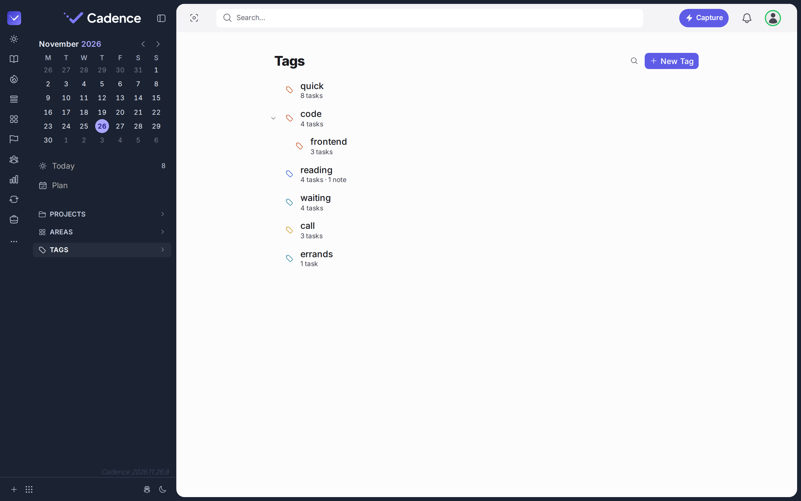
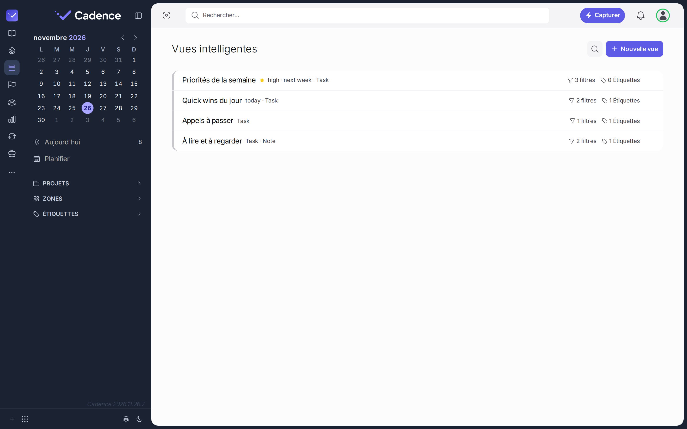
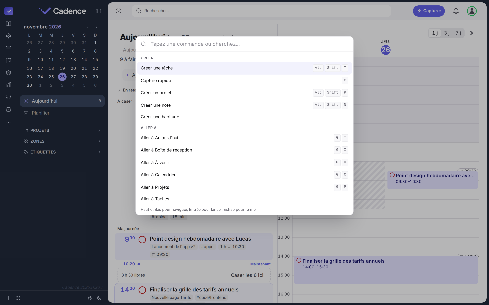

# Tags, Views and Navigation

Tags classify tasks, notes and projects freely; views save a search so you can reopen it in one click; the sidebar, the `Ctrl+K` palette and keyboard shortcuts take you anywhere without the mouse. In the French interface, a "tag" is called **étiquette**.

## Tags

### What a tag can do

- Apply to a **task, a note or a project**; the same tag serves all three.
- **Create itself** the first time you write it: `#home` in a capture, or typing in a task's tags field.
- Carry a **colour**, an **icon** and a **parent** (they nest like folders).
- Be **pinned** to find them at the top of the sidebar.
- Filter: clicking a tag opens its page, which lists its tasks, notes and projects.

Tags are **personal**: your collaborators on a shared project do not have yours, and they can create their own tags of the same name. A tag therefore cannot be shared.

### Write a tag

| Where | How |
|---|---|
| Quick capture | `#home`, `#personal/sport` (see [Inbox and Capture](Inbox-and-Capture)) |
| A task's panel | The **Tags** chip (a field with suggestions) |
| Sidebar | The **+** of the Tags section ("Add Tag") |
| Tags page | "New Tag" |

The tags field completes as you type: it offers the tags that contain your letters (ignoring case), up to ten at a time, and **"+ Create "name""** if nothing matches. Enter or a comma adds and continues; Backspace removes the last one when the field is empty; Esc closes the list. Above, up to **five quick-access chips** show your pinned tags, otherwise your five most used. **Ten tags at most** per item: the field stops by itself once the limit is reached.

### Name rules

- From 1 to 50 characters per part (200 for the whole path); surrounding spaces are removed.
- The characters `#`, `%`, `&`, `{`, `}`, `\`, `<`, `>`, `*`, `?`, `$`, `!`, `'`, `"`, `@`, `+`, the backtick, `|` and `=` are refused. Letters, digits, spaces, hyphens and underscores pass; there are no emojis.
- The `#` is only a typing signal: `#travail` creates the tag `travail`.
- **No duplicates**: `Travail`, `travail` and `TRAVAIL` are the same tag (the displayed case is that of the first use). Creating a duplicate by hand is refused with a message naming the existing tag.

### Nested tags

**A tag's name is its full path**: `perso/sport/course`. There is **no depth limit**.

- Writing `perso/sport` anywhere (task, note, project, tag panel) **creates the missing ancestors**: `perso`, then `perso/sport`.
- Two `sport` tags can coexist under different parents.
- **Renaming** a tag renames its whole subtree (`a` becomes `x`: `a/b` becomes `x/b`). A name already taken, including by a child of the subtree, refuses the operation. A tag cannot be placed under itself or under one of its descendants.
- A tag's **panel** (pencil) edits its short name and its **"Parent tag"** (a list of all the others, by full path; "None (top level)" moves it up). It also sets the colour, the icon and the pin.
- **Deleting a parent keeps its children**: they move up one level and their name loses the deleted part.
- **Filtering by a parent includes all its descendants**: the tag `perso` gathers the tasks of `perso/sport/course`. This does not concern a tag that merely starts with the same letters (`perso2`). With several tags at once, each must be present (or one of its descendants): `travail` and `urgent` find a task tagged `travail/appels` and `urgent`.
- In a **tree** (sidebar, Tags page), the short name is shown under its parent, the full path in a tooltip; elsewhere (task chips, selectors), it is the full path.
- On Android, tags are also shown as a collapsible tree (filtering by a parent includes its children), and entry accepts `/`.

### Colours and icons

**Colour.** A tag always has a colour, in this order: its own, otherwise that of **the nearest ancestor that has one** (`perso` for `perso/sport`), otherwise a shade drawn from the first segment of its name (always the same for the same name, never grey). The picker offers each shade in **three tones** (light, medium, dark), a free hexadecimal colour, and **"Automatic"**. The colour appears on chips, in the sidebar tree, on the tag's page, on Android and in the Today widget.

**Icon.** The tag's panel (and a project's) opens an icon grid with search (label or keyword, ignoring accents) and "No icon". The set of sixty icons is the same on the web and on Android. With no choice, a project keeps its folder and a tag nothing more. The icon is shown in the sidebar, the header, the project card, task rows and the Tags page.

### System tags

Each account has two system tags, **`today`** and **`someday`**, which can be neither renamed nor deleted (their colour and pin can be changed).

- `today`: an open task that carries it counts among the day's priority candidates, whatever its dates (see [Today and Daily Plan](Today-and-Daily-Plan)).
- `someday`: "later". The tasks that carry it, and those of a project that carries it, are not suggested to fill the day; `someday` projects are hidden from the Projects page until its "Someday" filter is turned on; filing an idea as "Later" creates a task that carries it.

### The Tags page

The **Tags** page (`/tags`) lists your tags **by usefulness**: pinned first, then the most used (subtree included), then by name. Each row: a pill in the tag's colour (or its icon), its name, then "5 tasks · 2 notes" (nothing if the tag is unused; no zeros). Children are indented under their parent; a parent's arrow collapses them. Search ("Search…") keeps a parent when it or one of its children matches. Hover or menu: "Edit", "Delete".

A **tag's page** (`/tag/<id>-<name>`) has a bold title, the "Tag progress · 3 of 12 tasks done" line (only once a task is done), then the **Tasks**, **Notes**, **Projects** tabs with their counts. The Tasks tab offers the status filter (open, all, done), sorting (due date, name, priority, status, creation) and grouping by project. In the Minimal interface, it also has the **List / Board / Calendar** switch of views (see below), remembered per tag.

### Pin

In the sidebar, a pushpin button appears on hover over each project or tag row (always visible on touch): a click pins without opening. The tag panel also offers "Pin to sidebar". A pinned tag also comes first among the quick-access chips.

### Delete

Deleting a tag asks for confirmation ("Are you sure you want to delete the tag "…"?") and is **immediate and permanent**: it disappears from all tasks, notes and projects, which themselves remain. No undo is possible.

## Saved views

A **view** is a saved search: it keeps your criteria, never the items, and is re-evaluated each time it is opened, so its results are always up to date. Views are personal and are not shared.

### Create a view

- **From the sidebar (Minimal interface).** The **+** of the "Views" section opens "New view" with no prior search: **Name** (required), **Project**, **Tag** and **Priority** (each restricts the view, or "Any" accepts them all), **Due** (Today, Next 7 days, Overdue, No due date), **Status** (Open, by default, or Done). A view only lists tasks. "Create view" saves it and opens it. A project you no longer have access to returns no tasks.
- **From search.** Open search (`/`), set the text, the types (tasks, notes, projects), the priority, the status, the due date, the postponement, the tags and the "extras" (is recurring, has content, is deferred, has tags, is assigned to a project, is overdue, has no due date; most go in opposite pairs, choosing one side removes the other), then **"Save as Smart View"** and a name. The Dense interface keeps this single path.

The view saves the text, the types, the priority, **a single status**, the due date, the postponement, the tags and the extras. It does not save the sorting, the grouping or the active/done filter: they are set at each visit.

### Find and manage them

- **Sidebar**: the "Views" section lists your views; **pinned** views (star) come at the top, reorderable by dragging (a 250 ms press then drag, or with the keyboard using Space and the arrows).
- **"Smart Views" page** (`/views`): all your views as cards, pinned first, with search.
- **Opened**, a view shows its name (click to rename in place; Enter saves, Esc cancels), the search, sort and group buttons, an information button that recalls the criteria, the star to pin and the trash to delete (with confirmation). Deleting a view does not delete what it shows.
- Subtasks are not listed alone; results load 20 at a time ("Load more") with "Showing X of Y"; they update when you complete, edit or delete an item.

### List, Board or Calendar

In the Minimal interface, a saved view, a tag page, a project and the Tasks list have a **View: List / Board / Calendar** switch above the tasks. The list is the default choice.

- **Board**: four columns by priority (High, Medium, Low, None); dragging a card to another column changes its priority; a click opens it in the panel.
- **Calendar**: a month of tasks by due date, with previous, next and "Today"; dragging a task onto another day changes its due date. Postponement chips show the start day and cannot be moved.
- The choice is **remembered per view**, per tag, per project and for the Tasks list, **in your profile**: it follows you from one browser to another. A project also keeps its own Board tab (its sections) and a Calendar tab. Dense has no switch.

### On Android

Saved views are read in the list selector: pinned ones under « Épinglés » (Pinned), all under « Vues » (Views). A view whose criteria can be computed on the phone (status, priority, due date, postponement, tags, project, text, extras) opens offline; otherwise it goes through an online request. A view on notes or projects shows « Vue disponible sur le web » (View available on the web) (or « Hors ligne », Offline). **Creating or editing a view is done on the web.**

## The sidebar

### The two looks

The sidebar has two looks, according to Profile › Interface › Appearance › Interface: **Minimal** (default) and **Dense** (the original bar, all links in one list). This section describes Minimal.

- **The icon rail**, always visible on the left (it is the whole bar when collapsed). By default: Today, Calendar, Notes, Habits, Views, Areas, Goals, People, Insights, Review, Career; the rest sleeps in the **"More"** menu: All Tasks, Assigned to me, Everyone, Boards, Templates, Access. The rail keeps the same icons in the same order on every page. Under 1280 px wide the bar starts collapsed to the rail; expanding or collapsing it yourself is remembered on this device and wins over the width.
- **The panel**, beside it: its blocks from top to bottom are **Pinned**, **Month calendar**, **Smart lists**, **Projects**, **Areas** and **Tags**, in the order chosen in the settings.
- **The footer** (+, apps, theme) runs under the rail and the panel.
- You **widen or narrow** the bar by dragging its right edge (from 90 to 110% of the default width; double-click to return; arrows, Home and End on the keyboard). The panel scrolls on its own; its sections collapse by their header.
- On tablet and phone, the bar is a drawer with a scrim and a close button.

### Pinned

At the top of the panel, a **"Pinned"** block (tinted background, always open, no arrow; it disappears when nothing is pinned) gathers your pinned projects, notes and tags, with the project's icon in its colour, the tag's pill or the note icon. The cross on hover unpins. Projects and notes can also be pinned from their page ("⋯" menu). The block does not move: it always comes first; its switch is at the top of Profile › Interface › Sidebar.

### Smart lists

Four rows at the top of the panel, each with a counter of open tasks:

| Row | Opens | Counts |
|---|---|---|
| Today | Today | Open tasks due today (excluding subtasks) |
| Tomorrow | The list of tomorrow's tasks | Open tasks due tomorrow |
| Next 7 days | Plan | Tasks of the 7-day board |
| Inbox | The inbox (Plan's column) | Items to sort |

By default, only **Today** and **Inbox** show a counter; Tomorrow and Next 7 days stay silent until you turn it on. Counters refresh on each navigation.

### Projects, areas, tags

- **Projects** and **Tags** keep their nesting. A project that has subprojects carries a **chevron** that collapses or expands them, at any depth; the choice is kept on this device, and the open project stays visible even if its parent is collapsed.
- **Areas are folders**: the arrow shows the area's projects, the name opens the area's page.
- Rows are 34 px high, in 14 px text.
- The rail's **Goals**, **Habits** and **Notes** icons each open their own panel (blocks adjustable in Profile › Interface › Sidebar). The Habits panel ticks a day's habit with one touch.

### Drop on the sidebar

Drag a task, a note or a project onto a row of the bar to file it: on a project, it is moved there; on a tag, it receives the tag (full path, the others stay); on an area, it takes the area (a project is filed in the area); on "Today" or "Tomorrow", it becomes due that day. The target under the pointer gets a blue ring only when it accepts what you are holding; releasing elsewhere changes nothing. Nothing is saved if the item already has it. Refused: a note on an area or a day, a recurring task on Today or Tomorrow, a subproject on an area (it follows its parent), a task from a `TODO.md` file. Sorting by drag remains, but dropping on the bar takes precedence; with the keyboard, you reorder without aiming at the bar. A failure shows an error message.

### Customize

Profile › Interface › Sidebar (or "Customize sidebar" in the rail's **More** menu):

- **Panel**: show or hide each block, move it up or down, and turn on the counter of Projects, Areas and Tags (off by default).
- **Smart lists**: show, hide, order each row and its counter.
- **Icon rail and More**: each entry is on the icon rail, in the **More** menu or hidden.
- **Reset to default** restores everything. A hidden block does not hide the matching icon. Modules turned off in Profile › Advanced › Features & Add-ons (Habits, Calendar, Templates…) stay off the bar.
- The grid button in the footer opens a launcher with **all** pages as tiles, including those hidden from the bar.

### On Android

The **title of the Tasks screen** is the open list (« Aujourd'hui ▾ », Today ▾) and opens the list selector: the **pinned** items (a tap opens, a long press unpins), then Aujourd'hui (Today), Planifier (Plan), Projets (Projects), Étiquettes (Tags), Notes, Terminées (Done), Vues (Views), the area, Réglages (Settings). Pinned projects and notes are there; pinned tags are not yet.

## The command palette (`Ctrl+K`)

`Ctrl+K` (`Cmd+K` on Mac) opens the **Command palette**, usable even while typing. Search is fuzzy: accents ignored, each word must match, keywords count a little less. The typed text is highlighted in each row. Up and Down move, Enter runs, Esc closes. When the field is empty, the palette lists your recent commands and the last items opened. Each row shows its shortcut.

The palette searches:

- **commands**: Create task, project, note, habit; Quick capture; Search; Triage the inbox; Toggle dark mode; Keyboard shortcuts;
- **pages**: Go to Today, Inbox, Upcoming, Calendar, Projects, Tasks, Notes, Habits, Settings;
- **items**: tasks, projects, notes, goals, **links** (a click opens the address in a new tab), habits; a goal opens its page;
- **actions on a task**, when a task is the target: Complete or Reopen, Open, Date (today, tomorrow, next week, none), Priority, Move to project.

**The target task** is the row that has focus, otherwise the row under the pointer, otherwise the task open in the panel.

### Search (`/`)

Search opens a panel of **filter chips** (types with their result counts, priority, due date; "More filters" shows more) instead of a sentence. Results are grouped (Tasks, Projects, Notes, Areas, Tags, Links) with their counts; Up and Down navigate, Enter opens, Esc closes. The found text is coloured, links included. "Save as Smart View" turns the search into a view.

## All keyboard shortcuts

`?` opens the help overlay. Single keys only activate **when** focus is not in a field, an editor or a modal window (with Ctrl, Cmd or Alt held, they are ignored).

### General

| Keys | Action |
|---|---|
| `Ctrl+K` / `Cmd+K` | Command palette (works in fields) |
| `c` | Quick capture |
| `/` | Search |
| `?` | Show shortcuts |

### Go to (second key within the following second)

| Keys | Action |
|---|---|
| `g` then `t` | Today |
| `g` then `i` | Inbox (Plan's column) |
| `g` then `u` | Plan |
| `g` then `c` | Calendar |
| `g` then `p` | Projects |

### On a task (selected row)

| Keys | Action |
|---|---|
| Up and Down | Move between tasks |
| `x` or Space | Complete or reopen |
| `e` or Enter | Open the task |
| `d` | Set the date |
| `p` | Set the priority |
| `m` | Move to a project (opens the palette on projects) |
| Del | Delete, with "Undo" |
| `j` / `k` | Next or previous task, in the panel |

Deleting with undo hides the row immediately and only calls the server after a few seconds: "Undo" restores the same task, and reloading the page during this delay cancels the deletion.

### Create

| Keys | Action |
|---|---|
| `Alt+Shift+I` | An inbox item |
| `Alt+Shift+T` | A task |
| `Alt+Shift+P` | A project |
| `Alt+Shift+N` | A note |
| `Alt+Shift+A` | An area |
| `Alt+Shift+G` | A tag |

These combinations are set in Profile › Interface › Shortcuts.

### On the Plan page

| Keys | Action |
|---|---|
| `n` | Add to the inbox |
| Arrows or `h` `j` `k` `l` | Move from one card or day to another |
| Shift+← / Shift+→ | Move the card (or the selection) by one day |
| `t` / Shift+T | Plan it today / tomorrow |
| Shift+W / Shift+M | Send it to next week / this month |
| `m` | Pick it up to move it with the arrows (Enter drops it) |
| Ctrl, Cmd or Shift + click | Select several cards |
| Esc | Clear the selection |

### Inbox triage

| Keys | Action |
|---|---|
| `t` | Make it a task |
| `p` | Make it a project |
| `n` | Make it a note |
| `s` | Later (stays in the inbox) |
| Del | Delete |
| Enter | Accept the suggestion |
| Esc | Exit |

### In a list or a panel

In menus: the right arrow opens a submenu, the left arrow or Esc goes back. In the panel: Esc closes, `j` and `k` change task. The "Menu" key and Shift+F10 open the row menu.

## Special cases

| Situation | What happens |
|---|---|
| You rename a nested tag | Its whole subtree follows, and `/tag/…` addresses keep their id: no link breaks |
| You delete a tag in use | It disappears from all items, with no undo possible |
| Ten tags are already set | The field accepts no more, without a message |
| A system tag | Cannot be renamed or deleted |
| A view points to a project you can no longer read | It returns no tasks |
| You hide a block of the bar | Its rail icon stays; Today, Inbox and Areas come back on the rail when their block is hidden |
| Shortcut pressed in a field | Ignored (except `Ctrl+K`) |

## Going further

- [Tags](https://github.com/PreciselyWrong/cadence/blob/main/docs/09-tags-system.md)
- [Saved views](https://github.com/PreciselyWrong/cadence/blob/main/docs/08-views-system.md)
- [Sidebar](https://github.com/PreciselyWrong/cadence/blob/main/docs/32-sidebar.md)
- [Keyboard, palette and inbox triage](https://github.com/PreciselyWrong/cadence/blob/main/docs/35-keyboard-palette.md)
- [Web comfort audit](https://github.com/PreciselyWrong/cadence/blob/main/docs/fork/QOL-AUDIT-WEB.md)
