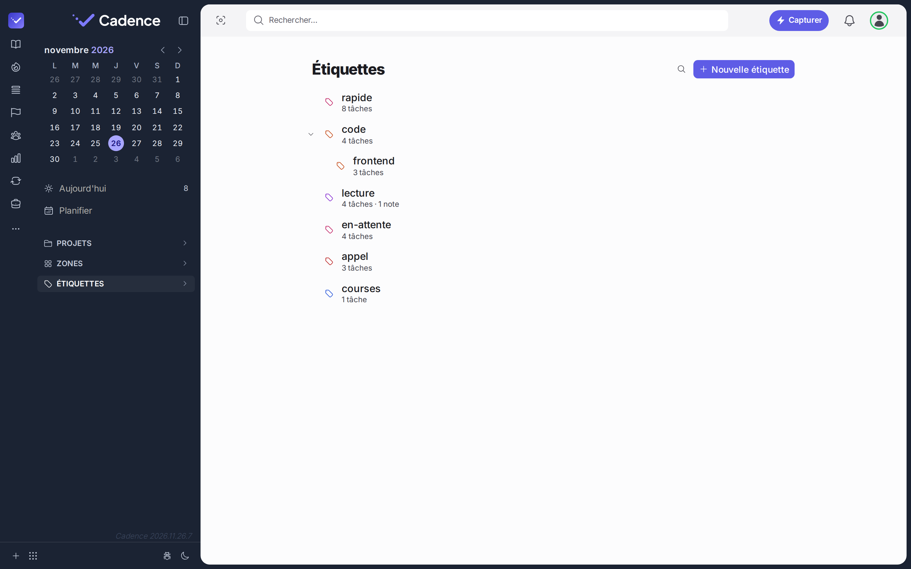
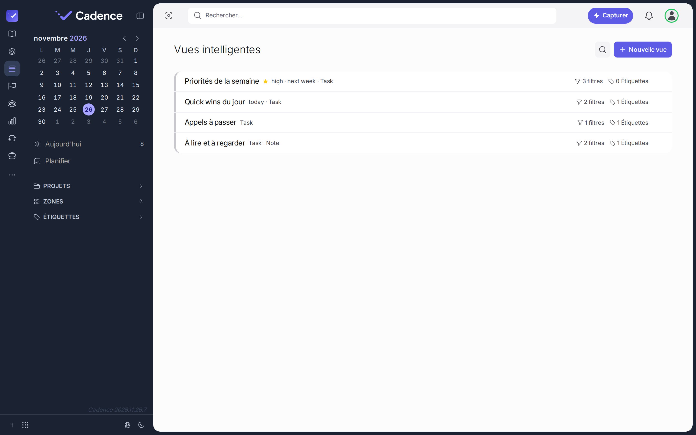
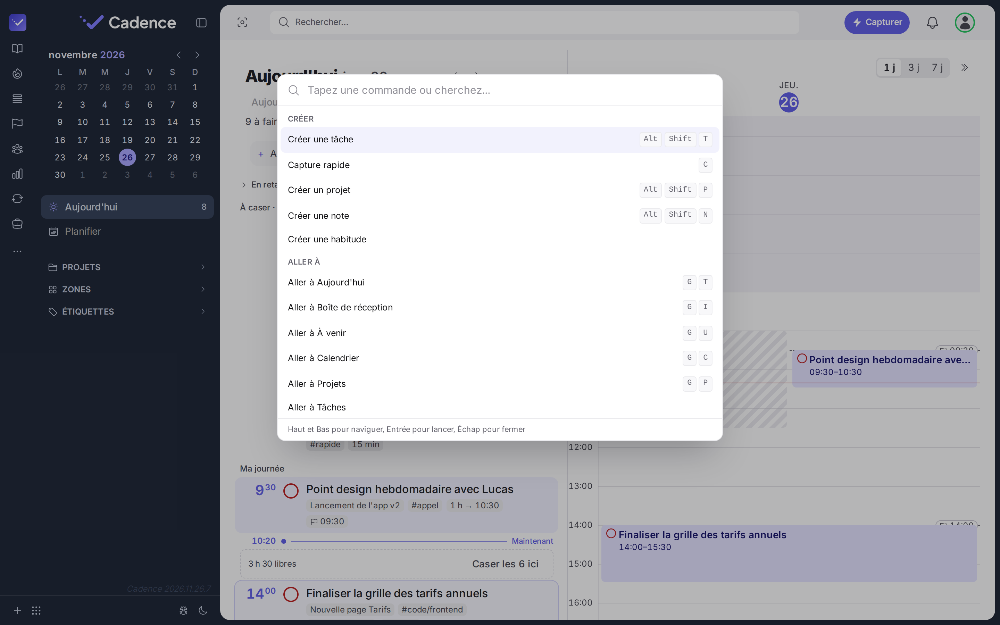

# Tags, vues et navigation

Les étiquettes (tags) classent librement tâches, notes et projets ; les vues enregistrent une recherche pour la rouvrir en un clic ; la barre latérale, la palette `Ctrl+K` et les raccourcis clavier vous font aller partout sans la souris. Dans l'interface française, un « tag » s'appelle **étiquette**.

## Les étiquettes (tags)

### Ce qu'une étiquette peut faire

- S'appliquer à une **tâche, une note ou un projet** ; la même étiquette sert aux trois.
- Se **créer toute seule** la première fois qu'on l'écrit : `#maison` dans une capture, ou une saisie dans le champ d'étiquettes d'une tâche.
- Porter une **couleur**, une **icône** et un **parent** (elles s'emboîtent comme des dossiers).
- Être **épinglée** pour les retrouver en tête de la barre latérale.
- Filtrer : cliquer une étiquette ouvre sa page, qui liste ses tâches, ses notes et ses projets.

Les étiquettes sont **personnelles** : vos collaborateurs sur un projet partagé n'ont pas les vôtres, et ils peuvent créer leurs propres étiquettes du même nom. On ne peut donc pas partager une étiquette.

### Écrire une étiquette

| Où | Comment |
|---|---|
| Capture rapide | `#maison`, `#perso/sport` (voir [Boîte de réception et capture](Boite-de-reception-et-capture)) |
| Fiche d'une tâche | La puce **Étiquettes** (une saisie avec suggestions) |
| Barre latérale | Le **+** de la section Étiquettes (« Ajouter une étiquette ») |
| Page Étiquettes | « Nouvelle étiquette » |

Le champ d'étiquettes complète en tapant : il propose les étiquettes qui contiennent vos lettres (sans tenir compte des majuscules), jusqu'à dix à la fois, et **« + Créer « nom » »** si rien ne correspond. Entrée ou une virgule ajoute et continue ; Retour arrière retire la dernière quand le champ est vide ; Échap ferme la liste. Au-dessus, jusqu'à **cinq puces d'accès rapide** montrent vos étiquettes épinglées, sinon vos cinq plus utilisées. **Dix étiquettes au plus** par élément : le champ s'arrête de lui-même une fois la limite atteinte.

### Les règles de nom

- De 1 à 50 caractères par partie (200 pour le chemin entier) ; les espaces autour sont retirés.
- Sont refusés les caractères `#`, `%`, `&`, `{`, `}`, `\`, `<`, `>`, `*`, `?`, `$`, `!`, `'`, `"`, `@`, `+`, le guillemet inversé, `|` et `=`. Lettres, chiffres, espaces, tirets et soulignés passent ; il n'y a pas d'émojis.
- Le `#` n'est qu'un signal de saisie : `#travail` crée l'étiquette `travail`.
- **Pas de doublon** : `Travail`, `travail` et `TRAVAIL` sont la même étiquette (la casse affichée est celle de la première utilisation). Créer un doublon à la main est refusé avec un message qui nomme l'étiquette existante.

### Les étiquettes imbriquées

Le **nom d'une étiquette est son chemin complet** : `perso/sport/course`. Il n'y a **pas de limite de profondeur**.

- Écrire `perso/sport` n'importe où (tâche, note, projet, panneau d'étiquette) **crée les ancêtres manquants** : `perso`, puis `perso/sport`.
- Deux `sport` peuvent coexister sous des parents différents.
- **Renommer** une étiquette renomme tout son sous-arbre (`a` devient `x` : `a/b` devient `x/b`). Un nom déjà pris, y compris par un enfant du sous-arbre, refuse l'opération. Une étiquette ne peut pas être placée sous elle-même ni sous l'un de ses descendants.
- Le **panneau d'une étiquette** (crayon) modifie son nom court et son **« Étiquette parente »** (liste de toutes les autres, par chemin complet ; « Aucune (niveau supérieur) » la remonte). Il règle aussi la couleur, l'icône et l'épingle.
- **Supprimer un parent garde ses enfants** : ils remontent d'un niveau et leur nom perd la partie supprimée.
- **Filtrer par un parent inclut tous ses descendants** : l'étiquette `perso` rassemble les tâches de `perso/sport/course`. Cela ne concerne pas une étiquette qui commence seulement par les mêmes lettres (`perso2`). Avec plusieurs étiquettes à la fois, il faut que chacune soit présente (ou l'un de ses descendants) : `travail` et `urgent` trouvent une tâche étiquetée `travail/appels` et `urgent`.
- Dans un **arbre** (barre latérale, page Étiquettes), le nom court s'affiche sous son parent, le chemin complet en infobulle ; ailleurs (puces de tâche, sélecteurs), c'est le chemin complet.
- Sur Android, les étiquettes s'affichent aussi en arbre repliable (filtrer par un parent inclut ses enfants), et la saisie accepte `/`.

### Couleurs et icônes

**Couleur.** Une étiquette a toujours une couleur, dans cet ordre : la sienne, sinon celle de **l'ancêtre le plus proche qui en a une** (`perso` pour `perso/sport`), sinon une teinte tirée du premier segment de son nom (toujours la même pour le même nom, jamais grise). Le sélecteur propose chaque teinte en **trois nuances** (clair, moyen, foncé), une couleur libre en hexadécimal, et **« Automatique »**. La couleur apparaît sur les puces, dans l'arbre de la barre latérale, sur la page de l'étiquette, sur Android et dans le widget Aujourd'hui.

**Icône.** Le panneau de l'étiquette (et celui d'un projet) ouvre une grille d'icônes avec recherche (libellé ou mot-clé, sans tenir compte des accents) et « Aucune icône ». Le jeu de soixante icônes est le même sur le web et sur Android. Sans choix, un projet garde son dossier et une étiquette rien de plus. L'icône s'affiche dans la barre latérale, l'en-tête, la carte du projet, les lignes de tâche et la page Étiquettes.

### Étiquettes système

Chaque compte a deux étiquettes système, **`today`** et **`someday`**, qui ne se renomment ni ne se suppriment (leur couleur et leur épingle se changent).

- `today` : une tâche ouverte qui la porte compte parmi les candidates prioritaires de la journée, quelles que soient ses dates (voir [Aujourd'hui et plan du jour](Aujourd-hui-et-plan-du-jour)).
- `someday` : « plus tard ». Les tâches qui la portent, et celles d'un projet qui la porte, ne sont pas proposées pour remplir la journée ; les projets `someday` sont cachés de la page Projets tant que son filtre « Un jour » n'est pas activé ; classer une idée « Plus tard » crée une tâche qui la porte.

### La page Étiquettes

La page **Étiquettes** (`/tags`) liste vos étiquettes **par utilité** : épinglées d'abord, puis les plus utilisées (sous-arbre compris), puis par nom. Chaque ligne : une pastille de la couleur de l'étiquette (ou son icône), son nom, puis « 5 tâches · 2 notes » (rien si l'étiquette est inutilisée ; pas de zéros). Les enfants sont en retrait sous leur parent ; la flèche d'un parent les replie. La recherche (« Rechercher… ») garde un parent quand lui ou l'un de ses enfants correspond. Survol ou menu : « Modifier », « Supprimer ».

La **page d'une étiquette** (`/tag/<identifiant>-<nom>`) a un titre en gras, la ligne « Avancement de l'étiquette · 3 tâches sur 12 terminées » (seulement une fois une tâche terminée), puis les onglets **Tâches**, **Notes**, **Projets** avec leurs nombres. L'onglet Tâches offre le filtre de statut (ouvertes, toutes, terminées), le tri (échéance, nom, priorité, statut, création) et le regroupement par projet. En interface Minimale, il a aussi l'interrupteur **Liste / Tableau / Calendrier** des vues (voir plus bas), mémorisé par étiquette.

### Épingler

Dans la barre latérale, un bouton punaise apparaît au survol de chaque ligne de projet ou d'étiquette (toujours visible au tactile) : un clic épingle sans ouvrir. Le panneau d'étiquette propose aussi « Épingler à la barre latérale ». Une étiquette épinglée vient aussi en tête des puces d'accès rapide.

### Supprimer

Supprimer une étiquette demande confirmation (« Voulez-vous vraiment supprimer l'étiquette « … » ? ») et est **immédiat et définitif** : elle disparaît de toutes les tâches, notes et projets, qui eux restent. Aucune annulation n'est possible.

## Les vues enregistrées

Une **vue** est une recherche enregistrée : elle garde vos critères, jamais les éléments, et se réévalue à chaque ouverture, donc ses résultats sont toujours à jour. Les vues sont personnelles et ne se partagent pas.

### Créer une vue

- **Depuis la barre latérale (interface Minimale).** Le **+** de la section « Vues » ouvre « Nouvelle vue » sans recherche préalable : **Nom** (obligatoire), **Projet**, **Étiquette** et **Priorité** (chacun restreint la vue, ou « Toutes » les accepte), **Échéance** (Aujourd'hui, 7 prochains jours, En retard, Sans échéance), **Statut** (Ouvertes, par défaut, ou Terminées). Une vue ne liste que des tâches. « Créer la vue » l'enregistre et l'ouvre. Un projet auquel vous n'avez plus accès ne renvoie aucune tâche.
- **Depuis la recherche.** Ouvrez la recherche (`/`), réglez le texte, les types (tâches, notes, projets), la priorité, le statut, l'échéance, le report, les étiquettes et les « extras » (récurrent, a du contenu, différé, a des étiquettes, assigné à un projet, en retard, sans échéance ; la plupart vont par paires opposées, choisir un côté retire l'autre), puis **« Enregistrer en tant que vue intelligente »** et un nom. L'interface Dense garde ce seul chemin.

La vue enregistre le texte, les types, la priorité, **un seul statut**, l'échéance, le report, les étiquettes et les extras. Elle n'enregistre pas le tri, le regroupement ni le filtre actif/terminé : ils se règlent à chaque visite.

### Les retrouver et les gérer

- **Barre latérale** : la section « Vues » liste vos vues ; les vues **épinglées** (étoile) viennent en haut, réordonnables par glisser (appui de 250 ms puis glisser, ou au clavier avec Espace et les flèches).
- **Page « Vues intelligentes »** (`/views`) : toutes vos vues en cartes, épinglées d'abord, avec recherche.
- **Ouverte**, une vue affiche son nom (cliquez pour le renommer en place ; Entrée enregistre, Échap annule), les boutons de recherche, de tri et de regroupement, un bouton d'information qui rappelle les critères, l'étoile pour épingler et la corbeille pour supprimer (avec confirmation). Supprimer une vue ne supprime pas ce qu'elle montre.
- Les sous-tâches ne sont pas listées seules ; les résultats se chargent 20 par 20 (« Charger plus ») avec « Affichage de X sur Y » ; ils se mettent à jour quand vous terminez, modifiez ou supprimez un élément.

### Liste, Tableau ou Calendrier

En interface Minimale, une vue enregistrée, une page étiquette, un projet et la liste Tâches ont un interrupteur **Affichage : Liste / Tableau / Calendrier** au-dessus des tâches. La liste est le choix par défaut.

- **Tableau** : quatre colonnes par priorité (Haute, Moyenne, Basse, Aucune) ; glisser une carte vers une autre colonne change sa priorité ; un clic l'ouvre dans la fiche.
- **Calendrier** : un mois de tâches par échéance, avec précédent, suivant et « Aujourd'hui » ; glisser une tâche sur un autre jour change son échéance. Les puces de report montrent le jour de début et ne se déplacent pas.
- Le choix est **mémorisé par vue**, par étiquette, par projet et pour la liste Tâches, **dans votre profil** : il vous suit d'un navigateur à l'autre. Un projet garde aussi son propre onglet Tableau (ses sections) et un onglet Calendrier. Dense n'a pas d'interrupteur.

### Sur Android

Les vues enregistrées se lisent dans le sélecteur de listes : les épinglées sous « Épinglés », toutes sous « Vues ». Une vue dont les critères se calculent sur le téléphone (statut, priorité, échéance, report, étiquettes, projet, texte, extras) s'ouvre hors ligne ; sinon elle passe par une requête en ligne. Une vue sur des notes ou des projets affiche « Vue disponible sur le web » (ou « Hors ligne »). **Créer ou modifier une vue se fait sur le web.**

## La barre latérale

### Les deux apparences

La barre latérale a deux apparences, selon Profil › Interface › Apparence › Interface : **Minimale** (par défaut) et **Dense** (la barre d'origine, tous les liens dans une liste). Cette section décrit Minimale.

- **La barre d'icônes**, toujours visible à gauche (elle est toute la barre quand elle est réduite). Par défaut : Aujourd'hui, Calendrier, Notes, Habitudes, Vues, Zones, Objectifs, Personnes, Aperçus, Revue, Carrière ; le reste dort dans le menu **« Plus »** : Toutes les tâches, Assigné à moi, Tout le monde, Tableaux, Modèles, Accès.
- **Le panneau**, à côté : ses blocs de haut en bas sont **Épinglés**, **Calendrier du mois**, **Listes intelligentes**, **Projets**, **Zones** et **Étiquettes**, dans l'ordre choisi dans les réglages.
- **Le pied** (+, applications, thème) court sous la barre et le panneau.
- On **élargit ou réduit** la barre en tirant son bord droit (de 90 à 110 % de la largeur par défaut ; double-clic pour revenir ; flèches, Début et Fin au clavier). Le panneau défile seul ; ses sections se replient par leur en-tête.
- Sur tablette et téléphone, la barre est un tiroir avec un voile et un bouton de fermeture.

### Épinglés

En tête du panneau, un bloc **« Épinglés »** (fond teinté, toujours ouvert, sans flèche ; il disparaît quand rien n'est épinglé) réunit vos projets, notes et étiquettes épinglés, avec l'icône du projet à sa couleur, la pastille de l'étiquette ou l'icône de note. La croix au survol désépingle. Les projets et les notes s'épinglent aussi depuis leur page (menu « ⋯ »). Le bloc ne se déplace pas : il vient toujours en premier ; son interrupteur est en tête de Profil › Interface › Barre latérale.

### Listes intelligentes

Quatre lignes en tête du panneau, chacune avec un compteur de tâches ouvertes :

| Ligne | Ouvre | Compte |
|---|---|---|
| Aujourd'hui | Aujourd'hui | Tâches ouvertes dues aujourd'hui (hors sous-tâches) |
| Demain | La liste des tâches de demain | Tâches ouvertes dues demain |
| 7 prochains jours | Planifier | Tâches du tableau de 7 jours |
| Boîte de réception | La boîte (colonne de Planifier) | Éléments à trier |

Par défaut, seuls **Aujourd'hui** et **Boîte de réception** affichent un compteur ; Demain et 7 prochains jours restent muets jusqu'à ce que vous l'activiez. Les compteurs se rafraîchissent à chaque navigation.

### Projets, zones, étiquettes

- **Projets** et **Étiquettes** gardent leur imbrication. Un projet qui a des sous-projets porte un **chevron** qui les replie ou les déplie, à toute profondeur ; le choix est gardé sur cet appareil, et le projet ouvert reste visible même si son parent est replié.
- **Les zones sont des dossiers** : la flèche montre les projets de la zone, le nom ouvre la page de la zone.
- Les lignes font 34 px de haut, en texte de 14 px.
- Les icônes **Objectifs**, **Habitudes** et **Notes** du rail ouvrent chacune leur propre panneau (blocs réglables dans Profil › Interface › Barre latérale). Le panneau Habitudes coche une habitude du jour d'un toucher.

### Déposer sur la barre latérale

Glissez une tâche, une note ou un projet sur une ligne de la barre pour la ranger : sur un projet, elle y est déplacée ; sur une étiquette, elle reçoit l'étiquette (chemin complet, les autres restent) ; sur une zone, elle prend la zone (un projet est rangé dans la zone) ; sur « Aujourd'hui » ou « Demain », elle devient due ce jour-là. La cible sous le pointeur s'entoure d'un anneau bleu seulement quand elle accepte ce que vous tenez ; relâcher ailleurs ne change rien. Rien n'est enregistré si l'élément l'a déjà. Sont refusés : une note sur une zone ou sur un jour, une tâche récurrente sur Aujourd'hui ou Demain, un sous-projet sur une zone (il suit son parent), une tâche d'un fichier `TODO.md`. Le tri par glisser reste, mais le dépôt sur la barre l'emporte ; au clavier, on réordonne sans viser la barre. Un échec montre un message d'erreur.

### Personnaliser

Profil › Interface › Barre latérale (ou « Personnaliser la barre latérale » dans le menu **Plus** du rail) :

- **Panneau** : afficher ou masquer chaque bloc, le monter ou le descendre, et activer le compteur des Projets, Zones et Étiquettes (désactivé par défaut).
- **Listes intelligentes** : afficher, masquer, ordonner chaque ligne et son compteur.
- **Barre d'icônes et Plus** : chaque entrée est sur la barre d'icônes, dans le menu **Plus** ou masquée.
- **Rétablir par défaut** remet tout. Un bloc masqué ne masque pas l'icône correspondante. Les modules désactivés dans Profil › Avancé › Fonctionnalités et modules (Habitudes, Calendrier, Modèles…) restent hors de la barre.
- Le bouton en grille du pied ouvre un lanceur avec **toutes** les pages en tuiles, y compris celles cachées de la barre.

### Sur Android

Le **titre de l'écran Tâches** est la liste ouverte (« Aujourd'hui ▾ ») et ouvre le sélecteur de listes : les **épinglés** (un appui ouvre, un appui long désépingle), puis Aujourd'hui, Planifier, Projets, Étiquettes, Notes, Terminées, Vues, la zone, Réglages. Les projets et notes épinglés y sont ; les étiquettes épinglées ne le sont pas encore.

## La palette de commandes (`Ctrl+K`)

`Ctrl+K` (`Cmd+K` sur Mac) ouvre la **Palette de commandes**, utilisable même pendant la saisie. La recherche est floue : accents ignorés, chaque mot doit correspondre, les mots-clés comptent un peu moins. Le texte tapé est surligné dans chaque ligne. Haut et Bas déplacent, Entrée lance, Échap ferme. Quand le champ est vide, la palette liste vos commandes récentes et les derniers éléments ouverts. Chaque ligne affiche son raccourci.

La palette cherche dans :

- les **commandes** : Créer une tâche, un projet, une note, une habitude ; Capture rapide ; Rechercher ; Trier la boîte de réception ; Basculer le mode sombre ; Raccourcis clavier ;
- les **pages** : Aller à Aujourd'hui, Boîte de réception, À venir, Calendrier, Projets, Tâches, Notes, Habitudes, Paramètres ;
- les **éléments** : tâches, projets, notes, objectifs, **liens** (un clic ouvre l'adresse dans un nouvel onglet), habitudes ; un objectif ouvre sa page ;
- les **actions sur une tâche**, quand une tâche est la cible : Terminer ou Rouvrir, Ouvrir, Date (aujourd'hui, demain, semaine prochaine, aucune), Priorité, Déplacer vers un projet.

**La tâche cible** est la ligne qui a le focus, sinon la ligne sous le pointeur, sinon la tâche ouverte dans la fiche.

### La recherche (`/`)

La recherche ouvre un panneau de **puces de filtre** (types avec leur nombre de résultats, priorité, échéance ; « Plus de filtres » en montre davantage) au lieu d'une phrase. Les résultats sont groupés (Tâches, Projets, Notes, Zones, Étiquettes, Liens) avec leurs nombres ; Haut et Bas naviguent, Entrée ouvre, Échap ferme. Le texte trouvé est coloré, les liens inclus. « Enregistrer en tant que vue intelligente » transforme la recherche en vue.

## Tous les raccourcis clavier

`?` ouvre l'aide en superposition. Les touches simples ne s'activent **que** quand le focus n'est pas dans un champ, un éditeur ou une fenêtre modale (avec Ctrl, Cmd ou Alt enfoncés, elles sont ignorées).

### Général

| Touches | Action |
|---|---|
| `Ctrl+K` / `Cmd+K` | Palette de commandes (marche dans les champs) |
| `c` | Capture rapide |
| `/` | Rechercher |
| `?` | Afficher les raccourcis |

### Aller à (la seconde touche dans la seconde qui suit)

| Touches | Action |
|---|---|
| `g` puis `t` | Aujourd'hui |
| `g` puis `i` | Boîte de réception (colonne de Planifier) |
| `g` puis `u` | Planifier |
| `g` puis `c` | Calendrier |
| `g` puis `p` | Projets |

### Sur une tâche (ligne sélectionnée)

| Touches | Action |
|---|---|
| Haut et Bas | Passer d'une tâche à l'autre |
| `x` ou Espace | Terminer ou rouvrir |
| `e` ou Entrée | Ouvrir la tâche |
| `d` | Définir la date |
| `p` | Définir la priorité |
| `m` | Déplacer vers un projet (ouvre la palette sur les projets) |
| Suppr | Supprimer, avec « Annuler » |
| `j` / `k` | Tâche suivante ou précédente, dans la fiche |

La suppression avec annulation masque la ligne tout de suite et n'appelle le serveur qu'au bout de quelques secondes : « Annuler » restaure la même tâche, et recharger la page pendant ce délai annule la suppression.

### Créer

| Touches | Action |
|---|---|
| `Alt+Maj+I` | Un élément de boîte de réception |
| `Alt+Maj+T` | Une tâche |
| `Alt+Maj+P` | Un projet |
| `Alt+Maj+N` | Une note |
| `Alt+Maj+A` | Une zone |
| `Alt+Maj+G` | Une étiquette |

Ces combinaisons se règlent dans Profil › Interface › Raccourcis.

### Sur la page Planifier

| Touches | Action |
|---|---|
| `n` | Ajouter à la boîte de réception |
| Flèches ou `h` `j` `k` `l` | Passer d'une carte ou d'un jour à l'autre |
| Maj+← / Maj+→ | Déplacer la carte (ou la sélection) d'un jour |
| `t` / Maj+T | La planifier aujourd'hui / demain |
| Maj+W / Maj+M | L'envoyer à la semaine prochaine / ce mois-ci |
| `m` | La prendre pour la déplacer aux flèches (Entrée la pose) |
| Ctrl, Cmd ou Maj + clic | Sélectionner plusieurs cartes |
| Échap | Vider la sélection |

### Tri de la boîte de réception

| Touches | Action |
|---|---|
| `t` | En faire une tâche |
| `p` | En faire un projet |
| `n` | En faire une note |
| `s` | Plus tard (reste dans la boîte) |
| Suppr | Supprimer |
| Entrée | Accepter la suggestion |
| Échap | Quitter |

### Dans une liste ou une fiche

Dans les menus : flèche droite ouvre un sous-menu, flèche gauche ou Échap revient. Dans la fiche : Échap ferme, `j` et `k` changent de tâche. Les touches « Menu » et Maj+F10 ouvrent le menu de la ligne.

## Cas particuliers

| Situation | Ce qui se passe |
|---|---|
| Vous renommez une étiquette imbriquée | Tout son sous-arbre suit, et les adresses `/tag/…` gardent leur identifiant : aucun lien ne casse |
| Vous supprimez une étiquette utilisée | Elle disparaît de tous les éléments, sans annulation possible |
| Dix étiquettes sont déjà posées | Le champ n'en accepte plus, sans message |
| Une étiquette système | Impossible à renommer ou supprimer |
| Une vue pointe vers un projet que vous ne lisez plus | Elle ne renvoie aucune tâche |
| Vous masquez un bloc de la barre | Son icône du rail reste ; Aujourd'hui, Boîte de réception et Zones reviennent sur le rail quand leur bloc est masqué |
| Raccourci pressé dans un champ | Ignoré (sauf `Ctrl+K`) |

## Pour aller plus loin

- [Étiquettes](https://github.com/PreciselyWrong/cadence/blob/main/docs/09-tags-system.md)
- [Vues enregistrées](https://github.com/PreciselyWrong/cadence/blob/main/docs/08-views-system.md)
- [Barre latérale](https://github.com/PreciselyWrong/cadence/blob/main/docs/32-sidebar.md)
- [Clavier, palette et tri de la boîte](https://github.com/PreciselyWrong/cadence/blob/main/docs/35-keyboard-palette.md)
- [Audit de confort web](https://github.com/PreciselyWrong/cadence/blob/main/docs/fork/QOL-AUDIT-WEB.md)
