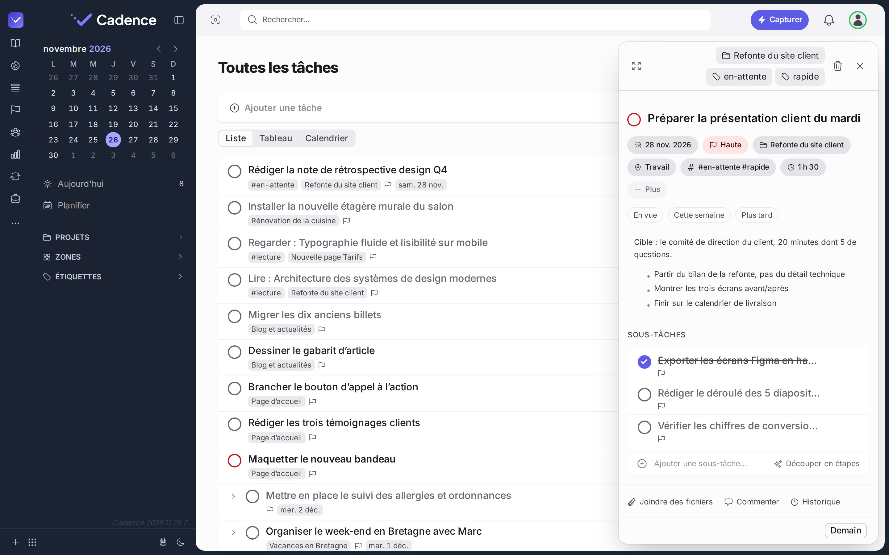

# Tasks

A task is Cadence's basic unit: something to do, which only needs a name and to which you add, only if you want, a due date, a project, a priority or a recurrence. This page describes task rows and their gestures, the panel that opens on click, and each field with its special cases.

## Create a task

- **A name is enough.** An empty name, or one made of spaces, is refused; everything else is optional, and the task is born "Not started".
- **Where to create.** The "+ Add task" field at the top of Today, of the Tasks list, of a project page and of a tag page; quick capture (the `c` key, see [Inbox and Capture](Inbox-and-Capture)); the inbox; Telegram; the API and agents.
- **The "Add task" field reads your sentence.** A date ("tomorrow", "Friday", "12/3"), a priority (`!1` to `!3`), a project or tags (`#`) and a duration are removed from the name and set on the task. A project named in the sentence wins over the one of the list; on a tag page, the tag stays. The task also inherits from its list: the project of a project, the tag of a tag, the displayed day for Today.
- Enter creates the task and clears the field; Esc clears the field; an empty name does nothing. If creation fails, your text comes back and an error is shown.
- A task's title is edited with the same reading: typing "Call Paul tomorrow 3pm #personal" in the panel's title applies the date and the tag.

## Task rows

In the **Minimal** interface (the default), a row fits on one level: a **round checkbox**, the title, then chips on the right. In **Dense**, the row keeps its full controls and unfolds in place.

### What you see on a row

- The **round checkbox** before the title carries a ring in the priority colour; a high priority is the only one marked in red. Clicking the checkbox completes the task after a short tick, with an "Undo" message; the row then leaves the list.
- The **chips** on the right (adjustable in Profile › Interface › Appearance › Task row details): recurrence icon, number of comments, the first two tags then "+N", the project, the priority flag and the due date. The due date reads Today, Tomorrow or the date, in a warning tint once it has passed.
- The **description** (note) appears as compact Markdown on the row, as plain text on a card.
- A task that contains a web address shows the site's icon and name, and the page's image; a click on the site opens it in a new tab without opening the task (see [Inbox and Capture](Inbox-and-Capture)).
- The **origin badge** (see below) and the **Blocked** badge when a task is waiting for another.
- An arrow (chevron) before the checkbox signals subtasks: one click shows them indented under the row, a second click hides them. Rows start collapsed.

### Gestures on a row

| Gesture | Effect |
|---|---|
| Click on the title | Opens the panel (see below) |
| Click on the checkbox | Completes or reopens, with "Undo" |
| Click on the flag or on the due date | Changes the priority or date in place, without opening |
| Right click, long press (touch), "⋯" button or Menu key (Shift+F10) | Opens the task menu |
| Ctrl or Cmd + click | Adds the row to a selection |
| Shift + click | Selects all rows since the last one chosen |
| Drag a row | Reorders the list (see below) or files the task if you drop it on the sidebar |
| Group header (by project or by day) | Collapses on click, state kept for this list in this browser |

The "⋯" only appears on the selected or active row, or on right click: nothing pops up on a simple hover.

### The task menu

The same menu exists everywhere a task appears: lists in Minimal as in Dense, Today, Plan (day cards, overdue, horizons, inbox), a project's board, "Tasks to sort". Page-specific actions come first (on Today: schedule at the next free slot, remove the time, postpone to tomorrow or to next week, remove from the day; on Plan: "Send to a horizon", "Commit to"). Then:

- **Open** (Enter) and **Complete** or **Reopen** (X).
- **Date ▸**: Today, Tomorrow, Next week (the following Monday), "Pick a date…" (the shared picker), and "Clear date" when a date exists. Choosing a date through this menu clears the time.
- **Priority ▸**: High, Medium, Low, None (the current value is ticked).
- **Move to project ▸**: "No project" or an open project. Completed, cancelled and archived projects are not offered.
- **Pin** or **Unpin**.
- **Duplicate**, **Turn into a project**, **Copy link** (the `/task/<id>` address), **Copy title**.
- **Delete** (Del), in red, last.

Submenus open on hover, on click or with the right arrow; the left arrow or Esc goes back. A change of date or project shows "Undo", which restores the old value (except for a recurring task: see below). Tasks coming from a `TODO.md` file offer no move, duplication or deletion (see [TODO.md Projects](TODO-md-Projects)).

### Select several tasks

As soon as a selection exists, a bar appears at the bottom with **Complete**, **Date ▸**, **Priority ▸**, **Move to project ▸** and **Delete**, valid for all chosen tasks, with a single "Undo" for the group. A simple click, Esc or a page change clears the selection. A selection never deletes a recurring task: it is kept and a message says so. The Plan page has its own selection (see [Today and Daily Plan](Today-and-Daily-Plan)).

### Reorder by hand

In the Tasks list (with no imposed sort), in a project and on a tag page, drag a row to its new place: the order survives a reload and the list switches to **Custom** sort. A first drag made under another sort starts from the order that was on screen.

- The order of All tasks and of each tag is personal; only a tag's owner can order its tasks.
- A project's order is shared by everyone who can edit it, and it is the same on Android. A read-only member cannot change it.
- With a filter, a search or pagination, only the displayed tasks move; the others keep their place. Tasks never placed (new ones) come first, from newest to oldest.

### Drop on the sidebar

Drag a row onto a project, a tag, an area, "Today" or "Tomorrow" in the sidebar: the task changes project, receives the tag (its other tags stay), takes the area, or becomes due that day. Nothing is saved if it already has it. A recurring task does not accept "Today" or "Tomorrow" (a single date of a series moves through the scope choice, see below), and a task from a `TODO.md` file cannot be dragged.

### Keyboard

A single row of the list is in the tab order. The up and down arrows go from one row to the next (subtasks included). Enter opens the task; Space completes or reopens it; `D` opens the date picker, `P` the priority one; `X`, `E`, `M` and Del are found in [Tags, Views and Navigation](Tags-Views-and-Navigation). These keys do nothing while typing in a field.

### "Done (N)"

At the bottom of Today, Tasks, a project and a tag, a collapsed "Done (N)" section lists completed tasks, with the same actions. Its state is kept per list in the browser. It only appears when the list shows open tasks: with the "Done" or "All" filter, they are already there. The Tasks and Plan lists open on open tasks by default; "All" is an explicit choice (`status=all` in the address).

## A task's panel

### Open it

Clicking a task, wherever it is (lists, Today, search, notifications, calendar, parent link), opens it in **the same floating panel**, wide, placed at the bottom of the page. The address keeps `?task=<id>`, so a reload reopens it; the `/task/<id>` link opens All tasks with this panel.

- On a screen of 1280 px or more, the panel is a column one third of the width, placed on the side opposite the clicked row: the row stays visible.
- **Expand** (icon) makes it fill the whole page; "Shrink" brings it back. Under 768 px, it takes the whole screen with a "Close" button.
- Close it with Esc, a click outside, a second click on the same row, or by completing the task with its checkbox. Reopening a completed task leaves it open.
- `J` and `K` go to the next or previous task of the page, except while typing or when a menu is open.
- "Open full page" leads to the full-page panel (`/task/<id>/details`), which also contains the **Relations** card (see below).
- A single occurrence of a series opens a dialog rather than the panel; habits have their own page.

### Edit it

There is no "Save" button: **everything saves by itself**, on leaving a field, on Enter or when picking in a bubble. The panel's footer shows "Saving…" then "Saved"; a failure restores the previous value and shows "Save failed, change undone" (nothing is half saved). Esc saves what is typed but not yet confirmed.

Reading order, from top to bottom (since 26 November 2026):

1. The **round checkbox** and the **title**, large and editable.
2. A row of **chips** (one per field), each opening a small bubble; an empty chip shows the field's name.
3. Right below, **In view / This week / Later** and the task's postponements (they speak of timing, like the date). See [Review, Insights and Focus](Review-Insights-and-Focus).
4. The **description**, in Markdown, edited in place (click to type, leave to save; ticking a list checkbox also saves). See [Notes and Outliner](Notes-and-Outliner).
5. The **subtasks**, with "Break down into steps" on the add row.
6. Attachments and comments, only if there are any.
7. At the bottom, a discreet **Attach · Comment · History** bar; the history opens below it.

"Planned …" only appears when it does not repeat the due date. The footer keeps the "Tomorrow" button: it moves the due date to tomorrow, keeping the time.

### The chips and what is "behind More"

A simple task stays simple: **Due** and **Project** are always there. The other chips only appear if they are filled, or all at once with the **More** chip:

| Chip | Role | Notes |
|---|---|---|
| Due | By when to finish it | Shared date picker (see below) |
| Start | When the work begins | Places the task on timelines; does not hide it |
| Priority | High, Medium, Low, None | Only affects display and sorting |
| Project | Where the task is filed | Without a project, the task is "alone" |
| Area | The sector of life | Inherits from the project when it has one ("Project area") |
| Tags | Keywords | Ten at most per item |
| Status | See below | |
| Recurrence | Repeat | See below |
| Estimate | Planned duration | 15 min, 1 h, 30 min, 2 h; clicking the active choice again clears it |
| Defer Until | Hides the task until then | See below |
| Reminder | An alarm at a precise time | See [Notifications and Reminders](Notifications-and-Reminders) |
| Assigned to | A person | Appears once filled, or under "More" when people exist |

Safeguards: the start cannot be after the due date, and "Defer Until" cannot exceed the due date. A recurring task always asks for the scope of a date change.

### "History"

The "History" button (closed by default) lists every change with **its exact time** and **who made it**: "In the app", "Through an API key", "From a device" (an offline sync is dated by the device's clock), "By the AI", "AI suggestion you accepted" or "Imported". Creation is noted too; for an old task, the server opens the history with its creation date. The history is immutable: it can be neither edited nor erased. It helps you understand where an unexpected task came from. On Android, the same list opens at the bottom of the panel (online only).

## Statuses

| Status | Meaning | Visibility |
|---|---|---|
| Not Started | Default value | Open lists |
| Planned | Meant to be worked on | Open lists |
| In Progress | Work started | Open lists; tints the row on Today |
| Waiting | Blocked by something or someone | Open lists |
| Done | Completed | Leaves open lists, stays in "Done" |
| Archived | Completed and put away | Out of open lists |
| Cancelled | Abandoned | Out of open lists |

Switching to "Done" records the moment of completion; leaving it erases it. Completing a task does not complete its subtasks, and completing all subtasks does not complete the task.

## Priorities

Three levels: **High**, **Medium**, **Low**, plus "None". In most views, sorting goes from High to Low. Priority has no effect on behaviour, only on order and colour; quick capture reads it with `!1` (high), `!2` (medium), `!3` (low).

## Dates

### Due date, start and time

- A due date is optional; a task without a due date is a "someday maybe". It can have a time. Dates are displayed in your timezone.
- A task is **overdue** when its due date has passed and it is neither done, nor archived, nor cancelled. Cadence changes no status by itself, sends no overdue notification and does not count days late; a task without a date is never late.
- The **start** places the task on timelines; a due date without a time lasts until the end of its day.

### The date picker

A single bubble serves all date chips: quick choices (Today, Tomorrow, This weekend, Next week, No date), a month calendar that starts on the first day of the week of your profile, an optional time, and **a text field** that understands natural language ("tomorrow 2pm", "Friday", "in 3 days") with an "Understood" preview as you type. Enter applies; "Date not understood" signals a failure. This weekend is the next Saturday (the coming one, if you are already in the weekend); next week starts on the first day of the week. A date without a time, or at midnight, never shows a time.

The **"Later"** row of the due date picker offers This week, Next week, This month, Next month and Someday: it is a commitment without a fixed day, which clears the date and removes the task from plans from today. See [Today and Daily Plan](Today-and-Daily-Plan).

### Defer Until (postpone)

A deferred task is **kept out of lists** until the chosen date and time: "starts Monday" or "remind me in 2 hours". It is not the same as the due date: the postponement says "do not show it before", the due date says "to finish by". With both, the task is hidden until the postponement, then the due date gives the urgency. The server checks every 5 minutes for postponements that have come due, and a "Available now" notification can be sent (adjustable). This field can be edited or cleared at any time.

### Estimate

Between 5 and 720 minutes, chosen in the Estimate chip (15 min, 30 min, 1 h, 2 h) or set by a duration in capture. It is the default duration of a block in the plan; each day can have another one. Resizing a block in Today does not change the task's estimate, only the duration for that day.

## Recurrence

A recurring task is **a single task** that resets itself: you complete it, it comes back "Not started" with a new due date. Future occurrences are only computed previews, present in lists but not in the database.

### Settings

The "Recurrence" chip offers Daily, Weekly (one or more days, for example Monday, Wednesday, Friday), Monthly (a fixed day of the month), Monthly on weekday ("the second Thursday") and Monthly on last day, with an interval ("every 2 weeks"), an **end date** ("Until") and the **"After completion"** option.

| Computing the next date | Example (due Monday, completed Wednesday) |
|---|---|
| From the due date (default) | The next one stays the Monday after |
| After completion | The next one falls 7 days after the Wednesday |

A task with a time keeps its **local time** across clock changes: 9 am stays 9 am. Quick capture understands "every monday at 9am", "every tuesday at 6:30pm" and the same forms in French.

### Edit a series: "this task or the series?"

Any change other than the recurrence asks once, on saving: **"Edit this task or the series?"**

| Choice | Effect |
|---|---|
| Only this occurrence | This day becomes a separate task carrying the change; the series skips this day (or moves to its next one if it was the current occurrence) |
| This and following occurrences | The series stops the day before; a new series starts that day with the change |
| All occurrences | The series itself changes |

On the first occurrence, "This and following occurrences" is equivalent to "All occurrences". The question comes once per save (never on each keystroke) and covers the name, the note, the time, the estimate, the priority, the project, the area, the goal, the tags, the reminder, the start and the postponement, the assignee and the status. Pinning, the daily plan, the order and board columns never ask it. Cancelling the question saves nothing. Changing the recurrence itself changes the whole series without asking.

The same question applies **to moving** an occurrence (dragging it to another day, changing its date or time) and to its **deletion** ("Delete this task or the series?": only this occurrence skips it, "this and following occurrences" stops the series, "all occurrences" deletes it; the history of the times you completed it is kept). When the task is in the daily plan, the question also offers "Also take it off my day" (ticked by default).

### Skip an occurrence

The "⋯" menu of a recurring task offers **"Skip this occurrence"** (Android: « Sauter cette occurrence »): the task moves to its next date without being completed. The occurrence is marked "skipped"; it counts neither in statistics, nor in Today, nor in the plan. It is refused for a completed task or a series without a following occurrence.

### Special cases

- An overdue recurring task stays at its missed date until you complete it; it does not pile up.
- Previews: lists show about the next 6 to 7 occurrences; the Calendar shows all those of the displayed month plus one week, but only the current occurrence can be moved.
- A reminder follows the date: when the task moves to its next date (completed, skipped, moved, synced), the reminder advances by the same distance and rings again.
- Deleting all occurrences deletes the series; the history of completions remains.

## Subtasks

- A task can have subtasks, **on a single level**: a subtask has no subtasks.
- Each subtask is a real task (status, priority, due date). The parent task shows "2 of 5 completed".
- Completing the parent does not complete its subtasks and vice versa; **deleting the parent deletes its subtasks** (a warning is shown).
- Subtasks are reordered by dragging (new ones are placed at the end) and do not appear alone in lists, except on Today when their own date falls on that day: they are then listed under the parent's name.
- "Add a subtask" is on the add row of the panel. On Android too, the panel has « Ajouter une sous-tâche » (Add a subtask).

### Break down into steps

For a big task with no obvious first move, the **"Break down into steps"** link (sparkle) under the subtasks opens a sheet. It only exists for a top-level task that does not come from a `TODO.md` file.

1. Cadence asks the AI (settings in Profile › Integrations › AI Assistant) to propose small timed steps, based on the name, the note and the subtasks. Nothing is written at this stage: "The AI is splitting the task…".
2. The list is editable: name, minutes (from 5 to 720, empty allowed), Move up, Move down, Remove; "Add a step" adds a 5-minute row (50 steps at most) and Enter in the last name adds one too.
3. The footer shows "Total: 1h 20m" and the "Add N steps" button creates the subtasks in one go, with their estimates.
4. A duration out of bounds or a name over 200 characters blocks the button and shows the reason. Esc closes the sheet only, not the panel.

**Without AI** (turned off, not set up, down or not answering), the sheet asks instead **"A first step of 2 min?"** with a single empty row to fill by hand (5 minutes, the smallest stored duration) and a discreet line explaining why ("AI is turned off.", "AI is not set up.", "AI is unavailable.", "The AI proposed no steps."). All settings are in the "Break down into steps" card at the bottom of Profile › Integrations › AI Assistant; each field shows the server's default value. Android offers the same path, online only, from the panel's subtask add row. See [AI and Proposals](AI-and-Proposals).

## Dependencies and blocked tasks

A task can be linked to another, even in another project: the **Relations** card of a task's full page (search for a task, choose the type, add).

| You choose | The other task shows |
|---|---|
| Blocks | Blocked by |
| Blocked by | Blocks |
| Related to | Related to |
| Duplicates | Duplicated by |
| Duplicated by | Duplicates |

- A single link is stored and the other side is deduced: removing it on one side removes it on both.
- A task cannot be linked to itself, two identical links are refused, and a circular chain of blockers (A blocks B which blocks A) too.
- You must be able to edit both tasks. Linked tasks you cannot read do not appear, and their name is never revealed.
- Deleting a task removes its links; every changed link appears in the history of both tasks.

### "Blocked" is a deduced state

A task is **blocked** as long as a task that blocks it is still open (neither done, nor archived, nor cancelled). Completing the blocker unblocks it, with nothing to erase. The "Blocked" badge is shown in lists; the bubble says "Blocked by N open task(s)". Completing a blocked task remains possible: the panel asks "Complete anyway". Blocking never hides a task (Today, Plan and the other lists do not change). `/tasks?type=all&blocked=true` lists blocked tasks.

### A blocked task follows its blocker

A blocked task is scheduled **after** what blocks it (end before start). When the dates, week or month of a task change, or when a "blocks" link is created, every open task it blocks that no longer follows it is **pushed later**, as are those it blocks in turn. **Nothing is ever brought earlier**: moving a blocker earlier leaves a gap.

- Between two dated tasks, the blocked one must start the day after the blocker's last day; it shifts by the needed number of days while keeping its duration and hours.
- If either is "This week" or "This month", the comparison is made at that grain: the blocked task must be in the week (or month) where the blocker ends, or after. Sharing a week is allowed. Weeks start on the first day of your profile.
- Tasks without a date, completed, archived, cancelled or recurring neither push nor are pushed, and the push stops there.
- This applies on the server side to all writes (web, agents, Android through sync). A toast on the web names the shifted tasks: "Following tasks shifted: …". On Android, shifts arrive through sync; the Relations card (« Liens » (Links), « Bloque : … » (Blocks: …), « Bloquée par : … » (Blocked by: …), « + Lier » (+ Link)) is available in the panel, with online reading and cached offline display.

## Pin

"Pin" is in the task menu and in the "⋯" of the task page; a pinned task shows a small pushpin. Pinned tasks come **first** in their list, the most recently pinned first, the rest keeping the list's order (Custom included). This applies to All tasks, a project, Plan's groups and the Today sections sorted by the server; within a group, a pinned task stays in its group. Pinning again keeps the original pin date. Pinning only concerns order: "In view", "This week" and "Later" are other decisions.

## Duplicate, turn into a project

- **Duplicate** creates an open task with the name, the note, the project, the area, the tags, the priority and the dates; it opens in the panel. Subtasks, recurrence, status and parent are **not** copied.
- **Turn into a project** (web, Android and agents), for a simple top-level task: the name becomes the project's name, the note its description, the subtasks its tasks, the addresses in the note its pages, and the tags and area follow; the task is removed. It is refused for a recurring task, a subtask, a `TODO.md` task and someone else's task. See [Projects and Areas](Projects-and-Areas).

## The origin badge

A task remembers where it came from: a small badge (icon + name) shows **Gmail, Telegram, MCP, Android, Desktop, Link or TODO.md**. When the origin is a web page, the icon is the site's (read by the server, so the site never knows who is looking); otherwise, or while it is missing, it is a letter (Gmail "M", Telegram "T", MCP "C", Android "A", Desktop "D", Link "L"). A click on a badge with an address opens the page in a new tab without opening the task. A task created by hand in the web app has no badge. The origin is kept by sync and backups. An inbox idea passes its origin to the task it becomes; free text such as "manual" is not copied. On Android, the same marker is shown in neutral on rows and in the panel.

## Comments and attachments

- **Comments**: anyone who can read the task can comment (a read-only reader too). Plain text up to 10,000 characters, pasted images included (they are not listed in the attachments). Replies are on a single level. `@` mentions assignable people. One "Like" or "Dislike" reaction per person and per comment. Only the author deletes: the row stays with "Comment deleted" to keep replies in context. Notifications (reply, comment on your task, mention) are never sent twice for the same comment nor to its author.
- **Attachments**: several files per task, 10 MB each by default (adjustable on the server). Images and PDFs are shown as previews, text as plain text; unusual types are always served as downloads, so that a browser never runs them. The attachments of an inbox idea move to the task when it is converted. On Android, the « Pièces jointes » (Attachments) section of the panel is online only.

## Delete

Deletion is **permanent** on the server (no trash), but the interface delays it: the row disappears immediately and an **"Undo"** message keeps it for about five seconds; after that, or if you leave the page, the deletion goes through. Reloading the page during this delay cancels the deletion. Deleting also removes subtasks, attachments (files included), history and links; tags remain. Only the owner, members with write access to the project and administrators can delete. A recurring task asks for the scope first.

## On Android

- The row is Android's own (square checkbox, swipes to set in « Réglages › Gestes » (Settings › Gestures)). A long press opens a menu with entries close to the web's: Complete or Reopen, Pin, Duplicate, « Sauter cette occurrence » (Skip this occurrence), Turn into a project, Share, Copy, Delete.
- The panel follows the web's order: chips, scheduling and postponements, description, subtasks, links, attachments and comments only if there are any, then the "Attach · Comment · History" bar.
- Tags are **chosen** in the panel but created on the web.
- Changes are made offline and leave on reconnection; see [Offline and Sync](Offline-and-Sync) and [Android](Android).

## Shortcuts

| Key | Action (on a selected row) |
|---|---|
| Up and down arrows | Go from one row to the next |
| Enter or `E` | Open the panel |
| Space or `X` | Complete or reopen |
| `D` | Date |
| `P` | Priority |
| `M` | Move to project (opens the palette on projects) |
| Del | Delete, with "Undo" |
| `J` / `K` (panel open) | Next / previous task |
| Esc | Close the panel, clear the selection |

The full list is in [Tags, Views and Navigation](Tags-Views-and-Navigation).

## Going further

- [Task behaviour](https://github.com/PreciselyWrong/cadence/blob/main/docs/00-tasks-behavior.md)
- [Recurring tasks](https://github.com/PreciselyWrong/cadence/blob/main/docs/01-recurring-tasks-behavior.md)
- [Task dependencies](https://github.com/PreciselyWrong/cadence/blob/main/docs/00-tasks-behavior.md#blocked-tasks-follow-their-blocker)
- [Origin badge](https://github.com/PreciselyWrong/cadence/blob/main/docs/00-tasks-behavior.md#origin-badge-source-source_url)
- [AI assistant and "Break down into steps"](https://github.com/PreciselyWrong/cadence/blob/main/docs/13-ai-assistant.md)
- [Review and decisions](https://github.com/PreciselyWrong/cadence/blob/main/docs/34-review.md)
- [Web comfort audit](https://github.com/PreciselyWrong/cadence/blob/main/docs/fork/QOL-AUDIT-WEB.md)
